# TRIGGER: Time Debt — Reference Bible

**References for creation.** How the game looks, moves and sounds, and how to make every piece of it: the rendering pipeline and the nine canvases, character specs, a creation brief and generation prompt for each of the 112 catalog items, the twelve plates, UI, music and sound briefs, and a manifest of every asset the full game needs.

This is one of three bibles. The Story Bible holds the plot, cast and endings; the Combat Laws Bible holds the battle rules and numbers; this one holds art, audio and production. Where they touch, the facts agree.

**The game in one paragraph.** It is 1024 A.D., twenty-four years after the Millennial Fair. Crono is 41, and he is not the boy who died at the Ocean Palace: he is a porcelain Bekkler copy with a Time Egg where his heart should be, and he cracks as the Time Debt grows. His daughter Sera, 17, slips between seven aborted universes that the Golden Timeline was built on. Vaelos, a humanoid Lavos grown from the original Crono's atoms, wants her as the keystone of a timeline without death or free will. Nine playable characters, nine elements and nine art styles share one rendering pipeline, and every character keeps their own medium and frame rate wherever they go.

**How to use this bible.**

- To make anything, start with [§1](#1-how-to-create-assets-for-this-game) (routes, units, formats, checks), then find the asset in the manifest ([§11](#11-asset-manifest)).
- For the look of a world, read its canvas in [§3](#3-the-nine-canvases-u0u8). For a character, read [§4](#4-character-visual-specs). For a catalog item, read its brief in [§5](#5-visual-catalog-and-creation-briefs).
- For music and sound, read [§8](#8-audio-direction).
- Images live in `design/images/` and every path here is relative to `design/`.
- Hex values come from the sources or are sampled from the plates. A dagger (†) marks a new starting value written for this bible where the sources gave none. Every number is a starting value; change any of them to make the game look, sound or play better.

## Contents

- [1. How to create assets for this game](#1-how-to-create-assets-for-this-game)
  - [1.1 The asset loop](#11-the-asset-loop)
  - [1.2 Units, grids and scale](#12-units-grids-and-scale)
  - [1.3 Folders and naming](#13-folders-and-naming)
  - [1.4 Spec templates](#14-spec-templates)
  - [1.5 Route A: code-generated pixel art](#15-route-a-code-generated-pixel-art)
  - [1.6 Route B: Blender headless](#16-route-b-blender-headless)
  - [1.7 Route C: shaders and the CompositorEffect stack](#17-route-c-shaders-and-the-compositoreffect-stack)
  - [1.8 Route D: procedural VFX with GPUParticles3D](#18-route-d-procedural-vfx-with-gpuparticles3d)
  - [1.9 Route E: building scenes in Godot](#19-route-e-building-scenes-in-godot)
  - [1.10 Route F: procedural and synthesised audio](#110-route-f-procedural-and-synthesised-audio)
  - [1.11 Route G: AI image, music and voice generation](#111-route-g-ai-image-music-and-voice-generation)
  - [1.12 Import settings by asset type](#112-import-settings-by-asset-type)
  - [1.13 Acceptance checks for every asset](#113-acceptance-checks-for-every-asset)
- [2. Visual pillars and the single rendering pipeline](#2-visual-pillars-and-the-single-rendering-pipeline)
  - [2.1 Pillars](#21-pillars)
  - [2.2 One pipeline](#22-one-pipeline)
  - [2.3 Ground, light and camera](#23-ground-light-and-camera)
  - [2.4 The UniverseSwitcher and quantised drift](#24-the-universeswitcher-and-quantised-drift)
  - [2.5 Shared materials](#25-shared-materials)
  - [2.6 The Visual Bleed Rule](#26-the-visual-bleed-rule)
- [3. The nine canvases (U0–U8)](#3-the-nine-canvases-u0u8)
  - [3.1 Canvas table](#31-canvas-table)
  - [3.2 U0 — Atrium Horologe, Guardia and Truce (1024 A.D.)](#32-u0--atrium-horologe-guardia-and-truce-1024-ad)
  - [3.3 U1 — Crimson Shogunate](#33-u1--crimson-shogunate)
  - [3.4 U2 — Clockwork Ossuary (2300 A.D.)](#34-u2--clockwork-ossuary-2300-ad)
  - [3.5 U3 — Saurian Eden (65,000,000 B.C.)](#35-u3--saurian-eden-65000000-bc)
  - [3.6 U4 — Drowned Cathedral (12,000 B.C.)](#36-u4--drowned-cathedral-12000-bc)
  - [3.7 U5 — Carnival of Ash (600 A.D.)](#37-u5--carnival-of-ash-600-ad)
  - [3.8 U6 — 1999 A.D. Singularity](#38-u6--1999-ad-singularity)
  - [3.9 U7 — Bone-Tree of Eternity (∞ A.D.)](#39-u7--bone-tree-of-eternity--ad)
  - [3.10 U8 — Vaelos Heart](#310-u8--vaelos-heart)
  - [3.11 Transit and ending looks](#311-transit-and-ending-looks)
- [4. Character visual specs](#4-character-visual-specs)
  - [4.1 Crono (41) — ASTRAL — U0 watercolour, 60 fps](#41-crono-41--astral--u0-watercolour-60-fps)
  - [4.2 Sera (17) — TACHYON — Quantum Flicker](#42-sera-17--tachyon--quantum-flicker)
  - [4.3 Krona — RUIN — U1 sumi-e, 24 fps on twos](#43-krona--ruin--u1-sumi-e-24-fps-on-twos)
  - [4.4 Cassia-09 — FERRO — U2 clay with VHS, 12 fps stepped](#44-cassia-09--ferro--u2-clay-with-vhs-12-fps-stepped)
  - [4.5 Xyloph — MYCELIA — U3 ligne claire, 30 fps](#45-xyloph--mycelia--u3-ligne-claire-30-fps)
  - [4.6 Vesper Alfador (29) — VITREOUS — U4 stained glass](#46-vesper-alfador-29--vitreous--u4-stained-glass)
  - [4.7 Pierrot-Glenn — GUILE — U5 rubber-hose, 24 fps on twos](#47-pierrot-glenn--guile--u5-rubber-hose-24-fps-on-twos)
  - [4.8 Static (13) — HZ — U6 cel anime, on twos](#48-static-13--hz--u6-cel-anime-on-twos)
  - [4.9 Omega-Spekkio — NULL — U7 gold leaf, 24 fps with long holds](#49-omega-spekkio--null--u7-gold-leaf-24-fps-with-long-holds)
  - [4.10 Vaelos](#410-vaelos)
  - [4.11 Supporting cast](#411-supporting-cast)
- [5. Visual catalog and creation briefs](#5-visual-catalog-and-creation-briefs)
  - [5.1 How to read a brief](#51-how-to-read-a-brief)
  - [5.2 Playable characters](#52-playable-characters)
  - [5.3 Enemies and bosses](#53-enemies-and-bosses)
  - [5.4 NPCs](#54-npcs)
  - [5.5 Equipment](#55-equipment)
  - [5.6 Environments](#56-environments)
  - [5.7 Props and interactables](#57-props-and-interactables)
  - [5.8 VFX](#58-vfx)
  - [5.9 UI](#59-ui)
  - [5.10 Audio families](#510-audio-families)
- [6. The 12-plate gallery](#6-the-12-plate-gallery)
  - [Plate 00 — Brass hall and the clock-faced pillar](#plate-00--brass-hall-and-the-clock-faced-pillar)
  - [Plate 01 — U2 Proto-Dome Slag-Yards](#plate-01--u2-proto-dome-slag-yards)
  - [Plate 02 — Krona sprite sheet](#plate-02--krona-sprite-sheet)
  - [Plate 03 — Xyloph sprite sheet](#plate-03--xyloph-sprite-sheet)
  - [Plate 04 — Cassia-09 sprite sheet](#plate-04--cassia-09-sprite-sheet)
  - [Plate 05 — Arch-Curator R-66Y](#plate-05--arch-curator-r-66y)
  - [Plate 06 — Crono sprite sheet](#plate-06--crono-sprite-sheet)
  - [Plate 07 — U3 Saurian Eden triptych](#plate-07--u3-saurian-eden-triptych)
  - [Plate 08 — U6 Singularity](#plate-08--u6-singularity)
  - [Plate 09 — U7 Bone-Tree](#plate-09--u7-bone-tree)
  - [Plate 10 — U1 burning castle town](#plate-10--u1-burning-castle-town)
  - [Plate 11 — U4 Drowned Cathedral](#plate-11--u4-drowned-cathedral)
- [7. UI references](#7-ui-references)
  - [7.1 The UI language](#71-the-ui-language)
  - [7.2 Battle HUD](#72-battle-hud)
  - [7.3 Field UI](#73-field-ui)
  - [7.4 Status and element icons](#74-status-and-element-icons)
  - [7.5 Affinity, endings and choices](#75-affinity-endings-and-choices)
  - [7.6 Dialogue, fonts and special speech](#76-dialogue-fonts-and-special-speech)
  - [7.7 Hub and skill tree](#77-hub-and-skill-tree)
- [8. Audio direction](#8-audio-direction)
  - [8.1 Pillars and mix](#81-pillars-and-mix)
  - [8.2 RTPCs, buses and the degradation chain](#82-rtpcs-buses-and-the-degradation-chain)
  - [8.3 Motif cells](#83-motif-cells)
  - [8.4 Universe palettes](#84-universe-palettes)
  - [8.5 Track briefs](#85-track-briefs)
  - [8.6 SFX family briefs](#86-sfx-family-briefs)
  - [8.7 Voice and barks](#87-voice-and-barks)
- [9. Design research](#9-design-research)
  - [9.1 Working method](#91-working-method)
  - [9.2 The Chrono genome](#92-the-chrono-genome)
  - [9.3 Combat principles](#93-combat-principles)
  - [9.4 The Octopath genome](#94-the-octopath-genome)
  - [9.5 Music as world memory](#95-music-as-world-memory)
  - [9.6 Cooperative combat families](#96-cooperative-combat-families)
  - [9.7 Time as the world simulation](#97-time-as-the-world-simulation)
  - [9.8 Production families](#98-production-families)
  - [9.9 Definition of done](#99-definition-of-done)
  - [9.10 Starter asset families](#910-starter-asset-families)
- [10. Production references](#10-production-references)
  - [10.1 Engine and project](#101-engine-and-project)
  - [10.2 Asset pipeline](#102-asset-pipeline)
  - [10.3 The prototype under `prototype/`](#103-the-prototype-under-prototype)
  - [10.4 Accessibility](#104-accessibility)
  - [10.5 Performance at 60 fps](#105-performance-at-60-fps)
- [11. Asset manifest](#11-asset-manifest)
  - [11.1 Playable characters](#111-playable-characters)
  - [11.2 Vaelos](#112-vaelos)
  - [11.3 NPCs](#113-npcs)
  - [11.4 Enemies](#114-enemies)
  - [11.5 Bosses](#115-bosses)
  - [11.6 Environments](#116-environments)
  - [11.7 Props](#117-props)
  - [11.8 VFX](#118-vfx)
  - [11.9 UI](#119-ui)
  - [11.10 Music](#1110-music)
  - [11.11 Sound effects and ambience](#1111-sound-effects-and-ambience)
  - [11.12 Voice](#1112-voice)
- [Appendix A — Image index](#appendix-a--image-index)
- [Appendix B — Audit notes](#appendix-b--audit-notes)

## 1. How to create assets for this game

Every asset in TRIGGER: Time Debt can be made inside a working session: by code, by headless Blender, by Godot scripts, by synthesised audio, and by image, music or voice generators whenever the session has one. This section gives the routes, the shared units, the formats and the checks. [§11](#11-asset-manifest) lists every asset the full game needs. [§5](#5-visual-catalog-and-creation-briefs) gives a creation brief for each of the 112 catalog items, and [§8](#8-audio-direction) gives the music and sound briefs.

### 1.1 The asset loop

1. Find the asset's row in the manifest (§11). It gives the ID, type, universe, spec code (§1.4), style anchor image and priority.
2. Read the canvas in §3. For catalog items, also read the brief in §5. Open the anchor image.
3. Make the asset by the route that fits it (table below). Routes chain. A typical sprite runs: concept (G or B), then frames (B or A), then the palette and outline pass (A), then the sheet pack (A), then import (§1.12) and a SpriteFrames build (E).
4. Keep the generator. Scripts go in `tools/`; prompts, seeds, layered sources and raw generations go in `source_art/`. Any asset can then be rebuilt after a number changes.
5. Import with §1.12, drop the asset into its test scene, run the checks in §1.13, then commit and push.

| Route | Use it for | Tools |
|---|---|---|
| A. Code pixel art (§1.5) | Sprite sheets, palette and outline passes, icons, UI frames, flipbooks, paper and noise textures, normal and mask maps | Python 3 with Pillow, numpy and scipy; Godot `Image` scripts |
| B. Blender headless (§1.6) | Environment kits, props, multi-part bosses, 3D-to-sprite baking, turnarounds | `blender -b --factory-startup -P script.py -- args` |
| C. Shaders (§1.7) | Canvas looks, porcelain and crack_mask, galaxy interiors, caustics, ink bleed, CRT, LUTs | Godot shading language, compute GLSL in CompositorEffects |
| D. Particles (§1.8) | Element VFX, rain, ash, spores, gold kirie, sound rings, Break shatter | GPUParticles3D with flipbook materials |
| E. Scene building (§1.9) | Locations, battle arenas, the hub, enemy prefabs, SpriteFrames | GDScript tools run with `--script` |
| F. Audio synthesis (§1.10) | Music box, drones, hums, SFX, MIDI or tracker renders, stems | numpy and scipy, mido with FluidSynth, sox, ffmpeg |
| G. AI generation (§1.11) | Concept art, portraits, backdrops, texture sources, voice, music sketches | Any image, music or speech generator the session has |

### 1.2 Units, grids and scale

- **World:** 1 Godot unit = 1 metre. The battle ground is a PlaneMesh of 28 × 28 m with 648 triangles (18 × 18 quads, so `subdivide_width = subdivide_depth = 17`). It sits over the NavMesh wherever a fight starts.
- **Sprite density:** 64 px = 1 m, so a sprite's `pixel_size` is 0.015625. Environment albedo uses the same 64 px per metre, which makes a pixel on a wall the same size as a pixel on a character. Paper, grain and normal overlays sit on top as separate high-resolution textures.
- **Cells:** the standard cell is 128 × 128 px (2 × 2 m). Larger cells are multiples of 128: 256, 384, 512 and 768. The pivot is bottom-centre and the feet sit on the line 8 px above the cell's bottom edge.
- **Sizes in game:**

| Character or creature | Height | Pixels | Cell |
|---|---|---|---|
| Crono (41) | 1.78 m | 114 | 128 |
| Sera (17) | 1.62 m | 104 | 128 |
| Krona | 1.72 m | 110 | 128 |
| Cassia-09 (gramophone centaur, six legs) | 1.9 m tall, 2.1 m long | 122 tall | 128 field, 256 battle |
| Xyloph (six-winged Reptite Archon) | 2.2 m, wings 4.4 m | 141 | 128 field (wings folded), 256 battle |
| Vesper Alfador | 1.95 m | 125 | 128 |
| Pierrot-Glenn | 1.80 m plus ruff and shoes | 118 | 128 |
| Static (13) | 1.45 m | 93 | 128 |
| Omega-Spekkio (lotus throne and halo) | 2.4 m | 154 | 256 |
| Vaelos, sovereign form | 2.74 m (nine feet) | 175 | 256 |
| Marle, Glenn, Magus | 1.68 / 1.80 / 1.85 m | 108 / 115 / 118 | 128 |
| Arch-Curator R-66Y | 6.1 m (twenty feet) | 390 | 512 |
| Juvenile Lavos Matriarch | 9.1 m (thirty feet) | 585 | 768 |
| Kami-Ori's crane form | 6.1 m | 390 | 512 |

- **Camera:** explore at FOV 32° with a 15° high angle. Truth moments lerp to 24° over 0.45 s (easeOutCubic) with DOF far 12.0 and near 0.05. Check every asset at both.
- **Frame rate:** the game renders at 60 fps. Each canvas steps its own drawings (§3). A sprite's SpriteFrames speed is its canvas drawing rate, and holds use per-frame duration.

### 1.3 Folders and naming

```
assets/
  characters/<id>/            <id>_field.png  <id>_battle.png  <id>_portrait_<expr>.png  <id>_frames.tres
  enemies/<u>/<id>/           <id>_sheet.png  <id>_sheet_n.png (normal)  <id>_sheet_m.png (mask)
  bosses/<id>/                <id>_p<phase>_sheet.png  or  <id>.glb plus part sprites
  npcs/<id>/
  environments/<u>/<location>/  <kit>_<module>.glb  textures/
  props/<u>/<id>.glb  or  <id>.png
  vfx/<family>/<id>_fb_<n>f.png  <id>.tscn
  ui/<group>/<id>_<size>.png   fonts/
  luts/lut_u0.png … lut_u8.png
  materials/   shaders/   compositor/
  audio/music/<u>/<track>__<stem>.ogg
  audio/sfx/<family>/<id>_<nn>.wav
  audio/vo/<speaker>/<line_id>.ogg
source_art/<same path as the asset>/   layered sources, prompts.txt, seeds, raw generations
tools/art/   tools/blender/   tools/audio/   tools/build/
```

- Names are snake_case ASCII and match the manifest ID. Universe codes are `u0` to `u9`.
- State suffixes: `_debt60`, `_debt20`, `_debt0`, `_broken`, `_salvaged`, `_rewound`, `_mask_off`. Directions: `s`, `w`, `e`, `n`. Frame numbers have two digits from `00`.
- Music stems are `<track>__<stem>.ogg` (two underscores), for example `mus_u0_wind_scene_1024__box.ogg`.

### 1.4 Spec templates

The briefs and the manifest refer to these codes.

| Code | What | Format and contents |
|---|---|---|
| CHR-F | Character field sheet | 128 cells. Rows are directions S, W, E, N (rows = directions and columns = frames, as the prototype's `ActorSprite` reads them). Columns: idle 4, walk 4–8 (per character, §4), run 6, interact 3, emote 4. Transparent PNG with optional `_n` normal and `_m` mask sheets |
| CHR-B | Character battle sheet | 128 or 256 cells, rows S, W, E, N. Columns: ready 4, run 6, attack 6, tech charge 4 (loop), release 6, hurt 3, KO or shutdown 6, revive or boot 5, victory 6, then the signature columns listed in §4. Mirror E→W only for symmetric characters |
| CHR-D | State sheet | The low-HP and story states drawn as their own rows (Crono 100/60/20/0%, Vesper's Fractured Lens, Pierrot-Glenn's cracked paint, Static's tuned and BLIND looks) |
| PRT | Portrait | 512 × 512 bust in the character's canvas. Eight expressions: neutral, sad, angry, surprised, smile, hurt, special A, special B |
| ENM-S / M / L / XL | Enemy sheet | Cells of 128 / 256 / 512 / 768. Rows: W and E at least, plus S and N for patrolling enemies. Columns: idle 4, move 6, attack 6, special 8, hurt 3, Break pose 1, death 6, and a gold porcelain statue frame 1 |
| BOS | Boss | One sheet per phase, or a glTF body with part sprites (masks, rings, threads). Each phase has a `plate_anchor` marker for its shield plate |
| ENV-K | Environment kit | glTF modules on a 2 m grid. Albedo at 64 px/m with nearest filtering. Vertex colour R = AO, G = moss or damp, B = paint mask. Objects named `*-col` get static collision. Up to 2,000 triangles per module, up to 150k triangles in view |
| ENV-L | Location | A `.tscn` assembled from kits and landmarks, with its WorldEnvironment preset, NavMesh, encounter zones and battle plane |
| PRP-S / PRP-M | Prop | A billboard sprite (128 or 256 cell) or a glTF mesh |
| VFX-F | Flipbook | 128 or 256 cells with the frame count at the canvas rate, additive or alpha. Name `<id>_fb_<n>f.png` |
| VFX-P | Particle scene | GPUParticles3D `.tscn` with `fixed_fps` set to the canvas rate |
| UI-I / UI-F / UI-G | Icon / frame / gauge | Icons authored at 256 and reduced by exact halves to 128 and 64 with nearest filtering. Frames are 9-slice. Gauges are housings plus fill masks |
| MUS | Music | OGG Vorbis q6, 48 kHz stereo. Stems are separate files of identical length. A `.json` sidecar holds BPM, bars, loop points and RTPC hooks |
| SFX | Sound effect | WAV 48 kHz 16-bit, mono for positional sounds and stereo for UI and beds. Peak −1 dBFS. Five variations for anything that repeats |
| VO | Voice | OGG 48 kHz mono, dialogue at −16 LUFS integrated. Barks are 2 s or shorter |

### 1.5 Route A: code-generated pixel art

Draw or render large, then reduce to the cell, snap to the canvas palette, add the canvas outline and pack. These helpers cover every sprite route. Save them as `tools/art/pixel.py`.

```python
# tools/art/pixel.py — shared helpers for every sprite route
import numpy as np
from PIL import Image
from scipy import ndimage

def hexes(*codes):                       # "#1A1A1A" -> (26, 26, 26)
    return [tuple(int(c[i:i + 2], 16) for i in (1, 3, 5)) for c in codes]

def key_out(img, tol=40):
    """Make the flat background transparent, starting from the image border only."""
    a = np.array(img.convert("RGBA"))
    bg = a[0, 0, :3].astype(int)
    near = np.abs(a[..., :3].astype(int) - bg).sum(-1) < tol
    lab, _ = ndimage.label(near)
    edge = np.unique(np.concatenate([lab[0], lab[-1], lab[:, 0], lab[:, -1]]))
    a[np.isin(lab, edge[edge > 0]), 3] = 0
    return Image.fromarray(a)

def reduce(img, cell):
    """Box-filter down to the cell size (keep the aspect, pad to the cell, feet 8 px up)."""
    img = img.crop(img.getbbox())
    s = (cell - 8) / max(img.size)
    img = img.resize((max(1, round(img.width * s)), max(1, round(img.height * s))), Image.BOX)
    out = Image.new("RGBA", (cell, cell))
    out.paste(img, ((cell - img.width) // 2, cell - 8 - img.height), img)
    return out

def to_palette(img, palette, dither=False):
    """Snap colour to the canvas palette and make alpha hard (scissor at 50%)."""
    rgba = img.convert("RGBA")
    alpha = rgba.getchannel("A").point(lambda v: 255 if v >= 128 else 0)
    flat = [v for rgb in palette for v in rgb]
    pal = Image.new("P", (1, 1))
    pal.putpalette(flat + flat[:3] * (256 - len(palette)))
    mode = Image.Dither.FLOYDSTEINBERG if dither else Image.Dither.NONE
    out = rgba.convert("RGB").quantize(palette=pal, dither=mode).convert("RGBA")
    out.putalpha(alpha)
    return out

def outline(img, rgb, px=1):
    """Add an outside outline of px pixels in one colour (U3 uses 2, U4 lead uses 4)."""
    a = np.array(img)
    solid = a[..., 3] > 0
    ring = ndimage.binary_dilation(solid, iterations=px) & ~solid
    a[ring] = (*rgb, 255)
    return Image.fromarray(a)

def pack(rows, cell):
    """rows = list of lists of cell-sized frames. Rows are directions, columns are frames."""
    sheet = Image.new("RGBA", (max(map(len, rows)) * cell, len(rows) * cell))
    for y, row in enumerate(rows):
        for x, frame in enumerate(row):
            sheet.paste(frame, (x * cell, y * cell))
    return sheet

def normal_from_height(height, strength=2.0):
    """Height (L image) to a normal map in Godot's convention (green = up)."""
    h = np.asarray(height, float) / 255.0
    dx = ndimage.sobel(h, 1) * strength
    dy = ndimage.sobel(h, 0) * strength
    n = np.dstack([-dx, dy, np.ones_like(h)])
    n /= np.linalg.norm(n, axis=2, keepdims=True)
    return Image.fromarray(((n * 0.5 + 0.5) * 255).astype(np.uint8))
```

Typical use for one Krona frame: `to_palette(reduce(key_out(raw), 128), hexes("#141412", "#4C4B49", "#FBFBF9", "#0D2640", "#8C1D18"))`, then pack the frames per direction.

Canvas notes for Route A:

- **U2 clay** needs a normal sheet. Build a height image from the frame's luma plus a thumbprint stamp (concentric ridges, 6–10 px, rotated per frame), then call `normal_from_height`.
- **U1 ink** frames get a 1–3 px dry-brush edge. Erode the alpha with a noise mask before the palette pass so edges break up instead of dithering.
- **U5 boil:** export each drawing twice with the outline jittered by 1 px. The material alternates the two at the canvas rate.
- **Masks (`_m`):** R = crack or emission, G = rim, B = gold leaf or kintsugi. The porcelain and gold materials read them.
- **Godot-side generation:** `prototype/tools/sprites/make_placeholders.gd` shows how to write labelled sheets from a headless Godot script with `Image.create` and `save_png`. Use it for placeholders and quick blockouts.

### 1.6 Route B: Blender headless

Blender gives deterministic environments and props, and it can bake 3D characters and bosses into sprite frames. Conventions: Z-up metres (the glTF exporter converts to Godot's Y-up), seeded randomness, and objects named `*-col` for collision. Bake stepped canvases at their drawing rate with CONSTANT interpolation; glTF stores that as STEP, and Godot keeps it.

```
blender -b --factory-startup -P tools/blender/build_<kit>.py -- assets/environments/u0/atrium/atrium_kit.glb
blender -b source_art/characters/crono/crono.blend -P tools/blender/bake_sprite.py -- --id crono --cell 128 --fps 60
```

`prototype/tools/blender/build_truce_pier.py` is a complete example of a kit script. It accumulates meshes, assigns materials and calls `bpy.ops.export_scene.gltf(filepath=out, export_format="GLB")`.

This sprite-bake script renders every action in four directions at the canvas rate:

```python
# tools/blender/bake_sprite.py
import bpy, math, os, sys

argv = sys.argv[sys.argv.index("--") + 1:]
args = dict(zip(argv[::2], argv[1::2]))
cell, fps, cid = int(args["--cell"]), int(args["--fps"]), args["--id"]
PPM = 64                                     # pixels per metre, matches the game
scn = bpy.context.scene
scn.render.resolution_x = scn.render.resolution_y = cell * 4   # render 4x, reduce in Route A
scn.render.film_transparent = True
cam = scn.camera
cam.data.type = "ORTHO"
cam.data.ortho_scale = cell / PPM
rig = bpy.data.objects["Rig"]
step = max(1, round(scn.render.fps / fps))   # e.g. 60 -> 12 takes every 5th frame
for d, yaw in {"s": 0, "w": 90, "e": -90, "n": 180}.items():
    rig.rotation_euler[2] = math.radians(yaw)
    for act in [a for a in bpy.data.actions if not a.name.startswith("_")]:
        rig.animation_data.action = act
        f0, f1 = (int(v) for v in act.frame_range)
        for i, f in enumerate(range(f0, f1 + 1, step)):
            scn.frame_set(f)
            scn.render.filepath = os.path.join("//bake", cid, f"{act.name}_{d}_{i:02d}.png")
            bpy.ops.render.render(write_still=True)
```

Pitch the camera to the game's explore angle so the sprite's lighting matches the scene. Shade the bake for its canvas: three or four constant bands through Shader-to-RGB for U6 cel, Freestyle at a constant 2 px for U3, a principled clay material with a thumbprint normal for U2, flat bands for U0 (then add watercolour edge bleed in Route A). Render albedo, normal and emission as separate passes to get the `_n` and `_m` sheets for free.

Environment kits: model modules on the 2 m grid, unwrap at 64 px/m, paint vertex colours (R = AO, G = moss or damp, B = paint mask), name collision hulls `*-col`, and export one `.glb` per kit.

### 1.7 Route C: shaders and the CompositorEffect stack

The split is simple. **The world's look comes from the compositor**, one stack per universe, blended by the UniverseSwitcher. **A character's look comes from its own sprite art and material**, so it keeps its canvas and frame rate in every universe (the Visual Bleed Rule).

The stack runs in this order on the Forward+ colour buffer:

1. Paper texture multiply (cold-press, washi, clay dust, bristol, vellum, newsprint, acetate, kozo per universe).
2. Colour LUT, one of nine.
3. Edge and quantisation: watercolour flowmap bleed (U0), dry-brush ink edge (U1), thumbprint grain and stepped hold (U2), the 2 px inverted-hull line comes from materials (U3), leaded 4 px edges from normal and depth discontinuities (U4), boiling outline (U5), 4-step cel band snap (U6), hairline darkening on paper (U7).
4. Bloom and glow. Use the Environment's glow at the shared values (§2.3).
5. VHS, CRT and chromatic: scanlines, barrel, tracking, colour fringe, and quantised drift `floor(TIME × fps) / fps` for every wobble.

Presets live in `compositor/`. Name each one after its look: `u0_watercolor_60fps.tres`, `u1_sumi_e_24fps.tres`, `u2_clay_12fps_vhs.tres`, `u3_moebius_30fps.tres`, `u4_stained_glass.tres`, `u5_rubber_hose.tres`, `u6_cel_anime_1988.tres`, `u7_amano_gold_leaf.tres` and `u8_prismatic_collision.tres`. Ending and post-game looks are presets too: `u0_golden_kintsugi_merge.tres`, `u7_gold_leaf_cracked_oil.tres`, `u9_borrowed_future_true.tres`, `u9_null_white_erasure.tres`, `u_codex_ledger_prismatic.tres`, `u15_sidequests_prismatic.tres` and `u0_commentary_void_prismatic.tres`.

A stack layer is a `CompositorEffect` that runs one compute shader over the colour buffer:

```gdscript
@tool
class_name CanvasLayerEffect
extends CompositorEffect
## One layer of the canvas stack. weights = U0..U8 blend from the UniverseSwitcher.

@export var shader_file: RDShaderFile
@export var weights := PackedFloat32Array([1, 0, 0, 0, 0, 0, 0, 0, 0])

var rd: RenderingDevice
var shader: RID
var pipeline: RID


func _init() -> void:
	effect_callback_type = EFFECT_CALLBACK_TYPE_POST_TRANSPARENT
	rd = RenderingServer.get_rendering_device()


func _render_callback(_type: int, render_data: RenderData) -> void:
	if rd == null or shader_file == null:
		return
	if not shader.is_valid():
		shader = rd.shader_create_from_spirv(shader_file.get_spirv())
		pipeline = rd.compute_pipeline_create(shader)
	var buffers := render_data.get_render_scene_buffers() as RenderSceneBuffersRD
	var size := buffers.get_internal_size()
	var push := PackedFloat32Array([size.x, size.y, Time.get_ticks_msec() / 1000.0, 0.0])
	push.append_array(weights)
	push.resize(16)  # push constants are padded to 16-byte blocks
	for view in buffers.get_view_count():
		var u := RDUniform.new()
		u.uniform_type = RenderingDevice.UNIFORM_TYPE_IMAGE
		u.binding = 0
		u.add_id(buffers.get_color_layer(view))
		var uniforms := UniformSetCacheRD.get_cache(shader, 0, [u])
		var list := rd.compute_list_begin()
		rd.compute_list_bind_compute_pipeline(list, pipeline)
		rd.compute_list_bind_uniform_set(list, uniforms, 0)
		rd.compute_list_set_push_constant(list, push.to_byte_array(), push.size() * 4)
		rd.compute_list_dispatch(list, ceili(size.x / 8.0), ceili(size.y / 8.0), 1)
		rd.compute_list_end()
```

```glsl
#[compute]
#version 450
layout(local_size_x = 8, local_size_y = 8) in;
layout(rgba16f, set = 0, binding = 0) uniform image2D color;
layout(push_constant, std430) uniform Params { vec2 size; float time; float pad; float w[12]; } p;

float qt(float fps) { return floor(p.time * fps) / fps; }   // quantised drift

void main() {
	ivec2 px = ivec2(gl_GlobalInvocationID.xy);
	if (px.x >= int(p.size.x) || px.y >= int(p.size.y)) return;
	vec4 c = imageLoad(color, px);
	// Example: U2 VHS jitter, a 0.5 px horizontal slip once every 12 frames at 12 fps.
	float slip = step(0.9, fract(sin(qt(12.0) * 78.233) * 43758.5)) * 0.5 * p.w[2];
	c.rgb = mix(c.rgb, imageLoad(color, px + ivec2(round(slip), 0)).rgb, p.w[2]);
	imageStore(color, px, c);
}
```

Attach the layers to a `Compositor` resource on the WorldEnvironment (or the Camera3D). During a universe change, tween the weights (§2.4).

Material shaders, one file each in `shaders/`: `sprite_canvas.gdshader` (billboard quad, nearest sampling, normal and mask sheets, quantised drift), `porcelain.gdshader` (§2.5), `ground_triplanar.gdshader`, `ink_bleed_decal.gdshader` (decals grow and feather over 2 s through an absorb mask), `caustics.gdshader` (U4 light through glass masks onto the floor at 15 fps), `clay_thumbprint.gdshader`, `cel_4step.gdshader`, `gold_leaf_kirie.gdshader`, `rubber_hose_boil.gdshader` and the prototype's `aoe_floor_ring.gdshader` for telegraphs.

Sprites that need normals or masks are drawn on a quad with this material instead of a plain AnimatedSprite3D. A script on the quad sets `frame_rect` from the SpriteFrames table:

```glsl
shader_type spatial;
render_mode cull_disabled;

uniform sampler2D sheet : source_color, filter_nearest;
uniform sampler2D sheet_normal : hint_normal, filter_nearest;
uniform vec4 frame_rect = vec4(0.0, 0.0, 1.0, 1.0); // uv origin and size of the current cell
uniform float canvas_fps = 60.0;                   // 60 U0, 24 U1, 12 U2, 30 U3, 15 U8 ...
uniform float wobble_px = 0.0;                      // ink boil or clay jitter, in sheet pixels
uniform vec2 sheet_px = vec2(1024.0);

void vertex() {  // Y-billboard, the same matrix StandardMaterial3D builds for BILLBOARD_FIXED_Y
	MODELVIEW_MATRIX = VIEW_MATRIX * mat4(
		vec4(normalize(cross(vec3(0.0, 1.0, 0.0), INV_VIEW_MATRIX[2].xyz)), 0.0),
		vec4(0.0, 1.0, 0.0, 0.0),
		vec4(normalize(cross(INV_VIEW_MATRIX[0].xyz, vec3(0.0, 1.0, 0.0))), 0.0),
		MODEL_MATRIX[3]);
	MODELVIEW_NORMAL_MATRIX = mat3(MODELVIEW_MATRIX);
}

void fragment() {
	float qt = floor(TIME * canvas_fps) / canvas_fps;
	vec2 j = vec2(fract(sin(qt * 91.7) * 4375.8), fract(sin(qt * 47.3) * 9631.1)) - 0.5;
	vec2 uv = frame_rect.xy + UV * frame_rect.zw;
	vec4 c = texture(sheet, uv + j * wobble_px / sheet_px);
	ALBEDO = c.rgb;
	ALPHA = c.a;
	ALPHA_SCISSOR_THRESHOLD = 0.5;
	NORMAL_MAP = texture(sheet_normal, uv).rgb;
}
```

### 1.8 Route D: procedural VFX with GPUParticles3D

- Set `fixed_fps` to the canvas rate and turn `interpolate` off for stepped canvases, so a U2 burst steps at 12 and a U0 smear stays at 60.
- The draw pass is a QuadMesh with a StandardMaterial3D in particle billboard mode and `particles_anim_h_frames` and `particles_anim_v_frames` set to the flipbook grid.
- Element language (each caster renders in its own canvas):

| Element | Look | Sound family |
|---|---|---|
| ASTRAL (Crono) | Watercolour smear, red→blue trail, afterimages sampled at 12 fps, ink turning to gold | Paper fizz high, tide low |
| TACHYON (Sera) | Clock-hand shards, seven ghosts at 14% opacity each at their native rates, backward clock shatter | Reversed tape and harp, seven-layer whisper |
| RUIN (Krona) | Wet sumi strokes that live 2 s then bleed 15%, ash fields, cinnabar sparks | Brush on paper, submerged gong |
| FERRO (Cassia-09) | Concentric sound rings (8 frames at 12 fps), mercury splash at 60 fps, amber shards, static noise | Pure sine attack, liquid mercury burst |
| MYCELIA (Xyloph) | Spore puffs, neon-green threads, ligne claire tubes, seedlings | Koto pluck and inhale, wet pops |
| VITREOUS (Vesper) | White beams splitting into RGB, caustic roses, glass shards | Glass harp and prismatic shimmer |
| GUILE (Pierrot-Glenn) | BAM!, POP! and BP! intertitle cards, hand-drawn smoke coils, 300% stretch | Slide whistle, boing, muted trumpet |
| HZ (Static) | White-noise blocks, scanline tears, CRT bloom, cel flare | White-noise crash resolving to a tone |
| NULL (Omega-Spekkio) | White erasure eating gold, butterfly silhouettes, kirikane flakes | Deep inhale then tape-stop silence |

- **Break:** gold shatter, chromatic aberration 0.02, and shards in the breaker's canvas: amber (U2), sumi bleed (U1), gold leaf (U7), static dots (U6). All share the amber shader.
- **Telegraphs:** reuse `aoe_floor_ring.gdshader` (pulse cyan→orange with `sin(TIME × 6)` and an inward scan wave). It already has circle, line and cone modes.

### 1.9 Route E: building scenes in Godot

Locations, arenas and prefabs are built by tool scripts, so a layout change is a re-run:

```gdscript
extends SceneTree
## godot --headless --path . --script res://tools/build/build_atrium.gd

const LAYOUT := [
	"#########",
	"#...P...#",
	"#T......#",
	"####G####",
]  # P central pillar, T training dummy, G gate ring
const PIECES := {
	"#": "res://assets/environments/u0/atrium/atrium_wall.glb",
	"P": "res://assets/environments/u0/atrium/robo_pillar.glb",
	"T": "res://assets/enemies/u0/training_dummy_prime/training_dummy.tscn",
	"G": "res://assets/environments/u0/atrium/gate_arch.glb",
}


func _initialize() -> void:
	var root := Node3D.new()
	root.name = "AtriumHorologe"
	for z in LAYOUT.size():
		for x in LAYOUT[z].length():
			var key: String = LAYOUT[z][x]
			if PIECES.has(key):
				var node := (load(PIECES[key]) as PackedScene).instantiate() as Node3D
				node.position = Vector3(x * 2.0, 0.0, z * 2.0)
				root.add_child(node)
				node.owner = root  # required so the node is saved with the scene
	var scene := PackedScene.new()
	scene.pack(root)
	ResourceSaver.save(scene, "res://scenes/u0/atrium_horologe.tscn")
	quit()
```

- `prototype/tools/build_samples.gd` builds a whole sandbox scene this way.
- Each location gets its WorldEnvironment preset (`environments/env_u0.tres` … `env_u8.tres`), a NavigationRegion3D baked from the floor, encounter zones and the battle PlaneMesh.
- Build SpriteFrames from sheets in the same way as `prototype/scripts/actors/actor_sprite.gd`. Change `FRAME_SIZE` to the cell, set each animation's speed to the canvas drawing rate, and pass a per-frame duration for holds (`SpriteFrames.add_frame(anim, texture, duration)`).
- 3D bodies on stepped canvases (the clay bosses) use `AnimationMixer.callback_mode_process = ANIMATION_CALLBACK_MODE_PROCESS_MANUAL` and call `advance(1.0 / fps)` from a timer at the canvas rate.

### 1.10 Route F: procedural and synthesised audio

- **Tools:** numpy and scipy (`scipy.io.wavfile`), `mido` for MIDI, FluidSynth with a General MIDI SoundFont (FluidR3_GM or GeneralUser GS) for shakuhachi, koto, shamisen, taiko, organ, calliope, marimba, music box, bassoon and synth pads, `sox` or `pedalboard` for filters, reverb and bitcrush, and `ffmpeg` for OGG.
- **Render a MIDI file:** `fluidsynth -ni -F out.wav -r 48000 GeneralUser.sf2 cue.mid`. **Shape it:** `sox out.wav shaped.wav lowpass 800 reverb 40 gain -n -1`. **Encode it:** `ffmpeg -i shaped.wav -c:a libvorbis -q:a 6 cue.ogg`.
- **Music box with removable tines.** This one generator makes the hub theme, the porcelain_stress behaviour (C4 tine gone at 60%, every third note missing at 20%, tape stop at 0%) and the missing tooth (every eighth tick silent):

```python
# tools/audio/music_box.py
import numpy as np
from scipy.io import wavfile

SR = 48000
PARTIALS = [(1.0, 1.0, 1.8), (2.76, 0.35, 3.5), (5.40, 0.15, 6.0), (8.93, 0.06, 9.0)]  # ratio, amp, decay

def tine(freq, dur=2.5):
    t = np.arange(int(SR * dur)) / SR
    s = sum(a * np.exp(-d * t) * np.sin(2 * np.pi * freq * r * t) for r, a, d in PARTIALS)
    return s * np.minimum(1.0, t * 400.0)          # 2.5 ms pluck

def render(notes, bpm=72, missing=(), skip_every=0, tape_stop=False):
    beat = 60.0 / bpm
    out = np.zeros(int(SR * (len(notes) * beat + 3.0)))
    for i, midi in enumerate(notes):
        if midi is None or midi in missing or (skip_every and i % skip_every == skip_every - 1):
            continue
        s = tine(440.0 * 2 ** ((midi - 69) / 12))
        k = int(i * beat * SR)
        out[k:k + len(s)] += s[:len(out) - k]
    if tape_stop:                                    # 0% integrity: pitch falls to nothing over 0.4 s
        n = int(0.4 * SR)
        idx = np.cumsum(np.linspace(1.0, 0.0, n)).astype(int)
        out = np.concatenate([out[:-n], out[-n:][np.clip(idx, 0, n - 1)]])
    out /= max(1e-9, np.abs(out).max())
    return (out * 0.8 * 32767).astype(np.int16)

# The hub cell at 100% integrity, then with the C4 tine removed (60%), then every third note gone (20%).
CELL = [64, 67, 72, 71, 67, 64, 62, 60] * 2          # an original eight-note figure, transpose freely
wavfile.write("box_100.wav", SR, render(CELL, skip_every=8))
wavfile.write("box_060.wav", SR, render(CELL, missing={60}, skip_every=8))
wavfile.write("box_020.wav", SR, render(CELL, missing={60}, skip_every=3))
```

- **Drones and hums:** Grief-Resonance is sine and sub-harmonics between 28 and 40 Hz. The Time Egg hums at 432 Hz pristine and 220 Hz when crack_mask passes 60%. The CRT hum (Hiss's purr) is 60 Hz raised 0.7 semitone, about 62.5 Hz. U3's moon drone is 18 Hz rising to 36 Hz. The U7 marrow pump beats at 0.8 Hz. U4 carries a constant 120 Hz tube hum.
- **SFX recipes:** porcelain tink (inharmonic partials between 3 and 9 kHz, 80 ms); crack (noise burst into a swept resonant band-pass); weak-hit bell ding (a bright bell, 1.3× the neutral hit's brightness); Break (gong plus a vinyl crack); paper tear (filtered noise with amplitude jitter); brush on paper (band-passed pink noise, 120 ms swell); clay squelch (low-passed noise pitched down); hydraulic (noise with a pitch bend and a long tail); slide whistle (sine glide); tape stop (pitch ramp to zero over 0.4 s); VHS tear (wow and flutter, −200 cents, then snap back).
- **Stems:** render each instrument group to its own file of identical length. Loop points sit on bar lines. Structure tracks as Intro, A, Bridge, B, Coda so loops never sound clean. Feed the sections to `AudioStreamInteractive` clips and the stems to `AudioStreamSynchronized`. RTPCs drive bus effects (§8.2).

### 1.11 Route G: AI image, music and voice generation

Use any generator the session has for concept art, portraits, backdrops and skyboxes, texture sources (paper, clay, glass), turnarounds, voice and music sketches. To make generations match the game:

1. Write the prompt as subject + identity block + view and framing + canvas tail (table below) + background.
2. Generate large. Use the catalog image as the image reference wherever the tool takes one.
3. Run Route A on every image: `key_out`, `reduce` to the cell, `to_palette` with the canvas palette, then the canvas outline. Raw generations are concept material until they pass this step.
4. For full frame sets, generate key poses and turnarounds, then build the in-betweens by Route B baking or by hand-cleaned interpolation. Keep the identity block word-for-word across every prompt for a character.

**Background:** flat #FF00FF, removed from the border inward (`key_out`). For subjects that contain magenta (U6 neon), use flat #00FF00.

**Add to every prompt:** single subject, full body unless stated, no text, no lettering, no watermark, no signature, no frame, no drop shadow, no cropped limbs.

| Canvas | Prompt tail |
|---|---|
| U0 | painterly cel-shaded watercolour on cold-press paper, desaturated (saturation 0.85), soft pigment bleed at the edges, slate grey, moss green, faded royal blue, bone cloth |
| U1 | sumi-e and ukiyo-e woodblock on washi, four inks only: sumi black #1A1A1A, cobalt #0D2640, cinnabar #8C1D18, paper white #F2EED8, dry-brush edges, carved wave lines |
| U2 | stop-motion claymation photographed under a hard key light, visible thumbprints in ochre clay, brass, ash and porcelain, mercury joints, VHS scanlines and chroma bleed |
| U3 | Franco-Belgian ligne claire, constant 2 px black line, closed forms, flat gouache fills, single-direction hatching, neon-pastel accents, bristol paper white #FAF6EE |
| U4 | Art Nouveau stained glass, 4 px lead cames, jewel-tone glass lit from behind, whiplash lily curves, underwater caustics, oil-on-glass sheen |
| U5 | 1930s rubber-hose cartoon, pie-cut eyes, white gloves, no joints, boiling ink outline 2–7 px, sepia #D8C99B, ash grey #9A9A94, harlequin red #C83A32, mustard #D8A14E, film grain |
| U6 | 1988 hand-painted cel anime, 4-step hard shading, neon rim light magenta #FF1E9C and cyan #00F0FF, rain streaks, CRT scanlines, chromatic fringe, acetate grain in the shadows |
| U7 | sketchbook ink and gold leaf on white kozo washi, 70% negative space, fine sumi-brown #3A2E1F hairlines, no black, kirikane gold flakes, translucent watercolour wash |
| U8 / MIX | translucent porcelain with gold kintsugi cracks and a galaxy visible inside, fragments of all nine canvases colliding |
| UI | flat vector icon, cream #F2EAD7 line on ink #161821, chamfered octagonal frame, diamond studs, no gradients |

- **Voice:** use the character direction in §8.7 as the speaker prompt, then apply the listed processing (for example Crono: light plate reverb and an 8 kHz low-pass).
- **Music:** feed the track brief in §8.5 as the prompt, re-time the result to the stated BPM, cut it into stems, and lay the character or world motif cell in by MIDI so motifs survive every arrangement.

### 1.12 Import settings by asset type

| Asset | Godot importer | Settings |
|---|---|---|
| Sprite sheets, flipbooks, UI icons | Texture2D | Compress Lossless; Mipmaps off; Fix Alpha Border on; Detect 3D → Compress To: Disabled; nearest filter on the node or material |
| `_n` and `_m` sheets | Texture2D | Lossless; Normal Map: Enable for `_n`; Mipmaps off; nearest |
| Paper, grain and triplanar textures | Texture2D | VRAM Compressed; Mipmaps on; repeat on; linear mipmap anisotropic; flag normal maps |
| LUTs | Texture3D | Horizontal slices = LUT size (32); Lossless; no mipmaps; linear |
| Galaxy interior | Cubemap | 6 × 1 or 3 × 2 layout; Lossless |
| glTF kits and props | Scene | Ensure Tangents on; `*-col` gives static collision; animation fps = canvas rate, STEP kept; extract materials to `materials/` and swap in the canvas shaders |
| Music and ambience beds | OggVorbis | Loop on; loop offset at the end of the intro; BPM, Beat Count and Bar Beats set for `AudioStreamInteractive` |
| SFX | WAV | Force Mono for 3D sounds; Compress QOA; Loop off; Trim on |
| Voice | OggVorbis | Loop off |
| Fonts | Font | Pixel faces: antialiasing None, hinting None, subpixel off. Text faces: grayscale antialiasing; MSDF for scalable titles |

Project settings: `rendering/textures/canvas_textures/default_texture_filter = Nearest`, `rendering/anti_aliasing/quality/msaa_3d = Disabled`, `physics/common/physics_ticks_per_second = 60`, V-Sync on. The UI uses `display/window/stretch/mode = canvas_items` with `scale_mode = integer` over a 640 × 360 base (3× at 1080p, 4× at 1440p, 6× at 2160p).

### 1.13 Acceptance checks for every asset

1. **Silhouette:** filled solid black on the in-game ground at FOV 32° and at battle distance, the asset is still identifiable and distinct from everything else in its encounter.
2. **Palette:** every opaque pixel is in the canvas palette. Strict canvases (U1, U5, U6, UI) allow none outside it. Painterly canvases (U0, U4, U7) allow up to 2% from paper grain. Script: count the pixels whose nearest palette distance is above 12.
3. **Timing:** SpriteFrames speed equals the canvas drawing rate (§3). Holds match the brief. Loops close without a pop.
4. **Scale:** the feet sit on the ground line and the height matches §1.2 within ±4 px.
5. **Edges:** alpha is hard (scissor at 0.5) with no halo. The outline follows the canvas law: U3 constant 2 px, U4 4 px lead, U5 variable 2–7 px boil, U1 dry-brush, U7 sumi-brown hairline and no black.
6. **Combat read:** the shield plate anchor is visible, telegraphs read against the floor, and every status shows a shape as well as a colour.
7. **Reduced flicker:** anything flickering faster than 3 Hz has a steady version for the reduced-flicker setting (§10.4).
8. **Audio:** loudness hits the targets in §1.4, loops are seamless, the motif cell is audible, and the RTPC hooks respond.
9. **Cost:** the scene holds 60 fps on the target machine with the asset in it.

## 2. Visual pillars and the single rendering pipeline

### 2.1 Pillars

1. **Nine canvases, one world.** Every universe has its own medium, palette and frame rate, and so does every playable character. The clash is the point. A party of three in U2 shows watercolour at 60 fps, sumi-e at 24 and clay at 12 side by side, and the player reads at a glance that time itself is broken.
2. **One pipeline.** One Godot Forward+ renderer with MSAA off and one CompositorEffect stack. The nine looks are presets that lerp into each other; they are never separate renderers, and gameplay never checks which style is showing. Art is a material override.
3. **Porcelain is the shared truth.** One crack_mask, one galaxy interior, one Lavos-fibre texture and one kintsugi gold run through Crono, the Arch-Curator's masks, Cassia-09's amber tank, Pierrot-Glenn's white paint, Vesper's glass, Static's throat and Vaelos's skin. When the player sees two cracks match, they learn something true about the story.
4. **Light is language.** FOV 32° means act; 24° means listen. Glow breathes with Sera's Chronoslip heartbeat. In U7 gold means safe and true. Contamination between canvases happens only when Vaelos is near, and it should feel like horror.
5. **Paper under everything.** Each canvas has a ground: cold-press watercolour paper (U0), washi (U1), clay dust on film (U2), bristol board (U3), vellum behind glass (U4), yellowed newsprint (U5), acetate cel (U6), deckled kozo (U7). The paper shows through more as Time Debt grows.
6. **Readability first.** Shield plates, telegraphs, turn order and status shapes sit above ornament. Every status reads by shape as well as colour, and every flicker has a steady alternative.

### 2.2 One pipeline

- Renderer: Forward+, MSAA off, tonemap ACES. ACES keeps watercolour and gold leaf from blowing out on white paper.
- Stack order: Paper Texture Multiply → Colour LUT (nine LUTs) → Edge and Quantisation → Bloom and Glow → VHS and Chromatic, with quantised drift `floor(TIME × fps) / fps` for every wobble. §1.7 shows how to build each layer.
- The edge layer has four main modes: watercolour flowmap bleed (U0 and U7 washes), inverted hull at 2 px (U3 line), thumbprint normal (U2 clay) and leaded 4 px (U4 glass). U1, U5 and U6 add dry-brush, boil and cel band snap.
- LUTs (`luts/lut_u0.png` … `lut_u8.png`, 32³ strips):

| LUT | Grade |
|---|---|
| U0 | Desaturated to 0.85, warm paper white, gold LUT at 15% |
| U1 | Four inks only: sumi black #1A1A1A, cobalt #0D2640, cinnabar #8C1D18, paper white #F2EED8. Fire and Crono's watercolour keep colour; everything else falls to ink |
| U2 | Ochre clay, iron brown, brass, oil black, mercury silver, amber orange. Sorrowful blue #7BA4C6 is protected and never desaturated, because that eye must weep |
| U3 | Flat pastel on bristol #FAF6EE, sky cobalt #5A7A9A only in cold areas, neon-pastel accents |
| U4 | Jewel tones through glass: cobalt grief, amber rage, aqua and rose; dark outside the light pools |
| U5 | Four-colour newsprint: sepia #D8C99B, ash grey #9A9A94, mustard, cherry, bruise purple |
| U6 | Indigo night, sodium yellow, blood-red bike, neon magenta #FF1E9C, cyan #00F0FF and acid green #A6FF00 |
| U7 | Gold LUT at 100% over white washi, sumi brown #3A2E1F for every line |
| U8 | Gold LUT blown to white. In the finale all eight LUTs average toward a white void |

### 2.3 Ground, light and camera

**Ground.** Every level shares the battle PlaneMesh: 28 × 28 m, 648 triangles, triplanar world-space mossy stone, so no tiling shows. It carries three paper textures (cold-press watercolour at 1024, gravel geo, and a gold-leaf mask) and vertex-colour dampness at the edges. When Time Debt passes 80%, the same mesh height-lerps into porcelain shards. Moss reads differently in each universe: watercolour moss in U0, clay thumbprints in U2, neon algae in U6. Puddles in U0 depressions use the U4 caustic, desaturated.

**Light.** WorldEnvironment with the same values everywhere; the LUTs make it read differently:

| Setting | Value |
|---|---|
| Tonemap | ACES |
| Glow | intensity 1.15, strength (bloom) 0.85, mix blend 0.35, HDR threshold 0.9 |
| SSAO | on |
| SDFGI | on, energy 0.2 |

The single glow pass gives both the wet watercolour edge bleed and the U6 neon bloom. U4 tints it jewel-toned; U8 blows it white. The glow breathes with Sera's Chronoslip heartbeat.

**Camera.** Explore at FOV 32° with a 15° high angle, the HD-2D diorama view. On truth moments (HP below 20%, a Vaelos monologue, the porcelain reveal) it lerps to 24° telephoto over 0.45 s with easeOutCubic and turns on DOF (far 12.0, near 0.05). Paper grain stays sharp in focus and the background washes to pigment. Crono's reveal uses 24° and DOF so the galaxy inside his chest is sharp while his face is soft. Players learn that 32 means act and 24 means listen.

U1 uses a locked isometric diorama like the burning-castle plate, with mountains on 0.1× parallax and smoke on 1.5×. U7 has no skybox and no horizon.

### 2.4 The UniverseSwitcher and quantised drift

A Chronoslip is a 0.8 s blend between presets:

| Time | What changes |
|---|---|
| 0.0–0.3 s | Paper dissolves from the old ground to the new |
| 0.2–0.6 s | LUT crossfades |
| 0.5–0.8 s | Frame rate snaps to the new canvas |

All shader wobble uses `floor(TIME × fps) / fps`, so the game runs at 60 fps while each canvas visibly stutters at its own rate. Audio stutters with it. Each recruited character locks their frame rate into the party, so battles mix timings on purpose.

At the hub, the Atrium's copper nerves leak at most two universes at a time, with priority to the current story gate, so U0 always reads as home. Props keep their source frame rate inside the hub. The clock hands move smoothly at 60 fps for readability.

### 2.5 Shared materials

**Porcelain (one material graph, `porcelain.gdshader`).**

- Base: watercolour paper at 3× UV with Crono's desaturated palette, subsurface scattering 0.65.
- crack_mask: triplanar noise masked by Time Debt, propagating from fixed seed points (Crono's left wrist, cheek seam and skull; the Arch-Curator's mask brows).
- Interior: a galaxy cubemap in emission (the Time Egg starfield), multiplied by the Lavos muscle-fibre cable texture. The Arch-Curator's thoracic heart and Crono's chest at 20% use the same texture.
- Kintsugi: when crack_mask passes 0.6, gold #D4AF37 emission fills the cracks.
- States:

| Integrity | Look |
|---|---|
| 100–61% | Pristine Bekkler doll. At full health Crono reads as an ordinary watercolour hero |
| 60–21% | Hairline gold veins across skull and left wrist, inner doll face visible, desaturation to 0.85 |
| 20–1% | Galaxy interior shows through the wrist seam and chest, shards float 2 px off the body, Astral Smear Dash trails red→blue |
| 0% | Flatline: the Atrium locks and Vaelos lays siege |

The same graph serves the Training Dummy, Bekkler dolls, Ashigaru masks, the Arch-Curator, Cassia-09's amber tank (stress cracks when Lucca refuses consent), Pierrot-Glenn (white paint cracks to warm circus bulbs), Vesper (lead blackens and cracks to show an infinite library below 25% HP), Static's throat decal and Vaelos. One crack sound plays across all of them (§8.6).

**Gold shatter (Break).** Instant gold shatter, full-screen chromatic aberration at 0.02 offset, and a crack_mask burst to the galaxy. The broken enemy flickers between its native frame rate and gold porcelain, then the screen briefly renders everything at a shared 60 fps in gold: Vaelos's dream of one perfect timeline. A thin gold bar shows the shield rebuilding. A target killed while broken stays as a gold porcelain statue for 8 s before it shatters.

**Boost style bleed.** At Boost Lv3 and above the caster's canvas bleeds into the strike: watercolour afterimages, clay thumbprint normals popping, gold-leaf flecks falling. Lv4 leaves a residual field on the floor in the caster's medium: a watercolour puddle, an ink stain or an amber pool.

**Ink bleed decals.** Decals grow and feather-fade over 2 s with an absorb mask and never pop. Krona's ink footprints last 6 s in the field and 30 s in the Atrium and in U4 light puzzles.

### 2.6 The Visual Bleed Rule

Every character keeps their own canvas, animation rate and shader in every universe. Crono always reads as U0 when the party is in another style; his watercolour bleed against the other canvases sells the Time Debt. Never cross-shade characters with the world's style. The only contamination is Vaelos: near him, watercolour bleeds into U3's clean line, styles leak through his fibre-optic mane, and the gold Break render takes over.

The active party is three. Three canvases plus Sera's flicker is the normal busy state of a battle, and the screen should still read cleanly.

## 3. The nine canvases (U0–U8)

### 3.1 Canvas table

| ID | Universe | Medium | Drawing rate | Paper | Line and edge | Preset | Anchors |
|---|---|---|---|---|---|---|---|
| U0 | Atrium Horologe, Guardia and Truce, 1024 A.D. | Painterly cel-shaded watercolour | 60 fps with smear | Cold-press, 3× UV grain | Soft edge, flowmap pigment bleed | `u0_watercolor_60fps` | plate-06, playable_crono, environment_guardia_castle |
| U1 | Crimson Shogunate | Ukiyo-e woodblock and violent sumi-e on washi | 24 fps, holds on twos | Washi | Dry brush; faces three strokes at most | `u1_sumi_e_24fps` | plate-10, plate-02, environment_kuro_truce_bamboo_grove |
| U2 | Clockwork Ossuary, 2300 A.D. | Stop-motion claymation with CRT analog horror | 12 fps stepped, 2 s holds | Clay dust on film | Thumbprint normals, VHS tracking | `u2_clay_12fps_vhs` | plate-04, plate-05, plate-01, enemy_arch_curator_r_66y |
| U3 | Saurian Eden, 65,000,000 B.C. | Psychedelic Franco-Belgian ligne claire | 30 fps, idles on twos | Bristol #FAF6EE, no grain | Constant 2 px, closed forms, no taper | `u3_moebius_30fps` | plate-07, plate-03, playable_xyloph |
| U4 | Drowned Cathedral, 12,000 B.C. | Art Nouveau stained glass and oil-on-glass | Body 60, light 12, Schala-cat 30, caustics 15 | Vellum behind glass | Lead cames 4 px | `u4_stained_glass` | plate-11, playable_vesper, environment_drowned_cathedral |
| U5 | Carnival of Ash, 600 A.D. | 1930s rubber-hose ink-blot and gothic puppetry | 24 fps on twos (12 drawings/s) with smear holds | Yellowed newsprint | Boiling 2-frame jitter, 2–7 px | `u5_rubber_hose` | playable_pierrot_glenn, equipment_tailor_s_guillotine |
| U6 | 1999 A.D. Singularity | 1988 hand-painted cel anime, cassette futurism | On twos, 15 drawings/s; ones on impacts | Acetate cel | 2 px inner, 3.5 px outer ink | `u6_cel_anime_1988` | plate-08, playable_static |
| U7 | Bone-Tree of Eternity, ∞ A.D. | Sketchbook ink, gold leaf, negative space | 24 fps with long held-breath frames | Deckled kozo washi | Sumi-brown #3A2E1F hairlines, never black | `u7_amano_gold_leaf` | plate-09, environment_bone_tree_of_eternity, playable_omega_spekkio |
| U8 | Vaelos Heart | Porcelain Null plus every style at once | 15 fps; the heartbeat drives the rate | Porcelain | Crack propagation | `u8_prismatic_collision` | enemy_vaelos |

Level bands: U0 Lv 1–4, U1 Lv 5–11, U2 Lv 12–20 (enemies scale to 35), U3 Lv 21–30, U4 Lv 31–40, U5 Lv 41–50, U6 Lv 51–60, U7 Lv 61–70, U8 Lv 71–80, U9 endings Lv 80–99.

### 3.2 U0 — Atrium Horologe, Guardia and Truce (1024 A.D.)

**Look.** The storybook baseline: lush painterly cel-shaded watercolour at 60 fps on cold-press paper with 3× UV grain, pigment pooling, flowmap bleed and a 15% gold LUT. Desaturated to 0.85 to show age. Palette from the Crono sheet: slate #696C6F, moss #73814B, faded royal blue #435085, scab red #934A4F, rust ochre #B08652, bone cloth #D3C3AD, ink #2C2C2C, gravel #565654. Rain falls as ink strokes, clay drops or torn parchment depending on where it lands.

**Places.**
- *Guardia Castle:* Crono's bedroom, the courtyard where Glenn and Magus deliver the warning, the crypts Magus has not left, and the Guardia Atrium family kitchen, whose stained-glass windows have not been cleaned since 1000 A.D. Bekkler tech keeps the moss off Guardia's stones; the castle is almost too preserved. Maids say the dishes sometimes look "drawn differently".
- *Truce:* industrialising with Porre trade. *Truce Canyon* is the Prologue's rain approach.
- *Leene Square, the twenty-fourth Millennial Fair:* crowds, chestnut vendors, the smell of chestnuts and ozone, Norstein Bekkler's tent.
- *Lucca's Telepod pavilion:* the geometric diamond over the Telepod where the sky splits into seven differently animated shards.
- *The Atrium Horologe:* Porre's gutted clocktower in Truce, a vertical cylinder with a moss-garden floor, a workbench ring and a gate ring. At its centre stands Robo's salvaged torso as the pillar: ribs as Gothic arches, exposed Lavos-fibre cable, copper vines pulsing at 72 BPM and carrying light from each gate, and a 10 ft porcelain clock face matching Crono's. The hour hand pierces the right eye (sorrowful blue, weeping clear oil); the minute hand pierces the left (empty, weeping black U1 ink). Porcelain theatre masks orbit the collar and crack-slide for expression. Robo idles at a 12 fps hydraulic step in a 60 fps world, so he stutters in a smooth room. At midnight both eyes shut and the tower inhales; 60 real seconds are one game hour. A gramophone sits at six o'clock. Lucca's training dummy stands in the north-west corner, the central pool (a reused U4 well) grows the Sera Clone, the garden takes the Seed of Doan, and the loft bedroom is a wall of Crono's old Truce house set into the tower.

**Degradation.** U0 never levels up; it fades as the other worlds grow stronger. The watercolour dilutes and more paper white shows. At 0% integrity Vaelos breaks the clock face, Robo's sorrowful eye turns black, and the final arena is the hub itself with watercolour running off the page.

### 3.3 U1 — Crimson Shogunate

**Divergence.** Crono was born female, her sacrifice failed at the Burning Castle siege against the Herald of Vaelos, and she drank Lavos's blood. Feudal Guardia fused with Zeal sky-magic into a martial empire that executes time travellers on sight.

**Look.** Stark ukiyo-e woodblock and violent sumi-e on washi at 24 fps with holds on twos, and a 2 s ink bleed on impacts. Four inks only: sumi black #1A1A1A, cobalt #0D2640, cinnabar #8C1D18 (fire and banners), paper white #F2EED8. Only crimson and Crono's watercolour keep colour. Fire is the only warm saturated thing and pops against the cobalt sea. The sky is always cobalt (0.05, 0.15, 0.35), even when everything is burning. Water is carved wave lines, never transparent. Luminance maps to ink density; ink spatter uses hold frames; there is no gold. Rain falls as vertical calligraphy strokes, and sword slashes tear the paper texture of the screen. Decals expand and feather over 2 s and never pop. The camera is a locked isometric diorama: mountains on 0.1× parallax, smoke on 1.5×.

**Places.**
- *Kuro-Truce Bamboo Grove:* the duel arena. Black ink terrain that Astral burns into golden watercolour patches.
- *Kuro-Truce streets and the Iron Bridge,* the *melted Leene Bell* recast as a guillotine, and *Lucca's house, now the Ash Forge.*
- *Chitin-Pagoda summit:* a claymation gear from U2 crashes into it.
- *Mammon Furnace:* Sera hangs above it in a geometric cage.
- *Goyama Castle:* the top three floors burn forever and never collapse. Four bridges teach the parry. The pigment vault holds cobalt.
- *The Jokamachi lowlands* run an 8-minute cycle: Ashen Morning (explorable, with NPCs repainting gates bone white #F2EED8) and Crimson Night (combat, smoke spawns, cinnabar banners).
- *The Hinterlands:* negative-space washi mountains, a faint wash of a distant peak, mossy torii. No combat; ink refills here.

**Visual verbs.** The Ens parry is a closing sumi-e circle (a 6-frame window; 8 frames against the Daimyo's first phase). The Washi Reveal shows hidden slopes only when wet; Cobalt Wash reveals paths and dyes portals. The BLIND ink blot covers 60% of the view and Cobalt Wash cures it.

### 3.4 U2 — Clockwork Ossuary (2300 A.D.)

**Divergence.** Lucca failed to repair Robo. Mother Brain survived in the Proto Dome, caged a dying Lavos two miles down in a Dyson-Cage, and turned the planet into the Geno-Foundry: 10,000-ton iron syringes pumping boiling Lavos marrow-oil. Survivors became immortal biomechanical reliquaries.

**Look.** Stop-motion claymation and CRT analog horror at 12 fps stepped with 2 s holds. Every boulder shows a sculptor's fingerprint (the thumbprint normal shader), with amber subsurface and liquid mercury orbs. The VHS layer adds chroma aberration, scanlines, a 0.5 px jitter every 12 frames and noise that doubles as fog, with a CRT barrel and chroma bleed. Palette: ochre #C48A3F, kiln brown #8B5A2B, iron #2C2C2C, slate #4A5E6E, bone #E8D9C5, mercury silver, brass, oil black, amber orange, and sorrowful blue #7BA4C6 for eyes only. Effects are pixel-stepped: Sound Ring, Mercury Splash, Amber Shard, Static Noise. Dust puffs hold 2 frames.

**Places (zones and levels).**
- *Proto-Dome Slag-Yards (hub, Lv 12–14):* frozen slag and a ribcage landscape on magnetic sand. 1970s CRTs are stacked as shrines that pray in static. Copper umbilicals pump Lavos-Oil. Here are Johnny's Gramophone Shop and the Epoch-Tether Beacon.
- *Spine-Highway, Lab 32 (Lv 14–16):* a collapsed mag-lev fused into the planet's ribcage, with brass chasms and mercury pools.
- *Choir of Arris Dome (Lv 16–18):* a human museum turned Robo chapel. Hundreds of smiling porcelain theatre masks, each a Robo that porcelainised itself to survive the oil, weep black oil and hum one note. The central conductor mask is cracked, its blue eye weeping. Cooling towers stand outside.
- *Geno-Foundry and the conveyor (Lv 17–19):* a factory cathedral. Syringes hammer every 3 s (the world metronome); magnetic crushers and conveyors reverse under Ferro polarity; geothermal pipes; an amber tank farm holds Lucca's fragments; the Unstable Amber Rift glows here.
- *Mother Brain's Dyson-Cage (Lv 19–22):* down the Core Shaft, a two-mile drop. A Giger-like biomechanical cathedral: a rebar sphere caging the Lavos heart-muscle, a skinless carapace pinned by iron syringes, and Mother Brain as an industrial press with a sorrowful blue eye grafted to Lavos fibre. Sera waits in a glass birth-pod at 40% translucency.

**Hazards as pictures.** VHS Fog shrinks the vision cone and glitches the UI. Mercury pools drop the party to a 6 fps visual step and clay feet stick. Grief-Resonance fills the air near masks with reversed whispers. Ruin Decay cracks sprites like Crono's doll. Oil-Blight leaves an amber shard stuck on the sprite.

**Flag looks.** *Arris Sleeping:* the domes hum and the vendors live. *Arris Incinerated:* the sky is orange forever, ash falls, and vendors are charcoal outlines who still trade at a 40% guilt markup.

### 3.5 U3 — Saurian Eden (65,000,000 B.C.)

**Divergence.** Azala killed Ayla and froze the meteor in orbit. There was no Ice Age; mammals went extinct and are archived as a failed draft. Reptites spent 65 million years building a telepathic bio-architecture. Lavos never fell: it hangs two miles up as a bleeding purple second moon.

**Look.** The most designed and least organic line in the game: Moebius-inspired ligne claire at 30 fps, a constant 2 px line with closed forms and no taper or pressure, flat gouache fills with no bleed, single-direction hatching, dot eyes, and a 12-pose walk loop. Paper is bristol #FAF6EE with no grain. Palette: bone-white #F5F1E8, lichen-jade #7FB069, cream #EDE3C8, amber eye #D4A24E, gold #E8D9A0, amber river #E8C86A, sky cobalt #5A7A9A in cold areas only. Neon-pastel accents (spore neon #AEFF54) light the fungus. Parallel hatching marks Divinity; pale-blue hatching spirals #A8C8E0 are thermals, and the thermals are collision. When Vaelos is near, watercolour bleeds into the clean line, and that is the horror.

**Places.** A three-tier bio-city:
- *Mycelia Floor (Lv 21–23):* a glowing fungal river that is one organism, 20 m ripples per step, HUMAN = FAILED murals, and seed bridges that sleep until tethered.
- *Papyrus Mid-City (Lv 23–26):* nautilus spirals and living vellum scroll-walls that unfurl.
- *Crown Canopy (Lv 26–29):* 80 m white feather-palms, open sky and thermal columns, with the Moon dominating noon.
- Also the Observatory (Worship Gaze), temples with a 40 m Divinity aura, the PROJECT MAMMAL FAILED arboretum, the golden river and the Breeding Cliffs.
- *The Frozen Lavos Moon:* a 2 km embryo in torpor, tidally locked at noon, pulsing every 12 s.

### 3.6 U4 — Drowned Cathedral (12,000 B.C.)

**Divergence.** Zeal did not fall; it sank on purpose to hide from Lavos. Schala shattered her pendant, and the Mammon Machine vitrified the ocean, the air and the people into glass.

**Look.** Illuminated Art Nouveau stained glass and oil-on-glass: Mucha and Chartres underwater, never blue fog. Lead lines are 4 px. Colour comes from light passing through glass, never from texture paint. Ray-marched caustics play across every surface at 15 fps. Movement trails wet oil strokes, and characters cast prismatic refractions instead of shadows. Bodies move at 60 fps while light is keyed at 12. Paper is vellum.

**World.** High noon 400 m down: a complete Ocean Palace cathedral of living glass, with whiplash-lily arches for kelp, brass organ pipes grown with coral, and floors of on-edge mosaic whose lead cames are the paths. The walls are windows. Inside focused light the water is breathable and time flows; outside is crushing dark full of time-frozen debris. The sun's angle is the dungeon clock. Citizens are part glass and their emotions tint their skin: grief is cobalt, rage is amber. NPCs glow with jellyfish subsurface, and their gold halos flicker when Vaelos drains them. Salt statues weep in the galleries; Zeal and the surface hang sideways.

**Places.** The baptistery where Sera's slip lands, the nave, the library-church, the central Rose Window (the Central Eye: polish it or break it; breaking it reveals Vaelos's siphon pipes), the Prism Gate that needs a seven-colour rose, and the Moon (Sleep leaves a healing fountain of intact glass; Shatter leaves a debris dungeon of prismatic shards).

### 3.7 U5 — Carnival of Ash (600 A.D.)

**Divergence.** Ozzie, Flea and Slash butchered Magus and fed Lavos blood to the world. Lavos exhaled early, and in 597 A.D. a premature ashfall buried Guardia's fields. The kingdom built a perpetual fair that never ends, because when the music stops people look at the sky. Cyrus survived Denadoro, burned, breathed Lavos vapour for three years, and now hangs 12 ft above the midway as the Marionettist, pulling the fair on solid time-smoke threads.

**Look.** 1930s rubber-hose ink-blot with dark gothic puppetry: bouncy cartoon energy, film grain, Victorian cutouts, pie-cut eyes and white gloves. It is the only world with bendy limbs: no joints, 300% stretch and squash, and hitstop squash that stretches hurtboxes for comedy. The outline boils (two drawings alternating) at a variable 2–7 px. The rate is 24 fps on twos with smear holds. Palette: sepia #D8C99B, ash grey #9A9A94, mustard #D8A14E, cherry/harlequin #C83A32, bruise purple, newsprint white and India ink black on yellowed paper through a four-colour newsprint LUT. Fire is a flat two-tone 3-frame loop. Hits are literal BAM! and POP! intertitle cards; smoke is hand-drawn coil loops.

**World.** Every fight happens on a circular carnival stage, and turn order shows as a thread bar hanging from Cyrus. Cut too many threads and the stage collapses into an ash pit. The fair loops until Cyrus is freed; stalls burn in a different order each loop (Gacha, Wrestling, Sweetcorn Pope). The sky is patchwork. Castles walk on chicken legs. Traversal uses accordion platforms, trumpet-slide ladders and balloon squeezes. The Big Top is the boss arena.

### 3.8 U6 — 1999 A.D. Singularity

**Divergence.** Humanity harpooned Lavos in 1900 and built a cassette-futurist megalopolis into its carapace, powered by Dream-Static harvested from its nerves. Ninety percent of the population can no longer tell waking from nightmare. The black halo over downtown is the Singularity, a Dyson-chrysalis feeding on data and the cradle where Vaelos learned adolescence.

**Look.** 1988 hand-painted cel anime with grit, in the line of the great cyberpunk features of that year. Four steps of shade with no gradients: base, shadow 1 (hue −15%), shadow 2 (+60% black), neon rim. Ink is 2 px inside and 3.5 px outside. Mouths have 3 frames; hair has a 4-tone ramp. Neon bloom is emission bleeding through rain. The CRT layer: barrel 1.02×, chromatic R +2 px and B −2 px, a scanline every 3 px at 40%, vignette 20%, Kodak 5247 plate grain in the shadows only. The rate is on twos (15 drawings/s), jumping to ones for impacts and for 6 frames on a Tune lock. During a Larva alert: one frame of white-noise dither and a horizontal hold slip. Palette: indigo night, sodium yellow, blood-red, neon magenta #FF1E9C, cyan #00F0FF and acid green #A6FF00.

**World.** The Third District of the Neo-Truman Dome, a vertical slum stack in rain that never stops because the Singularity is still buffering.
- *Low:* tin shacks, CRT-stack shrines blasting white noise, laundry on live wires, cooling-tower waterfalls into oil. The save point is a pachinko wall.
- *Mid:* PACHINKO, CLINIC, BAR and COFFEE in hand-painted katakana and acid neon, hologram loops of a wired kid, and a red bike under a shutter.
- *High:* maglev loops, scaffolds and a sky that never clears.
- *Rain and arenas:* rain is hand-painted cel streaks on twos; puddles are inverted SSR with neon smear. Rain density drives the encounter rate, and at 100% the VHS rolls. The CRT Shrine Plaza is the boss arena: nine TV stacks in a ring. Reactor trenches run below.

### 3.9 U7 — Bone-Tree of Eternity (∞ A.D.)

**Divergence.** Gaspar died, the Time Buckets overflowed, and the End of Time starved for a billion years. The lamppost grew into a tree in a white void, and lost travellers wash up as faceless porcelain husks.

**Look.** Sketchbook ink and gold leaf: ink wash, feathered graphite, translucent watercolour and 70% negative space at all times. If a screenshot looks busy, it is wrong. Lines are sumi brown #3A2E1F, never black, at 5% of the picture. Kirikane gold flakes, butterflies, moths and asanoha fans peel off interactables as rigid cutouts; gold marks only what can be touched, and gold means safe. The rate is 24 fps with long held-breath frames, on deckled cold-pressed kozo with paper SSS, edge darkening, marrow SSS and gold-leaf decals, and ink-bleed AO only. Powerful attacks slice the white canvas to reveal raw cosmic equations.

**World.** One tree grown from the fused spines, ribs and antlers of every extinct species of the other universes, in infinite white paper. There is no skybox and no horizon. The trunk is stacked vertebrae and ribs whose thin edges glow warm amber-pink when backlit, like washi held to the sun, with no specular and ink pooling in the crevices. Temple islands orbit the tree, linked by bone-bamboo bridges that breathe 2–3 px. Negative space is the path, and hidden routes show only as drifting gold dust.
- *Root Approach (south-east):* the void-walk tutorial. Stand for 3 s and the ink footsteps fade.
- *Mid-Spire Shrines (western chain):* fossilised moments from other worlds, such as U2 amber with VHS static and a U6 CRT glow. Fold puzzles.
- *Crown of Horns:* antlers sprout rib-lanterns and hanging paper cranes. The boss arena is a flat lotus dais over an infinite white drop.
- *Lotus ponds:* the Divinity Field, where kintsugi repairs Crono's glaze.

### 3.10 U8 — Vaelos Heart

**Look.** Porcelain Null at 15 fps with every style colliding: translucent porcelain, the galaxy inside its cracks (the same tech as Crono's 20% reveal), black oil tears, subsurface with an internal cubemap galaxy, cracks propagating through triplanar noise masked by Time Debt, and a gold LUT blown to white. The heartbeat dictates the frame rate (0–144 BPM). At the end all the LUTs average to a white void.

**World.** A womb-museum: a sphere 400 m across built from overlapping Time Eggs, each one a failed Bekkler doll copy.
- *The Navel String (Lv 71–73):* an umbilical of fused Bekkler doll string and Lavos muscle fibre that the party walks on. It pulses at Sera's heartbeat, and each pulse quantises every active art style at once.
- *Gallery of Copies (Lv 73–75):* eggs that Cassia-09 can loom open into memories, such as Marle touching Crono's wrist to check its warmth, or Lucca saying "you have to ask me before you use me".
- *Central Cradle (Lv 75–80):* zero gravity. The party floats as in U4 but drawn in U3 line, and only the gold-leaf butterflies are solid.
- *The Time Debt Well* lies at the centre.

### 3.11 Transit and ending looks

**Chronoslip transit.** The space between worlds: a fracture sky split into seven differently animated shards, wind and chest rumble instead of music, and the 0.8 s UniverseSwitcher blend on arrival. When the party leaps through the seam at the end of Chapter 1, Crono lands face-first in the U1 bamboo grove.

| Ending space | Preset | Look |
|---|---|---|
| Golden Light (1) | `u0_golden_kintsugi_merge` | All nine canvases leak at once but weight toward watercolour at 60 fps; gold leaf seals Crono's galaxy |
| Empress Heir (2) | `u7_gold_leaf_cracked_oil` | U7 gold leaf at 24 fps cracking to black oil, dropping to Porcelain Null at 15 fps on Break; 1988 cel gold leaf cracking |
| Vaelos Child (3) | `u7_amano_gold_leaf` (playground) | Negative space stays 70% but white tints to cream, washi SSS 0.8, chalk-dust particles, a crayon outline on the galaxy, stained glass and rubber-hose bounce with a gold halo |
| Borrowed Future (4) | `u9_borrowed_future_true` | All nine styles collide on one PlaneMesh |
| Porcelain Silence (5) | museum variant of U0 | The Atrium becomes exhibit R-65Y: watercolour paper floor, walls of 41 masks |
| Mycelia Bloom (6) | bloom variant | A tri-illuminated spore canopy over the Atrium Heart |
| Ashen Jester (7) | carnival variant | The Atrium becomes an eternal carnival |
| Null Erasure (8) | `u9_null_white_erasure` | 95% white, triplanar weights at 0.05, SDFGI 0, gold kirie dust held still in the air |
| Possibility Codex (post-game) | `u_codex_ledger_prismatic` | All nine at once plus ledger ink |
| Director Commentary | `u0_commentary_void_prismatic` | A white-void dev room of annotated plinths |

## 4. Character visual specs

Characters are drawn as Chrono Trigger's cast reimagined, aged and altered by the story. Crono, Marle, Lucca, Robo, Glenn, Magus, Spekkio and Gaspar appear as themselves. The nine playables keep their canvas in every universe (§2.6). Sheets follow CHR-F, CHR-B, CHR-D and PRT (§1.4); this section lists what is particular to each character.

### 4.1 Crono (41) — ASTRAL — U0 watercolour, 60 fps

- **Read:** a tired father, not the boy hero. Spiky red hair under a white headband with trailing tails, grey stubble, a frayed orange scarf, a ragged blue tunic, stone pauldrons overgrown with moss (1024 A.D. gear), gravel-worn cloth, and Epoch's Wake: a Rainbow katana wired into a heavy brass gauntlet on his right arm, built from the salvaged Wings of Time core. The sword and gauntlet read as one connected shape. The gauntlet makes him asymmetric, so never mirror him.
- **Palette:** slate #696C6F, moss #73814B, faded royal blue #435085, scab red #934A4F, rust ochre #B08652, bone cloth #D3C3AD, ink #2C2C2C, gravel #565654, at saturation 0.85 on cold-press paper at 3× UV.
- **Field:** idle 4 (breathing light) and walk 4 in four directions, the scarf trailing a watercolour bleed.
- **Battle signatures:** Draw Stance 4 (time-stutter stars), Tech Charge 4 (clock wisps and a water swirl with a pocket-watch echo), Astral Smear Dash 4 (paint drag with a desaturated red→blue trail; afterimages sampled at 12 fps), Shutdown 6 (he powers down rather than dies).
- **States (CHR-D):** at 100% a watercolour hero, while the doll sheet shows the Bekkler doll holding a golden Time Egg replica. At 60%, hairline gold cracks across the skull and left wrist, with the inner doll face visible. At 20%, the porcelain reveal: South Cracked, West Cracked, South Cracked Peak, East and North, with the galaxy swirling inside the Time Egg heart (no flesh, no gore) and shards floating 2 px off the body. After Chapter 3, two fingers have lost their watercolour skin and show white porcelain. The galaxy core in the end state carries no stars, only light.
- **Behaviour:** sleeps sitting up, afraid the galaxy will spill. No battle grunts under 50% HP. Ceramic-tap footsteps in quiet rooms.
- **Anchors:** plate-06, playable_crono.

### 4.2 Sera (17) — TACHYON — Quantum Flicker

- **Read:** a short auburn bob undercut at the sides, Crono's frayed red scarf knotted at the throat, a teal jacket over a cream shirt, brown trousers and boots, a cape of manuscript lettered "∆t<0", heterochromia (Crono blue and a Vaelos-violet star), a porcelain crack under the left eye that glows when Rewind is ready, Marle's pendant (Schala's pendant), and the Twin Pendulum Blades: clock-hand daggers on light ribbons. She never touches the ground; she hovers 4 px.
- **Canvas:** base U0 watercolour at 60 fps plus seven ghost layers at 14% opacity each, each at its native rate: sumi-e stroke (24), clay thumbprint with VHS jitter (12), Moebius line (30), glass-shard caustic, rubber-hose stretch, cel hard shadow and gold dust.
- **Palette:** U0 palette plus tachyon violet #8B7CFE and kintsugi gold #D4AF37.
- **Frames:** idle 4, walk 4, Draw Stance, Tech Charge, Smear Dash, hurt 3, shutdown 6 (the galaxy inside, like Crono's 20% reveal), spawn 5.
- **Translucency states:** 80% double-voice whisper; 60% hair flickers with stars and she can duplicate a token; 40% Causal Collapse: she phases out for two turns and only her U7 gold-leaf ghost remains; 20% an Amber Rift opens around her. Late game, kintsugi gold fills her cracks and the scarf gilds. In New Game+ she starts at 5% translucency.
- **Other forms:** hover-support from outside the party (floating with Turn-Bar daggers), caged above the Mammon Furnace, in the U2 glass birth-pod at 40%, and the solo interludes seen from Vaelos's side.
- **Anchors:** playable_sera, equipment_twin_pendulum_blades, vfx_chronoslip_style_phase.

### 4.3 Krona — RUIN — U1 sumi-e, 24 fps on twos

- **Read:** U1's Crono, born female. Ageless since she drank Lavos's blood; she looks early thirties. Crono's spiky hair in a war-knot, Crono's brow, tired eyes, a cheek scar. A cracked o-yoroi with a melted pauldron, a dry-brush cape, a hip gourd that drips, and bare feet. She carries dual nodachi forged from the snapped Masamune and red Lavos chitin (the Defiled Masamune), later reforged as the Cobalt Nodachi.
- **Canvas and palette:** heavy sumi outline; three tones (bone paper, soot grey, arterial crimson) with pixel dither inside the ink and no gradient. Plate swatches: sumi black #141412, charcoal #4C4B49, bone white #FBFBF9, cobalt #143CA2 (the nodachi edge), faded vermilion #BE5342. Ink flicks, never tweens. Authored at 24 fps and shown in the 60 fps game by alternating 2- and 3-frame holds.
- **Frames:** idle 4 plus an ink-bleed pulse; walk 6 (a stomp); the plate gives 8 frames per direction; jump and fall; impact holds 6 frames at 24 fps for weight; ink bleed 2 s on impact, dissipating over 12 frames; a dissolve-to-ruin row.
- **Signatures:** Teppo Ash-Cut (a 180° brush slash that leaves a wet ink zone), Shogun's Command (taunt stance), Cobalt Nodachi iai (hold 2 s, then a 12-frame slice that splits the screen indigo→white).
- **States:** Oil-Drinker (oil veins and a full gourd) or vein sealed. Barefoot ink footprints in gold-black.
- **Anchors:** plate-02, playable_krona, equipment_krona_dual_nodachi. The plate draws her chibi with bone-white hair as an ink study; use it for layout, brushwork, ink bleed and palette, and the catalog painting for costume and hair.

### 4.4 Cassia-09 — FERRO — U2 clay with VHS, 12 fps stepped

- **Read:** a six-legged brass and porcelain gramophone-centaur archivist. An amber ribcage furnace holds Lucca's nervous system in resin, still sparking. A gramophone horn grows from her shoulder, mercury orbs serve as shoulder joints, and a tungsten-wire Tesla Loom bracer sits on her arm. Her legs are reverse-jointed. The hostile Porcelain Weaver form carries Mother Brain antennae on its back.
- **Forms:** after the Arch-Curator she stays the Gramophone Centaur (support, can climb) or becomes Bipedal Porcelain (Lucca's silhouette, high damage, no climbing). Draw both.
- **Palette:** ochre #C48A3F, kiln brown #8B5A2B, iron #2C2C2C, slate #4A5E6E, bone #E8D9C5, mercury silver. Plate swatches add #CD8733, #A05B17, #A86040, #433935, #525A67, #9B9491, #D1B497 and an oxidised olive #767340.
- **Frames (plate-04):** turnaround front, 3/4 right, side right, back. Idle 4 (amber synaptic flicker), turn 4 (mercury spill), walk 6 (back view, clay clumps displace), Gramophone Resonance 8 (concentric sound rings), Mercury Pulse 6 (orb shatters and magnetises), hurt 3 (amber crack, mercury spit), shutdown or death 6 (horn droops, legs fold like an insect's), spawn or boot 5 (nervous system root-bloom). Effects at 12 fps stepped: Sound Ring, Mercury Splash, Amber Shard, Static Noise.
- **Anchors:** plate-04, enemy_porcelain_weaver, equipment_tesla_loom.

### 4.5 Xyloph — MYCELIA — U3 ligne claire, 30 fps

- **Read:** a six-winged feathered Reptite Archon, part condor-raptor priest and part serpent-drake. Long neck, narrow snout, six true scapula mounts, a papyrus feather coat (broad bases, frayed translucent tips), prehensile lily-pad tail fronds that curl when she focuses, bioluminescent spore mandibles and living amber orbs. She levitates. No metal anywhere on her.
- **Palette:** bone-white skin, lichen-jade underfeathers, sun-bleached cream top, amber eye ring. Plate swatches: #F9F2E2, #F2F0E3, #D1DEE4, #8A9BA5, #6E9FA3, #D3B568, #AC979C, spore neon #AEFF54.
- **Frames:** four directions × 8 (plate-03). Idles on twos with a cloak fold, and she breathes every 42 frames. **Wings never flap in sync:** over an 18-frame cycle the offsets are [2, 4, 6, 2, 4, 6]: the fore pair down at frame 2, the mid pair at 4 and 6, the hind pair offset at 2-4-6, so the wings ripple like a manta's, not a dove's. When walking she fans the hind wings for balance with no flap. Photosynthetic Burst: fold all six wings in, hold 0.6 s, then burst outward.
- **Feathers are an archive:** at 200% inspection zoom each primary covert resolves into legible 65,000,000 B.C. weather (isobars, pollen counts, jet-stream eddies in Reptite cuneiform). In dialogue close-ups one feather always shows the current zone's wind map.
- **Anchors:** plate-03, playable_xyloph, equipment_xyloph_amber_orbs, vfx_mycelia_spores.

### 4.6 Vesper Alfador (29) — VITREOUS — U4 stained glass

- **Read:** a towering feline-headed knight-librarian of the sunken Zeal library-church, in living leaded glass armour with Art Nouveau lily filigree and organ-curve trim. His torso is an aquarium of abyssal jellyfish. Schala (a U4 librarian, not the queen) lives in his breastplate as a cat-shaped shadow refraction, curled in the chest glass when idle. He carries the Abyssal Scythe and the Refracting Pendulum. He never makes eye contact; the cat does.
- **Canvas:** body at 60 fps, light keyed at 12, the Schala-cat at 30 as a separate entity. Colour comes from light through the glass; an iridescent coat shifts amber→aqua as he moves. Chromatic aberration only on glass edges. A caustic pool moves on the floor by itself: a soft circle at idle, a fractal rose when charging.
- **Palette (†):** cobalt glass #2B4C9B, rose #C2456E, amber #E0A33A, aqua #4FB8B0, lily green #6E9F5B, lead #23242A, leaf gold #D4AF37.
- **Signatures:** Prism Guard (a held stance that converts damage to Light Stacks, up to 5), Lily Lancets (three refracting shards that split to six through the cat's caustic), Rose Window (a cathedral rose overhead projecting Schala's full portrait), Fractured Lens (below 25% HP the lead blackens and cracks and an infinite library shows inside; cracked glass spills coloured buff pools), the Polish verb and Read Light.
- **Anchors:** playable_vesper, equipment_abyssal_scythe, equipment_refracting_pendulum, plate-11.

### 4.7 Pierrot-Glenn — GUILE — U5 rubber-hose, 24 fps on twos

- **Read:** the U5 Glenn, who never became a frog. A white pierrot suit with ash-grey diamond motley, a weeping porcelain frog mask, massive floppy shoes twice the size of his head, a single right arm made of hose, and the left stump capped with a black coat button. His ruff lags 6 frames behind his head. There are no elbows, knees or joints anywhere. Strings run faintly from the top of the frame to his limbs, tugged by the skeletal Cyrus ghost overhead. Weapons: the Tailor's Guillotine shears and props (cane, slapstick, juggling pins), each with a weapon mode and a circus-tool mode; the cane is also a vault pole.
- **Palette:** newsprint white, India ink black, harlequin red #C83A32, mustard #D8A14E, slate-blue shadow only. Thick variable outline 2–7 px. No gradients.
- **Frames:** four-direction walk 4 on twos, idle (an invisible pogo bounce, 4-frame loop), steal 8, face-swap 6, flatten 3, big-top inflate 12, puppet idle override, prop idle with a cane twirl, death held for 4 frames. Stretch to 300% for steals and squash on landings. His face parts float and can slide off the outline; shock puts his eyes on stalks.
- **States:** at low HP the white paint cracks and shows tiny warm circus bulbs. Mask on or mask off; off, he is a one-armed knight kneeling to Cyrus.
- **Anchors:** playable_pierrot_glenn, equipment_tailor_s_guillotine.

### 4.8 Static (13) — HZ — U6 cel anime, on twos

- **Read:** a mute street kid in an oversized patched yellow hazard coat, shorts, tape-wrapped feet and CRT goggles pushed up and full of static. His spine is wired through cassette decks and vacuum tubes to Hiss, the juvenile Lavos larva that ate his larynx in the womb and gave him sight. His throat bulge pulses and fibre-optic roots glow cyan when he is tuned. He carries the magnetic tape-reel whip and the larval subwoofer cannons on his back.
- **Speech:** no lip-sync. He speaks with katakana cards (at most three kanji) and by tuning TV walls.
- **Looks:** BLIND is a white-noise block with two blue eyes; Tuned is a clean cel line. Hurt brings VHS barrel, scanlines, drop-out and chroma bleed.
- **Palette:** coat sodium yellow #E8B931 (†), indigo night #1B1E3F (†), blood red #B3202A (†), with magenta #FF1E9C and cyan #00F0FF rim. Four tones, hard cel shadow.
- **Frames:** on twos (15 drawings/s), jumping to ones for 6 frames on a Tune. Signatures: Tune (a card raise), White Noise, the Red Bike Ghost light-trail dash, and the ultimate, in which the jacket opens, Hiss blooms and a full-screen flare fires.
- **Anchors:** playable_static, equipment_magnetic_tape_reel_whip, plate-08.

### 4.9 Omega-Spekkio — NULL — U7 gold leaf, 24 fps with long holds

- **Read:** what Spekkio became after the End of Time starved: a six-armed origami astral deity on a lotus throne, with a mandala halo of gold-leaf kikko and asanoha, a cracked jester mask over a faceless Noh face, origami score lines, golden gyroscopes and Gaspar's bowler hat. He carries the uprooted Lamppost of Eternity and the Polyhedral Fate-Dice.
- **Canvas:** 70% unpainted cold-pressed deckled washi; 5% detail in sumi-brown #3A2E1F lines and never black. Kirikane flakes accumulate wherever a weakness is erased. Material: paper SSS, edge darkening, marrow SSS, gold-leaf decal.
- **Animation:** pose-to-pose holds of 2 s, serene, then a 12-frame paper-crumple snap. He does not move to attack; the world folds into him. Lotus Reverse unfolds an ally and leaves a paper-echo decoy.
- **Final Dojo forms:** Crane, Samurai, Dragon (the six arms unfold) and Faceless.
- **Anchors:** playable_omega_spekkio, equipment_polyhedral_fate_dice, plate-09.

### 4.10 Vaelos

The humanoid Lavos grown from the original Crono's atoms. He speaks with Crono's clean young voice.

| Form | Where | Look |
|---|---|---|
| Sovereign | Fair descent, the universes, the finale | Nine feet, androgynous, cracked alabaster skin leaking starlight, a fibre-optic mane that shifts art styles, a mantle of fossilised saurian bones, 2300 A.D. server blades and Zeal stained glass |
| Echo | Prologue | An intangible shadow only Sera can strike; it lowers the local frame rate |
| Lamplighter | Each universe | A helpful lamplighter pruning timelines; leaves a stained-glass shard of Crono's face |
| Boy | Atrium, Act 2 | A boy who looks like Crono's son; copper turns to muscle where he touches the pillar |
| Heart | Chapter 9 | Crono's face but taller, U7 gold-leaf skin with U0 watercolour bleeding at the edges as he moves, chest open to the original starfield; he mends a tiny porcelain Sera doll with gold |
| Empress | Ending 2 | Absorbs the porcelain shards; gold leaf cracking to black oil |
| Child | Ending 3, then New Game+ | 4'2", a porcelain theatre mask too big for his face, the galaxy in his chest pulsing to the 78 BPM music box, a toddler's wobble, learning the spoon. As a party member: stained glass with a rubber-hose bounce walk and a gold halo |
| Unfolding | With Omega-Spekkio in the finale | An Amano-style death: he unfolds into red-haired cranes that fly into the Bone-Tree |

Anchor: enemy_vaelos. His interior uses the shared galaxy cubemap, so the player can see he is made of the same atoms as Crono.

### 4.11 Supporting cast

| Character | Look | Anchor |
|---|---|---|
| Marle (Queen Nadia, 40) | Blonde ponytail, ceremonial blue, a ledger under her arm, barefoot in the family kitchen; burdened by statecraft. Checks Crono's wrist for warmth at night | npc_marle |
| Glenn (47) | One-armed Marshall of Guardia (left arm gone, sleeve hanging), grey hair, green cape over white-and-gold plate, a cane capped with the deactivated bronze Masamune hilt. Keep the missing arm and the cane silhouette. The painting reads older than 47; keep the grey and soften the age | npc_glenn |
| Robo (Prometheus) | His positronic brain runs the Atrium Horologe; his torso is its pillar (§3.2). In the Rewind path the clay grafts rot away in reverse to expose the original golden Robo | npc_robo_clocktower, plate-00 |
| Magus (Janus) | Blind in one eye, bleeding liquid silver time; long silver-lavender hair, violet cloak. Keep the asymmetry | npc_magus |
| Lucca Ashtear | Vanished eight years ago after Project Klein. Her own portrait (journal, memories) is separate from her nervous system living in Cassia-09's amber | prop_project_klein_journal |
| Johnny | Clay-moulded U2 vendor, jetbike wheels fused to his workbench | npc_johnny_gramophone_vendor |
| Cyrus | U5's Marionettist: a charred skeletal ghost-knight 12 ft above the midway, working time-smoke threads; his Ash-Knight form is heavy and jerky and refuses to squash | playable_pierrot_glenn |
| Bekkler | The Fair tent's showman; in U5 a guilty rubber-hose creator; in the post-game the Codex Keeper, wearing a coat of failed Crono dolls | plate-06 (his dolls), playable_pierrot_glenn (U5 line) |
| Belthasar | Seen through his workbench, notes and recordings: the failsafe's engineer | prop_project_klein_journal |
| Schala (U4) | A librarian who polished the Rose Window for 200 years; a cat-shaped shadow in Vesper's chest; her Art Nouveau portrait fills the Rose Window | playable_vesper |
| Azar | U3's Divinity Warden: a 2.8 m mantle that is a living archive, a beak with a sliver of the Moon, Xyloph's clutch held in stasis | plate-07 |
| Kami-Ori | U7's six-armed origami Noh deity. A faceless mask that shifts with the camera; six arms in half-lotus holding a golden apple, a baby tooth, a lotus, a broken Masamune shard, a blank scroll and a prayer mudra. She speaks in haiku sheets unfolding in mid-air | plate-09 |
| Sera Clone | A chibi porcelain doll with a 3-frame idle, grown in the Atrium pool on the mercy path | playable_crono |
| Faceless travellers | Lost travellers washed into U7's white void as robed porcelain husks | npc_faceless_porcelain_travelers |

## 5. Visual catalog and creation briefs

The catalog holds 112 seed items: 9 playables, 6 enemies and bosses, 8 NPCs, 14 pieces of equipment, 19 environments, 18 props, 20 VFX, 8 UI families and 10 audio families. Fifty-nine have a reference image, shown with the brief. The rest name the image to match.

### 5.1 How to read a brief

Each brief has five parts:

- **Make:** what to produce and where the game uses it.
- **Specs:** spec codes from §1.4, cell size, drawing rate, frames, palette, outline and shading, and file paths.
- **Prompt:** ready to paste into an image generator. Add the line from §1.11 (single subject, no text, no watermark and so on). The prompt is also the written description for hand-drawn, code-drawn or Blender-baked versions.
- **Check:** the item's own acceptance checks. The general checks in §1.13 always apply.
- **Anchor:** the image to match for style and identity. "This image" means the picture shown with the brief.

### 5.2 Playable characters

#### 5.2.1 Crono — `playable_crono`


*Crono at 41: brass gauntlet on the right arm wired to the katana, orange scarf, white headband. The magenta field is a chroma backdrop, not a colour cue.*

- **Make:** field, battle and state sheets, the doll sheet (100/60/20%) and eight portraits. He is on screen in every chapter.
- **Specs:** CHR-F, CHR-B, CHR-D and PRT at 128, 60 fps with smear; frames and palette in §4.1. Soft watercolour edge, with a 1 px ink #2C2C2C line only where the bleed fades. Files `assets/characters/crono/crono_field.png`, `crono_battle.png`, `crono_debt.png`, `crono_doll.png`, `crono_portrait_<expr>.png`.
- **Prompt:** `Crono, 41-year-old weary swordsman father, spiky red hair, white headband with trailing tails, grey stubble, frayed orange scarf, ragged blue tunic, brown trousers and boots, moss-covered stone pauldrons, heavy brass gauntlet on the right arm wired to a curved katana with a faint rainbow sheen, thin porcelain seam at the left wrist, full body, three-quarter front view, painterly cel-shaded watercolour on cold-press paper, desaturated (saturation 0.85), soft pigment bleed at the edges, flat #FF00FF background`
- **Check:** the gauntlet and katana read as one shape in black silhouette at FOV 32°. At 20% the galaxy shows through wrist and chest at 24° with DOF. He still reads as U0 beside any other canvas.
- **Anchor:** this image; plate-06 for frame layout and the doll states.

#### 5.2.2 Sera — `playable_sera`


*Sera at 17 with the clock-hand daggers. Her translucent states are contextual; most depictions are solid.*

- **Make:** base sheets, seven ghost sheets (each drawn in its own canvas), translucency states, the hover-support pose, the caged and birth-pod poses, and portraits.
- **Specs:** CHR-F, CHR-B, CHR-D (100/80/60/40/20%) and PRT at 128; frames in §4.2. Ghost sheets at native rates: U1 24, U2 12, U3 30, U4 light 12, U5 12 drawings, U6 15, U7 24. She hovers 4 px. Files `assets/characters/sera/sera_field.png`, `sera_battle.png`, `sera_ghost_u1.png` … `sera_ghost_u7.png`, `sera_translucency.png`.
- **Prompt:** `Sera, 17-year-old girl, short auburn bob undercut at the sides, frayed red scarf knotted at the throat, teal jacket over a cream shirt, belt with pouch, brown trousers and boots, manuscript cape lettered ∆t<0, one blue eye and one violet eye with a star, hairline porcelain crack under the left eye, two clock-hand daggers on ribbons of light, hovering just above the ground, full body, three-quarter front view, painterly cel-shaded watercolour on cold-press paper, desaturated, soft pigment bleed, tachyon violet #8B7CFE accents, flat #FF00FF background`. For each ghost sheet, swap in that canvas's tail from §1.11.
- **Check:** every ghost is recognisably Sera at 14% opacity. The 40% gold-leaf ghost reads on its own. Her feet never touch the ground line.
- **Anchor:** this image; vfx_chronoslip_style_phase; equipment_twin_pendulum_blades.

#### 5.2.3 Krona — `playable_krona`

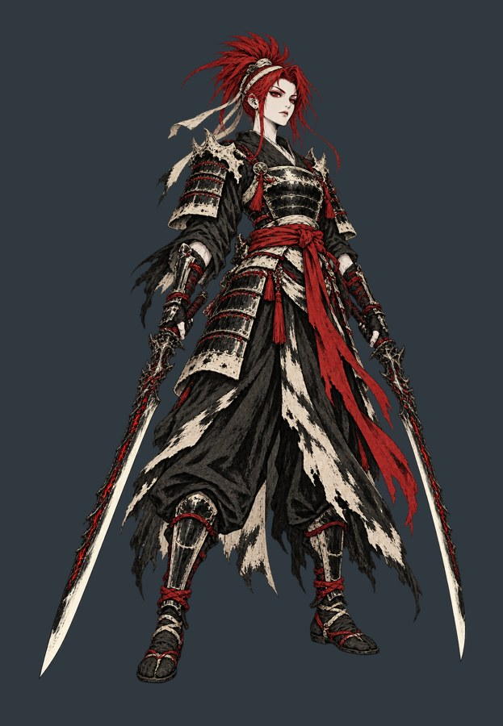

*Krona, U1's Crono: war-knotted red hair, black o-yoroi, red sash and the dual nodachi.*

- **Make:** field and battle sheets, the Chapter 2 duel-boss variant (Defiled Masamune), the Oil-Drinker and sealed states, the Cobalt Nodachi variant, and portraits.
- **Specs:** CHR-F, CHR-B, CHR-D and PRT at 128, 24 fps on twos; frames in §4.3. Heavy sumi outline, dry-brush cape, dither inside the ink. Palette: U1 inks plus the plate-02 swatches. Files `assets/characters/krona/krona_field.png`, `krona_battle.png`, `krona_duel.png`, `krona_portrait_<expr>.png`.
- **Prompt:** `Krona, ageless woman who looks early thirties, female mirror of Crono, spiky red hair tied in a war-knot with white ties, tired eyes, cheek scar, cracked black lacquered o-yoroi with a melted pauldron, red sash, tattered dry-brush cape, dripping gourd at the hip, bare feet, two long nodachi of snapped steel and red chitin, full body, three-quarter front view, sumi-e and ukiyo-e woodblock on washi, four inks only: sumi black #1A1A1A, cobalt #0D2640, cinnabar #8C1D18, paper white #F2EED8, dry-brush edges, flat #FF00FF background`
- **Check:** only cinnabar keeps colour. Impact frames hold 6 at 24 fps, and the ink bleed lasts 2 s. The crossed blades form a clean X for Eclipse X-Strike.
- **Anchor:** this image for costume and hair; plate-02 for sheet layout, brushwork, ink bleed and palette.

#### 5.2.4 Cassia-09 — `playable_cassia_09`

- **Make:** both forms (Gramophone Centaur and Bipedal Porcelain), the recruited state (Mother Brain antennae gone, Lucca's tank calm gold), boot and shutdown, and portraits that show the amber tank glowing.
- **Specs:** CHR-F at 128 and CHR-B at 256 (for the resonance rings), 12 fps stepped with 2 s holds; frames in §4.4. `_n` thumbprint normal sheet and `_m` (R amber glow, B mercury). Files `assets/characters/cassia_09/cassia_centaur_field.png`, `cassia_centaur_battle.png`, `cassia_bipedal_field.png`, `cassia_bipedal_battle.png`.
- **Prompt:** `Cassia-09, six-legged brass and porcelain gramophone centaur archivist, amber ribcage furnace holding a glowing human nervous system in resin, gramophone horn on the shoulder, liquid mercury orb shoulder joints, reverse-jointed brass legs, tungsten-wire loom bracer on one arm, cracked porcelain face plate, full body, three-quarter right view, stop-motion claymation photographed under a hard key light, visible thumbprints in ochre clay, brass, ash and porcelain, VHS scanlines and chroma bleed, flat #FF00FF background`
- **Check:** the amber tank is the brightest point of the sprite. Legs step on 12 with holds. The recruited form has no antennae. The bipedal form keeps Lucca's silhouette.
- **Anchor:** plate-04; enemy_porcelain_weaver; equipment_tesla_loom.

#### 5.2.5 Xyloph — `playable_xyloph`

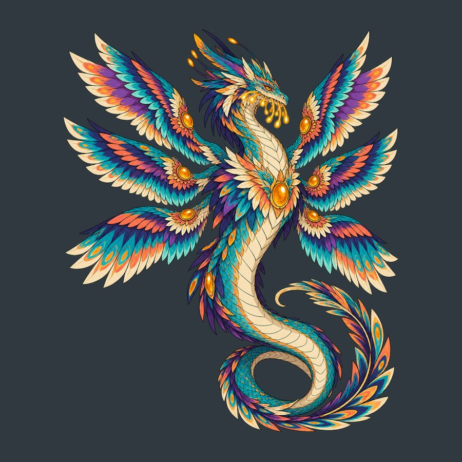

*Xyloph: six wings, a papyrus feather coat and a serpent-drake body.*

- **Make:** a field sheet with wings folded, a battle sheet with wings spread, Photosynthetic Burst, tether placement, the feather-archive texture for close-ups, and portraits.
- **Specs:** CHR-F at 128 and CHR-B at 256, 30 fps with idles on twos. Wing offsets [2, 4, 6, 2, 4, 6] over 18 frames; a breath every 42 frames. Constant 2 px line, flat gouache, palette in §4.5. A 1024 feather-archive texture for the 200% inspection zoom. Files `assets/characters/xyloph/xyloph_field.png`, `xyloph_battle.png`, `xyloph_feather_archive.png`.
- **Prompt:** `Xyloph, six-winged feathered Reptite Archon priestess, long neck, narrow raptor snout, feather coat of papyrus scrolls with frayed translucent tips covered in tiny weather charts, prehensile lily-pad tail fronds, glowing spore mandibles, living amber orbs floating near her hands, levitating, full body, three-quarter front view, Franco-Belgian ligne claire, constant 2 px black line, closed forms, flat gouache fills, single-direction hatching, neon-pastel accents, bristol paper white #FAF6EE, flat #FF00FF background`
- **Check:** no two wing pairs are down on the same frame. The line is exactly 2 px at every scale step. The feathers stay legible at 200%.
- **Anchor:** this image; plate-03.

#### 5.2.6 Vesper — `playable_vesper`


*Vesper Alfador: feline head, leaded glass armour, aquarium chest, scythe and pendulum.*

- **Make:** sheets in three layers (body at 60, light and caustics keyed at 12, the Schala-cat at 30), the Fractured Lens state, the Rose Window portrait overlay, and portraits.
- **Specs:** CHR-F and CHR-B at 128, plus 256 for scythe arcs. A separate `_light` sheet at 12 fps and a `_cat` sheet at 30. Emissive glass through `_m`. Lead 4 px. Palette in §4.6. Files `assets/characters/vesper/vesper_field.png`, `vesper_battle.png`, `vesper_light.png`, `vesper_cat.png`, `vesper_rose_window.png`.
- **Prompt:** `Vesper Alfador, towering feline-headed knight-librarian in living stained-glass armour, Art Nouveau lily filigree in gold leading, transparent glowing chest like an aquarium holding abyssal jellyfish, a cat-shaped shadow curled inside the breastplate, giant crescent scythe set with blue jewels, crystal pendulum hanging from the other hand, full body, three-quarter front view, Art Nouveau stained glass, 4 px lead cames, jewel-tone glass lit from behind, underwater caustics, oil-on-glass sheen, flat #00FF00 background`
- **Check:** the colour comes from transmitted light (with the light off, the glass goes dark). The three layers step at 60, 12 and 30 independently. The cat never becomes human.
- **Anchor:** this image; plate-11.

#### 5.2.7 Pierrot-Glenn — `playable_pierrot_glenn`


*Pierrot-Glenn with the skeletal Cyrus overhead and the Tailor's Guillotine.*

- **Make:** sheets with the Cyrus string layer as a separate overlay, mask on and mask off, the cracked-paint state, the prop modes, and portraits.
- **Specs:** CHR-F and CHR-B at 128, plus 256 for the 300% stretch. 24 fps on twos (12 drawings), two boil variants per drawing; frames in §4.7; variable 2–7 px outline; palette in §4.7. Files `assets/characters/pierrot_glenn/pierrot_glenn_field.png`, `pierrot_glenn_battle.png`, `pierrot_glenn_strings.png`.
- **Prompt:** `Pierrot-Glenn, hyper-agile one-armed jester, white pierrot suit with ash-grey diamond motley, weeping porcelain frog mask, ruffled collar, huge floppy shoes, a single right arm made of rubber hose, left shoulder stump capped with a black coat button, giant tailor's shears, faint puppet strings rising to a skeletal ghost knight above, full body, three-quarter front view, 1930s rubber-hose cartoon, pie-cut eyes, white gloves, no joints, boiling ink outline 2–7 px, sepia #D8C99B, ash grey #9A9A94, harlequin red #C83A32, mustard #D8A14E, film grain, flat #00FF00 background`
- **Check:** no elbows or knees in any frame. The ruff trails the head by 6 frames. The left stump is in every frame, so he is never mirrored.
- **Anchor:** this image.

#### 5.2.8 Static — `playable_static`


*Static: the hazard coat, the larval subwoofer rig on his back and the tape-reel whip.*

- **Make:** sheets with the BLIND and Tuned looks, card-raise poses (the cards are separate sprites), the Hiss-bloom ultimate, the Red Bike Ghost dash, and portraits without mouth animation.
- **Specs:** CHR-F and CHR-B at 128, on twos (15 drawings/s) with ones for 6 frames on a Tune. Four-step cel shading; ink 2 px inside, 3.5 px outside; palette in §4.8. Katakana card sprites at 64 × 96. Files `assets/characters/static/static_field.png`, `static_battle.png`, `static_cards.png`.
- **Prompt:** `Static, mute 13-year-old street kid, dark curly hair, oversized patched sodium-yellow hazard coat with black stripes, black shorts, tape-wrapped feet in battered boots, CRT goggles pushed up and full of static, spine wired through cassette decks and vacuum tubes to a backpack rig of subwoofer speakers and chitin spines, magnetic tape-reel whip in one hand, glowing cyan fibre-optic roots at the throat, full body, three-quarter front view, 1988 hand-painted cel anime, 4-step hard shading, neon rim light, rain streaks, CRT scanlines, acetate grain in the shadows, flat #00FF00 background`
- **Check:** BLIND reads as a white-noise block with two blue eyes at battle distance. No lip-sync frames exist. Impacts pop to ones.
- **Anchor:** this image; plate-08.

#### 5.2.9 Omega-Spekkio — `playable_omega_spekkio`


*Omega-Spekkio: six arms, gold-leaf halo, the Lamppost of Eternity and the Fate-Dice.*

- **Make:** sheets built from holds and crumple snaps, the four Final Dojo forms (Crane, Samurai, Dragon, Faceless), the Lotus Reverse paper echo, and portraits.
- **Specs:** CHR-B at 256 (lotus throne and halo), 24 fps with 2 s holds and 12-frame snaps. Seventy percent of the cell stays unpainted washi; sumi-brown lines; gold kirie in the `_m` blue channel. Files `assets/characters/omega_spekkio/omega_spekkio_battle.png`, `omega_spekkio_dojo_<form>.png`.
- **Prompt:** `Omega-Spekkio, six-armed origami astral deity seated on a lotus throne, cracked jester mask over a faceless Noh face, mandala halo of gold leaf with kikko and asanoha patterns, golden gyroscopes, a small bowler hat, one hand holding an uprooted iron lamppost, golden polyhedral dice orbiting, folded paper body with visible score lines, sketchbook ink and gold leaf on white kozo washi, 70% negative space, fine sumi-brown #3A2E1F hairlines, no black, kirikane gold flakes, flat #FF00FF background`
- **Check:** 70% of the cell stays paper. No pixel is pure black. Every snap is preceded by a 2 s hold.
- **Anchor:** this image; plate-09.

### 5.3 Enemies and bosses

#### 5.3.1 Vaelos — `enemy_vaelos`


*Vaelos as the sovereign: cracked alabaster, a style-shifting mane, a mantle of fossil bone, server blades and Zeal glass.*

- **Make:** the sovereign boss and cutscene sheets, then every form in §4.10 (Echo, Lamplighter, Boy, Heart, Empress, Child, Unfolding).
- **Specs:** BOS at 256. The body steps at 15 fps (Porcelain Null); each mane strand carries a different canvas at its own rate. Porcelain material with the shared galaxy cubemap. Files `assets/bosses/vaelos/vaelos_sovereign.png`, `vaelos_<form>.png`.
- **Prompt:** `Vaelos, nine-foot androgynous sovereign, cracked alabaster skin leaking starlight through the cracks, long fibre-optic mane whose strands shift between watercolour, ink, clay, ligne claire, stained glass and cel styles, mantle of fossilised saurian ribs and spines, robes set with server blades and stained-glass panels, barefoot, translucent porcelain with gold kintsugi cracks and a galaxy visible inside, full body, front view, flat #00FF00 background`
- **Check:** his chest galaxy uses the same cubemap as Crono's. He stands at least 60 px taller than any playable. The mane carries every canvas without turning to mud.
- **Anchor:** this image.

#### 5.3.2 Weeping Shogun — `enemy_weeping_shogun`

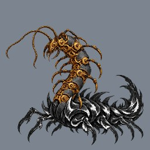

*The Amalgam Spawn: an ink Lavos Spawn fused to a claymation clockwork centipede.*

- **Make:** the Mammon Furnace boss of Chapter 2, the first three-way multiversal fight, with Sera caged above.
- **Specs:** BOS at 512. Two canvases in one body: the ink half at 24 fps on twos and the clay half at 12 fps stepped, drawn as two layered sheets that step out of phase. The shield plate anchors on the clay head. Files `assets/bosses/weeping_shogun/weeping_shogun_ink.png`, `weeping_shogun_clay.png`.
- **Prompt:** `Weeping Shogun, amalgam boss: the lower body is a black sumi-ink Lavos Spawn with spiked brush-stroke legs, fused at a ragged seam to a brass and clay clockwork centipede with segmented armour and a weeping porcelain face, sumi-e ink on washi for the ink half, stop-motion claymation with thumbprints for the clockwork half, three-quarter side view, flat #FF00FF background`
- **Check:** the seam shows both rates stepping out of phase. Sera's cage stays readable above it.
- **Anchor:** this image; environment_mammon_furnace; prop_sera_geometric_cage.

#### 5.3.3 Arch-Curator R-66Y — `enemy_arch_curator_r_66y`

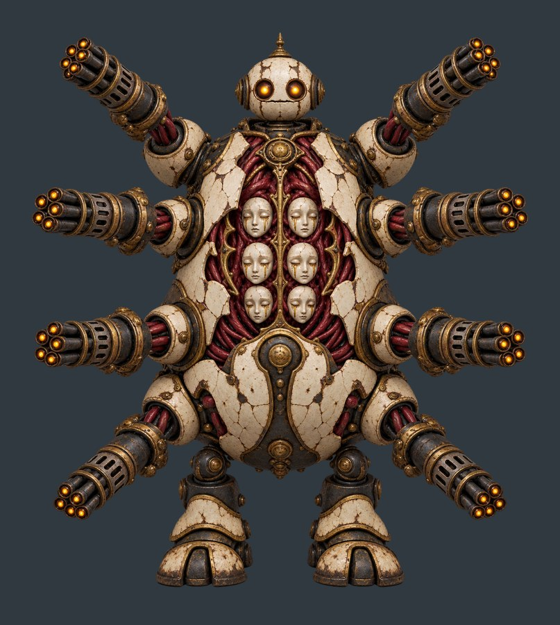

*R-66Y: a twenty-foot stop-motion Robo with Lavos muscle in a peeled-open chassis, weeping masks and eight gatling arms.*

- **Make:** the Chapter 3 boss (level 20) with five idle variants, phase sheets, the exposed chest, the Rewind state (clay grafts rot in reverse to show the original golden Robo), the Salvaged state (masks weep black oil forever) and the defeat pose (he sits, the blue eye closes, the masks frown). Reskins come from it: the Prologue's Atrium Cradle, U6's Pachinko ICE, U8's Paradox Curator Choir, the U4 glass variant and the post-game Echo.
- **Specs:** BOS at 512, or a glTF body with part sprites. Eight gatling arms on a rotating thoracic ring (one barrel glows before each volley; the safe spot is inside the ring), a mask orbit with crack-slide, the left eye sorrowful blue #7BA4C6 weeping clear oil, the right socket empty and weeping black oil, a Lavos muscle-fibre chest, a 12 fps hydraulic step. Files `assets/bosses/arch_curator_r_66y/r66y.glb`, `r66y_idle_01.png` … `r66y_idle_06.png`, `r66y_masks.png`.
- **Prompt:** `Arch-Curator R-66Y, twenty-foot corrupted robot goliath built from opera balconies and organ pipes, peeled-open chassis stuffed with red Lavos muscle fibre, cracked porcelain mask face with the left eye sorrowful blue weeping clear oil and the right socket empty weeping black oil, an orbit of smiling porcelain theatre masks, eight laser-gatling arms on a rotating thoracic ring, stop-motion claymation photographed under a hard key light, visible thumbprints, brass, ash and porcelain, VHS scanlines, front view, flat #00FF00 background`
- **Check:** the barrel about to fire is readable at battle distance. The safe zone inside the ring shows on the floor. A hero stands at ankle height, as on plate-05.
- **Anchor:** this image; plate-05.

#### 5.3.4 Bike Bros (Daltonized Models) — `enemy_bike_bros_daltonized_models`

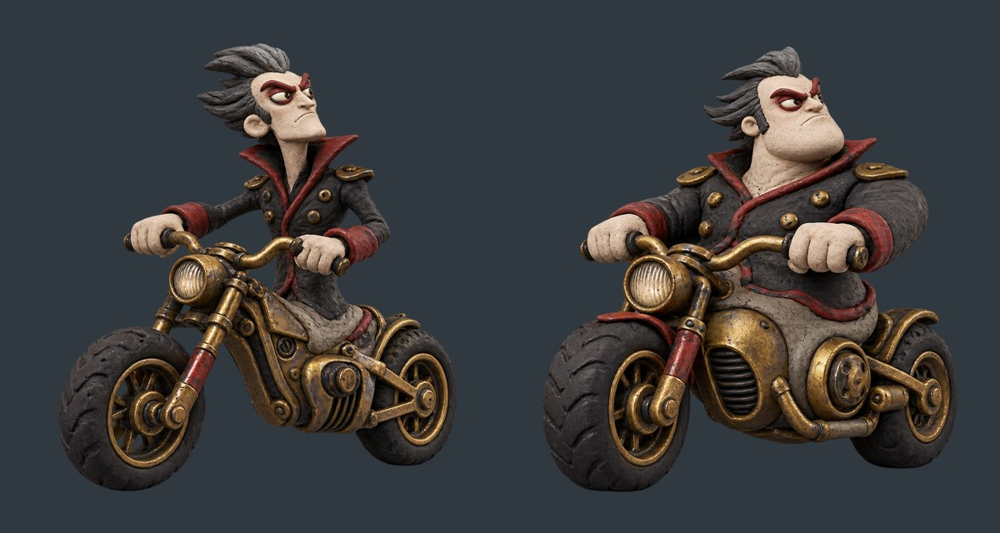

*Johnny's corrupted kin, fused to their bikes on the Spine-Highway.*

- **Make:** the Spine-Highway patrol (levels 14–16). They drift on an endless sine wave and lock mid-skid on Break, lined up for Solar Railgun.
- **Specs:** ENM-M at 256 (rider and bike), 12 fps. Rows W, E, S, N; a drift loop of 6; a skid-lock Break pose. Files `assets/enemies/u2/bike_bros/bike_bros_sheet.png`.
- **Prompt:** `two clay-fused biker brothers welded to their jet motorcycles, spiked hair, goggles, leather and brass, clay faces with thumbprints, drifting side by side in a sine-wave weave, stop-motion claymation photographed under a hard key light, ochre clay, brass, ash, VHS scanlines, three-quarter view, flat #FF00FF background`
- **Check:** the two read as a pair. The drift wave shows in the trail. The Break pose freezes mid-skid in a straight line.
- **Anchor:** this image; npc_johnny_gramophone_vendor.

#### 5.3.5 Cassia-09 as the Porcelain Weaver — `enemy_porcelain_weaver`

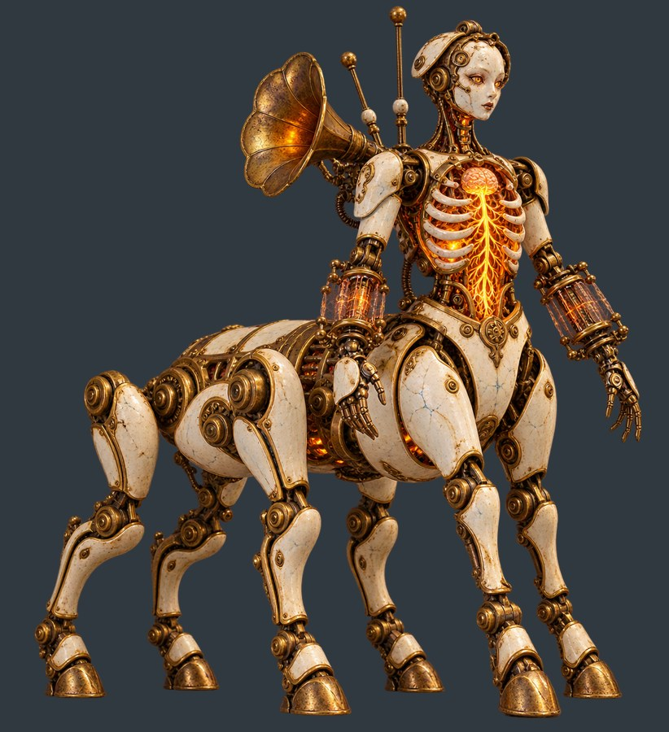

*The hostile Weaver: a brass and porcelain centaur, the amber ribcage holding Lucca's nervous system, the shoulder gramophone.*

- **Make:** the Chapter 3 recruitment boss. Never strike the amber tank; target the Mother Brain antennae on her back. Then the reboot in which Lucca speaks through the gramophone.
- **Specs:** BOS at 256, 12 fps. The antennae are separate sprites with their own plate anchors. The tank glows hostile red-amber, then calm gold after the reboot. Files `assets/bosses/porcelain_weaver/weaver_sheet.png`, `weaver_antennae.png`.
- **Prompt:** `the Porcelain Weaver, six-legged brass and porcelain centaur, amber ribcage furnace holding a glowing human nervous system, gramophone horn on the shoulder, tungsten-wire loom bracer, a hostile cluster of black antennae sprouting from her back, stop-motion claymation photographed under a hard key light, visible thumbprints, brass, ash and porcelain, VHS scanlines, three-quarter right view, flat #FF00FF background`
- **Check:** the antennae read as the targets; the tank never flashes as one.
- **Anchor:** this image; plate-04.

#### 5.3.6 Weeping porcelain citizen-husks — `enemy_weeping_porcelain_citizen_husks`


*An uploaded citizen of Arris Dome: the Porcelain Choir that drains MP with its hymn.*

- **Make:** the Arris Dome choir (level 16) with Grief-Resonance, in three states: hymning, asleep (the mercy harmonisation) and incinerated (charcoal outlines and ash).
- **Specs:** ENM-S at 128, 12 fps. Hymn idle 6, sleep pose 1, incinerated pose 1, three silhouette variants for crowds. Masks weep black oil. Files `assets/enemies/u2/citizen_husk/husk_sheet.png`.
- **Prompt:** `weeping porcelain citizen-husk, tall slender human figure of cracked white porcelain in a long robe, hands clasped, a smiling theatre mask for a face weeping black oil, faint red glow in the cracks, stop-motion claymation photographed under a hard key light, porcelain, ash and brass, VHS scanlines, front view, flat #FF00FF background`
- **Check:** a crowd of twenty reads as one choir. Asleep and incinerated differ by shape, not only by colour.
- **Anchor:** this image.

### 5.4 NPCs

#### 5.4.1 Marle (Queen Nadia) — `npc_marle`


*Queen Nadia at 40. The bible sets no crown or gown; this painting is the reference to build on.*

- **Make:** field sheet, the kitchen poses (leaning in to steal heat, ledger under her arm, barefoot), the night wrist-check, and portraits.
- **Specs:** CHR-F at 128 and PRT, 60 fps watercolour. Files `assets/npcs/marle/marle_field.png`, `marle_portrait_<expr>.png`.
- **Prompt:** `Queen Nadia (Marle), 40, blonde ponytail, ceremonial blue and cream gown with a fitted bodice, brown boots, a ledger under one arm, tired regal posture, painterly cel-shaded watercolour on cold-press paper, desaturated, soft pigment bleed, full body, three-quarter front view, flat #FF00FF background`
- **Check:** the royal blue survives the 0.85 desaturation.
- **Anchor:** this image.

#### 5.4.2 Glenn — `npc_glenn`


*Glenn at 47: one-armed Marshall, cane capped with the Masamune hilt.*

- **Make:** field sheet with a cane walk (4 frames), the training pose at the dummy, the refusal pose for blocked Dual Techs, and portraits.
- **Specs:** CHR-F at 128 and PRT, 60 fps watercolour. Never mirrored. Files `assets/npcs/glenn/glenn_field.png`.
- **Prompt:** `Glenn, 47, one-armed Marshall of Guardia, grey swept hair and short beard, left sleeve empty, green cape over white-and-gold plate armour, belts and pouches, a tall cane capped with an old bronze sword hilt in his right hand, worn boots, painterly cel-shaded watercolour on cold-press paper, desaturated, full body, three-quarter front view, flat #FF00FF background`
- **Check:** the missing left arm and the cane silhouette show in every frame. He reads 47, not 60.
- **Anchor:** this image.

#### 5.4.3 Robo, the Atrium Horologe — `npc_robo_clocktower`


*Robo's positronic brain runs the clocktower. In this game the tower is the Atrium Horologe, Porre's old clocktower in Truce.*

- **Make:** the exterior tower and the interior pillar (§3.2) as a landmark: a clock-face face with hour and minute hand bones, the mask orbit, copper vines pulsing at 72 BPM, and a 12 fps hydraulic idle. States: clear eye (mercy), black eye (siege), rebuilt (Golden Light), the 9999-shield Torso Heart.
- **Specs:** ENV-L landmark glTF plus part sprites. Files `assets/environments/u0/atrium/robo_pillar.glb`, `atrium_exterior.glb`.
- **Prompt:** `a gothic clocktower whose clock face is a porcelain face, the hour hand piercing the right eye weeping clear oil, the minute hand piercing the empty left socket weeping black ink, copper vines and brass speaking tubes wrapping the tower, glass dome above, painterly cel-shaded watercolour on cold-press paper, desaturated, soft pigment bleed, flat #FF00FF background`
- **Check:** the face reads as Crono's at 10 ft. The two eyes tick out of sync.
- **Anchor:** this image; plate-00 for the interior.

#### 5.4.4 Magus (Janus) — `npc_magus`


*Magus returns blind in one eye and bleeding liquid silver time.*

- **Make:** field sheet, the crypt and courtyard poses, the silver-time drip loop, and portraits.
- **Specs:** CHR-F at 128 and PRT, 60 fps. Asymmetric, never mirrored. Pairs with vfx_liquid_silver_time. Files `assets/npcs/magus/magus_field.png`.
- **Prompt:** `Magus, tall gaunt sorcerer, long silver-lavender hair, one eye blind and clouded, a slow trail of liquid silver dripping from the blind eye and fingertips, violet high-collared cloak over dark robes, painterly cel-shaded watercolour on cold-press paper, desaturated, full body, three-quarter front view, flat #00FF00 background`
- **Check:** the blind eye and the silver leak read from the dialogue camera.
- **Anchor:** this image.

#### 5.4.5 Lucca Ashtear — `npc_lucca_ashtear`

- **Make:** her own portrait for the journal and the memories (as last seen eight years ago, after Project Klein), flashback field poses, and the photo pinned in the Atrium workshop. Keep this portrait separate from the nervous system living in Cassia-09.
- **Specs:** PRT and CHR-F at 128, U0 watercolour. Files `assets/npcs/lucca/lucca_portrait_<expr>.png`, `lucca_field.png`.
- **Prompt:** `Lucca Ashtear, inventor in her mid-thirties, short purple-tinged hair, round glasses pushed up on a workshop helmet with goggles, oil-stained work coat full of tools, a notebook under her arm, determined tired smile, painterly cel-shaded watercolour on cold-press paper, desaturated, soft pigment bleed, bust portrait, flat #00FF00 background`
- **Check:** she reads as the inventor, not as Cassia.
- **Anchor:** prop_project_klein_journal; npc_marle for the U0 portrait style.

#### 5.4.6 Johnny — `npc_johnny_gramophone_vendor`


*Johnny, clay-moulded into his Gramophone Shop bench, jetbike wheels fused to its sides.*

- **Make:** the U2 hub vendor: shop idle, sell, and the Sync Hold tutorial pose ("Hold thinking, skid kid!").
- **Specs:** PRP-M or ENM-M at 256 including the bench, 12 fps. Files `assets/npcs/johnny/johnny_bench_sheet.png`.
- **Prompt:** `Johnny, a clay-moulded vendor with a spiked mohawk and goggles, fused at the waist into a heavy brass workbench with drawers and tools, jetbike wheels welded to both sides, a gramophone on the bench, stop-motion claymation photographed under a hard key light, visible thumbprints, brass and ash, VHS scanlines, three-quarter view, flat #FF00FF background`
- **Check:** the wheels and the gramophone read as the shop's silhouette from the Slag-Yards camera.
- **Anchor:** this image.

#### 5.4.7 Cyrus — `npc_cyrus_ghost`

- **Make:** the string-pulling ghost above Pierrot-Glenn and the Marionettist boss of Chapter 6: the invulnerable puppet master, the Ash-Knight who drops heavy and refuses to squash (the only thing in U5 that is not rubber, locked at 30 fps and jerky), the self-puppet with black oil threads, and the cut-down mercy pose. Also the Charred Laurel helm crest.
- **Specs:** an overlay sheet for Glenn at 128 and BOS at 512 for the Big Top. Files `assets/bosses/cyrus/cyrus_marionettist.png`, `cyrus_ash_knight.png`.
- **Prompt:** `Cyrus the Marionettist, a charred skeletal ghost-knight hanging in the air, burned armour, a laurel crest on the helm, smoky time-threads running from his bony fingers to puppets below, 1930s rubber-hose cartoon with dark gothic puppetry, boiling ink outline, sepia #D8C99B, ash grey #9A9A94, film grain, three-quarter front view, flat #00FF00 background`
- **Check:** the threads read as the turn-order bar from the battle camera. The Ash-Knight never squashes.
- **Anchor:** playable_pierrot_glenn, where the ghost hangs above Glenn.

#### 5.4.8 Faceless porcelain travellers — `npc_faceless_porcelain_travelers`

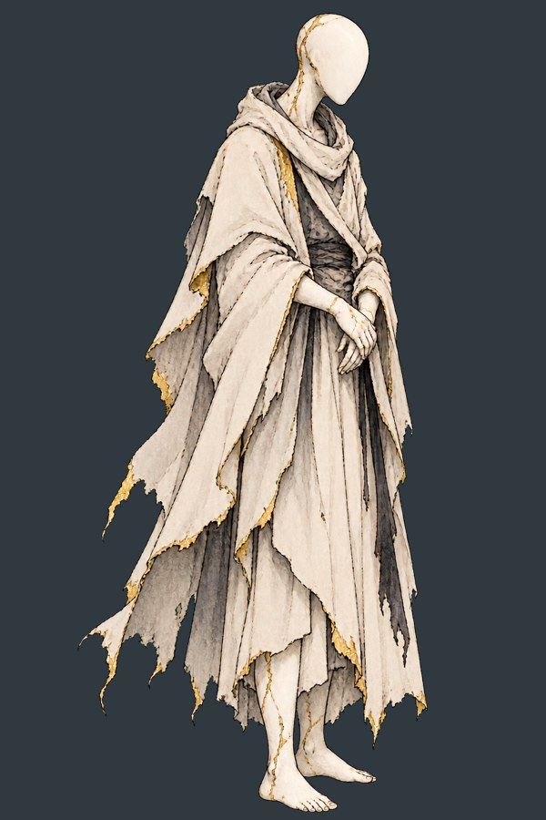

*A lost traveller washed into U7's white void.*

- **Make:** three variants with a slow idle drift; the one you can talk to carries a gold kirie mark. Bekkler's failed dolls reuse the body.
- **Specs:** CHR-F at 128, 24 fps with long holds. Sumi-brown lines, no black. Files `assets/npcs/u7_travelers/traveler_sheet.png`.
- **Prompt:** `faceless porcelain traveller, a robed figure with a blank smooth porcelain face, hood and tattered layered robes, standing still in white space, sketchbook ink and gold leaf on white kozo washi, 70% negative space, fine sumi-brown #3A2E1F hairlines, no black, full body, front view, flat #FF00FF background`
- **Check:** in groups the travellers keep the 70% white rule. Only the interactable one carries gold.
- **Anchor:** this image.

### 5.5 Equipment

Weapons appear in four places: the character sheets, a 256 detail sprite for menus and close-ups, a 64/128 icon, and the VFX they drive. Each brief covers all four.

#### 5.5.1 Epoch's Wake — `equipment_epoch_s_wake`

- **Make:** Crono's Rainbow katana wired into the Epoch gauntlet built from the salvaged Wings of Time core. Base state and the Ferro-Coil upgrade (a copper coil wrapped round the gauntlet after Chapter 3).
- **Specs:** PRP-S detail at 256, icon UI-I, U0 watercolour. The gauntlet's cable runs into the hilt so sword and arm read as one piece. Files `assets/items/epochs_wake.png`, `epochs_wake_ferro_coil.png`.
- **Prompt:** `Epoch's Wake, a curved katana with a faint rainbow sheen along the blade, its hilt wired by brass cables into a heavy brass gauntlet built from the wing core of a time machine, rivets and small dials, painterly cel-shaded watercolour on cold-press paper, desaturated, side view, flat #FF00FF background`
- **Check:** the cable link between gauntlet and hilt reads at icon size.
- **Anchor:** playable_crono.

#### 5.5.2 Twin Pendulum Blades — `equipment_twin_pendulum_blades`

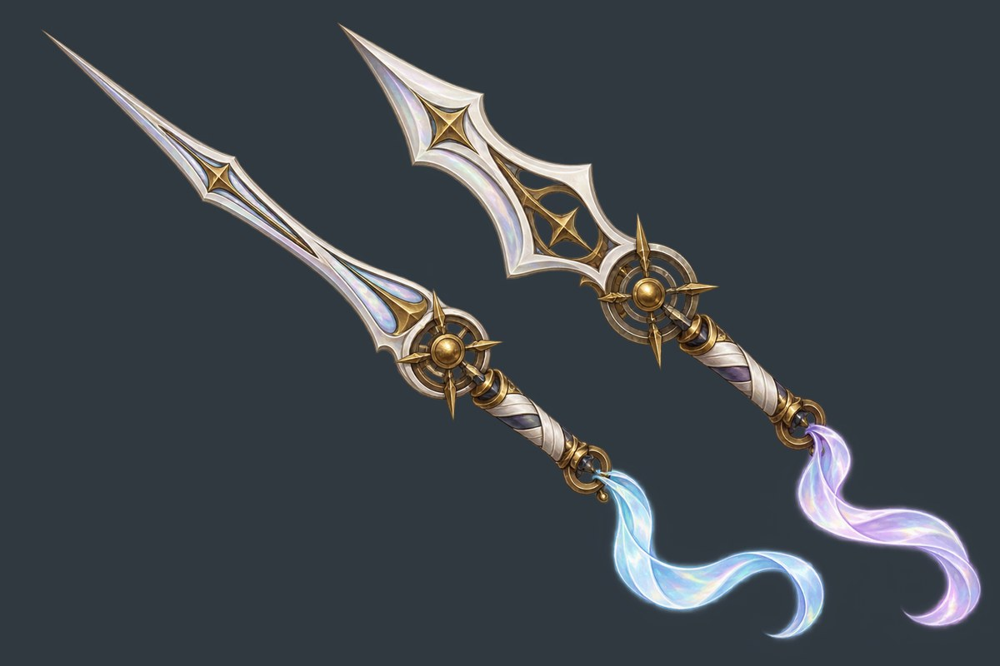

*Sera's clock-hand daggers trailing ribbons of light.*

- **Make:** detail sprite, icon, and the light-ribbon trail VFX (ribbons strike from past positions on her ghost layers).
- **Specs:** PRP-S at 256, U0 watercolour with tachyon violet #8B7CFE ribbons at 60 fps. Files `assets/items/twin_pendulum_blades.png`, `vfx/tachyon/ribbon_trail_fb_8f.png`.
- **Prompt:** `a pair of daggers shaped like clock hands, ornate silver blades with gold gear hubs, each trailing a ribbon of pale violet light, painterly cel-shaded watercolour on cold-press paper, desaturated, flat #00FF00 background`
- **Check:** the hour and minute hands are distinguishable.
- **Anchor:** this image.

#### 5.5.3 Krona's dual nodachi — `equipment_krona_dual_nodachi`

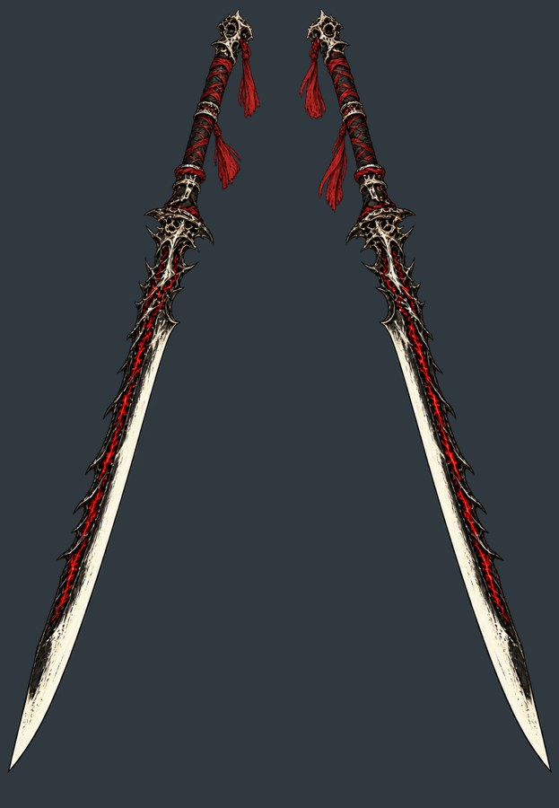

*The Defiled Masamune: two nodachi from the snapped Masamune and red Lavos chitin.*

- **Make:** detail sprite, icon, and the cross pose used by Eclipse X-Strike.
- **Specs:** PRP-S at 256, U1 inks, cinnabar tassels. Files `assets/items/krona_dual_nodachi.png`.
- **Prompt:** `two long nodachi, blades of snapped pale steel bound to ridged red chitin, black lacquered hilts with cinnabar tassels, sumi-e and ukiyo-e woodblock on washi, four inks only: sumi black #1A1A1A, cobalt #0D2640, cinnabar #8C1D18, paper white #F2EED8, flat #FF00FF background`
- **Check:** the chitin ridge shows on the blade's spine at 128.
- **Anchor:** this image.

#### 5.5.4 Tesla Loom — `equipment_tesla_loom`

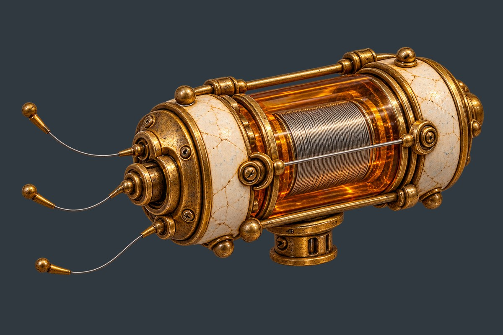

*Cassia-09's loom: monomolecular tungsten wire on an amber cylinder.*

- **Make:** the bracer detail, the wire VFX (grapple, Wire Loom Mend, Iron Maiden Scroll) and the Tungsten Loom drop.
- **Specs:** PRP-S at 256, U2 clay at 12 fps; wire VFX as 1 px glinting lines at 60 fps. Files `assets/items/tesla_loom.png`, `vfx/ferro/loom_wire.tscn`.
- **Prompt:** `Tesla Loom, a forearm bracer built around a glowing amber glass cylinder wound with copper coils, porcelain end caps, fine tungsten wires spooling out, stop-motion claymation photographed under a hard key light, brass, amber and porcelain, side view, flat #FF00FF background`
- **Check:** the wire stays visible against dark U2 backgrounds.
- **Anchor:** this image.

#### 5.5.5 Xyloph's amber orbs — `equipment_xyloph_amber_orbs`

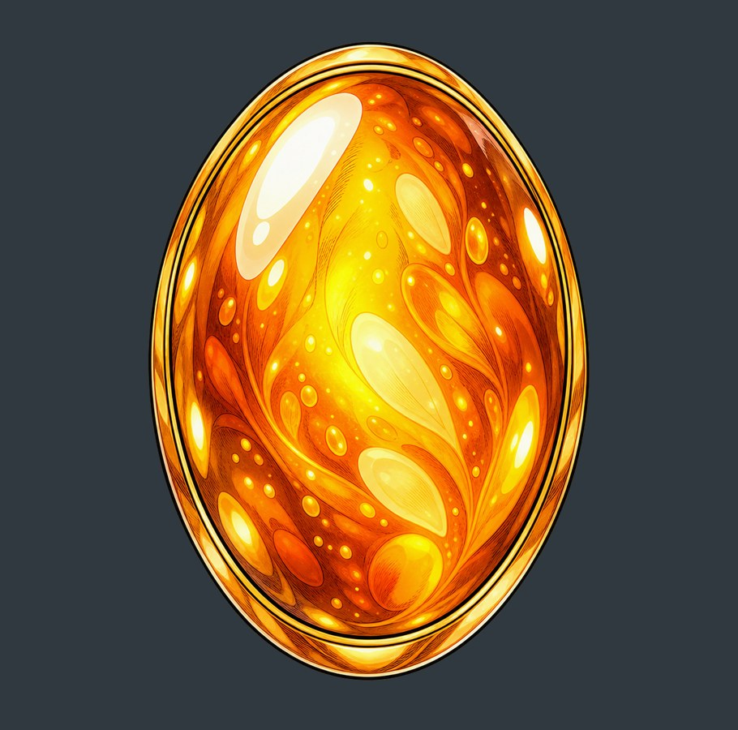

*One of Xyloph's living amber orbs.*

- **Make:** the orb sprite (three float around her), its spore-mandible bloom, and the tether-node marker.
- **Specs:** PRP-S at 128, U3 line, 30 fps; a slow 12-frame swirl inside the amber. Files `assets/items/xyloph_amber_orb.png`.
- **Prompt:** `a living amber orb, glowing golden resin with swirling inclusions and a tiny curled seedling inside, clean 2 px black outline, flat gouache fills, single-direction hatching, ligne claire, flat #FF00FF background`
- **Check:** the orb keeps a constant 2 px line even though the painting is soft.
- **Anchor:** this image.

#### 5.5.6 Abyssal Scythe — `equipment_abyssal_scythe`

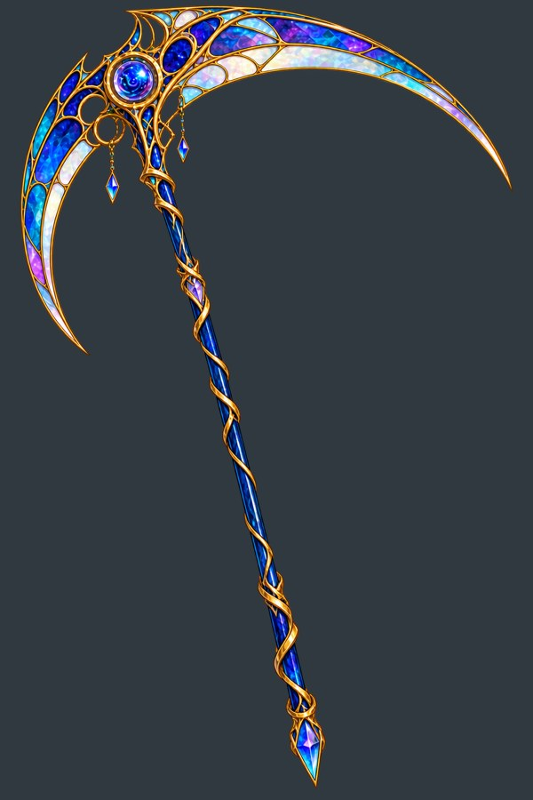

*Vesper's scythe: a crescent of leaded glass on a jewelled haft.*

- **Make:** detail sprite, icon, and the swing arcs (glass shards trail the blade).
- **Specs:** PRP-S at 256, U4 glass with 4 px lead; light layer keyed at 12 fps. Files `assets/items/abyssal_scythe.png`.
- **Prompt:** `Abyssal Scythe, a great crescent blade of iridescent blue and violet stained glass in gold leading, a spiralling haft set with sapphire jewels, Art Nouveau stained glass, jewel-tone glass lit from behind, flat #00FF00 background`
- **Check:** the crescent reads in black silhouette.
- **Anchor:** this image.

#### 5.5.7 Refracting Pendulum — `equipment_refracting_pendulum`

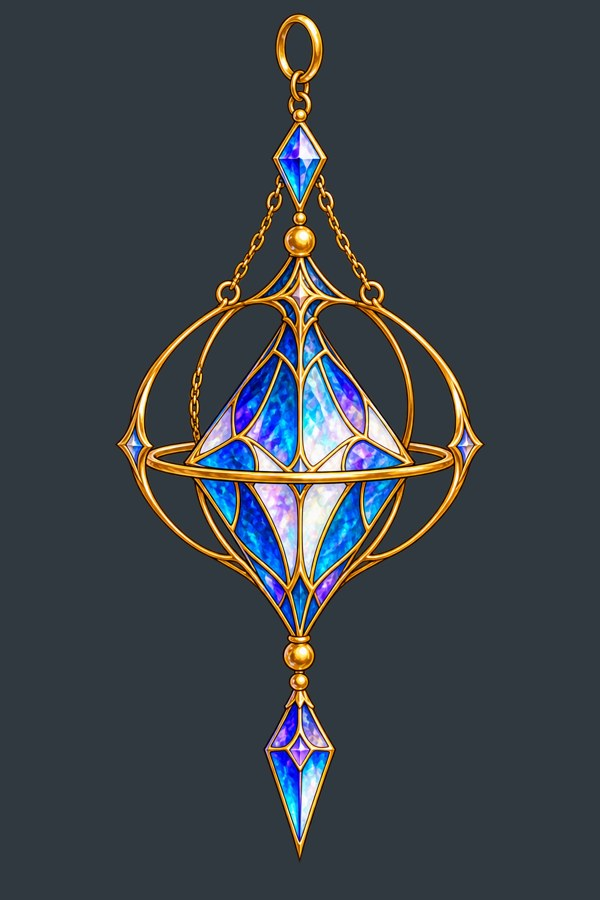

*Vesper's pendulum: a crystal in a gold cage that splits white light into colours.*

- **Make:** detail sprite, icon, and the beam split it throws (white in, RGB out).
- **Specs:** PRP-S at 128, U4; the beam split at 12 fps. Files `assets/items/refracting_pendulum.png`.
- **Prompt:** `Refracting Pendulum, a faceted blue and violet crystal hanging in an ornate gold cage on a chain, prisms catching light, Art Nouveau stained glass, jewel-tone glass lit from behind, flat #00FF00 background`
- **Check:** the split beam shows three colours at battle distance.
- **Anchor:** this image.

#### 5.5.8 Tailor's Guillotine — `equipment_tailor_s_guillotine`

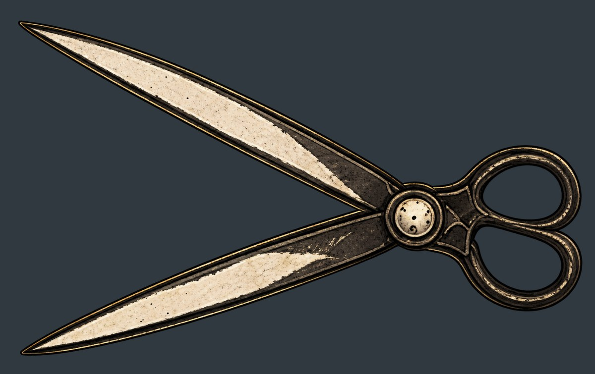

*Pierrot-Glenn's giant shears, which cut Cyrus's threads.*

- **Make:** detail sprite, icon, and the thread-cut snap (a 3-frame squash on the blades).
- **Specs:** PRP-S at 256, U5 boil, 12 drawings/s. Files `assets/items/tailors_guillotine.png`.
- **Prompt:** `giant tailor's shears, long pale blades and black looped handles with a brass pivot, 1930s rubber-hose cartoon style, boiling ink outline, sepia and ash grey, film grain, flat #00FF00 background`
- **Check:** the blades bend with the squash and keep the outline boil.
- **Anchor:** this image.

#### 5.5.9 Magnetic tape-reel whip — `equipment_magnetic_tape_reel_whip`

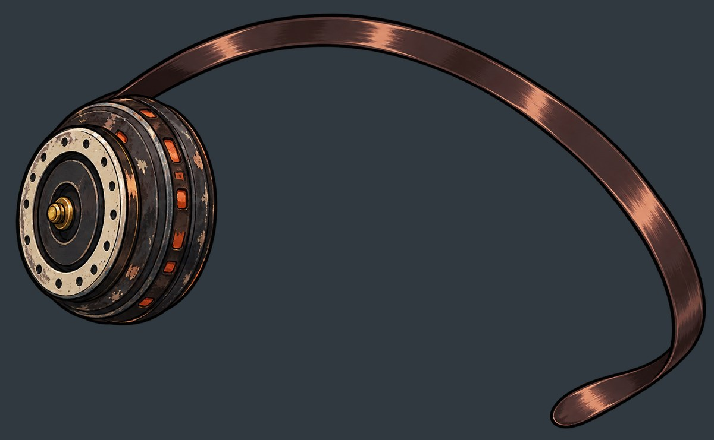

*Static's whip: a reel that lashes out magnetic tape.*

- **Make:** detail sprite, icon, and the tape lash (unspools on ones, rewinds on twos).
- **Specs:** PRP-S at 256, U6 cel; the tape catches neon rim light. Files `assets/items/tape_reel_whip.png`.
- **Prompt:** `a magnetic tape-reel whip, a scuffed metal reel with a brass hub, a long glossy brown tape lash curling out, 1988 hand-painted cel anime, 4-step hard shading, neon rim light, flat #00FF00 background`
- **Check:** the tape is never thinner than 2 px.
- **Anchor:** this image.

#### 5.5.10 Larval subwoofer cannons — `equipment_larval_subwoofer_cannons`

- **Make:** Static's symbiote sound weapons: twin speaker cannons grown with Hiss's chitin, mounted on his back rig, plus the firing pulse.
- **Specs:** PRP-S at 256, U6 cel, on twos. Pulse rings in white noise. Files `assets/items/subwoofer_cannons.png`, `vfx/hz/sub_pulse_fb_6f.png`.
- **Prompt:** `twin subwoofer speaker cannons on a backpack frame, the cones ringed with organic grey-violet chitin and spines, cassette decks and glowing vacuum tubes between them, 1988 hand-painted cel anime, 4-step hard shading, neon rim light, flat #00FF00 background`
- **Check:** the cones face the target in every battle direction.
- **Anchor:** playable_static (the backpack rig).

#### 5.5.11 Lamppost of Eternity — `equipment_lamppost_of_eternity`

- **Make:** Omega-Spekkio's uprooted iron lamppost from the End of Time: roots still hanging, the lamp lit with gold.
- **Specs:** PRP-S at 256, U7, 24 fps holds. Files `assets/items/lamppost_of_eternity.png`.
- **Prompt:** `an uprooted ornate iron lamppost, roots trailing from its base, the lamp glowing with gold leaf light, sketchbook ink and gold leaf on white kozo washi, 70% negative space, fine sumi-brown hairlines, no black, flat #FF00FF background`
- **Check:** the lamp is the only gold on the object.
- **Anchor:** environment_bone_tree_of_eternity (the lantern in the tree); playable_omega_spekkio.

#### 5.5.12 Polyhedral Fate-Dice — `equipment_polyhedral_fate_dice`

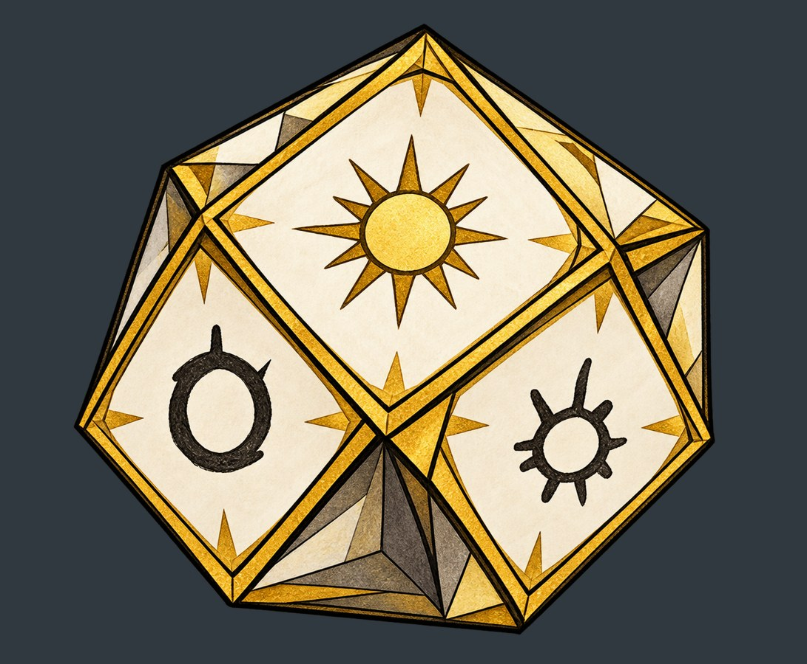

*Omega-Spekkio's golden dice, marked with suns and orbits.*

- **Make:** the dice sprites (they orbit him), the roll animation (12-frame tumble ending in a 2 s hold) and the result faces.
- **Specs:** PRP-S at 128, U7 gold. Files `assets/items/fate_dice.png`.
- **Prompt:** `a large golden polyhedral die with engraved sun, orbit and eye symbols, gold leaf on white paper, fine hairlines, flat #FF00FF background`
- **Check:** the face symbols read at 64 px.
- **Anchor:** this image.

#### 5.5.13 Cobalt Nodachi — `equipment_cobalt_nodachi`

- **Make:** Krona's upgrade: cobalt pigment from the Goyama vault, forged into the dual nodachi at the Geno-Foundry. The trail is permanent cobalt sky (0.05, 0.15, 0.35) and stains other universes' skyboxes. The iai holds 2 s, then a 12-frame slice splits the screen indigo→white.
- **Specs:** PRP-S at 256, U1 inks with the cobalt edge #143CA2; the slice as VFX-F (12 frames at 24 fps). Files `assets/items/cobalt_nodachi.png`, `vfx/ruin/cobalt_iai_fb_12f.png`.
- **Prompt:** `two long nodachi reforged with a deep cobalt-blue edge that bleeds ink, black lacquered hilts, sumi-e ink on washi, sumi black, cobalt #0D2640 and paper white, a brushed cobalt trail behind the blade, flat #FF00FF background`
- **Check:** the cobalt trail matches the U1 sky hue exactly.
- **Anchor:** plate-02 (the cobalt nodachi detail); equipment_krona_dual_nodachi.

#### 5.5.14 Lavos-Grafted Laser Cannon — `equipment_lavos_grafted_laser_cannon`

- **Make:** the cannon Krona rips from R-66Y on the Salvage path. It unlocks Omega Annihilation; Johnny's forge on the ruthless path sells copies.
- **Specs:** PRP-S at 256, U2 clay at 12 fps, Lavos fibre wrapping a gatling barrel, oil weeping. Files `assets/items/lavos_laser_cannon.png`.
- **Prompt:** `a heavy laser-gatling cannon torn from a giant robot, brass barrels wrapped in red Lavos muscle fibre, black oil weeping from the joints, stop-motion claymation photographed under a hard key light, visible thumbprints, brass and ash, flat #00FF00 background`
- **Check:** it reads as the same barrel as the Arch-Curator's arms.
- **Anchor:** enemy_arch_curator_r_66y.

### 5.6 Environments

Each environment brief covers the kit (ENV-K), the assembled location (ENV-L) and a painted backdrop or concept. Every encounter zone needs room for the 28 × 28 m battle plane.

#### 5.6.1 Guardia Castle — `environment_guardia_castle`


*A Guardia Castle piece: the brass speaking tubes that carry Robo's voice through the castle.*

- **Make:** Crono's bedroom, the courtyard, the crypts, the Guardia Atrium family kitchen (stained-glass windows uncleaned since 1000 A.D., the porridge pot) and the speaking tubes. Bekkler tech keeps the stones too clean.
- **Specs:** ENV-K and ENV-L, U0 watercolour. Mossy stone kept unnaturally clean inside the castle; moss outside. Files `assets/environments/u0/guardia/`.
- **Prompt:** `interior of a royal castle kitchen at dawn, stone walls, a hearth with a porridge pot, tall stained-glass windows dulled by years of dust casting faint coloured light, a long wooden table, painterly cel-shaded watercolour on cold-press paper, desaturated, soft pigment bleed, HD-2D diorama view from a high angle`
- **Check:** the U4-coloured window light reads as a leak from another world.
- **Anchor:** this image; plate-06 for materials (mossy stone, gravel-worn geo and cloth).

#### 5.6.2 Truce Canyon — `environment_truce_canyon`

- **Make:** the Prologue's rain approach. Rain changes as it lands: ink strokes on stone, clay drops on metal, torn parchment on cloth.
- **Specs:** ENV-K and ENV-L, U0, 60 fps rain VFX in three materials. Files `assets/environments/u0/truce_canyon/`.
- **Prompt:** `a rocky canyon path at dusk in heavy rain, wet cliffs, a distant town with smoking chimneys, the rain turning into ink strokes where it hits stone, painterly cel-shaded watercolour on cold-press paper, desaturated, HD-2D diorama view`
- **Check:** the three rain materials are distinct at the explore camera.
- **Anchor:** environment_guardia_castle; plate-06.

#### 5.6.3 Leene Square Fair — `environment_leene_square_fair`

- **Make:** the twenty-fourth Millennial Fair: crowds, chestnut vendors, Norstein Bekkler's tent, banners, the smell of chestnuts and ozone made visible as warm smoke.
- **Specs:** ENV-K and ENV-L, U0, crowd NPC sprites in three to five variants. Files `assets/environments/u0/leene_square/`.
- **Prompt:** `a crowded medieval town fair in a stone square, chestnut roasting stalls, striped tents including a showman's doll booth, bunting, a bell tower, warm afternoon light, painterly cel-shaded watercolour on cold-press paper, desaturated, HD-2D diorama view`
- **Check:** paths through the crowd stay readable during the Sera chase.
- **Anchor:** environment_guardia_castle.

#### 5.6.4 Lucca's Telepod pavilion — `environment_lucca_telepod_pavilion`

- **Make:** the Chapter 1 climax arena: the old Telepod pavilion with a geometric diamond above it, where the sky splits into seven differently animated shards and Vaelos descends.
- **Specs:** ENV-L, U0 plus all seven canvases in the sky shards (each shard animates at its own rate). Files `assets/environments/u0/telepod_pavilion/`.
- **Prompt:** `a fair pavilion with two old teleporter pods under a striped canopy, above them a huge floating geometric diamond cracking the sky into seven shards each painted in a different art style, painterly cel-shaded watercolour on cold-press paper, HD-2D diorama view`
- **Check:** each shard is identifiable as its universe.
- **Anchor:** environment_guardia_castle; vfx_chronoslip_style_phase.

#### 5.6.5 Kuro-Truce Bamboo Grove — `environment_kuro_truce_bamboo_grove`


*Ink bamboo with cinnabar leaves: the duel arena where Crono lands.*

- **Make:** the Chapter 2 duel arena and its bamboo kit. Black ink terrain that Astral burns into golden watercolour patches (vfx_astral_ink_to_gold_burn).
- **Specs:** ENV-K, U1 inks, 24 fps sway on twos. Files `assets/environments/u1/bamboo_grove/`.
- **Prompt:** `a dense bamboo grove of black ink stalks with cinnabar red leaves, ground of wet black ink, carved wave-line mist, sumi-e and ukiyo-e woodblock on washi, four inks only, HD-2D diorama view`
- **Check:** the ink ground reads as burnable terrain.
- **Anchor:** this image; plate-10.

#### 5.6.6 Iron Bridge streets — `environment_iron_bridge_streets`

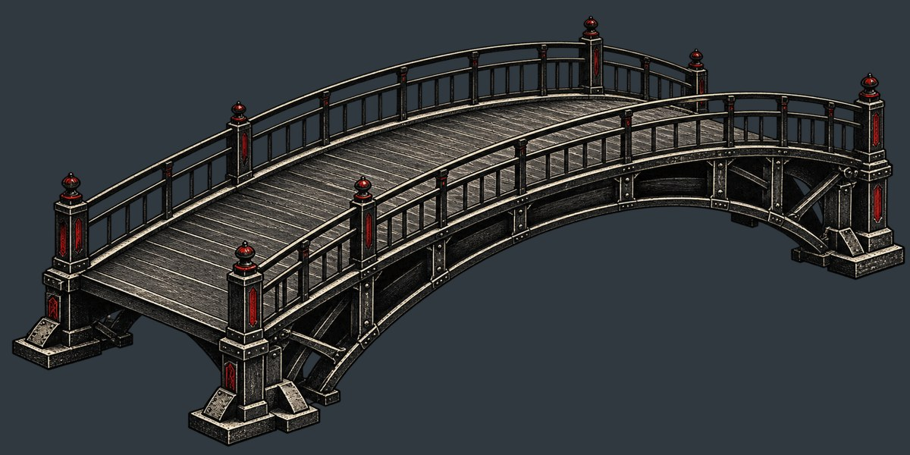

*An Iron Bridge module for the streets of Kuro-Truce.*

- **Make:** the Kuro-Truce street kit (bridges, houses, banners), with Goyama's four parry bridges built from the same pieces.
- **Specs:** ENV-K, U1. Files `assets/environments/u1/kuro_truce/`.
- **Prompt:** `an arched bridge of black iron and dark timber with lattice railings, over a canal of carved ink waves, sumi-e and ukiyo-e woodblock on washi, four inks only, three-quarter view, flat #FF00FF background`
- **Check:** railings stay readable as walls on the NavMesh.
- **Anchor:** this image; plate-10.

#### 5.6.7 Chitin-Pagoda summit — `environment_chitin_pagoda_summit`

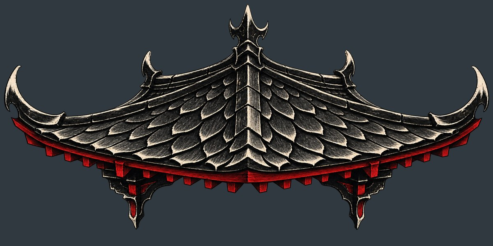

*The Chitin-Pagoda: black chitin roof scales, cinnabar under-eaves.*

- **Make:** the pagoda summit where a claymation gear from U2 crashes in (prop_claymation_fracture_gear).
- **Specs:** ENV-K landmark, U1, with a U2 impact crater in clay. Files `assets/environments/u1/chitin_pagoda/`.
- **Prompt:** `a pagoda roof tiled with black insect chitin scales curving to horned finials, cinnabar red under the eaves, sumi-e and ukiyo-e woodblock on washi, four inks only, three-quarter view, flat #FF00FF background`
- **Check:** the clay gear in its crater clashes on purpose (12 against 24).
- **Anchor:** this image.

#### 5.6.8 Mammon Furnace — `environment_mammon_furnace`

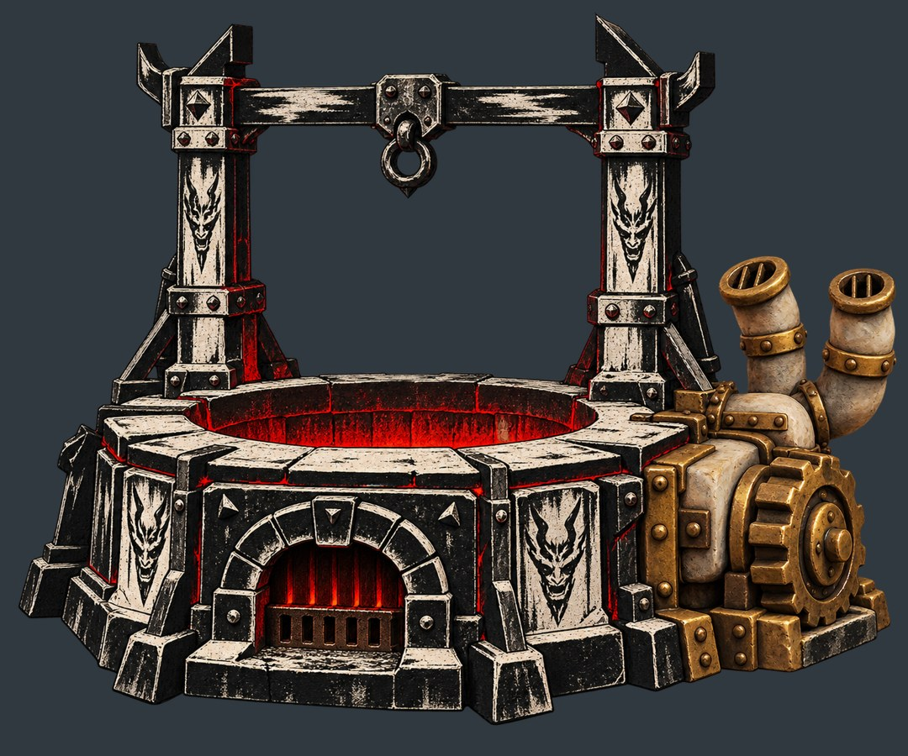

*The Mammon Furnace: an octagonal pit of red heat under a frame that holds Sera's cage.*

- **Make:** the Weeping Shogun arena, with the cage hook above and clockwork fused to its side.
- **Specs:** ENV-L arena, U1 with U2 machinery stepping at 12. Files `assets/environments/u1/mammon_furnace/`.
- **Prompt:** `an octagonal furnace pit glowing red, carved black and white stone walls, a gallows frame above with a hook for a hanging cage, brass gears and pipes fused to one side, sumi-e ink with cinnabar fire, three-quarter view, flat #00FF00 background`
- **Check:** the furnace glow is the only warm light in the arena.
- **Anchor:** this image.

#### 5.6.9 Ash Forge — `environment_ash_forge`

- **Make:** Lucca's house transformed in U1 into the Ash Forge, a blacksmith shrine.
- **Specs:** ENV-L interior, U1. Files `assets/environments/u1/ash_forge/`.
- **Prompt:** `a burned inventor's workshop turned blacksmith shrine, anvils, ash heaps, half-melted machines hung with paper charms, cinnabar forge fire, sumi-e and ukiyo-e woodblock on washi, four inks only, HD-2D diorama view`
- **Check:** the U0 house layout still shows under the ash.
- **Anchor:** environment_mammon_furnace; plate-10.

#### 5.6.10 Proto-Dome Slag-Yards — `environment_proto_dome_slag_yards`

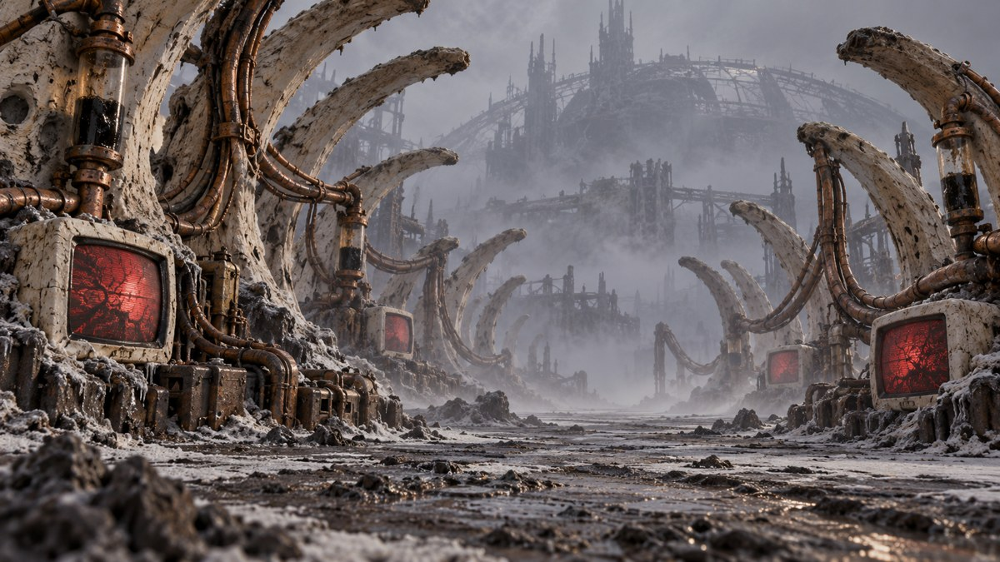

*The U2 hub: frozen slag, a ribcage landscape and praying CRTs.*

- **Make:** the U2 hub (levels 12–14): ribcage terrain, CRT shrines, copper umbilicals, Johnny's shop and the Epoch-Tether Beacon. Both flag looks (Sleeping, Incinerated).
- **Specs:** ENV-K and ENV-L, U2 at 12 fps, thumbprint normals on every boulder, VHS Fog volumes. Files `assets/environments/u2/slag_yards/`.
- **Prompt:** `a frozen industrial wasteland of grey slag and giant ribcage bones, stacked old CRT monitors glowing red like shrines, copper pipes pumping black oil, a ruined glass dome on the horizon, stop-motion claymation photographed under a hard key light, visible thumbprints, ash and brass, VHS scanlines, HD-2D diorama view`
- **Check:** every rock shows a fingerprint at the explore camera.
- **Anchor:** this image; plate-01.

#### 5.6.11 Spine-Highway — `environment_spine_highway`

- **Make:** Lab 32's ruins (levels 14–16): a collapsed mag-lev fused into the planet's ribcage, brass chasms for the Magnetic Loom, and mercury pools that drop the party to 6 fps.
- **Specs:** ENV-K and ENV-L, U2. Files `assets/environments/u2/spine_highway/`.
- **Prompt:** `a collapsed elevated mag-lev highway fused into giant vertebrae and ribs, brass chasms, pools of liquid mercury, sagging cables, stop-motion claymation photographed under a hard key light, visible thumbprints, VHS scanlines, HD-2D diorama view`
- **Check:** grapple points read as brass against ash.
- **Anchor:** environment_proto_dome_slag_yards; prop_brass_ribcage_bridges.

#### 5.6.12 Choir of Arris Dome — `environment_choir_of_arris_dome`

- **Make:** the museum turned Robo chapel (levels 16–18): tiers of porcelain masks, the cracked conductor mask, the cooling towers; Sleeping and Incinerated looks.
- **Specs:** ENV-L, U2 at 12 fps, a mask crowd from enemy_weeping_porcelain_citizen_husks. Files `assets/environments/u2/arris_dome/`.
- **Prompt:** `the interior of a museum dome turned chapel, tiers of hundreds of smiling porcelain theatre masks weeping black oil, a giant cracked conductor mask with one blue weeping eye, cooling towers beyond tall windows, stop-motion claymation photographed under a hard key light, VHS scanlines, HD-2D diorama view`
- **Check:** the conductor mask's blue eye is the focal point.
- **Anchor:** enemy_weeping_porcelain_citizen_husks; plate-00.

#### 5.6.13 Geno-Foundry conveyor belt — `environment_geno_foundry_conveyor_belt`


*A Geno-Foundry conveyor module; its direction flips under Ferro polarity.*

- **Make:** the factory cathedral (levels 17–19): conveyors, magnetic crushers, geothermal pipes, 10,000-ton syringes hammering every 3 s, the amber tank farm and the Unstable Amber Rift.
- **Specs:** ENV-K, U2, everything moving on the 3 s syringe metronome at 12 fps. Files `assets/environments/u2/geno_foundry/`.
- **Prompt:** `an industrial conveyor belt of riveted iron plates on brass rollers, heavy cast-iron legs, stop-motion claymation photographed under a hard key light, brass and iron, three-quarter view, flat #FF00FF background`
- **Check:** belt direction is readable from the camera.
- **Anchor:** this image; plate-00.

#### 5.6.14 Mother Brain's Dyson-Cage — `environment_mother_brain_dyson_cage`

- **Make:** the Chapter 3 finale (levels 19–22): the Core Shaft drop, the rebar sphere, the skinless carapace pinned by iron syringes, Mother Brain's press with its blue eye, Sera's birth-pod, and the Arch-Curator arena.
- **Specs:** ENV-L, U2. Files `assets/environments/u2/dyson_cage/`.
- **Prompt:** `a biomechanical cathedral two miles underground, a colossal sphere of rebar caging a beating red mass of muscle, a skinless carapace pinned by iron syringes, an industrial press with a single sorrowful blue eye, stop-motion claymation with Giger-like detail, VHS scanlines, HD-2D diorama view`
- **Check:** the boss floor stays flat and clear for the 28 × 28 m plane.
- **Anchor:** environment_proto_dome_slag_yards; enemy_arch_curator_r_66y.

#### 5.6.15 Saurian Eden — `environment_saurian_eden`

- **Make:** the three-tier bio-city (§3.5): Mycelia Floor, Papyrus Mid-City, Crown Canopy, the Observatory, temples and the Frozen Lavos Moon in the sky.
- **Specs:** ENV-K and ENV-L, U3, constant 2 px line through an inverted-hull material. Thermals are hatched spirals #A8C8E0 and are collision. Files `assets/environments/u3/`.
- **Prompt:** `a floating spore-forest city of white feather-palms and nautilus-spiral biological towers, a glowing fungal river below, a bleeding purple moon hanging in the sky, Franco-Belgian ligne claire, constant 2 px black line, flat gouache fills, neon-pastel accents, bristol paper white #FAF6EE, HD-2D diorama view`
- **Check:** thermals are visible enough to steer a glide.
- **Anchor:** plate-07; plate-03.

#### 5.6.16 Drowned Cathedral — `environment_drowned_cathedral`


*Zeal sunk intact: a living stained-glass cathedral 400 m down.*

- **Make:** the U4 kit and locations (§3.6): baptistery, nave, library-church, Rose Window, salt-statue galleries, crush-dark outside the light pools.
- **Specs:** ENV-K and ENV-L, U4. Caustics at 15 fps; a sun-angle light rig that advances per solved puzzle. Files `assets/environments/u4/`.
- **Prompt:** `a vast sunken cathedral made entirely of stained glass, whiplash lily arches like kelp, brass organ pipes grown with coral, mosaic floors with lead lines, shafts of jewel-coloured light through deep water, Art Nouveau stained glass, underwater caustics, HD-2D diorama view`
- **Check:** safe light pools are readable at a glance against the dark.
- **Anchor:** this image; plate-11.

#### 5.6.17 Carnival of Ash — `environment_carnival_of_ash`

- **Make:** the looping fair (§3.7): circular stages, the midway, the Big Top, burning stalls, accordion platforms, trumpet-slide ladders, walking chicken-leg castles and a patchwork sky.
- **Specs:** ENV-K and ENV-L, U5, 12 drawings/s with boil. Files `assets/environments/u5/`.
- **Prompt:** `a perpetual night carnival under a patchwork sky raining ash, round wooden puppet stages, a striped big top, stalls on fire in flat two-tone flames, a castle walking on chicken legs in the distance, puppet strings hanging from above, 1930s rubber-hose cartoon with gothic puppetry, boiling ink outline, sepia, ash grey, mustard, harlequin red, film grain, HD-2D diorama view`
- **Check:** each stage is a readable circle for the turn-order threads.
- **Anchor:** playable_pierrot_glenn; equipment_tailor_s_guillotine.

#### 5.6.18 1999 Singularity — `environment_1999_singularity`

- **Make:** the Third District stack (§3.8): low, mid and high tiers, the CRT Shrine Plaza, reactor trenches and the Singularity halo.
- **Specs:** ENV-K and ENV-L, U6. Rain as cel streaks on twos; puddles as inverted SSR with neon smear. Files `assets/environments/u6/`.
- **Prompt:** `a vertical neon slum city in endless rain built into a giant fossil carapace, stacked CRT shrines, laundry on live wires, hand-painted katakana shop signs PACHINKO CLINIC BAR COFFEE, maglev loops above and a black halo in the sky, 1988 hand-painted cel anime, 4-step hard shading, neon magenta #FF1E9C, cyan #00F0FF and acid green #A6FF00, CRT scanlines, HD-2D diorama view`
- **Check:** encounter density reads from the rain density.
- **Anchor:** plate-08.

#### 5.6.19 Bone-Tree of Eternity — `environment_bone_tree_of_eternity`

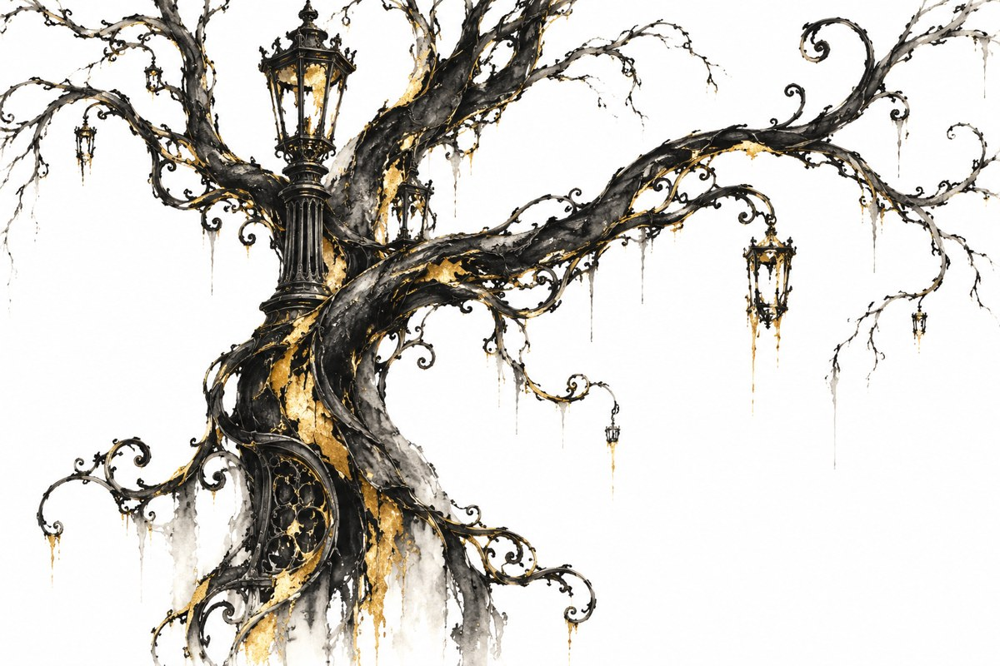

*The Bone-Tree: twisted iron and bone in an infinite white void.*

- **Make:** the U7 kit (§3.9): trunk, temple islands, breathing bone-bamboo bridges, Root Approach, Mid-Spire Shrines, Crown of Horns, lotus ponds.
- **Specs:** ENV-K and ENV-L, U7. 70% white on screen at all times; no skybox; gold dust marks the hidden routes. Files `assets/environments/u7/`.
- **Prompt:** `a twisted tree of iron and fused bone growing in infinite white space, an old lantern hanging from one branch, gold leaf flakes drifting, sketchbook ink and gold leaf on white kozo washi, 70% negative space, fine sumi-brown hairlines, no black, HD-2D diorama view`
- **Check:** a screenshot from any camera is at least 70% white.
- **Anchor:** this image; plate-09.

### 5.7 Props and interactables

#### 5.7.1 Leene Bell guillotine — `prop_leene_bell_guillotine`

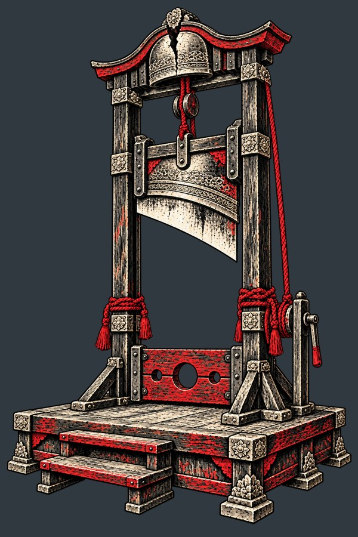

*In U1 the Leene Bell was melted down and recast as a guillotine.*

- **Make:** the Kuro-Truce square landmark: the same anchor geometry as U0's bell, transformed. Its toll is the bell's note, distorted.
- **Specs:** PRP-M glTF, U1. Files `assets/props/u1/leene_bell_guillotine.glb`.
- **Prompt:** `a tall execution guillotine whose blade and frame are cast from a melted bronze bell, black lacquered timber, cinnabar paint, bell inscriptions still visible on the blade, sumi-e and ukiyo-e woodblock on washi, four inks only, three-quarter view, flat #FF00FF background`
- **Check:** players who saw the U0 bell recognise its outline.
- **Anchor:** this image.

#### 5.7.2 Claymation fracture gear — `prop_claymation_fracture_gear`

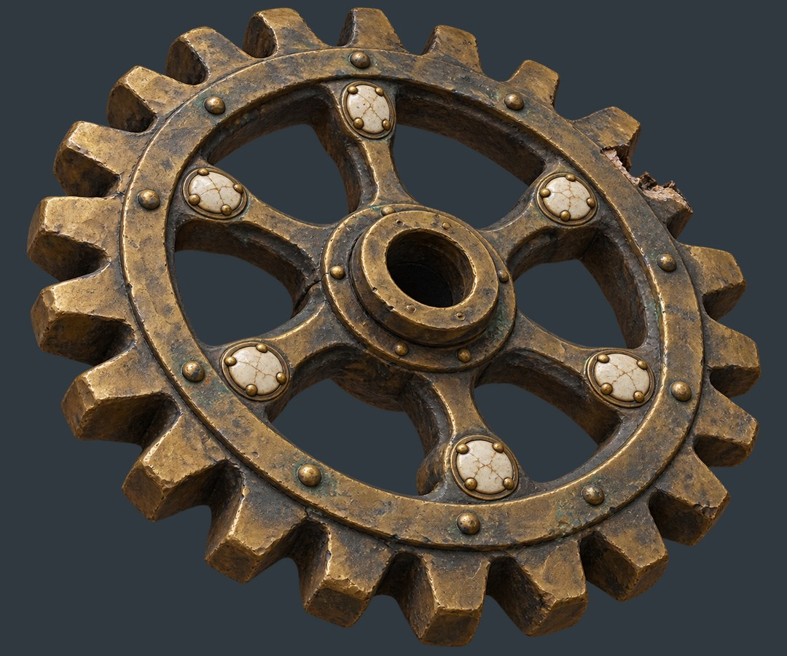

*A U2 gear that crashes through the fracture into Krona's pagoda.*

- **Make:** the falling gear (12 fps) and its crater on the Chitin-Pagoda; reused as debris wherever U2 leaks.
- **Specs:** PRP-M, U2 clay with thumbprints even inside U1. Files `assets/props/u2/fracture_gear.glb`.
- **Prompt:** `a huge bronze-clay cog wheel with bolts and a cracked rim, thumbprints in the clay, stop-motion claymation photographed under a hard key light, three-quarter view, flat #FF00FF background`
- **Check:** it steps at 12 while the pagoda burns at 24.
- **Anchor:** this image.

#### 5.7.3 Sera's geometric cage — `prop_sera_geometric_cage`

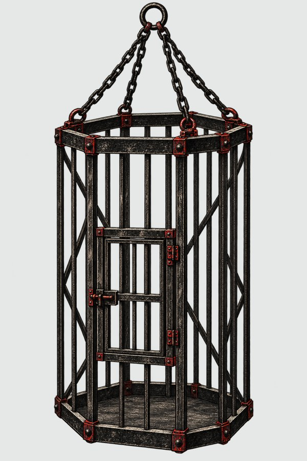

*The cage above the Mammon Furnace; Sera flickers inside through all seven styles.*

- **Make:** the cage, its chain, and a swing loop; Sera's sprite flickers inside it.
- **Specs:** PRP-M, mixed canvas: iron in U1 ink with U2 rivets. Files `assets/props/mix/sera_cage.glb`.
- **Prompt:** `a hexagonal birdcage-like prison of black iron bars hanging from chains, red glints on the bars, geometric facets, ink and clay mixed media, three-quarter view, flat #FF00FF background`
- **Check:** Sera is visible through the bars at every flicker layer.
- **Anchor:** this image.

#### 5.7.4 Epoch-Tether Beacon — `prop_epoch_tether_beacon`

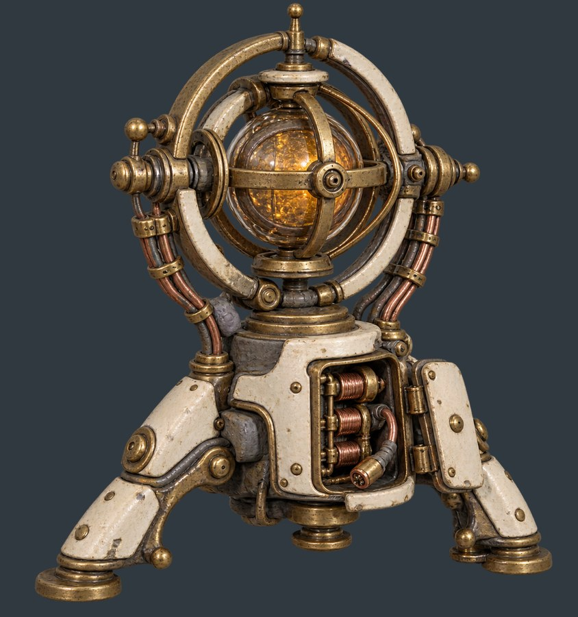

*The repairable beacon at the Slag-Yards hub.*

- **Make:** broken and repaired states; repairing it is the U2 hub objective. Lit, it pulses with Epoch light.
- **Specs:** PRP-M, U2. Files `assets/props/u2/epoch_tether_beacon.glb`.
- **Prompt:** `a brass and porcelain beacon on a tripod, a small globe in a gimbal on top, an engraved E emblem, dials and cables, stop-motion claymation photographed under a hard key light, three-quarter view, flat #FF00FF background`
- **Check:** broken and repaired read differently in silhouette (the gimbal tilts when broken).
- **Anchor:** this image.

#### 5.7.5 Gramophone Shop workbench — `prop_gramophone_shop_workbench`

- **Make:** Johnny's shop counter with the fused jetbike wheels, record racks of collectible 78 rpm records, and the shop sign.
- **Specs:** PRP-M, U2. Files `assets/props/u2/gramophone_shop.glb`.
- **Prompt:** `a brass vendor's workbench welded to jetbike wheels, crates of 78 rpm records, a gramophone, tools on hooks, a hand-painted shop sign, stop-motion claymation photographed under a hard key light, three-quarter view, flat #FF00FF background`
- **Check:** the records read as collectibles from the camera.
- **Anchor:** npc_johnny_gramophone_vendor.

#### 5.7.6 Ferro-Capacitor — `prop_ferro_capacitor`

- **Make:** the Spine-Highway quest loot from the Bike Bros that lowers the Core Shaft's shields.
- **Specs:** PRP-S at 128 plus icon, U2. Files `assets/props/u2/ferro_capacitor.png`.
- **Prompt:** `a heavy capacitor cell of brass rings around a core of liquid mercury, amber glass windows, cables trailing, stop-motion claymation photographed under a hard key light, flat #FF00FF background`
- **Check:** distinct from the Ferro-Coil at icon size.
- **Anchor:** equipment_tesla_loom.

#### 5.7.7 Seed of Doan — `prop_seed_of_doan`


*The Seed of Doan, frozen in amber. It opens Possibility Branch 2B.*

- **Make:** the amber seed, then the Atrium growth stages: seed, sprout with a gramophone horn, sapling; ash if Arris was destroyed. Fully grown, it holds a gate open during the siege.
- **Specs:** PRP-S at 128, U2 amber; growth stages as PRP-M in the U0 garden. Files `assets/props/u2/seed_of_doan.png`, `assets/props/u0/doan_tree_<stage>.glb`.
- **Prompt:** `a large seed suspended in a lump of clear golden amber, tiny bubbles and roots frozen inside, glowing softly, stop-motion claymation photographed under a hard key light, flat #FF00FF background`
- **Check:** each growth stage reads at the hub camera.
- **Anchor:** this image.

#### 5.7.8 Atropos-00 memory ribbon — `prop_atropos_00_memory_ribbon`


*Atropos-00's discarded memory ribbon, wound on a reel.*

- **Make:** the rescue item in the Geno-Foundry; playing it projects a memory.
- **Specs:** PRP-S at 128, U2. Files `assets/props/u2/atropos_ribbon.png`.
- **Prompt:** `an old brass film reel holding a long ribbon of glossy brown memory tape trailing loose, stop-motion claymation photographed under a hard key light, flat #FF00FF background`
- **Check:** reads as a ribbon, not as Static's whip.
- **Anchor:** this image.

#### 5.7.9 Ferro-Coil — `prop_ferro_coil`

- **Make:** the Epoch gauntlet upgrade from Cassia-09 that opens the U2 map.
- **Specs:** PRP-S at 128 plus the gauntlet variant in §5.5.1. Files `assets/props/u2/ferro_coil.png`.
- **Prompt:** `a coil of copper wire wound around a brass collar, mercury beads in the windings, stop-motion claymation photographed under a hard key light, flat #FF00FF background`
- **Check:** the same coil shows on Crono's gauntlet in the field sheet.
- **Anchor:** equipment_tesla_loom.

#### 5.7.10 Unstable Amber Rift — `prop_unstable_amber_rift`

- **Make:** the early U3 sequence-break portal in the Geno-Foundry. Through it: the Saurian Eden in ligne claire. It flickers with sound-ring pixels.
- **Specs:** PRP-M plus VFX-P, U2 frame with a U3 interior at 30 fps. Files `assets/props/u2/amber_rift.tscn`.
- **Prompt:** `a jagged oval tear in a factory wall filled with glowing amber light, through it a bright clean-lined jungle with feather palms, concentric sound rings rippling at the edges, clay and ligne claire mixed media, flat #00FF00 background`
- **Check:** the two canvases visibly clash at the rim.
- **Anchor:** prop_seed_of_doan; plate-07.

#### 5.7.11 Prometheus Core — `prop_prometheus_core`

- **Make:** the once-per-battle auto-revive accessory (150 Beckons). Gifted by the golden Robo on the Rewind path, locked behind the Doan garden if Arris sleeps, lying in the ash if Arris burned. When it fires, a star flash seals Crono's cracks and a gramophone crank sounds.
- **Specs:** PRP-S at 128, icon, revive VFX-F at 12 fps. Files `assets/props/u2/prometheus_core.png`, `vfx/ferro/core_revive_fb_10f.png`.
- **Prompt:** `a fist-sized brass sphere with a glowing positronic heart behind amber glass, rivets and a small crank, stop-motion claymation photographed under a hard key light, flat #FF00FF background`
- **Check:** the revive flash is gold, not the Break gold-shatter.
- **Anchor:** npc_robo_clocktower.

#### 5.7.12 Robo's Ribbon — `prop_robo_s_ribbon`

- **Make:** the secret Clocktower subquest item: Lucca's ribbon, found in Cassia's mercury shoulder joint and tied to the Core.
- **Specs:** PRP-S at 64 and 128, U0 watercolour. Files `assets/props/u0/robos_ribbon.png`.
- **Prompt:** `a faded red hair ribbon tied in a bow, a little oil-stained, painterly cel-shaded watercolour on cold-press paper, desaturated, flat #00FF00 background`
- **Check:** recognisable tied to the Core's icon.
- **Anchor:** npc_robo_clocktower.

#### 5.7.13 Sera's glass birth-pod — `prop_sera_glass_birth_pod`

- **Make:** the pod in the Dyson-Cage holding Sera at 40% translucency.
- **Specs:** PRP-M, U2 glass and brass; Sera inside uses her 40% state. Files `assets/props/u2/sera_birth_pod.glb`.
- **Prompt:** `an upright glass birth-pod of brass ribs and thick curved glass filled with faint amber fluid, cables and iron syringes feeding it, a pale translucent girl floating inside, stop-motion claymation with Giger-like detail, flat #00FF00 background`
- **Check:** Sera stays readable through the glass and fluid.
- **Anchor:** prop_sera_geometric_cage.

#### 5.7.14 Bloodshot CRT terminals — `prop_bloodshot_crt_terminals`

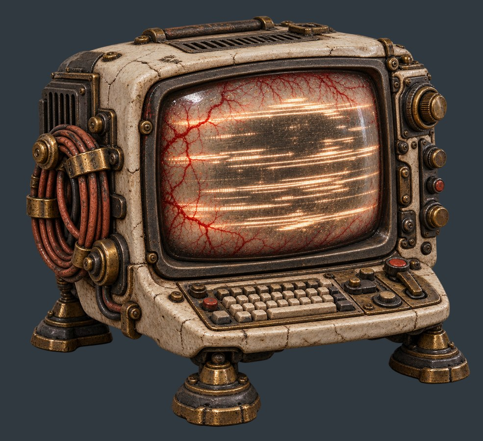

*A U2 lore terminal: a CRT whose screen is veined like a bloodshot eye.*

- **Make:** lore terminals and the stacked CRT shrines; the screen animates at 12 fps with static.
- **Specs:** PRP-M, U2. Files `assets/props/u2/crt_terminal.glb`.
- **Prompt:** `an old CRT computer terminal in a cream and brass case, the screen glowing red with bloodshot veins and static, a chunky keyboard, stop-motion claymation photographed under a hard key light, three-quarter view, flat #00FF00 background`
- **Check:** the screen is legible as interactive from the explore camera.
- **Anchor:** this image.

#### 5.7.15 Copper umbilicals — `prop_copper_umbilicals`


*Copper umbilicals pumping Lavos-Oil across the Slag-Yards.*

- **Make:** pipe kit pieces with a pulse (a bulge travels along them every 3 s); severable versions for the Marrow-Umbilical adds.
- **Specs:** ENV-K pieces, U2. Files `assets/props/u2/copper_umbilical_<piece>.glb`.
- **Prompt:** `ribbed copper umbilical pipes snaking between brass couplings, gauges and valves, black oil seeping at joints, stop-motion claymation photographed under a hard key light, flat #FF00FF background`
- **Check:** the pulse is visible at 12 fps.
- **Anchor:** this image.

#### 5.7.16 Brass ribcage bridges — `prop_brass_ribcage_bridges`

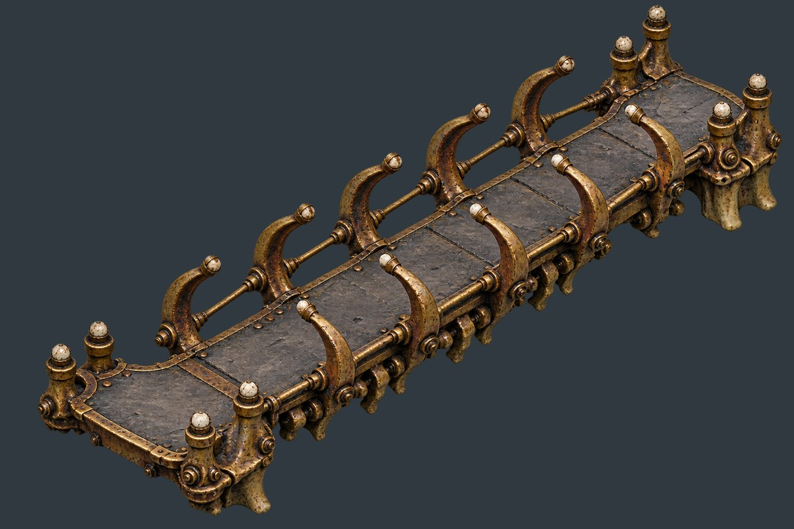

*A traversable bridge of brass ribs.*

- **Make:** bridge modules for the Spine-Highway and Slag-Yards; Cassia's loom can tear husks into new spans.
- **Specs:** ENV-K, U2. Files `assets/environments/u2/kit/rib_bridge_<n>.glb`.
- **Prompt:** `a narrow bridge walkway of riveted brass plates under arching brass ribs, bolted joints, stop-motion claymation photographed under a hard key light, three-quarter view, flat #FF00FF background`
- **Check:** walkable width is at least 1.5 m on the NavMesh.
- **Anchor:** this image.

#### 5.7.17 Frozen Lavos Moon — `prop_frozen_lavos_moon`

- **Make:** U3's sky landmark: a 2 km embryo frozen two miles up as a bleeding purple second moon, pulsing every 12 s. Worship Gaze cuts its drone; the secret path turns it red.
- **Specs:** a skybox layer and a billboard, U3 line. Files `assets/environments/u3/lavos_moon.png`.
- **Prompt:** `a huge pale purple moon that is a curled embryonic creature with spines, bleeding faintly, hanging in a clear daytime sky over feather-palm canopy, Franco-Belgian ligne claire, constant 2 px black line, flat gouache fills, flat colour sky`
- **Check:** the pulse reads from anywhere in U3.
- **Anchor:** plate-07.

#### 5.7.18 Project Klein journal — `prop_project_klein_journal`


*Lucca's warning journal: saving the timeline only quarantined the bad endings.*

- **Make:** the journal prop, its open-page UI (handwritten notes and diagrams) and the pickup icon.
- **Specs:** PRP-S at 128 and UI pages at 640 × 360, U0. Files `assets/props/u0/klein_journal.png`, `ui/journal/page_<n>.png`.
- **Prompt:** `a worn red-brown leather journal with a brass clasp and a ribbon bookmark, painterly cel-shaded watercolour on cold-press paper, desaturated, flat #00FF00 background`
- **Check:** page text is legible at 1080p.
- **Anchor:** this image.

### 5.8 VFX

Each VFX brief gives the effect, its canvas and rate, and its pieces (flipbooks VFX-F, particle scenes VFX-P, shader passes).

#### 5.8.1 Astral ink-to-gold burn — `vfx_astral_ink_to_gold_burn`

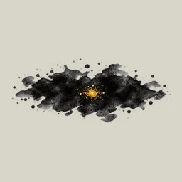

*Astral light burning black ink into gold.*

- **Make:** Crono's Astral burning U1 black ink terrain into golden watercolour patches that restore stamina (the Elemental Canvas Clash).
- **Specs:** a decal shader (ink→gold over 1.2 s at 60 fps) plus a gold mote VFX-P. Files `vfx/astral/ink_to_gold.tscn`.
- **Prompt:** `a splash of black sumi ink on cream paper with a glowing gold watercolour core spreading outward, gold flecks, flat cream background`
- **Check:** the burnt patch stays readable on the ink ground.
- **Anchor:** this image.

#### 5.8.2 Ruin Decay — `vfx_ruin_decay`

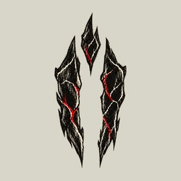

*Ruin Decay: cracks that lower the max-HP ceiling.*

- **Make:** the status look: −15% max-HP ceiling per stack (up to 3), shown as crack shards on the sprite that multiply per stack, with a paper-tear sound.
- **Specs:** `_m` crack overlay plus VFX-F at 24 fps. Files `vfx/status/ruin_decay_fb_8f.png`.
- **Prompt:** `two jagged shards of black ink-stone split by red glowing cracks, sumi-e ink on cream paper, flat cream background`
- **Check:** one, two and three stacks are distinguishable.
- **Anchor:** this image; ui_party_status_icons.

#### 5.8.3 Oil-Blight — `vfx_oil_blight`

- **Make:** the status look: −1 shared BP per 15 s and Ultimates blocked. Black oil drips from the sprite, with an amber shard stuck to it.
- **Specs:** VFX-P drip at the bearer's canvas rate plus a sprite decal. Files `vfx/status/oil_blight.tscn`.
- **Prompt:** `thick black oil dripping down in heavy drops with a stuck amber shard glinting, painterly, flat cream background`
- **Check:** distinct from Ruin Decay in shape (drops against cracks).
- **Anchor:** vfx_ruin_decay; ui_party_status_icons.

#### 5.8.4 Chronoslip style phase — `vfx_chronoslip_style_phase`

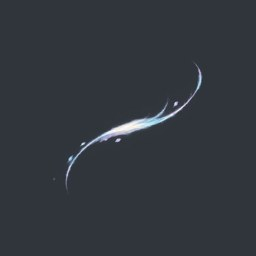

*Sera's Chronoslip: a light ribbon that phases her between canvases.*

- **Make:** the slip: ribbon arc, ghost spawn (six ghosts: sumi stroke, clay thumbprint, Moebius line, glass caustic, rubber stretch, cel hard shadow) and the UniverseSwitcher blend.
- **Specs:** VFX-P ribbon at 60 fps plus ghost sprites at native rates, 0.8 s total. Files `vfx/tachyon/chronoslip.tscn`.
- **Prompt:** `a curving ribbon of white and pale blue light with violet edges, motion-blurred, on a dark background`
- **Check:** with reduced flicker on, the ghosts fade in steadily.
- **Anchor:** this image.

#### 5.8.5 Seven-canvas Fracture — `vfx_seven_canvas_fracture`

- **Make:** the sky splitting into seven differently animated shards at the Telepod pavilion and at every major fracture.
- **Specs:** a sky shader with seven Voronoi cells, each sampling a canvas backdrop at its own rate. Files `vfx/fracture/seven_canvas_sky.tscn`.
- **Prompt:** `a sky shattered into seven jagged shards, each painted in a different style: watercolour, sumi ink, claymation, ligne claire, stained glass, rubber-hose cartoon, 1988 cel anime, glowing cracks between them`
- **Check:** each shard is identifiable as its universe.
- **Anchor:** vfx_chronoslip_style_phase; plate-08; plate-10.

#### 5.8.6 Eclipse X-Strike — `vfx_eclipse_x_strike`

- **Make:** Crono and Krona's Dual Tech: the screen splits diagonally into watercolour and sumi-e; the same stance mirrored; an X slash burns the paper.
- **Specs:** a full-screen split shader (diagonal mask) plus VFX-F slash, 60 fps on Crono's half and 24 on Krona's. Files `vfx/dual/eclipse_x_strike.tscn`.
- **Prompt:** `a diagonal split screen, left half a watercolour swordsman, right half a sumi-e swordswoman in the same stance mirrored, a burning X slash crossing at the centre and scorching the paper`
- **Check:** the two halves step at their own rates.
- **Anchor:** playable_crono; playable_krona.

#### 5.8.7 Overclocked Short-Circuit — `vfx_overclocked_short_circuit`

- **Make:** the Dual Tech found while fighting the Porcelain Weaver: Crono overcharges the gauntlet and arcs it into her Mother Brain antennae, frying the override.
- **Specs:** VFX-P arcs at 60 (Crono) striking a 12 fps clay burst. Files `vfx/dual/overclocked_short_circuit.tscn`.
- **Prompt:** `blue-white lightning arcing from a brass gauntlet into black antennae on a clay robot, sparks and smoke, watercolour and claymation colliding`
- **Check:** the tank stays untouched in every frame.
- **Anchor:** enemy_porcelain_weaver.

#### 5.8.8 Solar Railgun — `vfx_solar_railgun`

- **Make:** Cassia forms a magnetic induction barrel and fires Crono as a comet (line 12.0, three rail hits and a burn); sound rings from the horn; the galaxy shows in the rail core when Crono is below 60%.
- **Specs:** VFX-P comet trail at 60, VFX-F sound rings at 12. Files `vfx/dual/solar_railgun.tscn`.
- **Prompt:** `a red-haired swordsman fired as a blazing comet through a brass magnetic barrel, concentric sound rings bursting from a gramophone horn, watercolour streak against claymation`
- **Check:** the line footprint matches the telegraph.
- **Anchor:** plate-04; playable_crono.

#### 5.8.9 Iron Maiden Scroll — `vfx_iron_maiden_scroll`

- **Make:** Cassia's tungsten wires flatten enemies into an ukiyo-e scroll and Krona shreds it.
- **Specs:** an enemy flatten shader (squash to a paper plane), a scroll VFX-F at 24, a shred VFX-P. Files `vfx/dual/iron_maiden_scroll.tscn`.
- **Prompt:** `a monster pressed flat into a hanging ukiyo-e scroll by taut glinting wires, then slashed apart in strips of paper and ink`
- **Check:** the enemy is recognisable in its flattened scroll form.
- **Anchor:** equipment_tesla_loom; plate-02.

#### 5.8.10 Ashtear Paradox — `vfx_ashtear_paradox`

- **Make:** the Triple Tech: blood and oil magnetised into a singularity, two strikers hitting from opposite timelines, and a miniature Big Bang of watercolour gold, sumi-e crimson and liquid metal. The gramophone plays the old Fair theme, warped.
- **Specs:** a singularity shader (radial pinch), VFX-P burst in three materials. Files `vfx/triple/ashtear_paradox.tscn`.
- **Prompt:** `a tiny black singularity of blood and oil exploding into a big bang of watercolour gold, crimson sumi ink and liquid mercury`
- **Check:** each of the three materials reads separately at its own rate.
- **Anchor:** vfx_astral_ink_to_gold_burn; plate-04.

#### 5.8.11 Tachyon HP rewind — `vfx_tachyon_hp_rewind`

- **Make:** Sera rewinds an ally to the start of their last turn (HP, ATB, position). The snap plays in the target's native style for 0.4 s: a backward clock shatter and an inverse sound ring.
- **Specs:** VFX-F per canvas (a 0.4 s snap) plus reversed-trail afterimages. Files `vfx/tachyon/rewind_<canvas>_fb.png`.
- **Prompt:** `a clock face shattering backwards into one piece around a figure, violet light ribbons, afterimages reversing`
- **Check:** each canvas variant matches its target.
- **Anchor:** vfx_chronoslip_style_phase.

#### 5.8.12 Tachyon fast-forward — `vfx_tachyon_fast_forward`

- **Make:** Sera's Turn-Bar daggers advance an ally's gauge (first used on Krona at the Furnace).
- **Specs:** a dagger VFX-P flying to the turn bar plus a speed-line overlay on the target at its rate. Files `vfx/tachyon/fast_forward.tscn`.
- **Prompt:** `two clock-hand daggers streaking forward on violet light ribbons, a swordswoman blurred by forward speed lines`
- **Check:** the turn-bar marker visibly jumps.
- **Anchor:** equipment_twin_pendulum_blades.

#### 5.8.13 REWIND: 2300 A.D. — `vfx_rewind_2300_ad`

- **Make:** the Lullaby Rewind on the Arch-Curator: three Turn-Bar Echo casts on the exposed chest plate rot the clay grafts away in reverse until the original golden Robo stands there.
- **Specs:** a reverse-dissolve shader on the clay body (12 fps, run backwards), a gold reveal at 60. Files `vfx/tachyon/rewind_2300.tscn`.
- **Prompt:** `clay and muscle peeling away in reverse from a giant robot to reveal a small golden robot underneath, glowing, claymation dissolving into clean gold`
- **Check:** each of the three casts shows visible progress.
- **Anchor:** enemy_arch_curator_r_66y; npc_robo_clocktower.

#### 5.8.14 Omega Annihilation — `vfx_omega_annihilation`

- **Make:** the Dual Tech unlocked by the Lavos-Grafted Laser Cannon: tachyon flicker plus white-noise cancellation, a causal collapse. Total mute and a chime.
- **Specs:** a full-screen white-noise cancel shader (one cel frame, then white) and a cannon beam VFX-P. Files `vfx/dual/omega_annihilation.tscn`.
- **Prompt:** `a laser beam wrapped in violet tachyon ghosts and white static erasing everything it touches into blank white, a cel-anime flare`
- **Check:** the reduced-flicker version replaces the noise with a steady white fade.
- **Anchor:** equipment_magnetic_tape_reel_whip; enemy_arch_curator_r_66y.

#### 5.8.15 VHS Static Fog — `vfx_vhs_static_fog`

- **Make:** U2's ranged-accuracy hazard (BLIND −30%): static fog that shrinks the vision cone, glitches the UI and hides a second weakness as [?]; Astral light or a Sound Ring clears it.
- **Specs:** a volumetric fog plus a screen-space VHS noise layer at 12 fps. Files `vfx/hazard/vhs_fog.tscn`.
- **Prompt:** `a wasteland swallowed by grey video static fog, scanlines and tracking noise, a shrinking circle of clear vision`
- **Check:** shield plates stay readable through it (only the hidden tag turns to [?]).
- **Anchor:** environment_proto_dome_slag_yards.

#### 5.8.16 Mercury frame-trap pools — `vfx_mercury_frame_trap_pools`

- **Make:** liquid mercury pools that drop anyone standing in them from 12 to 6 fps (SLOW 0.5×, up to two stacks); clay feet stick.
- **Specs:** a mercury surface shader at 60 fps reflecting the scene; affected sprites step at half rate. Files `vfx/hazard/mercury_pool.tscn`.
- **Prompt:** `a pool of liquid mercury on clay ground, perfectly mirrored, a clay foot stuck in it with a silver splash`
- **Check:** the halved rate is visible on the affected sprite.
- **Anchor:** plate-04 (the mercury orb detail).

#### 5.8.17 Grief-Resonance — `vfx_grief_resonance`

- **Make:** the porcelain husks' MP drain (−2 MP per 10 s): reversed whispers, a 28–40 Hz sub felt in the chest, and black oil tears from empty sockets.
- **Specs:** a heat-shimmer distortion pulsing in time with the sub, plus tear decals. Files `vfx/status/grief_resonance.tscn`.
- **Prompt:** `porcelain masks weeping black oil in a dark chapel, the air rippling with sound waves`
- **Check:** a visual pulse pairs with the sub for deaf and hard-of-hearing players.
- **Anchor:** enemy_weeping_porcelain_citizen_husks.

#### 5.8.18 Mycelia Spores — `vfx_mycelia_spores`

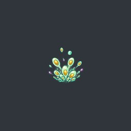

*Xyloph's spores, which can infect Mother Brain's wiring through the sequence-break.*

- **Make:** spore puffs, neon-green threads, tether pulses (1.5 s), the Fake Carrier Burn (brown pollen, no damage) and the Mother Brain infection.
- **Specs:** VFX-P at 30 fps with 2 px outlined particles. Files `vfx/mycelia/spores.tscn`.
- **Prompt:** `a cluster of pale green glowing spores and seed pods bursting outward, clean ligne claire outlines, flat colours, dark background`
- **Check:** the threads keep a constant 2 px line.
- **Anchor:** this image; plate-03.

#### 5.8.19 Liquid silver time — `vfx_liquid_silver_time`

- **Make:** Magus's leak: slow drops of liquid silver time from his blind eye and fingertips that fall upward for a moment before landing.
- **Specs:** VFX-P at 60 fps, mercury-like but cool silver-violet. Files `vfx/time/silver_leak.tscn`.
- **Prompt:** `drops of liquid silver light dripping from fingertips, some drifting upward against gravity, watercolour`
- **Check:** distinct from mercury (no clay, no stepping).
- **Anchor:** npc_magus.

#### 5.8.20 Null erasure — `vfx_null_erasure`

- **Make:** NULL erases allies or enemies for a moment: the white canvas eats the target, leaving gold butterfly silhouettes, and strong hits slice the paper open on raw equations.
- **Specs:** an erase shader (white mask growing from creases), VFX-P butterflies; void expansion held at 8 fps. Files `vfx/null/erasure.tscn`.
- **Prompt:** `a figure being erased into blank white paper along origami fold lines, gold leaf butterflies escaping, a torn slit showing handwritten equations underneath`
- **Check:** the erased target's position still shows (a faint crease outline).
- **Anchor:** environment_bone_tree_of_eternity; playable_omega_spekkio.

### 5.9 UI

The UI is one family: cream #F2EAD7 lines on ink #161821, chamfered octagonal frames with diamond studs, previewed on slate #4F5660 (§7). Icons are authored at 256 and reduced to 128 and 64.

#### 5.9.1 Turn-Order Bar — `ui_turn_order_bar`

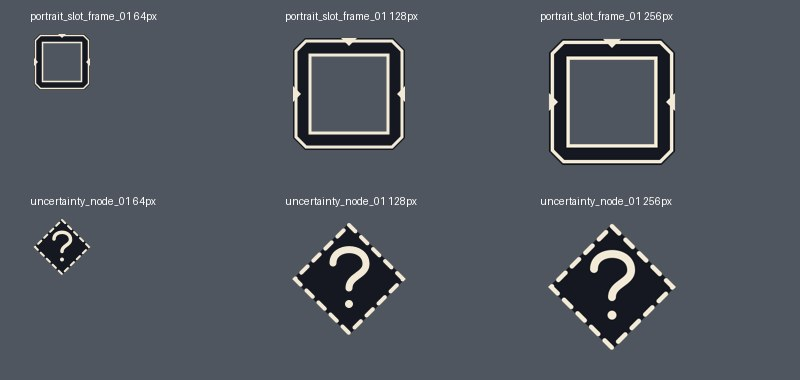

*Portrait slot frames and the dashed uncertainty node.*

- **Make:** the timeline HUD: portrait slots on the Active Time Debt timeline, Sync Hold at 99.0, Sera's edits (rewound or advanced markers), forecast and uncertainty.
- **Specs:** UI-F 9-slice slots, UI-I nodes at 64/128/256. Files `ui/timeline/portrait_slot_frame_01_<size>.png`, `uncertainty_node_01_<size>.png`.
- **Prompt:** `flat vector UI icon, a square portrait frame with chamfered corners and small triangle notches, cream #F2EAD7 line on ink #161821, no gradients`
- **Check:** slots read at 64 px with portraits inside.
- **Anchor:** this image.

#### 5.9.2 Tech availability — `ui_tech_availability`

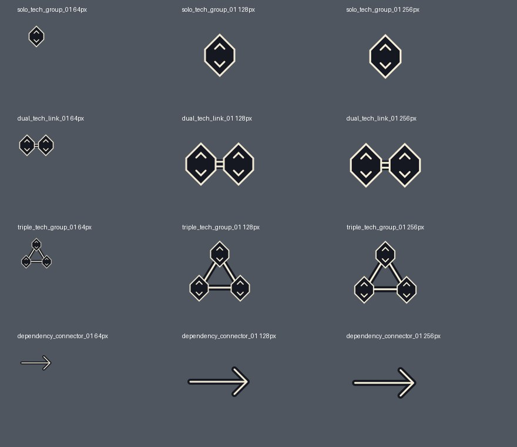

*Solo, Dual and Triple Tech groupings and the dependency connector.*

- **Make:** command-deck icons showing which Solo, Dual and Triple Techs are available and which members they need.
- **Specs:** UI-I hexagonal gems, linked in pairs and triangles. Files `ui/techs/solo_tech_group_01_<size>.png`, `dual_tech_link_01_<size>.png`, `triple_tech_group_01_<size>.png`, `dependency_connector_01_<size>.png`.
- **Prompt:** `flat vector UI icon, a hexagonal gem with an up and a down chevron, cream #F2EAD7 line on ink #161821, no gradients`
- **Check:** available and unavailable differ by shape (a broken link), not only by brightness.
- **Anchor:** this image.

#### 5.9.3 Target-area preview — `ui_target_area_preview`

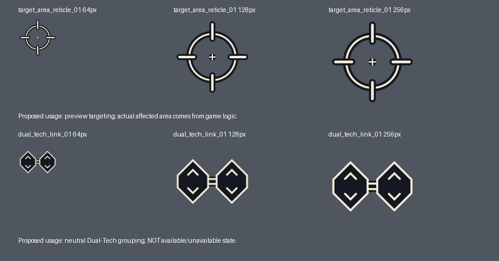

*The target reticle and the neutral Dual Tech link.*

- **Make:** the targeting reticle and the floor preview (the AoE decal pulsing cyan→orange), with hit count and weak-point preview before commit.
- **Specs:** UI-I reticle plus the floor shader in §1.8. Files `ui/targeting/target_area_reticle_01_<size>.png`.
- **Prompt:** `flat vector UI icon, a circular targeting reticle with four tick marks and a small cross at the centre, cream #F2EAD7 line on ink #161821, no gradients`
- **Check:** the decal and the reticle agree on the footprint.
- **Anchor:** this image.

#### 5.9.4 Paradox Affinity gauge — `ui_paradox_affinity_gauge`

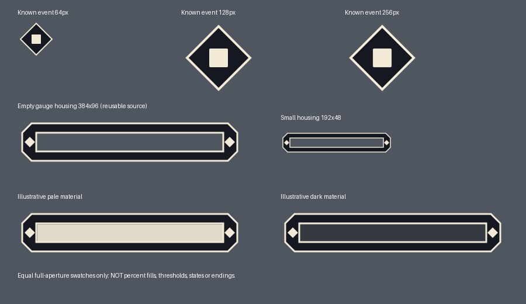

*Gauge housings (384 × 96 and 192 × 48) and the known-event diamond.*

- **Make:** the affinity readout. Affinity numbers stay hidden; the housing shows only art bleed (watercolour for Light, clay and VHS for Dark, all styles for Prismatic), and the ending select shows three broken porcelain plates.
- **Specs:** UI-G housings, pale and dark materials, known-event diamonds. Files `ui/affinity/gauge_housing_384x96.png`, `gauge_housing_192x48.png`, `known_event_<size>.png`.
- **Prompt:** `flat vector UI gauge housing, a long chamfered bar frame with diamond studs at each end, cream #F2EAD7 line on ink #161821, no gradients`
- **Check:** no number or percentage appears anywhere on the gauge.
- **Anchor:** this image.

#### 5.9.5 Party status icons — `ui_party_status_icons`

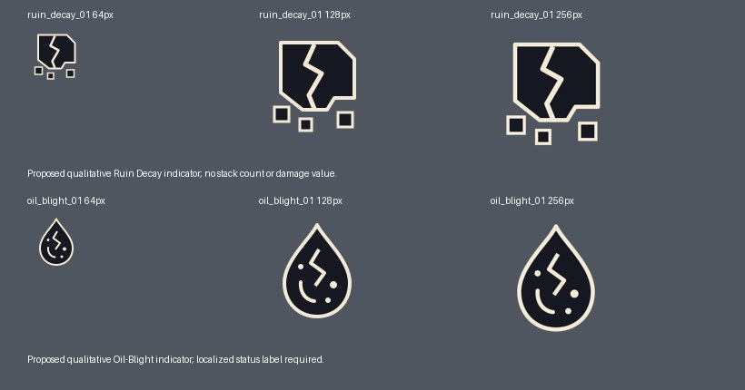

*Ruin Decay (a cracked block) and Oil-Blight (a cracked drop).*

- **Make:** icons for the nine elements and every status, each with its own shape as well as colour (the full list is in §7.4).
- **Specs:** UI-I at 64/128/256. Files `ui/status/<status>_01_<size>.png`.
- **Prompt:** `flat vector UI icon, a cracked square block with three small falling squares, cream #F2EAD7 line on ink #161821, no gradients`
- **Check:** every icon is identifiable in greyscale.
- **Anchor:** this image.

#### 5.9.6 Timeline causality graph — `ui_timeline_causality_graph`


*The same frame and uncertainty node, reused as graph nodes.*

- **Make:** the quest log as a causality graph: nodes for events, dependency arrows, dashed nodes for uncertainty, flags shown as forks (the Possibility Codex).
- **Specs:** UI-I nodes and the dependency connector from §5.9.2; the graph lays itself out in code. Files `ui/causality/`.
- **Prompt:** `flat vector UI icon, a diamond node with a question mark and a dashed outline, cream #F2EAD7 line on ink #161821, no gradients`
- **Check:** a branch fork reads as a choice at a glance.
- **Anchor:** this image; ui_tech_availability.

#### 5.9.7 Menus, frames, fonts and cursors — `ui_menus_frames_fonts_cursors`

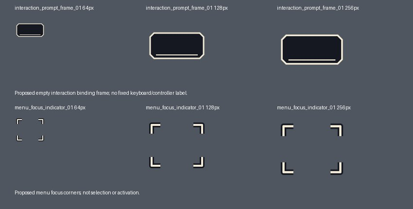

*The interaction prompt frame and the focus corners.*

- **Make:** menu frames, the interaction prompt (the button glyph is swapped in by input device), focus corners, the cursor and the fonts (§7.6).
- **Specs:** UI-F 9-slice frames and UI-I corners. Files `ui/frames/interaction_prompt_frame_01_<size>.png`, `menu_focus_indicator_01_<size>.png`.
- **Prompt:** `flat vector UI frame, a chamfered rectangular button frame with an underline, cream #F2EAD7 line on ink #161821, no gradients`
- **Check:** the focus corners move to every selectable element.
- **Anchor:** this image.

#### 5.9.8 Hub and skill-tree UI — `ui_hub_and_skill_tree_ui`

- **Make:** the Atrium menus (save, heal, party swap for nine, Crono's crack inspection, gate choice) and the skill tree laid out as constellations on Crono's galaxy (§7.7).
- **Specs:** UI-F and UI-I in the same family; tree nodes reuse the hexagonal gem. Files `ui/hub/`, `ui/skills/`.
- **Prompt:** `flat vector UI, a constellation of hexagonal gem nodes linked by thin cream lines over a dark starfield, cream #F2EAD7 on ink #161821`
- **Check:** each character's branch is coloured and shaped by element.
- **Anchor:** ui_tech_availability; ui_timeline_causality_graph.

### 5.10 Audio families

The audio briefs here are the catalog entries; the full track and SFX briefs are in §8.

#### 5.10.1 Core time, world and threat motifs — `audio_core_time_world_threat_motifs`

- **Make:** the three core motif families: Time (the music-box cell of "Wind Scene 1024"), World (the U0 Truce cell that returns in every universe re-orchestrated), Threat (Vaelos: contrabassoon C–G♭, the diminished fifth, under everything).
- **Specs:** MUS cells as MIDI plus rendered stems (§8.3). Files `audio/music/motifs/`.
- **Prompt:** `three short original motif cells for a time-travel RPG: a fragile music-box figure at 72 BPM, a warm hometown melody, and a low contrabassoon tritone pulse at 68 BPM`
- **Check:** each motif is recognisable in a different universe's instrumentation.
- **Anchor:** plate-00; npc_robo_clocktower.

#### 5.10.2 Character motif cells — `audio_character_motif_cells`

- **Make:** one short motif cell and identity timbre per major character (§8.3).
- **Specs:** MIDI cells and solo renders. Files `audio/music/motifs/<char>_cell.mid`.
- **Prompt:** `a three-to-six-note original motif for <character> on <identity timbre>, solo, dry, 4 bars`
- **Check:** each cell survives every universe palette.
- **Anchor:** the character's catalog image.

#### 5.10.3 Universe instrumentation palettes — `audio_universe_instrumentation_palettes`

- **Make:** the timbre and rhythm law for each canvas (§8.4).
- **Specs:** a sample pack and patch list per universe. Files `audio/palettes/u<n>/`.
- **Prompt:** see the palette rows in §8.4.
- **Check:** a muted screenshot of the world plus its palette alone identifies the universe.
- **Anchor:** each universe's plate.

#### 5.10.4 Region and location adaptive stems — `audio_region_and_location_adaptive_stems`

- **Make:** exploration, danger and boss transformations of each region's track, plus timeline alternatives (flag variants such as Arris Sleeping and Incinerated).
- **Specs:** MUS stems on `AudioStreamSynchronized`, sections on `AudioStreamInteractive` (§8.5).
- **Prompt:** the track briefs in §8.5.
- **Check:** switching state never drops the beat.
- **Anchor:** plate-01; plate-08.

#### 5.10.5 UI SFX — `audio_ui_sfx`

- **Make:** short tactile transients with one recognisable pitch and material per family (§8.6).
- **Specs:** SFX, stereo, 30–200 ms. Files `audio/sfx/ui/`.
- **Prompt:** `a short soft porcelain tick for a menu cursor, dry, 60 ms`
- **Check:** distinguishable with the music at full volume.
- **Anchor:** ui_menus_frames_fonts_cursors.

#### 5.10.6 Weapon SFX — `audio_weapon_sfx`

- **Make:** material-first layers per weapon with readable impact tiers (normal, weak 1.3× bright with a bell, Break gong).
- **Specs:** SFX mono, five variations each (§8.6). Files `audio/sfx/weapons/<weapon>/`.
- **Prompt:** `a katana slash recorded as a brush stroke on paper with a low tide swell, 300 ms`
- **Check:** the tiers are audible without looking.
- **Anchor:** the weapon's catalog image.

#### 5.10.7 Magic SFX — `audio_magic_sfx`

- **Make:** for each element: source gesture, travel, contact and tail (§8.6).
- **Specs:** SFX in four layers. Files `audio/sfx/magic/<element>/`.
- **Prompt:** `a reversed tape swell into a soft harp pluck and a whispered seven-voice chord, 1.2 s`
- **Check:** every element is identifiable blind.
- **Anchor:** the element table in §1.8.

#### 5.10.8 Environmental ambience — `audio_environmental_ambience`

- **Make:** a biome bed per location plus intermittent identity events (§8.6).
- **Specs:** OGG stereo loops of 60–120 s, events as SFX. Files `audio/ambience/u<n>/`.
- **Prompt:** `the room tone of an empty white paper void, a faint bone chime every 7 s, a deep marrow hum, 90 s loop`
- **Check:** silence is never digital zero; tape hiss stays underneath.
- **Anchor:** each universe's plate.

#### 5.10.9 Machine rhythms — `audio_machine_rhythms`

- **Make:** technology loops tied to fiction: the 3 s syringe metronome, the Arch-Curator's hydraulics, the hub mainspring every 4 bars, CRT hum, dial-up and pachinko (§8.6).
- **Specs:** SFX loops locked to the track tempo. Files `audio/sfx/machines/`.
- **Prompt:** `a giant iron syringe hammering once every 3 seconds in a factory cathedral, a hydraulic hiss tail, 12 s loop`
- **Check:** the machine loop lands on the beat of the area's music.
- **Anchor:** environment_geno_foundry_conveyor_belt.

#### 5.10.10 Time portal SFX — `audio_time_portal_sfx`

- **Make:** one sonic fingerprint for time, transformed by scale and state: Chronoslip, gate open per universe, Amber Rift, the UniverseSwitcher, the Fracture (§8.6).
- **Specs:** a source sound and its family of processed versions. Files `audio/sfx/time/`.
- **Prompt:** `a single glass-and-tape time-rift sound: a reversed music-box tine sucked into a deep breath, then released as a bright shimmer, 1.5 s`
- **Check:** every portal variant is audibly the same family.
- **Anchor:** vfx_chronoslip_style_phase.

## 6. The 12-plate gallery

The plates are the strongest style anchors in the project: four sprite sheets that fix the sheet layout, frame counts and palettes, and eight world paintings that fix scale, light and mood.

### Plate 00 — Brass hall and the clock-faced pillar


*A cathedral-scale brass hall under a glass dome and rose window: light shafts through dust, organ pipes, archive balconies, waterfalls, and at the centre a clockwork effigy with a porcelain clock face and a copper-vine ribcage heart.*

- Use it for the Atrium Horologe interior: Robo's torso as the clock pillar, the copper vines, the moss and the library rings (§3.2).
- Use it for the scale and brass of U2 interiors such as the Geno-Foundry and Arris Dome.
- Light reference for the shared glow and SDFGI values (§2.3).

### Plate 01 — U2 Proto-Dome Slag-Yards


*The shattered Proto-Dome over mossy slag terraces: giant iron syringes pumping magenta Lavos marrow into a caged mass, a fallen clockwork gear, chests, smoke and molten slag.*

- Blockout and composition for the U2 hub (§5.6.10) and the Dyson-Cage's syringes (§5.6.14), the colour of the VHS fog and the scale of the dome.

### Plate 02 — Krona sprite sheet


*Krona, RUIN: a 128 px sheet in four directions, sumi-e brush, Cobalt Nodachi, 24 fps; impact ink bleed held 2 s and dissipating over 12 frames; jump and fall; dissolve-to-ruin; palette sumi black, charcoal, bone white, cobalt, faded vermilion.*

- The template for every U1 sheet: row order, eight frames per direction, the impact and ink-bleed rows, and the dissolve row.
- The cobalt nodachi detail is the reference for equipment_cobalt_nodachi.

### Plate 03 — Xyloph sprite sheet


*Xyloph, MYCELIA: six-winged feathered Reptite Archon, ligne claire, 128 px, 30 fps; the wing offset [2, 4, 6, 2, 4, 6] as a perpetual non-looping moiré; papyrus feathers with legible weather data; neon spore threads; palette swatches.*

- The template for U3 sheets and for any multi-limb rig whose parts never move in sync.

### Plate 04 — Cassia-09 sprite sheet


*Cassia-09, FERRO: clay stop-motion, 12 fps stepped, 128 px grid. Thumbprint normal shader; turnaround front, 3/4, side, back; idle 4, turn 4, walk 6, Gramophone Resonance 8, Mercury Pulse, hurt 3, shutdown 6, boot 5; reverse-jointed legs; tungsten loom bracer; mercury orb joint; Lucca's nervous system in amber; stepped effects; palette.*

- The template for every U2 sheet, and the reference for the thumbprint normal, mercury and amber materials.

### Plate 05 — Arch-Curator R-66Y


*R-66Y: a 20 ft Robo goliath with a 12 fps hydraulic battle idle; the 8× gatling rotating thoracic ring; left eye sorrowful blue, right socket empty and weeping black oil; Lavos muscle fibre; the porcelain theatre mask with crack-slide; idle frames 01–06; a scale bar with the hero at ankle height.*

- The template for every giant boss: callout layout, scale bar, idle variants and part details.

### Plate 06 — Crono sprite sheet


*Crono, 41, ASTRAL: HD-2D hero sheet, 128 px, watercolour at 60 fps. Idle and walk in four directions (four-frame cycle); Draw Stance, Tech Charge and Astral Smear Dash; the 20% porcelain reveal (South Cracked, West Cracked, Peak, East, North); the Bekkler doll at 100%, 60% and 20%; mossy stone, triplanar geo, gravel-worn geo and cloth; watercolour paper at 3× UV; the desaturated palette.*

- The template for U0 sheets, the porcelain states and the ground materials.

### Plate 07 — U3 Saurian Eden triptych


*Saurian Eden, U3, 65,000,000 B.C., Lavos Never Fell: waterfall jungle on the left, spiral bio-architecture in the middle, the golden river on the right.*

- Composition, palette and the three-tier city. The plate is painterly; in game, apply the U3 line law (§3.5) on top of this layout.

### Plate 08 — U6 Singularity


*The Third District at night: stacked neon blocks, hand-painted signs, CRT stacks, rain and the black Singularity halo overhead.*

- Blockout of the vertical stack, sign density and the neon palette (§3.8).

### Plate 09 — U7 Bone-Tree


*The Bone-Tree in white space: a trunk of stacked vertebrae, a seated deity on the lotus dais at its root, floating temple islands with pagodas, gold butterflies and paper cranes, and most of the picture left as paper.*

- The 70% negative-space rule in practice, the island orbit and the Crown of Horns (§3.9).

### Plate 10 — U1 burning castle town


*The Crimson Shogunate: a castle town in blue sumi wash, burning under red banners beside a cobalt sea of carved waves, seen as an isometric diorama.*

- The U1 camera, the four-ink palette and Goyama's burning upper floors (§3.3).

### Plate 11 — U4 Drowned Cathedral


*The Drowned Cathedral: stained-glass arches under deep teal water, shafts of light through the rose window, jellyfish lanterns, coral, and a statue fountain in a pool of light.*

- Light pools as safe zones, the jewel palette and the scale of the nave (§3.6).

## 7. UI references

### 7.1 The UI language

One family across the game, sampled from the catalog sheets: chamfered octagonal frames, diamond studs, hexagonal gems, cream lines on dark ink, and no gradients.

| Token | Hex | Use |
|---|---|---|
| Ink | #161821 | Frame fills, icon fills |
| Cream | #F2EAD7 | Lines, text, glyphs |
| Pale material | #E1DAC8 | Filled gauges, parchment panels |
| Dark material | #2D3039 | Empty gauges, inactive panels |
| Slate | #4F5660 | Preview and editor background only |

- Line weight is 1/32 of the icon size (4 px at 128). Icons come in 64, 128 and 256.
- The base canvas is 640 × 360, scaled by whole numbers (§1.12).
- The frame never changes between universes; the paper behind it does. The menu backdrop shows the current universe's paper and LUT, so the UI always tells you where you are.
- In the final convergence, the U6 CRT barrel and vignette become the menu frame.
- Readability comes first: party state and time state outrank ornament.

### 7.2 Battle HUD

- **Timeline.** One horizontal gauge per battler on the Active Time Debt timeline. When any gauge reaches 99.0 (Sync Hold), every other gauge freezes and the HUD tints, the tick stops and a soft wind chime sounds, for an unlimited decision window. Portraits ride the gauges in the frames from ui_turn_order_bar. Sera's edits show as rewound or advanced ghost markers. Unknown enemy intents use the dashed uncertainty node.
- **Shield plates.** A screen-space plate over each enemy: `[SHIELD X → Y (−Z) → BREAK!]`, with the weakness tags on a second line (`[SWD][?]`). Hidden tags show `[?]` until Cassia-09's Mercury Pulse or Vesper's glass lens reveals them. Before commit the plate previews the shave from the planned action. On Break it turns gold, a thin gold bar shows the rebuild (18 per second after 3.0 s), and chromatic aberration hits 0.02 for the shatter. Multi-phase bosses stack plates, like the Arch-Curator's masks; ending bosses can stack three plates drawn in three canvases.
- **Boost.** A shared pool of 5 pips (6 late), spending up to 3 (4 late). Each level shows power (100 / 190 / 280 / 370 / 450%) and AoE scale (1.00 / 1.25 / 1.50 / 1.75 / 2.00). Lv3 shows a "+1 shave" badge; Lv4 shows the residual field it will leave. The caster previews their style bleed. Overflowing BP when Glenn steals shows as a pip sliding off the bar.
- **Command deck and targeting.** Solo, Dual and Triple availability with the icons from ui_tech_availability (unavailable shown as a broken link). The floor decal pulses cyan→orange with `sin(TIME × 6)` and an inward scan wave; the hit count from the TacticalPositioner's ShapeCast3D shows before commit.
- **Numbers.** Weak hits show 2.0× with a bell; Boost Lv3 shows 1.3× (2.6× on a weakness); hits on a broken enemy are criticals at ×1.5.
- **Crono's integrity** has no number on the HUD. His portrait carries the crack_mask state (100/60/20%), and Robo reports the figure at the Atrium.
- **Sera's translucency** is her clock: a ring of seven segments, one per universe-day, behind her portrait. The portrait itself fades as her translucency rises.
- **Overcap.** When the U2 stat cap is hit, the XP bar turns into amber shards with a VHS whine instead of a fanfare, and a tooltip reads "Time leaks — spend in U7 Gold Leaf".
- **Special plates.** Ending 3 replaces shield plates with the Lullaby Progress Plate. The Ledger Wisp's body lists your flag choices. The Training Dummy shows `[SHIELD 999]` to intimidate, though only 10 are real.

### 7.3 Field UI

- **No minimap.** Krona's ink footprints are the wayfinding: they bloom like watercolour and fade over 6 s in the field and 30 s in the Atrium and U4 light puzzles. Standing idle for 10 s blooms a lotus by the relevant gate. In U7 only drifting gold dust marks a hidden route.
- **Interaction prompt.** The frame from ui_menus_frames_fonts_cursors, with the device's button glyph inside.
- **Save points** belong to their world: the Atrium pillar, a gramophone in U2, a lotus in U3, a polished pane in U4, a ticket booth in U5, a pachinko wall in U6, a gold-leaf page in U7.

### 7.4 Status and element icons

Every icon has its own shape, so colour is never the only signal.

| Icon | Shape | Colour |
|---|---|---|
| VHS Fog (BLIND −30%) | A closed eye inside a TV-static rectangle | Grey |
| Mercury SLOW 0.5× | Two droplets beside a pause bar, a pip per stack | Silver |
| Grief (−2 MP per 10 s) | A mask with one empty socket weeping | Cobalt grey |
| Ruin (−15% max-HP ceiling) | A cracked block with falling squares, one square per stack | Black and red |
| Oil-Blight (−1 BP per 15 s) | A cracked drop | Black and amber |
| Divinity Field | A lotus holding a shield | Pale gold |
| Mycelia Tether | Three linked nodes | Neon green |
| Light Stacks | A pane with 1–5 notches | Jewel tones |
| Ash Field | A smudged circle | Ash grey |
| Knock-Static (forced 12 fps) | A TV with stepped bars | Magenta |
| Confuse (White Noise) | A spiral of static | White |
| Time Stop (Tracking Hold) | A clock with a pause symbol | Cyan |
| Silence | A crossed singing bowl | Pale blue |
| Fragile | A cracked pane | Clear |
| NULL'd | A white card with a gold edge reading [NULL — WEAKNESSES ERASED] | White and gold |
| Phase Out (Sera at 40%) | A gold-leaf ghost silhouette | Gold |
| Broken | A shattered gold shield | Gold |

| Element | Glyph |
|---|---|
| ASTRAL | An eight-point star inside a clock ring |
| TACHYON | A clock hand curling into a looped arrow |
| RUIN | A single brush stroke split by a crack |
| FERRO | Concentric rings around a magnet |
| MYCELIA | A spore trailing three threads |
| VITREOUS | A prism splitting one line into three |
| GUILE | A mask flipping a coin |
| HZ | A sine wave dissolving into noise |
| NULL | An empty circle with a gold rim |

### 7.5 Affinity, endings and choices

- **Affinity is hidden.** No numbers anywhere. Progress shows as art bleed: the world pulls toward watercolour for Light, toward clay and VHS for Dark, and toward every style at once in an Amber Rift for Prismatic. The gauge housing in ui_paradox_affinity_gauge holds swatches of these materials, never a fill level.
- **Ending select** shows three broken porcelain plates for Light 90, Dark 90 and Prismatic 45. Only on the Porcelain Silence path (Light cracked below 90, Dark overflowing at 90 or more, Prismatic unmixed below 45) does a fifth plate appear whole.
- **Possibility flags** appear in the causality graph as forks that stay forked: each node shows both states, with the one you chose inked and the other ghosted.

### 7.6 Dialogue, fonts and special speech

- **Fonts.** Two original families: a pixel face for numbers and battle text (8 px cap height on the 640 × 360 base) and a text face for dialogue. Start from open-licence faces and redraw where needed. Each universe adds a display face for titles: brush (U1), stencilled brass (U2), clean lettering (U3), Art Nouveau (U4), 1930s intertitle (U5), katakana neon (U6) and a sumi-brown hand (U7).
- **Crono's dialogue wheel** offers only [Nod], [Look Away] and [Say Sera's Name] until the Act 2 campfire unlocks full sentences.
- **Static** speaks in katakana cards of at most three kanji, raised in the world, and by tuning TV walls.
- **Kami-Ori** speaks in haiku sheets that unfold in mid-air.
- **U5** uses intertitle cards for hits and some lines.
- **Vaelos's lines** sit in a clean frame with no paper texture: the only text in the game without a paper ground.

### 7.7 Hub and skill tree

- **Atrium menus:** save, heal, swap among all nine party members, inspect Crono's cracks (a 24° close-up of the crack_mask), and choose a gate. The pillar's copper nerves glow in the colour of the active quest.
- **Fast travel** through the Sera Clone's hum, available only on the mercy path.
- **Skill tree (†):** each character's tree drawn as a constellation inside Crono's galaxy cubemap, nodes as the hexagonal gems from ui_tech_availability, links as Dual and Triple connectors. Unlocked nodes take on that character's canvas: a watercolour star, an ink star, a clay star.

## 8. Audio direction

### 8.1 Pillars and mix

- **Grief is a sub-frequency you feel in the chest.** All music is a broken lullaby trying to remember. Music is diegetic memory: it degrades with Crono's cracks and swells near Vaelos.
- **One motif family for time.** Eras are defined by instrumentation and rhythm, regions by local timbre and pulse, and characters by short cells that survive any arrangement. Peace, danger and boss versions share DNA. Changed history (a flag) changes harmony or orchestration, so the player hears the timeline they made.
- **Form:** Intro → A → Bridge → B → Coda, so loops never sound clean. Stems duck −6 dB under dialogue.
- **Audio stutters with the frame rate.** In the hub the gates tune the music box to their canvas: clean at 60 fps, softened at 30 for U3, bitcrushed at 12 for U2.
- **Mix for headphones.** Grief-Resonance, the 120 Hz hum and the boiling vapour sit in a stereo sub that must be felt. Tape hiss is always there; silence is never digital zero.
- **Gameplay never reads VFX brightness;** where a cue matters, it is a sound (a hum, a chime), paired with a visual pulse and controller rumble for players who cannot hear it.
- **Levels:** music −20 LUFS integrated, dialogue −16 LUFS, SFX peaks −1 dBFS, true silence replaced by a −60 dB room tone.

### 8.2 RTPCs, buses and the degradation chain

| RTPC | Range | Drives |
|---|---|---|
| porcelain_stress | 0–100 | Clock gear grind and the music-box tines: the C4 tine goes at 60%, every third note is missing at 20%, tape stop at 0%. Also crack, sub-bass and crystalline spill. Mirrors the visual crack_mask |
| vhs_tracking | 0–100 | Wow and flutter (−200 cents on a tear, then snap), gramophone crackle wetness, tape hiss as percussion side-chained to Crono's idle breath |
| mycelia_shared | 0–12 | Spore-puff filtered noise and vine pulse; the Fake Carrier Burn's vinyl crackle with no damage |
| bp_stolen | 0–3 | Laugh-track pitch drop of −100 cents per BP Glenn steals |
| shave_bonus | 0–1 | Brightness of the crystalline spill on the +1 shave at Boost Lv3 |
| translucency | 100–0 | Sera's Quantum Flicker double voice, from 1 to 7 ghost layers, and the volume of the seven-layer tachyon whisper |
| Camera_FOV | 32°–24° | Low-pass from 400 Hz (wide: windy, distant, as in Eden or the carnival) to 800 Hz (narrow: intimate, porcelain creak audible). A slip widens the FOV and muffles everything except the heartbeat |
| glow_intensity | 0–100 | Loudness and saturation of music-box and bell sources: 0 = −12 dB lo-fi, 100 = +2 dB saturated tape. Fed by Crono's 20% starfield, sumi wetness, the stained-glass beam, the gold halo and the marrow-pump light |
| grief_resonance | 28–40 Hz | Sub drone near Vaelos and the Arch-Curator. Gatling ring charges push it up and open the low-pass to 800 Hz, with rumble |
| breath | 0–100 | U4 breath meter as reverb wetness |
| heartbeat | 0–144 BPM | U8's heartbeat; sets the frame rate and the tempo together |

**Time Debt Degradation Bus.** Clean (0) → Cracked (vinyl crackle, +7% warble) → Shattered (the tape stops, the box misses every third note). It persists across universes as an audio scar.

**Fixed tones.** Hub tempo 72 BPM; Vaelos's heartbeat 68 BPM phasing against it. The Time Egg hums at 432 Hz pristine and 220 Hz once crack_mask passes 60%.

**Godot buses.** Master → Music (stems), SFX (UI, Weapons, Magic, Env, Machines, Time), VO, Sub. The Debt bus inserts AudioEffectLowPassFilter, AudioEffectPitchShift, AudioEffectChorus (warble), AudioEffectDistortion (lo-fi mode for bitcrush) and AudioEffectReverb. An `AudioDirector` autoload maps each RTPC to effect parameters, stem volumes and `AudioStreamInteractive` transitions.

### 8.3 Motif cells

Every cell below is original. Note names use scientific pitch (C4 = middle C).

| Cell | Notes and rhythm | Timbre | Notes on use |
|---|---|---|---|
| Time ("Wind Scene 1024") | E4 G4 C5 B4 · G4 E4 D4 C4, even quavers at 72 BPM; every eighth tick is a silent click (a missing tooth) | Music box | The final C4 is the tine that breaks first at 60% integrity, so the phrase can no longer come home |
| World (Truce) | D4 F4 A4 G4 E4, D Dorian, the last note held | Felt piano, then each universe's lead | Returns in every universe re-orchestrated; in U4 it is played as the Zeal theme in refracted canon |
| Threat (Vaelos) | C2 → G♭2, the diminished fifth, pulsing at 68 BPM | Contrabassoon hum | Sits under every world's music whenever Vaelos is near |
| Crono | G3 C4 D4 E4, the second note held 300 ms too long | Watercolour piano | Intentionally tired. Vaelos sings the same cell clean, a quarter-tone flat |
| Sera | E5 B4 D5 B4 E5, a palindrome, so it sounds the same reversed | Harp over reversed tape, double voice | Her slip plays it backwards; at low translucency up to seven voices sing it |
| Krona | G3 C4 D4 E♭4, a pitch bend into the E♭ | Shakuhachi | Crono's cell in minor |
| Cassia-09 | D5 A4 F4 · E4 F4 A4 in 3/4 with tape wow | Detuned music box | Lucca's own cell, A4 C5 E5 D5, surfaces on rusted glockenspiel |
| Xyloph | A koto pluck after an inhale: G4 A4 D5 · C5 A4 | Koto, bone flute | In U3 the bone flute glides F4 → C5 |
| Vesper | C5 E♭5 G5, the G detuned −30 cents once he cracks | Plate chime in C minor, glass harp | His glass rings this chord as he moves |
| Pierrot-Glenn | A waltz in A minor: C5 B4 A4 E4 over an A–E oom-pah-pah, drifting 0.5 cent per bar | Warped gramophone | Kicks to a 120 BPM big band on a BP steal |
| Static | A white-noise crash resolving to a pure A4 (440 Hz); it slides a semitone down when Hiss answers | Noise and sine | No melody; Hiss's chitter pitch carries emotion |
| Omega-Spekkio | Six rin chimes: C5 E♭5 G♭5 A5 C6 E♭6, a diminished-seventh cluster when he moves; a suzu shaker resolves to C major on a boon | Rin, suzu, shakuhachi breath | Over a 55 Hz (A1) marrow hum |

### 8.4 Universe palettes

| Universe | Instruments and texture | Pulse |
|---|---|---|
| U0 | Felt piano, music box, string quartet with vinyl crackle, detuned shamisen (15% flat), warped 808 (decay 2.2 s), tape hiss as percussion | Field 78 BPM; hub 72 BPM |
| U1 | Shakuhachi, detuned koto, broken-skin taiko, biwa tremolo at night, distorted guitar; silence as an instrument (−12 LUFS); page-rustle snare; ink-stroke swells; the war drum only on hitstop | 48 BPM (half of 24 fps × 2) |
| U2 | Industrial trip-hop, 78 rpm gramophone hymns, a 3 s hydraulic syringe metronome, 60 Hz syringe bass, a 28 Hz drone, clay clicks, vinyl crackle | 92 BPM; lullaby 78; forge 104 |
| U3 | Marimba (about 60% of the lead), a mycelia biwa drone carrier, bone flute, desert wind, hollow woodwinds; no drums indoors; a crystal bowl every 5 s; the moon's 18 Hz drone | 92 BPM; the Moon pulses every 12 s |
| U4 | Minor music box, 120 Hz vacuum-tube hum, underwater pipe organ (low-passed), glass-rim violins, boy soprano, a jellyfish bell at 60 BPM arpeggiated by the light | 72 BPM |
| U5 | Detuned calliope, a Depression-era swing band (brushed drums, muted trumpet, upright bass, glockenspiel −20 cents), boing and slide whistle | 90 BPM |
| U6 | City pop on a Juno-106-style polysynth through a sheet-metal rain impulse response; industrial trip-hop with dial-up as hi-hat, a 303 line, monorail brakes and bike-rev sub; the Singularity in mono with 12-bit crush | 90 and 92 BPM |
| U7 | Solo shakuhachi breath, a koto pluck about every 7 s, no orchestra, 70% silence, bone chimes, a marrow pump at 0.8 Hz, cicada buzz filtered through tatami for gold movement | Free time |
| U8 | Every palette at once on one chord, a biomechanical marrow pump, a choir built from Vaelos's stretched whisper | The heartbeat, 0–144 BPM |

### 8.5 Track briefs

Every track is MUS (§1.4). "Stems" lists the files `<id>__<stem>.ogg`. Priority codes are as in §11: VS vertical slice, MG main game, PG post-game. Daggers (†) mark new values written for this bible where the sources give none.

| ID | Where | BPM, meter, key | Palette and motifs | Form, stems and hooks | Pri |
|---|---|---|---|---|---|
| mus_title | Title screen | 72, 3/4, C major | Music box, felt piano, quartet; Time and Crono cells | Through-composed 2:00, then loops on the box. Stems box, piano, strings, hiss. With a save loaded, the box is missing that save's tines | VS |
| mus_u0_guardia_morning | Prologue kitchen | 72, 4/4, F major † | Quartet with vinyl crackle, felt piano; World cell | The stirring is quantised; when Crono stops stirring the house clock skips half a second. Stems quartet, piano, crackle | VS |
| mus_u0_wind_scene_1024 | Atrium hub | 72, 3/4, C major | Music box, felt piano, wind, tick; gear grind every 4 bars; Time cell | Layers: Peace; Debt > 60% (detuned escapement, reverse reverb on Robo's eye); Gate proximity (U2 gramophone hiss, U6 CRT hum). Below 40% HP a tape wobble; Vaelos adds a 68 BPM heartbeat. porcelain_stress, glow_intensity | VS |
| mus_u0_truce_1024 | Truce and the U0 field | 78, 4/4, D Dorian | Detuned shamisen, warped 808, broken music box, tape hiss; World cell | Kick side-chained to Crono's idle breath; warm at 100% HP, a hollow marrow pulse at 20%. Each crack removes a tine | VS |
| mus_u0_fair_1024 † | Leene Square, Chapter 1 | 108, 6/8, G major | Fair band (accordion, fiddle, tin whistle, frame drum); World cell | A chase layer adds tachyon chirps; at the Telepod the band detunes into seven canvases | VS |
| mus_battle_core † | Standard battles | 144, 4/4, E minor | Crono cell as the hook, arranged per universe palette | One arrangement per universe. Sync Hold ducks everything to the box and stops the tick. Break stinger: gong and vinyl crack. Boost Lv3 swells the strings (shave_bonus) | VS (U0, U1), MG |
| mus_boss_atrium_cradle | Prologue boss | 72, 4/4, C minor † | Robo's gramophone resonance, quartet, ceramic tings side-chained to 0.2 s silence | Phase 2 quantises the clock to 12 fps VHS at 72 BPM; Phase 3 swaps in 3 s of U7 gold leaf | VS |
| mus_vaelos_theme | Vaelos's scenes | 68, 4/4, C Locrian | Contrabassoon C–G♭, a clean boyish tenor humming Crono's cell, marrow pump | Laid under any world's track when he is near; grief_resonance | VS |
| mus_sera_theme | Sera's scenes | 72, 4/4, E minor † | Harp, reversed shamisen, double voice; Sera cell | translucency adds voices, up to seven | VS |
| mus_u1_ashen_morning | Jokamachi by day | 48, free, A minor pentatonic † | Shakuhachi, taiko, koto; World cell | Long silences; ink-stroke swells on movement | VS |
| mus_u1_crimson_night | Jokamachi at night | 48 (96 felt), D minor † | Biwa tremolo, washi crackle; the war drum only on hitstop | Smoke spawns raise the drum layer | MG |
| mus_u1_krona_duel | Bamboo Grove duel | 96, 4/4, D minor | Shakuhachi, detuned koto, broken-skin taiko, distorted guitar; Krona cell | The 24 fps smear triggers a 0.3 s reverb freeze | VS |
| mus_u1_hinterlands | Hinterlands | Free | 70% silence, page-rustle snare, ink-stroke swells | No combat layer | MG |
| mus_u1_boss_daimyo | Goyama, Ashen Daimyo | 96, D minor † | Taiko, distorted guitar, burning-roof crackle | One section per phase; Phase 3 adds Oil-Blight drips | MG |
| mus_u1_boss_weeping_shogun | Mammon Furnace | 96 over 72 † | U0 quartet, U1 shakuhachi and U2 hydraulics in one track | Three stems step at three rates: the first three-way fight | MG |
| mus_u2_slag_yards | U2 hub and field | 92, 4/4, F minor † | Industrial trip-hop, hydraulic 3 s metronome, 60 Hz syringe bass, gramophone brass with crackle pre-roll, binaural mercury | Arris Sleeping swaps in the 78 BPM lullaby box; Incinerated keeps 92 with oil drip and VHS wobble | MG |
| mus_u2_arris_hymn | Choir of Arris Dome | 78 rpm source, 72, A♭ major † | Gramophone hymn, Lucca's lullaby, porcelain mask chimes, 28 Hz drone | Harmonising (the mercy puzzle) plays the hymn in opposite phase and the choir sleeps | MG |
| mus_u2_boss_arch_curator | Dyson-Cage | 92, F minor † | Gramophone hymn, a 20 ft stomp kick, mask chimes, 28 Hz drone | Ring charges raise grief_resonance and open the low-pass to 800 Hz. After victory the record stays scratched: all U2 music keeps the crackle | MG |
| mus_u2_johnny_forge | Ruthless forge shop | 104, 4/4 | Industrial hammering | Ruthless path only | MG |
| mus_u3_eden | Saurian Eden | 92, 4/4, F Lydian † | Marimba, mycelia biwa drone, bone flute F4 → C5, desert wind, hollow woodwinds | Footsteps emit notes; Moebius lines sing biwa when crossed; Worship Gaze cuts the 18 Hz drone to 0.5 s of silence | MG |
| mus_u3_boss_azar | Azar, Divinity Warden | 92, F Lydian † | Page-turn foley ×3 offset, bowl tick every 5 s, 18→36 Hz hum, clean paper-snap Break gong | The Moon's 12 s pulse is the metronome | MG |
| mus_u4_cathedral | Drowned Cathedral | 72, 3/4, C minor | Minor music box, 120 Hz tube hum, underwater organ, glass-rim violins, boy soprano, 60 BPM jellyfish bell; World cell as the Zeal theme in refracted canon (voices delayed by colour) | A correct focus opens the filter and the choir turns pure; breath and glow_intensity drive it | MG |
| mus_u4_boss_schala | Schala Shadow Weaver | 72, C minor | A broken organ chord recorded in a flooded church, glass harp | Schala hums the hymn reversed, Vaelos forward | MG |
| mus_u5_carnival | Carnival of Ash | 90, 4/4, B♭ major † | Detuned calliope, swing band, glockenspiel −20 cents; Vaelos's fifth under the calliope | Stalls burning in a new order each loop re-voice the band | MG |
| mus_u5_glenn_waltz | Pierrot-Glenn's scenes | 3/4, A minor | Warped gramophone waltz | Kicks to a 120 BPM big band on each BP steal; bp_stolen | MG |
| mus_u5_boss_cyrus | Big Top | 78 rpm source slowed 0.6× | Fire crackle as vinyl noise; brass stabs in the Ash-Knight phase | Memory return: clean legato strings break through the 1930s mix with Crono's U0 cell | MG |
| mus_u6_third_district | Third District | 90, 4/4, E♭ major 7 colour † | City pop, Juno-style pads, sheet-metal rain IR | The CRT tuning puzzle matches white noise to this lullaby | MG |
| mus_u6_neo_truce_action | U6 battles and chases | 92, 4/4 | Trip-hop, dial-up hi-hat, 303, monorail brakes, bike-rev sub | The handshake speeds up with each good Chronoslip and freezes when Vaelos hijacks | MG |
| mus_u6_boss_matriarch | CRT Shrine Plaza | 90 → 92 | Phase 1 Lullaby; Phase 2 Faraday Lull (mono, 12-bit, city muted to rain and static); Phase 3 Adolescence; Phase 4 silence and cards | Reuses Crono's crack sample for the white-noise hit | MG |
| mus_u7_bone_tree | Bone-Tree | Free | Solo shakuhachi breath, koto about every 7 s, bone chime | 70% silence | MG |
| mus_u7_boss_kami_ori | Crown of Horns | Free → 60 | Phase 1 rin chimes; Phase 2 a paper-fold choir; Phase 3 heartbeat and paper rustle only | NULL casts: a deep inhale, then tape-stop silence | MG |
| mus_u7_final_dojo | Omega-Spekkio's dojo | Free | Shakuhachi breath, 55 Hz marrow hum, rin cluster | Severance mutes all but leaf tinkle and a side-chained heartbeat | MG |
| mus_u8_vaelos_heart | Vaelos Heart | 0–144 | Every palette on one chord; marrow pump; stretched-whisper choir | The Navel String pulses at Sera's heartbeat; heartbeat sets the frame rate | MG |
| mus_u8_boss_vaelos | Vaelos | 72, then 100 | Paper rustle, shakuhachi and U6 wet-street synth on the same chord in nine layers | At Dark ≥ 70: 100 BPM trip-hop with the U2 3 s metronome and vinyl crackle | MG |
| mus_transit_chronoslip | Between worlds | Free | Brown-noise thermals, Sera's heartbeat as chest rumble, rubber-hose Doppler whoosh | No music; the wind and rumble are the navigation | VS |
| mus_sera_interlude | Sera's solo interludes | 68 | Music box with Vaelos's fifth underneath | Seen from Vaelos's side | MG |
| mus_end1_golden_light | Ending 1 | 72 → 144 → 72 | Wind Scene 1024, complete, with no grind | Locks at 72 at the end | MG |
| mus_end2_empress_heir | Ending 2 | 68 | Shakuhachi and 1988 synth gold cracking to black-oil drips | Ends on the fifth, unresolved | MG |
| mus_end3_vaelos_child | Ending 3 | 72 | U1 shamisen (78), U2 gramophone hymn (92) and the U4 box layered at 72, then stripped to one complete music box | The first time the box plays a full measure | MG |
| mus_end4_borrowed_future | Ending 4 | 72 / 68 → 120 | All nine palettes | The split tempos resolve to a shared 120 after the Kintsugi | MG |
| mus_end5_porcelain_silence | Ending 5 | 72 → 0 | The box loses every tine, then tape stop | Museum hush | PG |
| mus_end6_mycelia_bloom | Ending 6 | — | No music: gramophone hiss | Spore bed only | PG |
| mus_end7_ashen_jester | Ending 7 | Calliope slowed 40% | Calliope, windchime, U3 birds | Becomes the Atrium's music after the ending | PG |
| mus_end8_null_erasure | Ending 8 | 40 → 0 | Woodblock every 3 s, porcelain bell | The woodblock stops at stir 4; stirs 5–7 are silent | PG |
| mus_pg_possibility_codex | Possibility Codex | 72 base | The page you stand on sets the tempo: 78 Sleeping, 92 Incinerated, 88 Rewound, 104 Salvaged | vhs_tracking on the burned pages | PG |
| mus_pg_director_commentary | Director Commentary | 72 → 0 | Music box with missing tines | Drops to 0 BPM on the thesis line, which plays at 68 against the 72 | PG |
| mus_stings | Everywhere | — | Victory: the Time cell resolving with whatever tines remain. Defeat: tape stop and a crack as the Debt advances. Overcap: a VHS whine, never a fanfare | Short one-shots | VS |

### 8.6 SFX family briefs

| Family | Direction | Sounds (IDs under `audio/sfx/`) |
|---|---|---|
| UI | Short tactile transients with one pitch and material per family. Porcelain ticks for menus, a woodblock for the hour, an ink splash for the minute | `ui/cursor`, `confirm`, `cancel`, `open`, `close`, `page`, `error`, `save`, `sync_hold_freeze` (the tick stops, a wind chime) |
| Combat core | The shield tells you everything by ear | `combat/shield_chip` (ceramic, pitch rising per hit), `weak_bell` (1.3× brighter), `break_gong_vinyl` (gong plus a vinyl crack), `shield_rebuild`, `bp_gain`, `bp_spend`, `boost_lv1` … `boost_lv4`, `telegraph_loop`, `statue_shatter` |
| Weapons | Material first, then a readable impact tier (normal, weak, broken) | Crono: brush on paper and a tide swell. Sera: ticking clock hands and a ribbon whoosh. Krona: brush on paper, never metal, and a submerged gong. Cassia: loom zip, needle drop, sound ring. Xyloph: amber thunk, spore pop. Vesper: glass harp and a scythe swish. Glenn: shears snip, boing, muted trumpet wah, cash-register ding. Static: tape lash, sub thump. Omega-Spekkio: paper snap, dice rattle, lamppost toll |
| Magic | Gesture, travel, contact, tail, by element (§1.8) | ASTRAL paper fizz and tide; TACHYON reversed tape, harp, seven-layer whisper; RUIN brush and gong; FERRO sine attack and mercury burst; MYCELIA koto, inhale, wet pops; VITREOUS glass harp and prismatic shimmer; GUILE slide whistle and boing; HZ white-noise crash into a tone; NULL inhale then tape-stop silence |
| Footsteps | One material per canvas, five variations each | U0 ceramic tap and mossy stone; U1 woodblock stamp; U2 clay squelch and spring creak; U3 page turn and soft talons; U4 glass clink and submerged organ; U5 squeaky shoes and tap dance; U6 wet street; U7 dry brush strokes |
| Porcelain | One crack sound shared by every porcelain thing | `porcelain/tink`, `crack_small`, `crack_large`, `crystalline_spill`, `galaxy_hum` (432 / 220 Hz), `wind_chime_crack` |
| Status and hazards | Each status has a loop that matches its icon | VHS fog hiss; mercury slosh; grief reversed whispers and sub; ruin paper tear; oil drip; Divinity bowl chime every 5 s; conductivity buzz; ash cough; crush-dark pressure groan |
| Machines | Technology rhythms locked to the music's tempo | Syringe hammer every 3 s; Arch-Curator hydraulics (long tail, side-chained to vhs_tracking); hub mainspring grind every 4 bars; CRT hum at 60 Hz +0.7 semitone; dial-up handshake; pachinko chime (U6 save); gramophone crank |
| Time and portals | One fingerprint transformed by scale and state | `time/chronoslip`, `gate_open_u0` … `u8`, `amber_rift`, `universe_switch` (0.8 s), `fracture_sky`, `rewind`, `fast_forward`, `tape_stop` |
| Flags and affinity | A sting when the world changes | Light: harp glissando in major. Dark: the music box turns minor under a hydraulic hiss. Prismatic: a vinyl needle drop and an amber chime with a Doppler rubber-hose whoosh |
| Creatures | One vocal palette per universe | U1 brush hiss and paper rustle; U2 clay squeal and gramophone wail; U3 dry trills and page snaps; U4 glass chimes and bubbling; U5 laugh-track yelps; U6 static chirps and modem squeals; U7 origami snaps; U8 marrow gurgles |

**Ambience beds** (60–120 s loops plus identity events):

| Universe | Bed | Identity events |
|---|---|---|
| U0 | Wind, distant fair, clock tick | Bell, gulls over Truce, Robo's eye chirp |
| U1 | Fire roar under silence, washi crackle | A temple bell, a crow, banners snapping |
| U2 | VHS motor warble, wind through ribs | Syringe hammer every 3 s, CRT prayer static |
| U3 | Desert wind, cicadas, a 35 Hz sub when the tether is connected | The Moon's pulse every 12 s, a bowl chime |
| U4 | Underwater room tone, 120 Hz hum | The jellyfish bell at 60 BPM, glass groans |
| U5 | Crowd murmur, fire crackle, calliope far off | A laugh track, a stall collapsing |
| U6 | Rain on sheet metal, neon buzz | A passing maglev, a pachinko payout, a TV changing channel |
| U7 | Empty large-room tone, 70% silence | A bone chime, the marrow hum near the trunk, a paper crane unfolding |
| U8 | Heartbeat, marrow pump | Egg cracks, a whisper choir swelling |

### 8.7 Voice and barks

| Speaker | Direction | Processing | Barks |
|---|---|---|---|
| Crono | Gravel-voiced 41: low, slow, flat, every line effortful, as if paying for speech. Silent under 50% HP | Light plate reverb, 8 kHz low-pass | Few: a breath on Draw Stance, "Sera" on her KO, one full sentence in the early chapters: "Because when she has nightmares she calls for me." |
| Sera | Bright, quick, frightened under the bravado | Double voice from other timelines; up to seven layers by translucency | Rewind call, phase-out "Don't forget me", the audio-only whisper "Mama?" |
| Krona | Female, thirties, low, flat, an exhausted general, soft Japanese-accented English. One surprised laugh per chapter | Dry room | Short commands, a sake-gourd sip, "You drank it too?" |
| Cassia-09 | Two layers: a young clay girl (wet P and B pops) and Lucca, dry, forties | Lucca low-passed through amber; a gramophone crackle pre-roll on long lines; a 50 Hz loom hum when Lucca surfaces | "Collarbone −0.4% per jump. Your Lucca didn't reinforce?" |
| Xyloph | Low alto, dry, a faint trill on the s | Wing rustles as page turns | "My little rots." |
| Vesper | Formal, cataloguing ("Entry 4-22: I am afraid.") | Glassy; the Schala-cat whispers reversed with wet reverb, as through an aquarium | Entry numbers before techs |
| Pierrot-Glenn | Mostly silent in performance; when he speaks, a voice like cracked vinyl | Cyrus takeovers: reverb-heavy Old English whisper with creaking strings | A laugh when hurt, a sob on a critical |
| Static | No voice | Hiss: pitched larva chitter through a vocoder with gramophone crackle; pitch is emotion | Card flips; in one ending a single pure scream |
| Omega-Spekkio | No voice | Rin chimes, intimate tatami-room reverb | Chimes only |
| Vaelos | Crono's clean voice, younger, warm, sorrowful | No plate reverb at all; pitched against a 0.8 Hz marrow pump with a biomechanical undertone | "You hum like the house I was never allowed into." |
| Marle | Regal, tired, warm | Light room | Short queen's commands; Crono's name |
| Glenn (Marshall) | Weathered, kind, unbending | Light room | "You wear a doll to hide cracks." when he refuses a Dual Tech |
| Magus | Quiet, precise, cold with old grief | Faint silver shimmer on sibilants | Warnings |
| Robo | Synthesised, gentle | Gramophone resonance; "PRESERVATION ≠ LOVE. ERROR." in the Prologue | Debriefs |
| Azar | Old priestess, kind and terrible | Dry, close | "Little pot. You were fired wrong. Let me glaze you again — still." |

## 9. Design research

The research series behind this project treats Chrono Trigger and Octopath Traveler as a design laboratory: keep their functional lessons, emotional architecture, readability, pacing and systemic elegance, and express them through this game's own cast, worlds, art, music and systems.

### 9.1 Working method

Observe, abstract, transform, test. The Design Genome method runs seven questions on any reference:

1. **Observe.** What does the reference actually do?
2. **Function.** What player problem does it solve?
3. **Emotion.** What feeling or rhythm does it create?
4. **Constraint.** What old limitation shaped it?
5. **Opportunity.** What can modern hardware or systemic design add?
6. **Transform.** What new rule expresses the same strength differently?
7. **Verify.** Does the new rule stand on its own in this game?

| Layer | What to study | What we produce |
|---|---|---|
| Characters | Silhouette, role, motion, party function | A cast grammar |
| World | Eras, settlements, dungeons, causality | A temporal atlas |
| Visuals | Pixel readability, spaces, lighting, VFX | The HD-2.5D canvas rules |
| Combat | Timing, position, Tech cooperation | Temporal synergy combat |
| Audio | Motif hierarchy, era identity, SFX function | An adaptive score and SFX |
| Narrative | Time travel, consequence, endings | A causal world model |

### 9.2 The Chrono genome

| Genome | Observation | Principle | This game's mutation |
|---|---|---|---|
| Time travel | Travel across eras to change history | Actions can alter the future | A causal simulation with propagation rules (the Possibilities Engine) |
| Battle tempo | Active and Wait modes | Decision pressure is configurable | A live timeline with Sync Hold at 99.0 as an unlimited focus window |
| Techs | Single, double and triple combinations | Party members are mechanical relationships | Contextual synergies: Dual and Triple Techs across canvases |
| Targeting | Position shapes multi-target chances | Space matters even in menu combat | Formations, fields and moving hazards on the 28 × 28 plane |
| Cast | Companions differ by era and function | Party diversity shows world diversity | Nine variants of one bloodline and one man, one per universe |

Lessons carried into every asset:

- **Characters:** silhouette first, readable at sprite scale. Every role has three layers: narrative role, exploration verb, battle verb. Motion is characterisation. Cooperation is relationship made mechanical.
- **World:** era contrast reads within seconds through palette, density, architecture, ecology, behaviour and sound. Places recur through history so cause and consequence read spatially; small details carry story. Hubs cut navigation friction and become familiar neutral ground.
- **Narrative:** every temporal puzzle runs antecedent, intervention, propagation, consequence and optional correction. Visible changes need gameplay effects. Allow trade-offs instead of a perfect timeline, and let the future remember the player imperfectly.
- **Audiovisual:** every era gets a timbral law, every main character a short motif cell, and portal sounds form one family. Palette and effects show instability before dialogue explains it.

### 9.3 Combat principles

| Keep | Improve into |
|---|---|
| Readable commands | Context-sensitive previews (shield shave, hit count, footprint) before commit |
| Time pressure | Player-selectable focus windows (Sync Hold) |
| Combined Techs | Multi-stage and environmental synergies |
| Area targeting | Dynamic zones and movement |
| Bespoke boss patterns | Timeline-reactive phases |
| New Tech capability | Mastery that changes interactions, not just numbers |

### 9.4 The Octopath genome

| Octopath lesson | This game's mutation |
|---|---|
| 2D and 3D contrast | Each universe uses its own material and lighting laws |
| Weakness discovery | Temporal anatomy: weaknesses shift by era and state, and discoveries carry over within an enemy family |
| Burst planning | A shared Boost bank spent on solo or cooperative actions |
| Traveller motifs | Lineage motifs that mutate across the nine variants |
| Regional score | The same place gets historically transformed arrangements |
| Cinematic depth | The camera reveals timeline scars in physical layers |

Presentation: era-reactive sprite materials; traversable layered 2.5D spaces; light that encodes time contamination; weather and particles that carry timeline state; subtle parallax and restraint during navigation. Telegraph state clearly, and let different builds solve the same defence problem.

### 9.5 Music as world memory

| Layer | Rule |
|---|---|
| World | One interval or motif family represents time itself (the music-box cell) |
| Era | Instrumentation and rhythm define historical texture |
| Region | Local timbre and pulse customise the era |
| Character | Short motifs survive arrangement changes |
| State | Peace, danger and boss versions share musical DNA |
| Timeline mutation | Harmonic or orchestration changes reveal altered history |

Compose motif cells before full tracks. Keep a cue sheet linking every track to its narrative state and gameplay trigger; Static's sound-as-weapon kit makes the cue sheet a gameplay dependency.

### 9.6 Cooperative combat families

| Family | Meaning | In this game |
|---|---|---|
| Solo Tech | Identity-defining action | Crono's Astral anchors |
| Dual Tech | Two abilities make a third behaviour | Eclipse X-Strike, Solar Railgun, Iron Maiden Scroll |
| Triple Tech | Party-level set piece | The Ashtear Paradox |
| Environment Tech | Terrain or material becomes an operand | Astral burning U1 ink into gold |
| Era Tech | Historical state modifies the result | Cross-universe canvas bonuses |
| Chain Tech | Actions leave combinable residues | Ruin Decay plus Oil-Blight; ash fields consumed by Krona |
| Temporal Tech | Past, present and future become combat data | Sera's past-position strikes; REWIND: 2300 A.D. |

### 9.7 Time as the world simulation

Give important entities a Temporal DNA record: origin, dependencies, mutation triggers, extinction conditions, descendants, and ecological, cultural and technological influence. Player actions propagate instead of swapping maps: a protected species reshapes a later forest, a ruined bridge redirects trade, a saved inventor seeds a technology lineage. This is the data model under the Possibilities Engine and the Seed of Doan.

**Asset record:** asset ID, category, narrative function, gameplay function, era states, original hook, reference lessons (principles only) and acceptance tests.

**Temporal asset-state schema:**

| Field | Meaning |
|---|---|
| asset_id | Stable identifier |
| era_id | Universe ID |
| state_id | Healthy, damaged, altered or extinct |
| cause_tags | Possibility flags that produce the state |
| inherits_from | Prior historical state |
| visual_variant | Art and material binding |
| audio_variant | Ambient and SFX binding |
| gameplay_variant | Collision, interactions, loot, hazard |
| propagates_to | Future states affected |

Under the Visual Bleed Rule the nine playables keep one canvas everywhere, so era variants apply to environments, NPCs and creatures.

### 9.8 Production families

- **Characters.** Heroes get a concept sheet, a motion set (eight-way where needed), a portrait and VFX hooks; companions add synergy poses; NPCs come in silhouette families by occupation with era variants; bosses get phase silhouettes, telegraphs and Break states. Minimum per character: front, side and back concept, a palette spec, a value-read thumbnail and material callouts. Animation covers idle, locomotion, interaction, attack anticipation, contact and recovery, hurt, downed, celebration and context actions.
- **Environments.** Natural (trees, rocks, fungi, water, weather: growth, erosion, mutation), built (homes, bridges, walls, shops: construction, use, decay, reuse), dungeon (landmarks, gates, hazards, puzzles: past causes visible in later geometry), props (tags for who held them and their history), terrain (biome and civilisation overlays). Build from modular kits and save bespoke silhouettes for landmarks. A place repeated across universes keeps its anchor geometry while showing a credible transformation, as the Leene Bell becomes a guillotine in U1.
- **Creatures.** A species record (body plan, habitat, diet or energy, locomotion, senses, threat behaviour, communication), a temporal lineage (ancestor, pressures, mutations, domestication or extinction, descendants), combat readability (vulnerable surfaces, attack tells, recovery state, status display) and a biome relationship.
- **VFX laws.** Time portals: layered refraction and particulate chronology. Magic: source, channel, impact, always readable. Elements: shared physical rules, with each character's canvas changing the expression. Status: a persistent readable signal where colour is never the only indicator. Timeline scars: a geometry or material mismatch marks causality damage. Mycelium: a pulse communicates the living world's state.
- **UI.** Party and time-state readability ahead of ornament; the timeline shows causality with nodes, dependencies and uncertainty; combat UI shows timing, synergy availability, target areas and state changes before commit; nostalgia comes from information rhythm.

### 9.9 Definition of done

An asset is finished when:

1. Its hook and gameplay purpose are clear.
2. Its era states and propagation rules exist where it has them.
3. It reads at the real camera zoom and in combat.
4. Collision, anchors, VFX, audio, LOD and import settings work in the engine.
5. It belongs to its biome, culture, era and score palette.
6. Its source files, generator, prompt and version are in the repository.

### 9.10 Starter asset families

| Family | Seed | Where it lives |
|---|---|---|
| Chronoweave | Visible scars where incompatible histories overlap | Fracture seams between universes |
| Mycelial Epochs | Elemental fungal networks that remember ecological history | Xyloph and U3 |
| Memory Stone | A mineral that stores environmental state rather than dialogue | Lore terminals and amber relics such as the Seed of Doan |
| Lineage Gear | Equipment that changes through inherited craft | Krona's nodachi → Cobalt Nodachi |
| Echo Fauna | Species whose descendants specialise around altered habitats | Enemy families that differ by universe |
| Resonance Shrines | Places where cooperative abilities bind to environment or time | Unlock points for Dual and Triple Techs |

## 10. Production references

### 10.1 Engine and project

- **Godot 4.7.2.** `source tools/setup_godot.sh` downloads it into `.tools/` and puts `godot` on the PATH. Renderer Forward+, MSAA off, physics at 60 ticks.
- **Headless commands:**

```bash
godot --headless --path . --import                                  # import assets
godot --headless --path . --script res://tests/run_tests.gd         # tests
godot --headless --path . --script res://tools/build/build_all.gd   # regenerate generated scenes and resources
gdlint scripts tests tools                                          # pip install "gdtoolkit==4.*"
```

- **Autoloads that the art and audio depend on:** `UniverseSwitcher` (compositor weights, canvas rates, the 0.8 s blend), `TimeDebt` (Crono's integrity, crack_mask, Sera's translucency), `PossibilityEngine` (flags that swap visual and audio variants), `AudioDirector` (RTPCs and buses).
- **Presets as resources:** `environments/env_u0.tres` … `env_u8.tres`, `compositor/*.tres`, `luts/lut_u*.png`, one `SpriteFrames` per character sheet.

### 10.2 Asset pipeline

1. **Source** in `source_art/`: layered files, prompts, seeds, raw generations.
2. **Generators** in `tools/art`, `tools/blender`, `tools/audio`, `tools/build`. Each writes into `assets/` deterministically.
3. **Import** with the settings in §1.12. Keep the `.import` files in the repository so every session imports the same way.
4. **Test scenes**, one per family: `scenes/test/sprite_lineup.tscn` (every character on the battle plane at 32° and 24°), `scenes/test/canvas_switch.tscn` (cycles U0–U8 through the UniverseSwitcher), `scenes/test/vfx_gallery.tscn`, `scenes/test/audio_board.tscn` (RTPC sliders).
5. **Checks as headless tests:** palette compliance per canvas (§1.13), frame counts and SpriteFrames speeds against the canvas table (§3.1), file naming against the manifest IDs (§11), loudness of every audio file. A failing check names the asset and the rule.
6. **Commit and push** after each batch. Update `PROGRESS.md` with what was made and what is next.

### 10.3 The prototype under `prototype/`

`prototype/` is a working Godot 4.7 combat core built before these bibles. Reuse anything in it.

| Piece | Where | Use it for |
|---|---|---|
| Combat core | `scripts/combat/` (timeline, ShieldComponent, BoostComponent, TechResource, TacticalPositioner3D, HybridBattleCoordinator) | The base of the battle system |
| HD-2D camera rig | `scripts/camera/hd2d_camera_rig.gd` | Tilted follow camera with map bounds and a DOF focus band; add the 32°→24° truth lerp |
| Sprite actor | `scripts/actors/actor_sprite.gd` | SpriteFrames from sheets (rows = directions); change `FRAME_SIZE` to 128 and speeds to canvas rates |
| Placeholder sheets | `tools/sprites/make_placeholders.gd` | Labelled placeholder sheets from a headless script |
| Blender kit | `tools/blender/build_truce_pier.py` → `assets/models/truce_pier.glb` | A complete deterministic kit script with `*-col` collision |
| Telegraph shader | `shaders/aoe_floor_ring.gdshader` | Circle, line and cone decals pulsing cyan→orange with an inward scan |
| HUD | `scripts/ui/` (timeline HUD, shield plates, AoE visualiser, victory screen) | The battle HUD skeleton |
| Tests | `tests/run_tests.gd` (237 headless checks), `scenes/combat_sandbox.tscn` (auto-plays a battle) | Regression safety while porting |

```bash
godot --headless --path prototype --import
godot --headless --path prototype --script res://tests/run_tests.gd   # "237 passed, 0 failed"
```

The prototype's numbers follow an older design (per-character BP, a shave cap, BREAK as a lost turn). The Combat Laws Bible has the current rules: a shared BP pool, Sync Hold at 99.0, BREAK as DEF −50% with every hit critical, and recovery after 3.0 s at 18 per second.

### 10.4 Accessibility

- **Reduced flicker** (a settings toggle, offered at first launch):

| Effect | Full | Reduced |
|---|---|---|
| Sera's ghost layers | Seven layers stepping at their own rates | Steady 14% ghosts that fade in and out over 0.5 s |
| VHS rolls, tears and tracking | Rolling noise, 0.5 px jitter | A static scanline overlay with no movement |
| CRT flicker and white-noise bursts | Full | Steady scanlines; bursts become a 0.3 s fade to grey |
| Screen splits (Eclipse X-Strike, fractures) | Hard animated splits | A 0.3 s crossfade between halves |
| U5 boiling outlines | Two drawings alternating | One drawing |
| Break flash | Chromatic aberration 0.02, gold flash | Aberration 0.005, no flash |
| Any flash | — | Never above 3 per second |

- **Shape plus colour.** Every status and element has its own glyph (§7.4), and every telegraph has a distinct outline per shape.
- **Sound paired with sight.** Sub-bass cues (Grief-Resonance, the Moon drone, the marrow pump) pair with a screen-edge pulse and controller rumble. Audio-only lines such as Sera's whispered "Mama?" are subtitled. Sound captions name important cues ("[the music box skips a note]").
- **Reading.** Adjustable text size, high-contrast dialogue boxes, speaker colours that also carry a name tag.
- **Motion and camera.** Toggles for screen shake, DOF strength and the 24° truth lerp.
- **Time.** Sync Hold already gives an unlimited decision window; add a setting that enters it automatically at every party turn.

### 10.5 Performance at 60 fps

- **Budget:** 16.6 ms per frame on the target machine, with about 2 ms for the compositor stack. Run bloom-like passes at quarter resolution.
- **Draw calls:** batch environment kits by material; one atlas per universe kit. Sprites are quads; keep under about 150 sprite quads on screen.
- **Particles:** cap a single effect at 2,000 GPU particles; stepped canvases use `fixed_fps` below 60, which also saves simulation time.
- **Lighting:** SDFGI at 0.2 energy plus SSAO. On low-end machines turn SDFGI off and keep SSAO at low quality.
- **Fallbacks:** if the U7 paper shader fails on a device, show a white void with gold flecks as platforms. If the compute stack is unavailable, the LUT and glow layers alone still distinguish every universe.
- **Memory:** stream universe kits and music per universe; keep the hub, the party sheets and the UI resident.

## 11. Asset manifest

One row per asset the full game needs. Spec codes are in §1.4, canvases in §3, briefs for catalog items in §5 and audio briefs in §8. Priority: **VS** = vertical slice (the Prologue, Chapter 1's hub and Fair, and the opening of Chapter 2 through Krona joining), **MG** = main game (Chapters 2–13, including endings 1–4 and side quests), **PG** = post-game (Chapters 14–20 and endings 5–8). IDs double as file and folder names.

### 11.1 Playable characters

| ID | Type | U | What | Spec | Anchor | Pri |
|---|---|---|---|---|---|---|
| chr_crono_field | Sprite sheet | U0 | Idle 4 and walk 4 in four directions, scarf bleed | CHR-F 128, 60 fps | plate-06 | VS |
| chr_crono_battle | Sprite sheet | U0 | Draw Stance, Tech Charge, Smear Dash, attacks, Shutdown 6 | CHR-B 128, 60 | plate-06 | VS |
| chr_crono_states | State sheet | U0 | Integrity 100/60/20/0, doll sheet, porcelain fingers | CHR-D 128 | plate-06 | VS |
| chr_crono_portraits | Portraits | U0 | Eight expressions plus the 20% reveal close-up | PRT | playable_crono | VS |
| chr_sera_field | Sprite sheet | U0 | Hovering idle and walk in four directions | CHR-F 128, 60 | playable_sera | VS |
| chr_sera_battle | Sprite sheet | U0 | Stance, charge, dash, hurt 3, shutdown 6, spawn 5 | CHR-B 128, 60 | playable_sera | VS |
| chr_sera_ghosts | Sprite sheets | MIX | Seven ghost layers drawn in U1–U7 canvases | CHR-F/B, native rates | vfx_chronoslip_style_phase | VS |
| chr_sera_states | State sheet | MIX | Translucency 80/60/40/20, hover support, cage, birth-pod | CHR-D 128 | playable_sera | VS |
| chr_sera_portraits | Portraits | U0 | Eight expressions, heterochromia visible | PRT | playable_sera | VS |
| chr_krona_field | Sprite sheet | U1 | Idle 4 with ink pulse, walk 6 stomp | CHR-F 128, 24 on twos | plate-02 | VS |
| chr_krona_battle | Sprite sheet | U1 | Ash-Cut, Shogun's Command, impacts, jump and fall | CHR-B 128, 24 | plate-02 | VS |
| chr_krona_duel | Sprite sheet | U1 | Chapter 2 duel-boss moves with the Defiled Masamune | BOS 128 | playable_krona | VS |
| chr_krona_states | State sheet | U1 | Oil-Drinker, sealed vein, Cobalt Nodachi, dissolve | CHR-D 128 | plate-02 | MG |
| chr_krona_portraits | Portraits | U1 | Eight expressions in four inks | PRT | playable_krona | VS |
| chr_cassia_centaur_field | Sprite sheet | U2 | Gramophone Centaur: idle, turn, walk 6 | CHR-F 128, 12 | plate-04 | MG |
| chr_cassia_centaur_battle | Sprite sheet | U2 | Resonance 8, Mercury Pulse, hurt, shutdown, boot | CHR-B 256, 12 | plate-04 | MG |
| chr_cassia_bipedal_field | Sprite sheet | U2 | Bipedal Porcelain form in Lucca's silhouette | CHR-F 128, 12 | plate-04 | MG |
| chr_cassia_bipedal_battle | Sprite sheet | U2 | High-damage bipedal moveset | CHR-B 128, 12 | plate-04 | MG |
| chr_cassia_portraits | Portraits | U2 | Eight expressions, amber tank glow | PRT | enemy_porcelain_weaver | MG |
| chr_xyloph_field | Sprite sheet | U3 | Wings folded, 8 per direction, breath every 42 | CHR-F 128, 30 | plate-03 | MG |
| chr_xyloph_battle | Sprite sheet | U3 | Wings spread, tether, Photosynthetic Burst | CHR-B 256, 30 | plate-03 | MG |
| chr_xyloph_feather_archive | Texture | U3 | Legible weather on papyrus feathers at 200% | 1024 PNG | plate-03 | MG |
| chr_xyloph_portraits | Portraits | U3 | Eight expressions in ligne claire | PRT | playable_xyloph | MG |
| chr_vesper_field | Sprite sheets | U4 | Body, light and cat layers | CHR-F 128; 60/12/30 | playable_vesper | MG |
| chr_vesper_battle | Sprite sheets | U4 | Prism Guard, Lily Lancets, scythe arcs | CHR-B 128/256 | playable_vesper | MG |
| chr_vesper_states | State sheet | U4 | Fractured Lens with the library inside | CHR-D 128 | playable_vesper | MG |
| chr_vesper_portraits | Portraits | U4 | Eight expressions; the cat in the glass | PRT | playable_vesper | MG |
| chr_pierrot_glenn_field | Sprite sheet | U5 | Pogo idle, walk 4 on twos, cane twirl | CHR-F 128, 12 drawings | playable_pierrot_glenn | MG |
| chr_pierrot_glenn_battle | Sprite sheet | U5 | Steal 8, face-swap 6, flatten 3, inflate 12 | CHR-B 128/256 | playable_pierrot_glenn | MG |
| chr_pierrot_glenn_strings | Overlay sheet | U5 | Cyrus's strings for every frame | CHR-F overlay | playable_pierrot_glenn | MG |
| chr_pierrot_glenn_states | State sheet | U5 | Cracked paint with bulbs, mask off kneeling | CHR-D 128 | playable_pierrot_glenn | MG |
| chr_pierrot_glenn_portraits | Portraits | U5 | Eight expressions, floating face parts | PRT | playable_pierrot_glenn | MG |
| chr_static_field | Sprite sheet | U6 | Walk and idle on twos, BLIND look | CHR-F 128, 15 | playable_static | MG |
| chr_static_battle | Sprite sheet | U6 | Tune, White Noise, Red Bike Ghost, Hiss bloom | CHR-B 128, 15/30 | playable_static | MG |
| chr_static_cards | Sprites | U6 | Katakana cards, up to three kanji each | 64 × 96 | playable_static | MG |
| chr_static_portraits | Portraits | U6 | Eight expressions, no mouth animation | PRT | playable_static | MG |
| chr_omega_spekkio_battle | Sprite sheet | U7 | Holds and 12-frame crumple snaps, Lotus Reverse | CHR-B 256, 24 | playable_omega_spekkio | MG |
| chr_omega_spekkio_dojo | Sprite sheets | U7 | Crane, Samurai, Dragon, Faceless forms | BOS 256 | playable_omega_spekkio | MG |
| chr_omega_spekkio_portraits | Portraits | U7 | Masks only; the Noh face shifts | PRT | playable_omega_spekkio | MG |
| chr_vaelos_child_party | Sprite sheets | U4/U5 | Bonus member in New Game+: glass, bounce walk, halo | CHR-F/B 128 | enemy_vaelos | PG |

### 11.2 Vaelos

| ID | Type | U | What | Spec | Anchor | Pri |
|---|---|---|---|---|---|---|
| vaelos_sovereign | Boss sheet | MIX | Nine-foot sovereign, style-shifting mane | BOS 256, 15 | enemy_vaelos | VS |
| vaelos_echo | Sprite sheet | U0 | Prologue shadow that lowers the local frame rate | ENM-M 256 | enemy_vaelos | VS |
| vaelos_lamplighter | Sprite sheet | MIX | Helpful lamplighter disguise in each universe | CHR-F 128 | enemy_vaelos | MG |
| vaelos_boy | Sprite sheet | U0 | The boy at the Atrium pillar | CHR-F 128 | playable_crono | MG |
| vaelos_heart | Boss sheet | U8 | Gold-leaf skin, watercolour edges, open starfield chest | BOS 256 | enemy_vaelos | MG |
| vaelos_empress | Boss sheet | U7 | Absorbs the shards; gold cracking to oil | BOS 512 | enemy_vaelos | MG |
| vaelos_child | Sprite sheet | U7 | 4'2", oversized mask, learning the spoon | CHR-F 128 | enemy_vaelos | MG |
| vaelos_unfolding | VFX sheet | U7 | Unfolds into red-haired cranes | VFX-F 256 | plate-09 | MG |
| vaelos_portraits | Portraits | MIX | Eight expressions, clean frame | PRT | enemy_vaelos | VS |

### 11.3 NPCs

| ID | Type | U | What | Spec | Anchor | Pri |
|---|---|---|---|---|---|---|
| npc_marle | Sheet and portraits | U0 | Queen Nadia: field, kitchen poses, wrist check | CHR-F, PRT | npc_marle | VS |
| npc_glenn | Sheet and portraits | U0 | One-armed Marshall, cane walk, refusal pose | CHR-F, PRT | npc_glenn | VS |
| npc_magus | Sheet and portraits | U0 | Blind eye, silver time leaking | CHR-F, PRT | npc_magus | VS |
| npc_lucca | Portraits and sheet | U0 | Journal portrait and flashbacks | PRT, CHR-F | prop_project_klein_journal | VS |
| npc_bekkler_fair | Sheet and portraits | U0 | The showman at his doll tent | CHR-F, PRT | plate-06 | VS |
| npc_u0_crowd | Sheets | U0 | Fair crowd, chestnut vendors, Porre traders, Truce folk | CHR-F 128 × 8 variants | npc_marle | VS |
| npc_u0_guardia_staff | Sheets | U0 | Guards and maids | CHR-F 128 × 4 | npc_glenn | VS |
| npc_johnny | Sheet | U2 | Clay vendor fused to his bench | PRP-M | npc_johnny_gramophone_vendor | MG |
| npc_cyrus | Overlay and portraits | U5 | The Marionettist ghost above Glenn | CHR-F overlay, PRT | playable_pierrot_glenn | MG |
| npc_golden_robo | Sheet | U2 | The original golden Robo after the Rewind | CHR-F 128 | npc_robo_clocktower | MG |
| npc_r66y_child | Sheet | U0 | R-66Y rewound to a child who teaches | CHR-F 128 | enemy_arch_curator_r_66y | MG |
| npc_belthasar | Recording sprite | U0 | The failsafe's engineer in recordings | CHR-F 128 | prop_project_klein_journal | MG |
| npc_doan | Sheet | U2 | Doan's descendant at the Slag-Yards | CHR-F 128 | npc_johnny_gramophone_vendor | MG |
| npc_sera_clone | Sheet | U0 | Chibi porcelain clone, 3-frame idle | CHR-F 128 | plate-06 | MG |
| npc_schala_cat | Sheet | U4 | The cat-shaped shadow, independent at 30 fps | CHR-F 128 | playable_vesper | MG |
| npc_schala_portrait | Painting | U4 | Schala's Art Nouveau portrait for the Rose Window | 1024 | plate-11 | MG |
| npc_gaspar_remains | Prop sprite | U7 | Gaspar's remains by the lamppost | PRP-S 128 | plate-09 | MG |
| npc_spekkio_memory | Sheet | U7 | Spekkio before he became Omega | CHR-F 128 | playable_omega_spekkio | MG |
| npc_krona_retainers | Sheets | U1 | Half-corroded retainers bound to oil | CHR-F 128 × 3 | playable_krona | MG |
| npc_u1_citizens | Sheets | U1 | Townsfolk repainting gates white | CHR-F 128 × 4 | plate-10 | VS |
| npc_u2_survivors | Sheets | U2 | Arris vendors; charcoal-outline variants | CHR-F 128 × 4 | plate-01 | MG |
| npc_u3_synod | Sheets | U3 | Feathered priests of the Moon | CHR-F 128 × 3 | plate-07 | MG |
| npc_u3_gene_scribes | Sheets | U3 | Archivists writing history on walls | CHR-F 128 × 2 | plate-07 | MG |
| npc_u3_unbound | Sheets | U3 | Young heretics who hear the Moon | CHR-F 128 × 2 | plate-07 | MG |
| npc_azar_scholar | Sheet | U3 | Azar after the Scholar choice | CHR-F 256 | plate-07 | MG |
| npc_u4_glass_citizens | Sheets | U4 | Part-glass people; grief cobalt, rage amber | CHR-F 128 × 4 | plate-11 | MG |
| npc_u5_vendors | Sheets | U5 | Gacha, Wrestling, Sweetcorn Pope, balloon seller | CHR-F 128 × 4 | playable_pierrot_glenn | MG |
| npc_u6_locals | Sheets | U6 | Noodle granny with a TV forehead, RAM fixers, clinic doctor | CHR-F 128 × 3 | plate-08 | MG |
| npc_u6_wired_kid_holo | VFX sheet | U6 | Hologram loop of a wired kid | VFX-F 256 | plate-08 | MG |
| npc_u7_travelers | Sheets | U7 | Faceless porcelain travellers | CHR-F 128 × 3 | npc_faceless_porcelain_travelers | MG |
| npc_bekkler_codex_keeper | Sheet and portraits | U0 | Coat of failed Crono dolls | CHR-F, PRT | plate-06 | PG |

### 11.4 Enemies

| ID | Type | U | What | Spec | Anchor | Pri |
|---|---|---|---|---|---|---|
| enm_u0_dust_mote_cluster | Enemy | U0 | Orbiting motes repeating the porridge stir | ENM-S 60 | plate-06 | VS |
| enm_u0_porcelain_shardling | Enemy | U0 | Porcelain shards that mimic Crono's idle | ENM-S 60 | plate-06 | VS |
| enm_u0_ashen_spoon | Enemy | U0/U1 | A sumi brush-stroke spoon creature, 24 fps judder | ENM-S 24 | plate-02 | VS |
| enm_u0_training_dummy_prime | Mini-boss | U0 | Bekkler doll with thoracic ring; splits into three dolls | BOS 256 | plate-05 | VS |
| enm_u0_moss_mouse | Enemy | U0 | Small mossy mouse | ENM-S 60 | plate-06 | VS |
| enm_u0_bekkler_fragment | Enemy | U0/U5 | Rubber-hose doll piece stretching 300% | ENM-S 12 drawings | playable_pierrot_glenn | VS |
| enm_u0_ashen_echo_krona | Enemy | U0/U1 | Sumi echo of Krona with a dry-brush cape | ENM-S 24 | plate-02 | VS |
| enm_u0_ferro_drone_09 | Enemy | U0/U2 | Prototype gramophone spider drone | ENM-S 12 | plate-04 | VS |
| enm_u0_trance_bellkeeper | Enemy | U0 | Patrolling bell-ringer that slows gauges | ENM-S 60 | environment_guardia_castle | VS |
| enm_u0_gato_ruin | Enemy | U0 | Carnival punching robot on the Bekkler pattern | ENM-M 24 | plate-06 | VS |
| enm_u0_debtling | Enemy | U0 | Swarm of tiny Bekkler doll heads | ENM-S 60 | plate-06 | VS |
| enm_u1_ashen_ashigaru | Enemy | U1 | Paper-armoured foot soldier; mask falls to galaxy | ENM-S 24 | plate-10 | VS |
| enm_u1_ink_calligrapher | Enemy | U1 | Writes kanji that become hitboxes | ENM-S 24 | plate-02 | VS |
| enm_u1_crimson_banner_samurai | Enemy | U1 | Holds a 2 s ink pose before the slash | ENM-S 24 | plate-10 | VS |
| enm_u1_gourd_bloated_heimin | Enemy | U1 | Oil-drunk peasant who bursts into ash | ENM-S 24 | playable_krona | MG |
| enm_u1_surrender_petition_yokai | Enemy | U1 | Folded origami petitions | ENM-S 24 | plate-10 | MG |
| enm_u1_omen_crow | Enemy | U1 | VHS-feathered crow that blinds | ENM-S 24 | plate-10 | MG |
| enm_u1_shogun_memory_flame | Enemy | U1 | Field boss of living fire | ENM-L 24 | plate-10 | MG |
| enm_u1_imp_crackle | Enemy | U1 | Sumi imp swarm that paints the floor | ENM-S 24 | plate-02 | MG |
| enm_u2_slag_mite | Enemy | U2 | Low scavenger darting between CRTs | ENM-S 12 | plate-01 | MG |
| enm_u2_bike_bros | Enemy | U2 | Two brothers fused to their bikes | ENM-M 12 | enemy_bike_bros_daltonized_models | MG |
| enm_u2_porcelain_choir | Enemy | U2 | Citizen-husks in hymn, sleep and ash states | ENM-S 12 | enemy_weeping_porcelain_citizen_husks | MG |
| enm_u2_foundry_press_golem | Enemy | U2 | Heavy press drone with magnetic crushers | ENM-L 12 | environment_geno_foundry_conveyor_belt | MG |
| enm_u2_marrow_umbilical | Enemy | U2 | Boss add that heals the boss until severed | ENM-M 12 | prop_copper_umbilicals | MG |
| enm_u2_porcelain_knight_squire | Enemy | U2 | Shield-wall knight that kneels on Break | ENM-S 12 | enemy_weeping_porcelain_citizen_husks | MG |
| enm_u2_mercury_leaker | Enemy | U2 | Orb-bellied leaker of mercury pools | ENM-S 12 | plate-04 | MG |
| enm_u2_loom_bracer_rook | Enemy | U2 | Elite wire-whipper | ENM-M 12 | equipment_tesla_loom | MG |
| enm_u2_mother_of_threads | Mini-boss | U2 | Three-phase mini-boss with Lucca's amber core | BOS 256 | plate-04 | MG |
| enm_u3_nestling | Enemy | U3 | Feathered chick that steals Shared | ENM-S 30 | plate-03 | MG |
| enm_u3_gene_scribe | Enemy | U3 | Writes FAILED ink fields | ENM-S 30 | plate-07 | MG |
| enm_u3_synod_acolyte | Enemy | U3 | Moonlit priest who heals shields | ENM-S 30 | plate-07 | MG |
| enm_u3_crown_saurian | Enemy | U3 | Airborne saurian, falls on Break | ENM-M 30 | plate-07 | MG |
| enm_u3_moon_egg | Enemy | U3 | Shield-only egg; a mercy puzzle | ENM-S 30 | plate-07 | MG |
| enm_u3_lichen_colony | Enemy | U3 | Three linked lichen bodies | ENM-S 30 × 3 | vfx_mycelia_spores | MG |
| enm_u3_bramble_rex | Enemy | U3 | Charger that breaks trees into cover | ENM-L 30 | plate-07 | MG |
| enm_u3_unfallen_pupa | Enemy | U3 | Floating Lavos spawn that never fell | ENM-M 30 | plate-07 | MG |
| enm_u3_eden_wisp | Enemy | U3 | Healer wisp | ENM-S 30 | vfx_mycelia_spores | MG |
| enm_u3_porcelain_raptor | Enemy | U3 | Cloaking raptor with porcelain plates | ENM-M 30 | plate-07 | MG |
| enm_u3_sky_ripper | Enemy | U3 | Breeding Cliffs flier | ENM-M 30 | plate-07 | MG |
| enm_u3_sumi_beetle | Enemy | U3 | Ink beetles loosed by closing papyrus walls | ENM-S 30 | plate-03 | MG |
| enm_u4_vitrified_choir | Enemy | U4 | Kneeling glass zealot whose hymn stuns | ENM-S 60/12 | plate-11 | MG |
| enm_u4_lead_lector | Enemy | U4 | Lead-barrier reader that bends beams | ENM-S 60/12 | plate-11 | MG |
| enm_u4_jellyfish_lantern | Enemy | U4 | Living lamp; killing it speeds the crush | ENM-S 60/12 | plate-11 | MG |
| enm_u4_mammon_siphon_tendril | Enemy | U4 | Elite siphon pair | ENM-M | environment_drowned_cathedral | MG |
| enm_u4_glass_mnemos | Enemy | U4 | Memory shard that needs a magnetic pull | ENM-S | plate-11 | MG |
| enm_u4_zealot_chandelier | Enemy | U4 | Chandelier of zealots | ENM-M | environment_drowned_cathedral | MG |
| enm_u4_anemone_scribe | Enemy | U4 | Anemone that writes in glass | ENM-S | plate-11 | MG |
| enm_u4_vaelos_siphon_tubule | Enemy | U4 | Tube that must be severed | ENM-S | environment_drowned_cathedral | MG |
| enm_u4_cathedral_choir_jelly | Enemy | U4 | Chorus jelly, bell interior | ENM-S | plate-11 | MG |
| enm_u4_ruin_eel | Enemy | U4 | Dashing eel with an oil trail | ENM-M | plate-11 | MG |
| enm_u4_zealian_ghost | Enemy | U4 | Porcelain ghost quoting Zeal lore | ENM-S | npc_faceless_porcelain_travelers | MG |
| enm_u4_mammon_conduit | Enemy | U4 | Mammon remnant channelling void | ENM-M | environment_drowned_cathedral | MG |
| enm_u5_ash_cotton_swirl | Enemy | U5 | Sticky ash candyfloss | ENM-S 12 drawings | playable_pierrot_glenn | MG |
| enm_u5_strongman_dummy | Enemy | U5 | Puppet strongman inflating 300% | ENM-M | playable_pierrot_glenn | MG |
| enm_u5_ticket_golem_barker | Enemy | U5 | Barker that shouts a laugh track | ENM-M | playable_pierrot_glenn | MG |
| enm_u5_heckler_harlequin | Enemy | U5 | Fast harlequin that steals BP | ENM-S | playable_pierrot_glenn | MG |
| enm_u5_jester_box_mimic | Enemy | U5 | Elite prop chest throwing chickens | ENM-M | equipment_tailor_s_guillotine | MG |
| enm_u5_popcorn_husk | Enemy | U5 | Popcorn creature shattered by sound | ENM-S | playable_pierrot_glenn | MG |
| enm_u5_charred_juggler | Enemy | U5 | Juggler whose true face shows in a prism | ENM-S | playable_pierrot_glenn | MG |
| enm_u5_time_smoke_stringer | Enemy | U5 | Thread-spinner of solid smoke | ENM-S | playable_pierrot_glenn | MG |
| enm_u5_laugh_track_choir | Enemy | U5 | Mouths in a row, shared shields | ENM-M | playable_pierrot_glenn | MG |
| enm_u5_ash_ringmaster | Mini-boss | U5 | Mini-boss that locks BP gain | BOS 256 | playable_pierrot_glenn | MG |
| enm_u5_chicken_leg_castle | Set piece | U5 | Walking castle set piece | ENV landmark, 12 drawings | playable_pierrot_glenn | MG |
| enm_u6_slag_rat_courier | Enemy | U6 | Courier rat on the laundry wires | ENM-S 15 | plate-08 | MG |
| enm_u6_ram_fixer_twins | Enemy | U6 | Twins tethered by oden steam | ENM-S × 2 | plate-08 | MG |
| enm_u6_pachinko_ice | Mini-boss | U6 | Arch-Curator reskin in cel and clay | BOS 512 | enemy_arch_curator_r_66y | MG |
| enm_u6_white_ear_child_echo | Enemy | U6 | Ghost of a wired child, seen only when BLIND | ENM-S 15 | plate-08 | MG |
| enm_u6_oil_fire_bike_bro | Enemy | U6 | Bike dasher leaving oil fire | ENM-M 15 | enemy_bike_bros_daltonized_models | MG |
| enm_u6_hiss_larva_drone | Enemy | U6 | Larva drone that regenerates near TVs | ENM-S 15 | playable_static | MG |
| enm_u6_neon_billboard_mimic | Enemy | U6 | Billboard that blinds with static | ENM-M 15 | plate-08 | MG |
| enm_u7_washi_hollow_monk | Enemy | U7 | Inside-out paper monk | ENM-S 24 | plate-09 | MG |
| enm_u7_vertebray | Enemy | U7 | Seven-vertebra stag; sheds two fawns | ENM-M 24 | environment_bone_tree_of_eternity | MG |
| enm_u7_ink_eater | Enemy | U7 | A black smudge that breaks the white | ENM-M 24 | plate-09 | MG |
| enm_u7_kirie_keeper | Mini-boss | U7 | Mini-boss trio of gold-cut keepers | BOS 256 | plate-09 | MG |
| enm_u7_marrow_lantern | Enemy | U7 | Rib lantern lit by Crono's crack light | ENM-S 24 | environment_bone_tree_of_eternity | MG |
| enm_u8_atom_eater | Enemy | U8 | Porcelain crab eating loose atoms | ENM-S 15 | plate-06 | MG |
| enm_u8_failed_doll_type_c | Enemy | U8 | Failed Bekkler doll, reveal always on | ENM-S 15 | plate-06 | MG |
| enm_u8_lavic_filament_guardian | Enemy | U8 | Fibre and tungsten antibody | ENM-M 15 | plate-05 | MG |
| enm_u8_paradox_curator_choir | Enemy | U8 | Arch-Curator remnant weeping blue and black | ENM-L 15 | plate-05 | MG |
| enm_pg_ledger_wisp | Enemy | U0 | A paper sheet listing your flags | ENM-S | ui_timeline_causality_graph | PG |
| enm_pg_arris_echo | Enemy | U2 | Arris echo in its Incinerated variant | ENM-M | enemy_weeping_porcelain_citizen_husks | PG |
| enm_pg_marrow_umbilical_twin | Enemy | U2 | Twin umbilicals in the irrigation | ENM-M | prop_copper_umbilicals | MG |
| enm_pg_ash_loom_marionette | Mini-boss | U5 | Thread Keeper with four puppet adds | BOS 256 | playable_pierrot_glenn | MG |
| enm_pg_cassia_forge_tendril | Mini-boss | U2 | Crafting boss in the Klein workbench | BOS 256 | plate-04 | MG |
| enm_pg_r66y_residual_sorrow | Mini-boss | U2 | R-66Y's lingering sorrow | BOS 512 | plate-05 | MG |

### 11.5 Bosses

| ID | Type | U | What | Spec | Anchor | Pri |
|---|---|---|---|---|---|---|
| bos_u0_atrium_cradle | Boss | U0/U2 | Proto Arch-Curator, three phases, mask and crack-slide | BOS 512 | plate-05 | VS |
| bos_u1_krona_duel | Boss | U1 | Krona in the Bamboo Grove | chr_krona_duel | playable_krona | VS |
| bos_u1_ashen_daimyo | Boss | U1 | Shogun Ashinaga of Goyama: body of petitions, four phases | BOS 512 | plate-10 | MG |
| bos_u1_weeping_shogun | Boss | MIX | Ink and clockwork amalgam over the Furnace | BOS 512 | enemy_weeping_shogun | MG |
| bos_u2_porcelain_weaver | Boss | U2 | Hostile Cassia-09 with antennae | BOS 256 | enemy_porcelain_weaver | MG |
| bos_u2_arch_curator_r66y | Boss | U2 | Twenty-foot goliath, phases, Rewind and Salvage | BOS 512 | plate-05 | MG |
| bos_u2_mother_brain | Boss | U2 | Press with a sorrowful blue eye on Lavos fibre | BOS 512 | environment_proto_dome_slag_yards | MG |
| bos_u3_azar | Boss | U3 | Divinity Warden, four phases plus the secret phase | BOS 256 | plate-07 | MG |
| bos_u3_mycelia_matriarch | Boss | U3 | Spore Mother cracking to gold leaf | BOS 512 | vfx_mycelia_spores | MG |
| bos_u4_schala_shadow_weaver | Boss | U4 | Woven portrait, then the giant shadow cat | BOS 512 | plate-11 | MG |
| bos_u4_arch_curator_glass | Boss | U4 | Glass variant of masks and organ pipes | BOS 512 | plate-05 | MG |
| bos_u4_leviathan_low_tide | Boss | U4 | Three-phase leviathan in the collapsing nave | BOS 768 | plate-11 | MG |
| bos_u5_cyrus_marionettist | Boss | U5 | Marionettist, Ash-Knight, self-puppet, mercy | BOS 512 | playable_pierrot_glenn | MG |
| bos_u6_juvenile_lavos_matriarch | Boss | U6 | Thirty-foot amber-glass chrysalis of cables | BOS 768 | plate-08 | MG |
| bos_u7_kami_ori | Boss | U7 | Six-armed origami Noh deity, then a 20 ft crane | BOS 512 | plate-09 | MG |
| bos_u8_vaelos | Boss | U8 | Which Father: four phases in the Heart | vaelos_heart | enemy_vaelos | MG |
| bos_u0_atrium_siege | Boss | U0 | Vaelos lays siege when Crono hits 0% | vaelos_sovereign plus adds | enemy_vaelos | MG |
| bos_end1_guardian_triad | Boss | U0 | Debt echoes, Robo's heart, Vaelos's final kintsugi | BOS 256 | plate-00 | MG |
| bos_end2_empress_vaelos | Boss | U7 | Empress Vaelos; the player as next cycle's boss | vaelos_empress | enemy_vaelos | MG |
| bos_end3_vaelos_child | Boss | U7 | Lullaby fight with the Lullaby Progress Plate | vaelos_child | enemy_vaelos | MG |
| bos_end4_chrono_ledger | Boss | U9 | Warranty Wall of Bekkler dolls ringed by gatlings | BOS 768 | plate-05 | MG |
| bos_end5_cronos_reflection | Boss | U0 | Faceless reflection made of 41 masks | BOS 256 | plate-06 | PG |
| bos_end6_bloom_matriarch | Boss | U0 | Negotiation under a spore canopy | BOS 512 | vfx_mycelia_spores | PG |
| bos_end7_cyrus_encore | Boss | U5 | Cyrus rewoven by Vaelos | BOS 512 | playable_pierrot_glenn | PG |
| bos_end8_omega_final_void | Boss | U9 | Omega-Spekkio in the white Atrium void | BOS 256 | playable_omega_spekkio | PG |
| bos_pg_kami_ori_seventh_arm | Boss | U7 | The seventh arm's true form | BOS 512 | plate-09 | PG |
| bos_pg_robo_torso_heart | Boss | U0 | R-66Y Echo and the 9999-shield Torso | BOS 512 | npc_robo_clocktower | PG |

### 11.6 Environments

| ID | Type | U | What | Spec | Anchor | Pri |
|---|---|---|---|---|---|---|
| env_ground_battle_plane | Material | All | 28 × 28 m PlaneMesh material, triplanar moss, porcelain-shard lerp | ENV-K | plate-06 | VS |
| env_u0_kit_town | Kit | U0 | Truce and Porre industrial town kit | ENV-K | environment_guardia_castle | VS |
| env_u0_kit_castle | Kit | U0 | Guardia stone kit, kept unnaturally clean | ENV-K | environment_guardia_castle | VS |
| env_u0_guardia_kitchen | Location | U0 | Family kitchen with dusty stained glass | ENV-L | environment_guardia_castle | VS |
| env_u0_guardia_rooms | Location | U0 | Bedroom, courtyard, crypts | ENV-L | environment_guardia_castle | VS |
| env_u0_truce_town | Location | U0 | Truce industrialising with Porre | ENV-L | plate-06 | VS |
| env_u0_truce_canyon | Location | U0 | Rain approach in three rain materials | ENV-L | plate-06 | VS |
| env_u0_leene_square_fair | Location | U0 | The twenty-fourth Fair | ENV-L | environment_guardia_castle | VS |
| env_u0_telepod_pavilion | Location | U0 | Pavilion under the geometric diamond | ENV-L | vfx_chronoslip_style_phase | VS |
| env_u0_atrium_interior | Location | U0 | Garden floor, workbench ring, gate ring, loft, pool | ENV-L | plate-00 | VS |
| env_u0_atrium_pillar | Landmark | U0 | Robo's torso pillar with face, eyes, masks, vines | ENV-L landmark | plate-00 | VS |
| env_u0_atrium_exterior | Location | U0 | Porre's clocktower in Truce | ENV-L | npc_robo_clocktower | VS |
| env_u0_atrium_siege | Location variant | U0 | The hub corrupted, watercolour running off the page | ENV-L variant | plate-00 | MG |
| env_u1_kit_sumi | Kit | U1 | Castle-town kit in four inks | ENV-K | plate-10 | VS |
| env_u1_bamboo_grove | Location | U1 | Duel arena of ink bamboo | ENV-L | environment_kuro_truce_bamboo_grove | VS |
| env_u1_kuro_truce_streets | Location | U1 | Streets and the Iron Bridge | ENV-L | environment_iron_bridge_streets | VS |
| env_u1_chitin_pagoda | Location | U1 | Pagoda summit with the clay-gear crater | ENV-L | environment_chitin_pagoda_summit | VS |
| env_u1_leene_bell_square | Location | U1 | Square with the bell guillotine | ENV-L | prop_leene_bell_guillotine | VS |
| env_u1_ash_forge | Location | U1 | Lucca's house as a forge shrine | ENV-L | environment_mammon_furnace | MG |
| env_u1_mammon_furnace | Location | U1 | Furnace arena with the cage hook | ENV-L | environment_mammon_furnace | MG |
| env_u1_goyama_castle | Location | U1 | Burning upper floors, four bridges, pigment vault | ENV-L | plate-10 | MG |
| env_u1_jokamachi | Location | U1 | Lowlands in Ashen Morning and Crimson Night | ENV-L, two states | plate-10 | MG |
| env_u1_hinterlands | Location | U1 | Negative-space mountains and mossy torii | ENV-L | plate-10 | MG |
| env_u1_burning_castle_flashback | Location | U1 | Krona's failed sacrifice at the siege | ENV-L | plate-10 | MG |
| env_u2_kit_clay | Kit | U2 | Clay, brass and rib kit | ENV-K | plate-01 | MG |
| env_u2_slag_yards | Location | U2 | Hub, with Sleeping and Incinerated looks | ENV-L | environment_proto_dome_slag_yards | MG |
| env_u2_spine_highway | Location | U2 | Lab 32 ruins, chasms, mercury pools | ENV-L | prop_brass_ribcage_bridges | MG |
| env_u2_arris_dome | Location | U2 | Mask chapel and cooling towers | ENV-L | enemy_weeping_porcelain_citizen_husks | MG |
| env_u2_geno_foundry | Location | U2 | Factory cathedral, conveyors, tank farm | ENV-L | environment_geno_foundry_conveyor_belt | MG |
| env_u2_core_shaft | Location | U2 | Two-mile elevator drop | ENV-L | plate-01 | MG |
| env_u2_dyson_cage | Location | U2 | Rebar sphere, pinned carapace, boss floor | ENV-L | plate-01 | MG |
| env_u3_kit_ligne | Kit | U3 | Ligne claire bio-architecture kit with hull lines | ENV-K | plate-07 | MG |
| env_u3_mycelia_floor | Location | U3 | Fungal river, murals, seed bridges | ENV-L | plate-07 | MG |
| env_u3_papyrus_midcity | Location | U3 | Nautilus spirals and vellum doors | ENV-L | plate-07 | MG |
| env_u3_crown_canopy | Location | U3 | Feather-palms and thermal columns | ENV-L | plate-07 | MG |
| env_u3_observatory_temples | Location | U3 | Observatory and Divinity temples | ENV-L | plate-07 | MG |
| env_u3_arboretum_cliffs | Location | U3 | MAMMAL FAILED arboretum, Breeding Cliffs | ENV-L | plate-07 | MG |
| env_u3_sky | Sky | U3 | Sky with the Frozen Lavos Moon | Skybox | plate-07 | MG |
| env_u4_kit_glass | Kit | U4 | Leaded glass, lily arches, coral pipes | ENV-K | plate-11 | MG |
| env_u4_baptistery_nave | Location | U4 | Entry baptistery and nave | ENV-L | environment_drowned_cathedral | MG |
| env_u4_library_church | Location | U4 | Vesper's sunken library | ENV-L | plate-11 | MG |
| env_u4_rose_window | Location | U4 | Central Eye, Polished and Broken | ENV-L, two states | plate-11 | MG |
| env_u4_salt_galleries | Location | U4 | Weeping salt statues, sideways Zeal | ENV-L | environment_drowned_cathedral | MG |
| env_u4_prism_gate | Location | U4 | Seven-colour rose gate | ENV-L | plate-11 | MG |
| env_u4_moon_states | Location | U4 | Healing fountain or prismatic debris dungeon | ENV-L, two states | plate-11 | MG |
| env_u5_kit_carnival | Kit | U5 | Stages, stalls, ladders, platforms | ENV-K | playable_pierrot_glenn | MG |
| env_u5_midway | Location | U5 | Looping midway with burning stalls | ENV-L | playable_pierrot_glenn | MG |
| env_u5_big_top | Location | U5 | Boss arena under the threads | ENV-L | playable_pierrot_glenn | MG |
| env_u5_ash_pit | Location | U5 | Collapsed-stage pit | ENV-L | playable_pierrot_glenn | MG |
| env_u5_sky | Sky | U5 | Patchwork sky raining ash | Skybox | playable_pierrot_glenn | MG |
| env_u6_kit_cel | Kit | U6 | Shacks, signs, wires, maglev | ENV-K | plate-08 | MG |
| env_u6_low_district | Location | U6 | Shacks, CRT shrines, laundry wires | ENV-L | plate-08 | MG |
| env_u6_mid_district | Location | U6 | Shopfronts and hologram loops | ENV-L | plate-08 | MG |
| env_u6_high_district | Location | U6 | Maglev loops and scaffolds | ENV-L | plate-08 | MG |
| env_u6_crt_shrine_plaza | Location | U6 | Boss arena ringed by nine TV stacks | ENV-L | plate-08 | MG |
| env_u6_reactor_trenches | Location | U6 | Trenches only Static can cross | ENV-L | plate-08 | MG |
| env_u6_sky_singularity | Sky | U6 | Rain sky under the black halo | Skybox | plate-08 | MG |
| env_u7_kit_paper | Kit | U7 | Bone, paper and gold kit | ENV-K | plate-09 | MG |
| env_u7_root_approach | Location | U7 | Void-walk tutorial | ENV-L | environment_bone_tree_of_eternity | MG |
| env_u7_mid_spire_shrines | Location | U7 | Fossilised moments, fold puzzles | ENV-L | plate-09 | MG |
| env_u7_crown_of_horns | Location | U7 | Lotus-dais boss arena | ENV-L | plate-09 | MG |
| env_u7_islands_bridges | Location | U7 | Temple islands and breathing bridges | ENV-L | plate-09 | MG |
| env_u7_lotus_ponds | Location | U7 | Divinity ponds for kintsugi | ENV-L | plate-09 | MG |
| env_u8_navel_string | Location | U8 | Umbilical walkway pulsing with Sera's heart | ENV-L | enemy_vaelos | MG |
| env_u8_gallery_of_copies | Location | U8 | Failed-doll eggs holding memories | ENV-L | plate-06 | MG |
| env_u8_central_cradle | Location | U8 | Zero-gravity cradle with butterfly platforms | ENV-L | enemy_vaelos | MG |
| env_u8_time_debt_well | Location | U8 | The well at the centre | ENV-L | enemy_vaelos | MG |
| env_transit_fracture_sky | Sky | MIX | The seven-shard sky between worlds | Skybox | vfx_chronoslip_style_phase | VS |
| env_end1_atrium_rebuilt | Location variant | U0 | Golden Light Atrium | ENV-L variant | plate-00 | MG |
| env_end2_bone_tree_corrupted | Location variant | U7 | Gold leaf cracking to oil | ENV-L variant | plate-09 | MG |
| env_end3_white_playground | Location variant | U7 | Cream-white playground void | ENV-L variant | plate-09 | MG |
| env_end4_borrowed_future | Location | U9 | All nine canvases on one plane | ENV-L | plate-06 | MG |
| env_end5_museum_atrium | Location variant | U0 | Exhibit R-65Y: 41 masks on the walls | ENV-L variant | plate-05 | PG |
| env_end6_spore_canopy | Location variant | U0 | Tri-lit spore canopy over the Atrium | ENV-L variant | vfx_mycelia_spores | PG |
| env_end7_carnival_atrium | Location variant | U0/U5 | The Atrium as an eternal carnival | ENV-L variant | playable_pierrot_glenn | PG |
| env_end8_white_atrium | Location | U9 | 95% white void, gold dust held still | ENV-L | plate-09 | PG |
| env_pg_possibility_codex | Location variant | U0 | The Atrium baked into a ledger | ENV-L variant | ui_timeline_causality_graph | PG |
| env_pg_commentary_room | Location | U0 | White dev room of annotated plinths | ENV-L | plate-06 | PG |

### 11.7 Props

| ID | Type | U | What | Spec | Anchor | Pri |
|---|---|---|---|---|---|---|
| prp_u0_speaking_tubes | Prop | U0 | Brass tubes carrying Robo's voice | PRP-M | environment_guardia_castle | VS |
| prp_u0_porridge_set | Prop | U0 | Pot, bowl, spoon, high chair | PRP-S | environment_guardia_castle | VS |
| prp_u0_klein_journal | Prop | U0 | Lucca's journal and its pages | PRP-S, UI pages | prop_project_klein_journal | VS |
| prp_u0_bekkler_tent | Prop | U0 | Doll booth with the Crono Clone prize | PRP-M | plate-06 | VS |
| prp_u0_telepods | Prop | U0 | Lucca's old Telepods | PRP-M | environment_guardia_castle | VS |
| prp_u0_leene_bell | Prop | U0 | The original bell, anchor geometry for U1 | PRP-M | prop_leene_bell_guillotine | VS |
| prp_u0_atrium_gramophone | Prop | U0 | The six o'clock gramophone | PRP-M | plate-04 | VS |
| prp_u0_doan_tree_stages | Prop | U0 | Seed, sprout with horn, sapling, ash | PRP-M × 4 | prop_seed_of_doan | MG |
| prp_u0_robos_ribbon | Prop | U0 | Lucca's ribbon | PRP-S | npc_robo_clocktower | MG |
| prp_u1_leene_bell_guillotine | Prop | U1 | The bell recast as a guillotine | PRP-M | prop_leene_bell_guillotine | VS |
| prp_u1_sera_cage | Prop | MIX | Cage above the Furnace | PRP-M | prop_sera_geometric_cage | MG |
| prp_u1_sake_gourd | Prop | U1 | Krona's dripping gourd | PRP-S | playable_krona | VS |
| prp_u1_petitions_banners | Prop | U1 | Surrender scrolls, red mon banners | PRP-S | plate-10 | VS |
| prp_u1_torii | Prop | U1 | Mossy torii | PRP-M | plate-10 | MG |
| prp_u1_vaelos_tooth | Prop | U1 | Relic from the Shogun armour | PRP-S | enemy_vaelos | MG |
| prp_u2_fracture_gear | Prop | U2 | Gear that crashes into U1 | PRP-M | prop_claymation_fracture_gear | VS |
| prp_u2_tether_beacon | Prop | U2 | Repairable hub beacon | PRP-M | prop_epoch_tether_beacon | MG |
| prp_u2_gramophone_shop | Prop | U2 | Johnny's shop counter and records | PRP-M | npc_johnny_gramophone_vendor | MG |
| prp_u2_records_78rpm | Prop | U2 | Collectible records: Lucca, Marle, Robo | PRP-S | npc_johnny_gramophone_vendor | MG |
| prp_u2_ferro_capacitor | Prop | U2 | Quest loot | PRP-S | equipment_tesla_loom | MG |
| prp_u2_ferro_coil | Prop | U2 | Gauntlet upgrade | PRP-S | equipment_tesla_loom | MG |
| prp_u2_seed_of_doan | Prop | U2 | Seed in amber | PRP-S | prop_seed_of_doan | MG |
| prp_u2_atropos_ribbon | Prop | U2 | Memory ribbon on a reel | PRP-S | prop_atropos_00_memory_ribbon | MG |
| prp_u2_amber_rift | Prop | U2 | Sequence-break portal | PRP-M, VFX-P | prop_seed_of_doan | MG |
| prp_u2_prometheus_core | Prop | U2 | Revive accessory | PRP-S | npc_robo_clocktower | MG |
| prp_u2_sera_birth_pod | Prop | U2 | Pod at 40% translucency | PRP-M | prop_sera_geometric_cage | MG |
| prp_u2_crt_terminals | Prop | U2 | Lore terminals and CRT shrines | PRP-M | prop_bloodshot_crt_terminals | MG |
| prp_u2_copper_umbilicals | Kit piece | U2 | Pulsing pipe kit | ENV-K | prop_copper_umbilicals | MG |
| prp_u2_rib_bridges | Kit piece | U2 | Traversable bridges | ENV-K | prop_brass_ribcage_bridges | MG |
| prp_u2_syringe_heart_key | Prop | U2 | Key to the true Lavos in U0 | PRP-S | plate-01 | MG |
| prp_u2_amber_tank_farm | Prop | U2 | Tanks holding Lucca's fragments | PRP-M | plate-04 | MG |
| prp_u3_papyrus_door | Prop | U3 | Living vellum door, open and closed | PRP-M | plate-07 | MG |
| prp_u3_tether_node | Prop | U3 | Tether node and seed bridge | PRP-S | equipment_xyloph_amber_orbs | MG |
| prp_u3_crystal_bowl | Prop | U3 | Divinity bowl | PRP-S | plate-07 | MG |
| prp_u4_rose_shard_swivel | Prop | U4 | Caustic puzzle shard on a swivel | PRP-M | plate-11 | MG |
| prp_u4_coral_switch | Prop | U4 | Light-activated switch | PRP-S | plate-11 | MG |
| prp_u4_crono_face_shard | Prop | U4 | Vaelos's stained-glass shard of Crono's face | PRP-S | enemy_vaelos | MG |
| prp_u5_traversal_set | Prop | U5 | Accordion platform, trumpet ladder, balloon | PRP-M × 3 | playable_pierrot_glenn | MG |
| prp_u5_charred_laurel | Prop | U5 | Cyrus's helm crest | PRP-S | playable_pierrot_glenn | MG |
| prp_u5_prop_hammer | Prop | U5 | Strongman's hammer, mercy lever | PRP-S | equipment_tailor_s_guillotine | MG |
| prp_u6_crt_stack | Prop | U6 | Stacked TVs, tunable | PRP-M | plate-08 | MG |
| prp_u6_pachinko_save | Prop | U6 | Pachinko wall save point | PRP-M | plate-08 | MG |
| prp_u6_red_bike | Prop | U6 | The red bike under its shutter | PRP-M | plate-08 | MG |
| prp_u6_vapor_memory_core | Prop | U6 | Relic holding 1% of Crono's atoms | PRP-S | plate-04 | MG |
| prp_u7_kirie_scales | Prop | U7 | The 100 torn-kimono collectibles | PRP-S | plate-09 | MG |
| prp_u7_rib_lantern_crane | Prop | U7 | Rib lanterns and hanging cranes | PRP-M | plate-09 | MG |
| prp_u8_failed_egg | Prop | U8 | Time Egg holding a failed doll | PRP-M | plate-06 | MG |
| prp_u8_porcelain_sera_doll | Prop | U8 | The tiny doll Vaelos mends with gold | PRP-S | enemy_vaelos | MG |
| prp_end4_belthasar_workbench | Prop | U9 | Repair kit, cracked Time Egg | PRP-M | prop_project_klein_journal | MG |

### 11.8 VFX

| ID | Type | U | What | Spec | Anchor | Pri |
|---|---|---|---|---|---|---|
| vfx_break_gold_shatter | VFX | All | Gold shatter, chromatic 0.02, per-canvas shards | VFX-P | plate-05 | VS |
| vfx_break_statue | VFX | All | Gold porcelain statue, 8 s, then shatter | Shader | plate-06 | VS |
| vfx_shield_chip | VFX | All | Ceramic chip per shave | VFX-F 6f | plate-06 | VS |
| vfx_telegraph_decals | VFX | All | Circle, line, cone, aura floor decals | Shader | ui_target_area_preview | VS |
| vfx_boost_bleed | VFX | All | Lv3 style bleed in the caster's canvas | VFX-P | plate-06 | VS |
| vfx_boost_residual | VFX | All | Lv4 puddle, ink stain or amber pool | Decal | vfx_astral_ink_to_gold_burn | VS |
| vfx_sync_hold | VFX | All | Freeze tint and stilled particles | Shader | ui_turn_order_bar | VS |
| vfx_universe_switch | VFX | All | 0.8 s paper, LUT and fps blend | Compositor | plate-06 | VS |
| vfx_crack_mask | VFX | All | Porcelain crack, galaxy, kintsugi states | Shader | plate-06 | VS |
| vfx_ink_footprints | VFX | U0 | Krona's footprints, 6 s and 30 s | Decal | plate-02 | VS |
| vfx_rain_materials | VFX | U0 | Rain as ink, clay drops, parchment | VFX-P | plate-06 | VS |
| vfx_seven_canvas_fracture | VFX | MIX | Seven-shard sky | Shader | vfx_chronoslip_style_phase | VS |
| vfx_chronoslip | VFX | MIX | Slip ribbon and ghost spawn | VFX-P | vfx_chronoslip_style_phase | VS |
| vfx_astral_ink_to_gold | VFX | U0/U1 | Ink burning to gold | Decal, VFX-P | vfx_astral_ink_to_gold_burn | VS |
| vfx_astral_slash | VFX | U0 | Cone slash bleeding cobalt to rust | VFX-F 60 | plate-06 | VS |
| vfx_astral_smear_dash | VFX | U0 | Red→blue paint drag | VFX-P 60/12 | plate-06 | VS |
| vfx_tachyon_needle | VFX | MIX | Three hits, ghosts in three canvases | VFX-P | vfx_chronoslip_style_phase | VS |
| vfx_tachyon_rewind | VFX | MIX | Backward clock snap per canvas | VFX-F | vfx_chronoslip_style_phase | VS |
| vfx_tachyon_fast_forward | VFX | MIX | Daggers to the turn bar | VFX-P | equipment_twin_pendulum_blades | MG |
| vfx_borrowed_future | VFX | MIX | Gauges slam back, a token duplicate in native art | VFX-P, UI | playable_sera | MG |
| vfx_ruin_purge | VFX | U1 | Ash circle and buff purge | VFX-F 24 | plate-02 | VS |
| vfx_teppo_ash_cut | VFX | U1 | 180° wet ink slash | VFX-F 24 | plate-02 | VS |
| vfx_ens_parry | VFX | U1 | Closing sumi circle and ring shield | Shader | plate-02 | VS |
| vfx_eclipse_x_strike | VFX | U0/U1 | Diagonal canvas split and X slash | Shader, VFX-F | playable_krona | VS |
| vfx_ferro_resonance | VFX | U2 | Sound rings, 8 frames | VFX-F 12 | plate-04 | MG |
| vfx_mercury_pulse | VFX | U2 | Orb shatter, magnet zones | VFX-P 12/60 | plate-04 | MG |
| vfx_wire_loom_mend | VFX | U2 | Wire stitching a body | VFX-P | equipment_tesla_loom | MG |
| vfx_overclocked_short_circuit | VFX | U0/U2 | Gauntlet arcs into antennae | VFX-P | enemy_porcelain_weaver | MG |
| vfx_solar_railgun | VFX | U0/U2 | Crono fired as a comet | VFX-P | plate-04 | MG |
| vfx_iron_maiden_scroll | VFX | U1/U2 | Flatten to scroll, then shred | Shader, VFX-P | equipment_tesla_loom | MG |
| vfx_ashtear_paradox | VFX | MIX | Singularity Big Bang in three materials | Shader, VFX-P | vfx_astral_ink_to_gold_burn | MG |
| vfx_rewind_2300 | VFX | U2 | Clay rotting off in reverse to golden Robo | Shader | enemy_arch_curator_r_66y | MG |
| vfx_omega_annihilation | VFX | MIX | Noise cancellation beam | Shader, VFX-P | enemy_arch_curator_r_66y | MG |
| vfx_prometheus_core | VFX | U2 | Revive star flash; relic ultimate melt | VFX-F 12 | npc_robo_clocktower | MG |
| vfx_mycelia_tether | VFX | U3 | Nodes, tubes, 1.5 s pulse | VFX-P 30 | vfx_mycelia_spores | MG |
| vfx_photosynthetic_burst | VFX | U3 | Wing fold, hold, ligne burst | VFX-F 30 | plate-03 | MG |
| vfx_spore_rail | VFX | U2/U3 | Seed fired through the horn; vine rail | VFX-P | vfx_mycelia_spores | MG |
| vfx_solar_winds | VFX | U0/U3 | Moebius wind carrying watercolour light | VFX-P | plate-03 | MG |
| vfx_reptite_crown | VFX | U3 | Flower mandala crowning | VFX-F 30 | plate-03 | MG |
| vfx_first_light | VFX | MIX | Gouache, glass rose and watercolour dawn | VFX-P | plate-07 | MG |
| vfx_vitreous_prism | VFX | U4 | Beams splitting to RGB, caustic rose | VFX-P 12 | equipment_refracting_pendulum | MG |
| vfx_lily_lancets | VFX | U4 | Three shards splitting to six | VFX-P | playable_vesper | MG |
| vfx_rose_window | VFX | U4 | Cathedral rose with Schala's portrait | VFX-F 12 | plate-11 | MG |
| vfx_fractured_lens | VFX | U4 | Lead cracking to a library | Shader | playable_vesper | MG |
| vfx_caustics | VFX | U4 | Light through glass at 15 fps | Shader | plate-11 | MG |
| vfx_guile_feint | VFX | U5 | 300% stretch, BP! coin card | VFX-F 12 | playable_pierrot_glenn | MG |
| vfx_intertitle_cards | VFX | U5 | BAM!, POP!, BP! cards | VFX-F | playable_pierrot_glenn | MG |
| vfx_carnival_of_souls | VFX | MIX | Big-top inflation refracting light | VFX-F 12 | playable_pierrot_glenn | MG |
| vfx_last_joke | VFX | U5 | All BP burned to force a laugh | VFX-P | playable_pierrot_glenn | MG |
| vfx_hz_white_noise | VFX | U6 | Noise field scrambling plates | VFX-P 15 | plate-08 | MG |
| vfx_56k_prayer | VFX | U6 | Hiss scream | VFX-F 15 | playable_static | MG |
| vfx_red_bike_ghost | VFX | U6 | Light-trail dash, Knock-Static | VFX-P | plate-08 | MG |
| vfx_hiss_bloom | VFX | U6 | Jacket opens, full-screen flare | VFX-F 30 | playable_static | MG |
| vfx_null_erasure | VFX | U7 | White erasure, gold butterflies | Shader, VFX-P | environment_bone_tree_of_eternity | MG |
| vfx_lotus_reverse | VFX | U7 | Ally unfolded, paper echo | VFX-F 24 | playable_omega_spekkio | MG |
| vfx_omega_triple | VFX | MIX | Origami unfold, kirikane accumulation | VFX-P | plate-09 | MG |
| vfx_kirikane_gold | VFX | U7 | Gold flakes and moths | VFX-P 24 | plate-09 | MG |
| vfx_atropos_ribbon | VFX | MIX | Fate-cut; all styles collapse into a tear | Shader | playable_sera | MG |
| vfx_cobalt_iai | VFX | U1 | 2 s hold, 12-frame screen slice | VFX-F 24 | plate-02 | MG |
| vfx_dual_set_b | VFX | MIX | Masque Feint, Prismlight Salvo, Guilt Halo, Tachyon Static, Ash Graveyard, Mycelia Time-Lapse, Ferro Null, Ruin Elastic, Refraction Needle, Graviton Whiteout, Bloom Crown | VFX-P each | Each actor's sheet | MG |
| vfx_dual_set_c | VFX | MIX | Fake Family Photo, Origami Requiem, Time Debt Paid, Ashen Bash, Mercy Leap, Chrono Prism, Anachronism Glass | VFX-P each | Each actor's sheet | MG |
| vfx_triple_set | VFX | MIX | Delta Storm, Washi-Hollow Rebirth, Promise Across Rust | VFX-P each | Each actor's sheet | MG |
| vfx_status_set | VFX | All | VHS fog, mercury, grief, ruin, oil-blight loops | VFX-P | ui_party_status_icons | VS |
| vfx_hazard_set | VFX | All | Ink blot, ash inhale, pollen haze, crush-dark, conductivity, neon bloom | VFX-P | Each universe's plate | MG |
| vfx_divinity_field | VFX | U3/U7 | Lotus aura, +1 shield per 5 s | VFX-P | plate-07 | MG |
| vfx_ash_field | VFX | U1 | Ash ground decal | Decal | plate-02 | MG |
| vfx_amber_rift | VFX | U2 | Rift rim with sound-ring pixels | VFX-P | prop_seed_of_doan | MG |
| vfx_kintsugi | VFX | U7 | Gold brushing over cracks (mini-game) | Shader | plate-06 | MG |
| vfx_xp_overcap | VFX | U2 | XP bar turning to amber shards | VFX-P | plate-04 | MG |
| vfx_liquid_silver_time | VFX | U0 | Magus's leak | VFX-P 60 | npc_magus | VS |
| vfx_gate_open | VFX | All | Gate opening per universe | VFX-P × 8 | vfx_chronoslip_style_phase | MG |

### 11.9 UI

| ID | Type | U | What | Spec | Anchor | Pri |
|---|---|---|---|---|---|---|
| ui_timeline_hud | UI | All | Gauges, portraits, Sync Hold tint | UI-G, UI-F | ui_turn_order_bar | VS |
| ui_portrait_slot | UI | All | Portrait slot frames | UI-F | ui_turn_order_bar | VS |
| ui_uncertainty_node | UI | All | Dashed unknown-intent node | UI-I | ui_turn_order_bar | VS |
| ui_shield_plate | UI | All | Shield plate, weakness line, stacked variants | UI-F | ui_tech_availability | VS |
| ui_lullaby_plate | UI | All | Lullaby Progress Plate | UI-F | ui_paradox_affinity_gauge | MG |
| ui_boost_meter | UI | All | Shared BP pips, levels, badges | UI-G | ui_paradox_affinity_gauge | VS |
| ui_command_deck | UI | All | Commands and tech list | UI-F | ui_menus_frames_fonts_cursors | VS |
| ui_tech_icons | UI | All | Solo, Dual, Triple, connector | UI-I | ui_tech_availability | VS |
| ui_target_reticle | UI | All | Reticle and hit-count readout | UI-I | ui_target_area_preview | VS |
| ui_damage_numbers | UI | All | Pixel numerals, weak and crit styles | Font | ui_menus_frames_fonts_cursors | VS |
| ui_status_icons | UI | All | The 17 status icons | UI-I | ui_party_status_icons | VS |
| ui_element_glyphs | UI | All | The 9 element glyphs | UI-I | ui_party_status_icons | VS |
| ui_translucency_ring | UI | All | Sera's seven-segment clock | UI-G | ui_paradox_affinity_gauge | VS |
| ui_xp_bar | UI | All | XP bar with the overcap state | UI-G | ui_paradox_affinity_gauge | MG |
| ui_affinity_housing | UI | All | Hidden-affinity material swatches | UI-G | ui_paradox_affinity_gauge | MG |
| ui_ending_plates | UI | All | Three broken plates and the fifth whole plate | UI-I | ui_paradox_affinity_gauge | MG |
| ui_causality_graph | UI | All | Quest graph with forks | UI-I | ui_timeline_causality_graph | MG |
| ui_menu_frames | UI | All | Menu and panel frames | UI-F | ui_menus_frames_fonts_cursors | VS |
| ui_focus_cursor | UI | All | Focus corners and cursor | UI-I | ui_menus_frames_fonts_cursors | VS |
| ui_interaction_prompt | UI | All | Prompt frame with device glyph sets | UI-F | ui_menus_frames_fonts_cursors | VS |
| ui_dialogue_box | UI | All | Dialogue box and Crono's three-choice wheel | UI-F | ui_menus_frames_fonts_cursors | VS |
| ui_katakana_cards | UI | All | Static's card frames | UI-F | playable_static | MG |
| ui_haiku_sheets | UI | All | Kami-Ori's unfolding sheets | UI-F | plate-09 | MG |
| ui_hub_menu | UI | All | Save, heal, party, crack inspection, gates | UI-F | ui_menus_frames_fonts_cursors | VS |
| ui_skill_tree | UI | All | Constellation skill tree | UI-I, shader | ui_tech_availability | MG |
| ui_journal_pages | UI | All | Klein journal pages | UI pages | prop_project_klein_journal | VS |
| ui_title_screen | UI | All | Title with the music box | UI-F | plate-00 | VS |
| ui_settings_accessibility | UI | All | Settings, reduced flicker, captions | UI-F | ui_menus_frames_fonts_cursors | VS |
| ui_fonts | UI | All | Pixel, text and seven display faces | Fonts | ui_menus_frames_fonts_cursors | VS |
| ui_save_point_marks | UI | All | One save marker per universe | UI-I | ui_menus_frames_fonts_cursors | MG |

### 11.10 Music

Briefs in §8.5.

| ID | Type | U | What | Spec | Anchor | Pri |
|---|---|---|---|---|---|---|
| mus_title | Music | All | Title screen; 72 BPM | MUS (§8.5) | plate-00 | VS |
| mus_u0_guardia_morning | Music | U0 | Prologue kitchen; 72 BPM | MUS (§8.5) | plate-06 | VS |
| mus_u0_wind_scene_1024 | Music | U0 | Atrium hub; 72 BPM | MUS (§8.5) | plate-00 | VS |
| mus_u0_truce_1024 | Music | U0 | Truce and the U0 field; 78 BPM | MUS (§8.5) | plate-06 | VS |
| mus_u0_fair_1024 | Music | U0 | Leene Square, Chapter 1; 108 BPM | MUS (§8.5) | plate-06 | VS |
| mus_battle_core | Music | All | Standard battles; 144 BPM | MUS (§8.5) | plate-06 | VS (U0, U1), MG |
| mus_boss_atrium_cradle | Music | U0 | Prologue boss; 72 BPM | MUS (§8.5) | plate-05 | VS |
| mus_vaelos_theme | Music | MIX | Vaelos's scenes; 68 BPM | MUS (§8.5) | enemy_vaelos | VS |
| mus_sera_theme | Music | MIX | Sera's scenes; 72 BPM | MUS (§8.5) | playable_sera | VS |
| mus_u1_ashen_morning | Music | U1 | Jokamachi by day; 48 BPM | MUS (§8.5) | plate-10 | VS |
| mus_u1_crimson_night | Music | U1 | Jokamachi at night; 48 (96 felt) BPM | MUS (§8.5) | plate-10 | MG |
| mus_u1_krona_duel | Music | U1 | Bamboo Grove duel; 96 BPM | MUS (§8.5) | plate-10 | VS |
| mus_u1_hinterlands | Music | U1 | Hinterlands; free time | MUS (§8.5) | plate-10 | MG |
| mus_u1_boss_daimyo | Music | U1 | Goyama, Ashen Daimyo; 96 BPM | MUS (§8.5) | plate-10 | MG |
| mus_u1_boss_weeping_shogun | Music | U1 | Mammon Furnace; 96 over 72 BPM | MUS (§8.5) | plate-10 | MG |
| mus_u2_slag_yards | Music | U2 | U2 hub and field; 92 BPM | MUS (§8.5) | plate-01 | MG |
| mus_u2_arris_hymn | Music | U2 | Choir of Arris Dome; 78 rpm source | MUS (§8.5) | plate-01 | MG |
| mus_u2_boss_arch_curator | Music | U2 | Dyson-Cage; 92 BPM | MUS (§8.5) | plate-01 | MG |
| mus_u2_johnny_forge | Music | U2 | Ruthless forge shop; 104 BPM | MUS (§8.5) | plate-01 | MG |
| mus_u3_eden | Music | U3 | Saurian Eden; 92 BPM | MUS (§8.5) | plate-07 | MG |
| mus_u3_boss_azar | Music | U3 | Azar, Divinity Warden; 92 BPM | MUS (§8.5) | plate-07 | MG |
| mus_u4_cathedral | Music | U4 | Drowned Cathedral; 72 BPM | MUS (§8.5) | plate-11 | MG |
| mus_u4_boss_schala | Music | U4 | Schala Shadow Weaver; 72 BPM | MUS (§8.5) | plate-11 | MG |
| mus_u5_carnival | Music | U5 | Carnival of Ash; 90 BPM | MUS (§8.5) | playable_pierrot_glenn | MG |
| mus_u5_glenn_waltz | Music | U5 | Pierrot-Glenn's scenes; 3/4 BPM | MUS (§8.5) | playable_pierrot_glenn | MG |
| mus_u5_boss_cyrus | Music | U5 | Big Top; 78 rpm source slowed 0.6× | MUS (§8.5) | playable_pierrot_glenn | MG |
| mus_u6_third_district | Music | U6 | Third District; 90 BPM | MUS (§8.5) | plate-08 | MG |
| mus_u6_neo_truce_action | Music | U6 | U6 battles and chases; 92 BPM | MUS (§8.5) | plate-08 | MG |
| mus_u6_boss_matriarch | Music | U6 | CRT Shrine Plaza; 90 → 92 BPM | MUS (§8.5) | plate-08 | MG |
| mus_u7_bone_tree | Music | U7 | Bone-Tree; free time | MUS (§8.5) | plate-09 | MG |
| mus_u7_boss_kami_ori | Music | U7 | Crown of Horns; free time → 60 BPM | MUS (§8.5) | plate-09 | MG |
| mus_u7_final_dojo | Music | U7 | Omega-Spekkio's dojo; free time | MUS (§8.5) | plate-09 | MG |
| mus_u8_vaelos_heart | Music | U8 | Vaelos Heart; 0–144 BPM | MUS (§8.5) | enemy_vaelos | MG |
| mus_u8_boss_vaelos | Music | U8 | Vaelos; 72 BPM | MUS (§8.5) | enemy_vaelos | MG |
| mus_transit_chronoslip | Music | MIX | Between worlds; free time | MUS (§8.5) | vfx_chronoslip_style_phase | VS |
| mus_sera_interlude | Music | MIX | Sera's solo interludes; 68 BPM | MUS (§8.5) | playable_sera | MG |
| mus_end1_golden_light | Music | U0 | Ending 1; 72 → 144 → 72 BPM | MUS (§8.5) | plate-00 | MG |
| mus_end2_empress_heir | Music | U7 | Ending 2; 68 BPM | MUS (§8.5) | plate-09 | MG |
| mus_end3_vaelos_child | Music | U7 | Ending 3; 72 BPM | MUS (§8.5) | plate-09 | MG |
| mus_end4_borrowed_future | Music | U9 | Ending 4; 72 / 68 → 120 BPM | MUS (§8.5) | plate-06 | MG |
| mus_end5_porcelain_silence | Music | U0 | Ending 5; 72 → 0 BPM | MUS (§8.5) | plate-05 | PG |
| mus_end6_mycelia_bloom | Music | U0 | Ending 6 | MUS (§8.5) | vfx_mycelia_spores | PG |
| mus_end7_ashen_jester | Music | U0/U5 | Ending 7; Calliope slowed 40% | MUS (§8.5) | playable_pierrot_glenn | PG |
| mus_end8_null_erasure | Music | U9 | Ending 8; 40 → 0 BPM | MUS (§8.5) | plate-09 | PG |
| mus_pg_possibility_codex | Music | U0 | Possibility Codex; 72 base BPM | MUS (§8.5) | ui_timeline_causality_graph | PG |
| mus_pg_director_commentary | Music | U0 | Director Commentary; 72 → 0 BPM | MUS (§8.5) | plate-06 | PG |
| mus_stings | Music | All | Everywhere | MUS (§8.5) | ui_menus_frames_fonts_cursors | VS |

### 11.11 Sound effects and ambience

Briefs in §8.6.

| ID | Type | U | What | Spec | Anchor | Pri |
|---|---|---|---|---|---|---|
| sfx_ui | SFX | All | Cursor, confirm, cancel, menus, save, error | SFX (§8.6) | ui_menus_frames_fonts_cursors | VS |
| sfx_combat_core | SFX | All | Shield chip, weak bell, Break gong and vinyl, rebuild, BP, Boost levels, telegraph | SFX (§8.6) | plate-05 | VS |
| sfx_sync_hold | SFX | All | Tick stop and wind chime | SFX (§8.6) | ui_turn_order_bar | VS |
| sfx_porcelain | SFX | All | Tink, cracks, crystalline spill, galaxy hum 432/220 Hz | SFX (§8.6) | plate-06 | VS |
| sfx_weapons_crono_sera_krona | SFX | U0/U1 | Brush and tide, clock hands and ribbons, nodachi | SFX (§8.6) | playable_crono | VS |
| sfx_weapons_rest | SFX | MIX | Loom, amber, glass scythe, shears, tape whip, subwoofers, paper and dice | SFX (§8.6) | equipment_tesla_loom | MG |
| sfx_magic_astral_tachyon_ruin | SFX | U0/U1 | Gesture, travel, contact, tail for three elements | SFX (§8.6) | vfx_astral_ink_to_gold_burn | VS |
| sfx_magic_rest | SFX | MIX | FERRO, MYCELIA, VITREOUS, GUILE, HZ, NULL | SFX (§8.6) | vfx_mycelia_spores | MG |
| sfx_footsteps_u0_u1 | SFX | U0/U1 | Ceramic tap, moss, woodblock stamp | SFX (§8.6) | plate-06 | VS |
| sfx_footsteps_rest | SFX | U2–U7 | Clay, page and talon, glass, squeak, wet street, brush | SFX (§8.6) | plate-04 | MG |
| sfx_status_hazards | SFX | All | Status loops and hazards | SFX (§8.6) | ui_party_status_icons | VS |
| sfx_machines | SFX | U2/U6 | Syringe, hydraulics, mainspring, CRT, dial-up, pachinko, crank | SFX (§8.6) | environment_geno_foundry_conveyor_belt | MG |
| sfx_time_portals | SFX | All | Slip, gates, rift, switcher, fracture, rewind, tape stop | SFX (§8.6) | vfx_chronoslip_style_phase | VS |
| sfx_flag_stings | SFX | All | Light, Dark and Prismatic stings | SFX (§8.6) | ui_paradox_affinity_gauge | MG |
| sfx_creatures_u0_u1 | SFX | U0/U1 | U0 and U1 creature voices | SFX (§8.6) | plate-02 | VS |
| sfx_creatures_rest | SFX | U2–U8 | U2–U8 creature voices | SFX (§8.6) | plate-05 | MG |
| sfx_laugh_track | SFX | U5 | Laugh track with BP pitch drops | SFX (§8.6) | playable_pierrot_glenn | MG |
| amb_u0 | Ambience | U0 | Wind, distant fair, clock; bell, gulls, Robo chirp | OGG loop (§8.6) | plate-06 | VS |
| amb_u1 | Ambience | U1 | Fire under silence; temple bell, crow, banners | OGG loop (§8.6) | plate-10 | VS |
| amb_u2 | Ambience | U2 | VHS warble, wind in ribs; syringe, CRT prayers | OGG loop (§8.6) | plate-01 | MG |
| amb_u3 | Ambience | U3 | Desert wind, cicadas, tether sub; Moon pulse, bowl | OGG loop (§8.6) | plate-07 | MG |
| amb_u4 | Ambience | U4 | Underwater tone, 120 Hz hum; jellyfish bell, glass groans | OGG loop (§8.6) | plate-11 | MG |
| amb_u5 | Ambience | U5 | Crowd, fire, far calliope; laugh track, collapsing stall | OGG loop (§8.6) | playable_pierrot_glenn | MG |
| amb_u6 | Ambience | U6 | Rain on sheet metal, neon buzz; maglev, pachinko, channel change | OGG loop (§8.6) | plate-08 | MG |
| amb_u7 | Ambience | U7 | Empty room tone, 70% silence; bone chime, marrow hum | OGG loop (§8.6) | plate-09 | MG |
| amb_u8 | Ambience | U8 | Heartbeat and marrow pump; egg cracks, whisper choir | OGG loop (§8.6) | enemy_vaelos | MG |
| amb_transit | Ambience | MIX | Fracture wind and chest rumble | OGG loop (§8.6) | vfx_chronoslip_style_phase | VS |
| amb_endings | Ambience | U9 | Ending-space beds | OGG loop (§8.6) | plate-09 | MG |

### 11.12 Voice

Direction in §8.7. Each set covers story lines and barks (battle start, tech call, hurt, KO, victory, Break, low HP).

| ID | Type | U | What | Spec | Anchor | Pri |
|---|---|---|---|---|---|---|
| vo_crono | Voice | U0 | Gravel-voiced 41, few words; silent under 50% HP | VO (§8.7) | playable_crono | VS |
| vo_sera | Voice | U0 | Bright and frightened; double voice by translucency | VO (§8.7) | playable_sera | VS |
| vo_krona | Voice | U1 | Low, flat, exhausted general; one laugh per chapter | VO (§8.7) | playable_krona | VS |
| vo_marle | Voice | U0 | Regal, tired, warm | VO (§8.7) | npc_marle | VS |
| vo_glenn | Voice | U0 | Weathered, kind, unbending | VO (§8.7) | npc_glenn | VS |
| vo_magus | Voice | U0 | Quiet, precise, old grief | VO (§8.7) | npc_magus | VS |
| vo_robo | Voice | U0 | Gentle synthesised voice through gramophone resonance | VO (§8.7) | npc_robo_clocktower | VS |
| vo_vaelos | Voice | MIX | Crono's clean young voice, no plate reverb | VO (§8.7) | enemy_vaelos | VS |
| vo_bekkler | Voice | U0 | The showman's patter, guilty underneath | VO (§8.7) | plate-06 | VS |
| vo_crowds | Voice | U0/U1 | Fair crowd walla, Kuro-Truce townsfolk | VO (§8.7) | npc_marle | VS |
| vo_cassia_09 | Voice | U2 | Clay girl and Lucca, two layers through amber | VO (§8.7) | enemy_porcelain_weaver | MG |
| vo_xyloph | Voice | U3 | Low dry alto with a trill on the s | VO (§8.7) | playable_xyloph | MG |
| vo_vesper | Voice | U4 | Formal catalogue entries; the cat whispers reversed | VO (§8.7) | playable_vesper | MG |
| vo_pierrot_glenn | Voice | U5 | Cracked-vinyl voice, mostly silent | VO (§8.7) | playable_pierrot_glenn | MG |
| vo_cyrus | Voice | U5 | Reverb-heavy Old English whisper over creaking strings | VO (§8.7) | playable_pierrot_glenn | MG |
| vo_static_hiss | Voice | U6 | No voice; Hiss chitters through a vocoder | VO (§8.7) | playable_static | MG |
| vo_omega_spekkio_chimes | Voice | U7 | No voice; rin chimes | VO (§8.7) | playable_omega_spekkio | MG |
| vo_azar | Voice | U3 | Old priestess, kind and terrible | VO (§8.7) | plate-07 | MG |
| vo_schala_cat | Voice | U4 | Reversed wet whisper through glass | VO (§8.7) | playable_vesper | MG |
| vo_johnny | Voice | U2 | Fast vendor patter, skid-kid slang | VO (§8.7) | npc_johnny_gramophone_vendor | MG |

## Appendix A — Image index

Every image in `design/images/`, what it shows, where it is embedded and which briefs name it as their anchor.

### A.1 Catalog images (59) and plates (12)

| Image | Shows | Embedded in | Anchor for |
|---|---|---|---|
| `images/catalog/enemy_arch_curator_r_66y.jpg` | R-66Y, twenty-foot clay goliath | §5.3.3 | §3.1, §5.5.14, §5.6.14, §5.8.13, §5.8.14, §11 |
| `images/catalog/enemy_bike_bros_daltonized_models.jpg` | Bike Bros fused to clay bikes | §5.3.4 | §11 |
| `images/catalog/enemy_porcelain_weaver.jpg` | Cassia-09 as the hostile Weaver | §5.3.5 | §4.4, §5.2.4, §5.8.7, §11 |
| `images/catalog/enemy_vaelos.jpg` | Vaelos as the alabaster sovereign | §5.3.1 | §3.1, §4.10, §11 |
| `images/catalog/enemy_weeping_porcelain_citizen_husks.jpg` | A weeping porcelain citizen-husk | §5.3.6 | §5.6.12, §5.8.17, §11 |
| `images/catalog/enemy_weeping_shogun.jpg` | Ink and clockwork amalgam centipede | §5.3.2 | §11 |
| `images/catalog/environment_bone_tree_of_eternity.jpg` | Ink tree with a lantern in white space | §5.6.19 | §3.1, §5.5.11, §5.8.20, §11 |
| `images/catalog/environment_chitin_pagoda_summit.jpg` | Pagoda roof of black chitin | §5.6.7 | §11 |
| `images/catalog/environment_drowned_cathedral.jpg` | Sunken stained-glass cathedral | §5.6.16 | §3.1, §11 |
| `images/catalog/environment_geno_foundry_conveyor_belt.jpg` | Brass and iron conveyor module | §5.6.13 | §5.10.9, §11 |
| `images/catalog/environment_guardia_castle.jpg` | Brass speaking tubes on a wall plate | §5.6.1 | §3.1, §5.6.2, §5.6.3, §5.6.4, §11 |
| `images/catalog/environment_iron_bridge_streets.jpg` | Arched iron and timber bridge | §5.6.6 | §11 |
| `images/catalog/environment_kuro_truce_bamboo_grove.jpg` | Ink bamboo with cinnabar leaves | §5.6.5 | §3.1, §11 |
| `images/catalog/environment_mammon_furnace.jpg` | Octagonal furnace under a cage frame | §5.6.8 | §5.3.2, §5.6.9, §11 |
| `images/catalog/environment_proto_dome_slag_yards.jpg` | Ribcage wasteland with CRT shrines | §5.6.10 | §5.6.11, §5.6.14, §5.8.15, §11 |
| `images/catalog/equipment_abyssal_scythe.jpg` | Stained-glass crescent scythe | §5.5.6 | §4.6, §11 |
| `images/catalog/equipment_krona_dual_nodachi.jpg` | Two nodachi of steel and chitin | §5.5.3 | §4.3, §5.5.13, §11 |
| `images/catalog/equipment_magnetic_tape_reel_whip.jpg` | Tape reel with a tape lash | §5.5.9 | §4.8, §5.8.14, §11 |
| `images/catalog/equipment_polyhedral_fate_dice.jpg` | Golden polyhedral die | §5.5.12 | §4.9, §11 |
| `images/catalog/equipment_refracting_pendulum.jpg` | Crystal pendulum in a gold cage | §5.5.7 | §4.6, §11 |
| `images/catalog/equipment_tailor_s_guillotine.jpg` | Giant shears | §5.5.8 | §3.1, §4.7, §5.6.17, §11 |
| `images/catalog/equipment_tesla_loom.jpg` | Amber cylinder with tungsten wires | §5.5.4 | §4.4, §5.2.4, §5.7.6, §5.7.9, §5.8.9, §11 |
| `images/catalog/equipment_twin_pendulum_blades.jpg` | Clock-hand daggers on light ribbons | §5.5.2 | §4.2, §5.2.2, §5.8.12, §11 |
| `images/catalog/equipment_xyloph_amber_orbs.jpg` | A living amber orb | §5.5.5 | §4.5, §11 |
| `images/catalog/npc_faceless_porcelain_travelers.jpg` | Faceless robed porcelain traveller | §5.4.8 | §4.11, §11 |
| `images/catalog/npc_glenn.jpg` | Glenn, one-armed Marshall with the hilt cane | §5.4.2 | §4.11, §11 |
| `images/catalog/npc_johnny_gramophone_vendor.jpg` | Johnny fused to his wheeled bench | §5.4.6 | §4.11, §5.3.4, §5.7.5, §11 |
| `images/catalog/npc_magus.jpg` | Magus, blind in one eye | §5.4.4 | §4.11, §5.8.19, §11 |
| `images/catalog/npc_marle.jpg` | Marle as Queen Nadia | §5.4.1 | §4.11, §5.4.5, §11 |
| `images/catalog/npc_robo_clocktower.jpg` | Clocktower with Robo's clock face | §5.4.3 | §4.11, §5.7.11, §5.7.12, §5.8.13, §5.10.1, §11 |
| `images/catalog/playable_crono.jpg` | Crono at 41 with Epoch's Wake (magenta chroma backdrop) | §5.2.1 | §3.1, §4.1, §4.11, §5.5.1, §5.8.6, §5.8.8, §11 |
| `images/catalog/playable_krona.jpg` | Krona in black o-yoroi with dual nodachi | §5.2.3 | §4.3, §5.8.6, §11 |
| `images/catalog/playable_omega_spekkio.jpg` | Omega-Spekkio, six-armed origami deity | §5.2.9 | §3.1, §4.9, §5.5.11, §5.8.20, §11 |
| `images/catalog/playable_pierrot_glenn.jpg` | Pierrot-Glenn with the Cyrus ghost overhead | §5.2.7 | §3.1, §4.7, §4.11, §5.4.7, §5.6.17, §11 |
| `images/catalog/playable_sera.jpg` | Sera at 17 with the clock-hand daggers | §5.2.2 | §4.2, §11 |
| `images/catalog/playable_static.jpg` | Static in the hazard coat with the subwoofer rig | §5.2.8 | §3.1, §4.8, §5.5.10, §11 |
| `images/catalog/playable_vesper.jpg` | Vesper Alfador in stained-glass armour | §5.2.6 | §3.1, §4.6, §4.11, §11 |
| `images/catalog/playable_xyloph.jpg` | Xyloph, six-winged Reptite Archon | §5.2.5 | §3.1, §4.5, §11 |
| `images/catalog/prop_atropos_00_memory_ribbon.jpg` | Reel of memory ribbon | §5.7.8 | §11 |
| `images/catalog/prop_bloodshot_crt_terminals.jpg` | CRT terminal with a bloodshot screen | §5.7.14 | §11 |
| `images/catalog/prop_brass_ribcage_bridges.jpg` | Brass ribcage bridge | §5.7.16 | §5.6.11, §11 |
| `images/catalog/prop_claymation_fracture_gear.jpg` | Clay and bronze gear | §5.7.2 | §5.6.7, §11 |
| `images/catalog/prop_copper_umbilicals.jpg` | Copper umbilical pipes | §5.7.15 | §11 |
| `images/catalog/prop_epoch_tether_beacon.jpg` | Brass and porcelain beacon on a tripod | §5.7.4 | §11 |
| `images/catalog/prop_leene_bell_guillotine.jpg` | Guillotine cast from the bell | §5.7.1 | §11 |
| `images/catalog/prop_project_klein_journal.jpg` | Lucca's leather journal | §5.7.18 | §4.11, §5.4.5, §11 |
| `images/catalog/prop_seed_of_doan.jpg` | Seed frozen in amber | §5.7.7 | §5.7.10, §11 |
| `images/catalog/prop_sera_geometric_cage.jpg` | Hexagonal hanging iron cage | §5.7.3 | §5.3.2, §5.7.13, §11 |
| `images/catalog/ui_menus_frames_fonts_cursors.jpg` | Interaction prompt frame and focus corners | §5.9.7 | §5.10.5, §7.3, §11 |
| `images/catalog/ui_paradox_affinity_gauge.jpg` | Gauge housings and known-event diamond | §5.9.4 | §7.5, §11 |
| `images/catalog/ui_party_status_icons.jpg` | Ruin Decay and Oil-Blight icons | §5.9.5 | §5.8.2, §5.8.3, §11 |
| `images/catalog/ui_target_area_preview.jpg` | Target reticle and Dual link | §5.9.3 | §11 |
| `images/catalog/ui_tech_availability.jpg` | Solo, Dual, Triple icons and connector | §5.9.2 | §5.9.6, §5.9.8, §7.2, §7.7, §11 |
| `images/catalog/ui_timeline_causality_graph.jpg` | Same image as the turn-order bar | §5.9.6 | §5.9.8, §11 |
| `images/catalog/ui_turn_order_bar.jpg` | Portrait slot frame and uncertainty node | §5.9.1 | §7.2, §11 |
| `images/catalog/vfx_astral_ink_to_gold_burn.jpg` | Black ink with a gold core | §5.8.1 | §5.6.5, §5.8.10, §11 |
| `images/catalog/vfx_chronoslip_style_phase.jpg` | White-blue ribbon of light | §5.8.4 | §4.2, §5.2.2, §5.6.4, §5.8.11, §5.10.10, §11 |
| `images/catalog/vfx_mycelia_spores.jpg` | Pale green spore cluster | §5.8.18 | §4.5, §11 |
| `images/catalog/vfx_ruin_decay.jpg` | Black shards split by red cracks | §5.8.2 | §5.8.3, §11 |
| `images/plates/plate-00-u0-atrium-horologe.jpg` | Domed brass hall with the clock-faced pillar | §6 | §4.11, §5.4.3, §5.6.12, §5.6.13, §5.10.1, §11 |
| `images/plates/plate-01-u2-proto-dome-slag-yards.jpg` | Shattered dome over the Slag-Yards | §6 | §3.1, §5.6.10, §5.10.4, §11 |
| `images/plates/plate-02-krona-ruin-sprite-sheet.jpg` | Krona sprite sheet | §6 | §3.1, §4.3, §5.2.3, §5.5.13, §5.8.9, §11 |
| `images/plates/plate-03-xyloph-mycelia-sprite-sheet.jpg` | Xyloph sprite sheet | §6 | §3.1, §4.5, §5.2.5, §5.6.15, §5.8.18, §11 |
| `images/plates/plate-04-cassia-09-ferro-sprite-sheet.jpg` | Cassia-09 sprite sheet | §6 | §3.1, §4.4, §5.2.4, §5.3.5, §5.8.8, §5.8.10, §5.8.16, §11 |
| `images/plates/plate-05-arch-curator-r-66y-sheet.jpg` | Arch-Curator boss sheet | §6 | §3.1, §5.3.3, §11 |
| `images/plates/plate-06-crono-41-astral-sprite-sheet.jpg` | Crono sprite sheet | §6 | §3.1, §4.1, §4.11, §5.2.1, §5.6.1, §5.6.2, §11 |
| `images/plates/plate-07-u3-saurian-eden-triptych.jpg` | Saurian Eden triptych | §6 | §3.1, §4.11, §5.6.15, §5.7.10, §5.7.17, §11 |
| `images/plates/plate-08-u6-singularity-neo-tokyo.jpg` | U6 neon city under the halo | §6 | §3.1, §4.8, §5.2.8, §5.6.18, §5.8.5, §5.10.4, §11 |
| `images/plates/plate-09-u7-bone-tree.jpg` | The Bone-Tree in white space | §6 | §3.1, §4.9, §4.11, §5.2.9, §5.6.19, §11 |
| `images/plates/plate-10-u1-burning-castle-town.jpg` | U1 burning castle town | §6 | §3.1, §5.6.5, §5.6.6, §5.6.9, §5.8.5, §11 |
| `images/plates/plate-11-u4-drowned-cathedral.jpg` | U4 underwater cathedral | §6 | §3.1, §4.6, §5.2.6, §5.6.16, §11 |

## Appendix B — Audit notes

How the visual and audio sources were reconciled for this bible. The full audit of all eight sources is in `design/AUDIT.md`; these are the points that touch art, animation and sound.

1. **Names.** Variant roster names in the art, audio and world sections (Issei, Kaen, Mirei, Isolde, Mistral, Saur, Sael, Rook, Liriel, Lir, Lys, Maris, Alethe, Pip, Jinx, Zeal Jester, Ren, KID-0, K-88, Metro-02, Akiro, AKIRA-6, Neo Runner, Amane, Amanae, Yukiha, Orihal Prophet) are the nine canonical characters, and their variant elements (Fire, Water, Ink, Wind, Light, Lightning, Shadow, Void and so on) are the nine canonical elements. The Tech Library's "Azar_RUIN" is Krona; Azar is U3's warden.
2. **Ages and looks.** Sera is 17, Static 13, Glenn 47 (the catalog says "sixties"; the painting is kept with the age softened), Krona looks early thirties (the "22-year-old dyer's daughter" is dropped). Sera's hair combines the bible's undercut with the painting's short bob.
3. **Crono's death** is at the Ocean Palace, 12,000 B.C., wherever a source said Death Peak, 1999, 1015 or 600 A.D. Death Peak is where the copy woke.
4. **Frame rates.** U4: body 60, light 12, Schala-cat 30, caustics 15 (sources said 24 or 30). U5: 24 on twos, 12 drawings a second (sources said 12 on ones or 30). U6: on twos at 15 drawings a second with ones on impacts (sources said 60, or 24 on twos). U7: 24 with long holds (one table said 18). U8: 15.
5. **Battle plane.** 648 triangles is 18 × 18 quads, `subdivide_width = subdivide_depth = 17` in Godot. The "24 × 24" and "8" subdivision figures in the sources do not produce 648.
6. **Camera.** DOF far 12.0 and near 0.05 (Art Direction and the chapters). An earlier "far 16, near 4, blur 0.08" is dropped.
7. **Glow.** "Glow 1.15, Bloom 0.85, Blend 0.35, HDR threshold 0.9" maps to Godot's glow intensity 1.15, strength 0.85, mix blend at 0.35 and HDR threshold 0.9.
8. **Robo and the clocktower.** The catalog puts Robo's brain in Guardia Castle's clocktower; in this game the clocktower is the Atrium Horologe, Porre's gutted tower in Truce. The Hub section called the pillar R-66Y's torso; it is Robo's.
9. **Plate 00.** The file is named for the U2 Geno-Foundry interior. The picture shows a clock-faced effigy wrapped in copper vines under a glass dome, which also fits the Atrium pillar, so it anchors both.
10. **Catalog image swaps.** The `environment_guardia_castle` image is the brass speaking-tube prop rather than a castle view; it anchors Guardia's materials and the tubes. `ui_turn_order_bar` and `ui_timeline_causality_graph` are the same image.
11. **Krona's plate and painting.** Plate 02 draws her chibi with bone-white hair as an ink study; the catalog painting gives the costume and red war-knot. The plate fixes layout and brushwork; the painting fixes the look.
12. **Cassia-09's body.** The text says six-legged centaur; plate 04 draws a gramophone-spider body and the Weaver painting shows four legs. She is drawn six-legged, in both the Centaur and Bipedal forms.
13. **Cobalt Nodachi.** The pigment comes from Goyama's vault (U1) and the blade is forged at the Geno-Foundry (U2); both stories are kept.
14. **Glenn's arms.** Both Glenns lost the left arm. Pierrot-Glenn's right arm is a hose.
15. **Krona's footprints** last 6 s in the field and 30 s in the Atrium and U4 light puzzles.
16. **VITREOUS** carries [VITREOUS][REFRACT][PRISM], not LIGHT, so it never overlaps ASTRAL.
17. **Audio.** The audio section's "home of Cassia-09" under U6 is corrected to U2. Its "U5 Chronoslip Fracture" cue (wind, chest rumble, Moon visible) is the transit between worlds; U5's music comes from the U5 world section. The U0 field (78 BPM) and the hub (72 BPM) are separate tracks. The laugh track drops 100 cents per stolen BP (another line said three semitones). Crono's leitmotif is an original cell; the source idea of a held second note is kept.
18. **Enemy codex.** The FINAL source's codex stops at E22 in U4. U5–U8 enemies here come from the chapters, the world sections and the V2 roster lists.
19. **New values.** Values marked † (some palettes, keys, tempos and the skill-tree look) are new starting values written where the sources were silent. Every value in this bible is a starting point to tune.
20. **What was left out of the sources:** readiness and status columns, provenance ledgers, sign-off labels, interpretation notes, originality tests and similarity checks. The creative content behind them stays.
