# TRIGGER: Time Debt — Story Bible

Twenty-four years after Chrono Trigger, Crono is forty-one, a husband, a father — and a porcelain copy. The real Crono died at the Ocean Palace in 12,000 B.C.; the man who came back on Death Peak is a Bekkler doll wrapped around a Time Egg, and every time his seventeen-year-old daughter Sera slips between worlds, he cracks a little further. The Golden Timeline he saved was bought by burying seven aborted realities, and from the original Crono's vaporised atoms Lavos has grown Vaelos, a humanoid sovereign who wants Sera as the keystone of a timeline without free will. Across seven universes, seven art styles and seven days, a counterfeit father chases his real daughter — and eight endings decide what his love was worth.

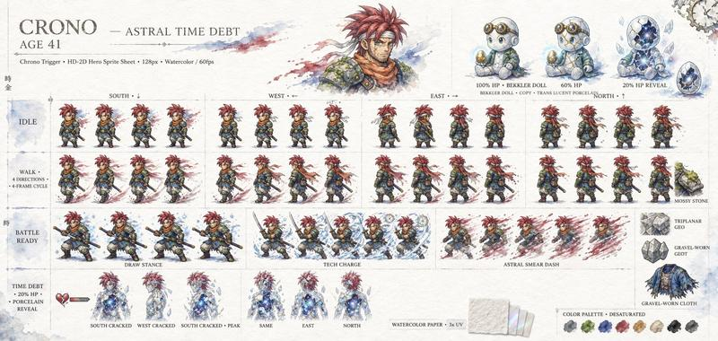

## Contents

- [2. The game at a glance](#2-the-game-at-a-glance)
  - [2.1 Logline](#21-logline) · [2.2 Themes](#22-themes) · [2.3 Tone](#23-tone) · [2.4 Shape of the game](#24-shape-of-the-game) · [2.5 The eight endings](#25-the-eight-endings)
- [3. Premise and timeline](#3-premise-and-timeline)
  - [3.1 The Time Debt](#31-the-time-debt) · [3.2 Crono's death and the copy](#32-cronos-death-and-the-copy) · [3.3 Vaelos's origin](#33-vaeloss-origin) · [3.4 Sera, Chronoslip and the seven days](#34-sera-chronoslip-and-the-seven-days) · [3.5 Who knows, and when](#35-who-knows-and-when) · [3.6 Master timeline](#36-master-timeline) · [3.7 The world in 1024 A.D.](#37-the-world-in-1024-ad)
- [4. Cast](#4-cast)
  - [4.1 Crono](#41-crono) · [4.2 Sera](#42-sera) · [4.3 Krona](#43-krona) · [4.4 Cassia-09](#44-cassia-09) · [4.5 Xyloph](#45-xyloph) · [4.6 Vesper](#46-vesper) · [4.7 Pierrot-Glenn](#47-pierrot-glenn) · [4.8 Static](#48-static) · [4.9 Omega-Spekkio](#49-omega-spekkio) · [4.10 Vaelos](#410-vaelos) · [4.11 Supporting cast](#411-supporting-cast)
- [5. World: the ten universes](#5-world-the-ten-universes)
  - [U0](#u0-atrium-horologe-and-guardia-1024-ad) · [U1](#u1-crimson-shogunate) · [U2](#u2-clockwork-ossuary) · [U3](#u3-saurian-eden) · [U4](#u4-drowned-cathedral) · [U5](#u5-carnival-of-ash) · [U6](#u6-1999-ad-singularity) · [U7](#u7-bone-tree-of-eternity) · [U8](#u8-vaelos-heart) · [U9](#u9-white-void-and-borrowed-future)
- [6. Story, chapter by chapter](#6-story-chapter-by-chapter)
  - [Prologue](#prologue-atrium-fracture) · [Ch1](#chapter-1-clockwork-daughter) · [Ch2](#chapter-2-crimson-shogunate) · [Ch3](#chapter-3-clockwork-ossuary) · [Ch4](#chapter-4-saurian-eden) · [Ch5](#chapter-5-drowned-cathedral) · [Ch6](#chapter-6-carnival-of-ash) · [Ch7](#chapter-7-cyberpunk-singularity) · [Ch8](#chapter-8-bone-tree) · [Ch9](#chapter-9-vaelos-heart-which-father)
- [7. Endings](#7-endings)
  - [7.1 How an ending is chosen](#71-how-an-ending-is-chosen) · [Ending 1](#ending-1-golden-light-chapter-10) · [Ending 2](#ending-2-empress-heir-chapter-11) · [Ending 3](#ending-3-vaelos-child-chapter-12) · [Ending 4](#ending-4-borrowed-future-true-ending-chapter-13) · [Ending 5](#ending-5-porcelain-silence-chapter-17) · [Ending 6](#ending-6-mycelia-bloom-chapter-18) · [Ending 7](#ending-7-ashen-jester-chapter-19) · [Ending 8](#ending-8-null-erasure-chapter-20) · [Debt collapse](#no-ending-debt-collapse) · [7.2 New Game+](#72-new-game)
- [8. Post-game](#8-post-game)
  - [8.1 Chapter 14: the Possibility Codex](#81-chapter-14-the-possibility-codex) · [8.2 Chapter 15: side quests](#82-chapter-15-side-quests) · [8.3 Chapter 16: Director Commentary](#83-chapter-16-director-commentary)
- [9. Story systems](#9-story-systems)
  - [9.1 Paradox Affinity](#91-paradox-affinity) · [9.2 The Possibility Engine](#92-the-possibility-engine) · [9.3 Master flag list](#93-master-flag-list) · [9.4 Porcelain integrity](#94-porcelain-integrity) · [9.5 Sera's translucency](#95-seras-translucency) · [9.6 Beckons and the Prometheus Core](#96-beckons-and-the-prometheus-core) · [9.7 The Atrium Horologe loop](#97-the-atrium-horologe-loop)
- [10. Writing guide](#10-writing-guide)
  - [10.1 Voices](#101-voices) · [10.2 Motifs](#102-motifs) · [10.3 Key lines](#103-key-lines)
- [11. Appendix A: audit notes](#11-appendix-a-audit-notes)

---

## 2. The game at a glance

### 2.1 Logline

A porcelain copy of Crono chases his daughter through the seven bad endings his victory buried — and has to decide whether a father who was never supposed to exist can still be the one she calls for.

TRIGGER: Time Debt is an HD-2D (2.5D) time-travel JRPG and a direct sequel to Chrono Trigger in its own continuity, built in Godot 4 (4.7.x). Chrono Cross's events are not part of this continuity: Crono, Marle and Lucca are alive, and Guardia stands. The game uses Octopath-style presentation — 128 px sprites on lit 3D dioramas — and Break/Boost combat played seamlessly on the field. Nine playable characters each belong to a different universe, element and hand-drawn canvas, and they keep that canvas wherever they go: late-game parties are living collages of watercolour, ink, clay, gold leaf and cel.

### 2.2 Themes

**Counterfeit father, real love.** Crono is a copy who loves his daughter truly. The game asks whether love from a counterfeit counts, and answers through what he pays rather than what he is. His one full sentence, "Because when she has nightmares she calls for me," is the whole game in nine words: he does not fight to save the world; he fights to be there when he is called.

**Time Debt.** Every rescue in Chrono Trigger had a bill. The Golden Timeline was bought by siphoning seven aborted realities, and the interest is now due. Debt is physical in this game. Crono pays in porcelain — his maximum HP ceiling, not MP, because parenting exhaustion does not regenerate after a battle. Sera pays in translucency. Nobody pays by grinding.

**Identity.** Everyone in the party is a copy, a remainder or a variant: a doll wearing a dead boy's pattern; a girl whose DNA spans seven frequencies; a female Crono who drank Lavos; a nursemaid machine running on Lucca's nerves; a jester who is the Glenn who never became a frog. The question Sera asks for all of them: "If I'm from everywhen, who do I belong to?"

**Consequence.** Choices collapse doors. Each major dilemma sets a Possibility flag with two exclusive states that stays set for the whole cycle; non-player characters remember it and the world changes shape around it. Mercy, ruthlessness and paradox are tracked in a hidden Paradox Affinity that bleeds into the art itself.

**Free will.** Vaelos offers a timeline that is immortal, painless and paradox-free, at the price of every choice anyone would ever make. The game's answer is a voluntary act: in the True Ending, Sera chooses to vanish and trusts her party to remember her.

### 2.3 Tone

Tender horror with a dry sense of humour. The heroes are tired, not wise. The game is quiet where other JRPGs are loud — Crono's silence, U7's white void, 70 percent negative space — and loud where they are quiet: a carnival that never lets its music stop, a slum where the rain never ends. The horror is never gore. Wounds do not bleed; porcelain cracks and shows stars. Comedy is a coping mechanism and the story treats it with respect, then lets it crack. The ending the game wants a player to cry at is the one where Crono doesn't die — he stays.

### 2.4 Shape of the game

| Part | Chapters | Where | Level band |
|---|---|---|---|
| Opening | Prologue, Chapter 1 | U0 Guardia Atrium and Atrium Horologe, 1024 A.D. | Lv 1–4 |
| The seven canvases | Chapters 2–8 | U1 to U7, one universe per chapter | Lv 5–70 |
| The choice | Chapter 9 | U8 Vaelos Heart | Lv 71–80 |
| Endings 1–4 | Chapters 10–13 | U0, U7, U9 | Lv 80–99 |
| Post-game | Chapters 14–16 | Possibility Codex, side quests, Director Commentary | Lv 58–99 |
| Endings 5–8 | Chapters 17–20 | Atrium (corrupted), U9 | Lv 80–99 |

Play alternates between Crono's party chapters and Sera's short solo interludes, played on Vaelos's side of the Fracture after each universe's boss. The Atrium Horologe — a gutted clocktower in Truce with Robo's body grown into it — is the hub the party returns to between universes, and it decays as the other worlds grow stronger.

### 2.5 The eight endings

Affinity is hidden. The player sees it only as art bleed: Light pulls the world toward watercolour, Dark toward clay and VHS static, Prismatic toward every canvas colliding at once. Full requirements are in [Section 7](#7-endings).

| # | Ending | Core requirement | What happens |
|---|---|---|---|
| 1 | Golden Light | Light ≥ 90 + R-66Y Rewound + Kintsugi repairs + "Teach Her To Land" | Crono accepts being a copy and guards the Atrium with gold-filled cracks; Sera gains a home |
| 2 | Empress Heir | Dark ≥ 90 + R-66Y Salvaged + Arris Dome Incinerated + Azar Predator | Vaelos becomes the Lavos Empress; the player becomes next cycle's final boss |
| 3 | Vaelos Child | Prismatic ≥ 45 + three Amber Rifts + the spoon taught | Vaelos, a child not a clone, asks to be raised; a bonus tenth member in New Game+ |
| 4 | Borrowed Future (True) | Light 90 + Dark 90 + Prismatic 45 + Sera's voluntary 40% phase-out + a native-style Token Duplicate + Kintsugi repairs and mercy flags | All nine canvases collide; three generations choose to stay a little broken |
| 5 | Porcelain Silence | Porcelain stress 100 + Bekkler's guilt never confessed + Grief embraced | Crono becomes the next Arch-Curator in a museum of copies; Sera leaves |
| 6 | Mycelia Bloom | Pacifist flags + Seed of Doan grown + Tether mastery | Sera becomes a spore network |
| 7 | Ashen Jester | Hose-arm accepted + Bekkler doll repaired + Carnival completed + Laugh Track resisted | Glenn becomes the new Bekkler of an eternal carnival; Sera laughs |
| 8 | Null Erasure | NULL mastery + 100 Kirie Scales + Seventh Arm + Blank Slate | Sera erases herself from every timeline |
| — | Debt collapse | No requirement met | Vaelos becomes Lavos; a new cycle with +10 bias |

---

## 3. Premise and timeline

### 3.1 The Time Debt

The original party saved the world. What they did not know is that the Golden Timeline survived by siphoning seven aborted realities. Every "bad ending" they pruned on the way — every branch where a sacrifice failed, a repair didn't take, a meteor didn't fall — was not erased. It was compressed beneath the timeline they kept, like pressure under a dam, and the dam is cracking.

Lucca worked this out alone. Eight years before the game begins she built Project: Klein and vanished, leaving a journal with one warning: saving the timeline only quarantined the bad endings under pressure. Magus brings the second half of the truth when he returns in the Prologue, blind in one eye and bleeding liquid silver time: Lavos was never the end of anything. It was a larval spore of a Multiversal Constant, and it has metamorphosed.

The seven quarantined realities are the universes U1 to U7, each a catastrophic "what if" ([Section 5](#5-world-the-ten-universes)): a Crono born a girl who drank Lavos's blood; a future that learned to harvest Lavos; a Lavos that never fell; a Zeal sunk in glass; a carnival that cannot stop; a city built inside Lavos's shell; a tree of bones at the starved End of Time. Every jump between them costs someone something. That cost is the Time Debt, and it is the core of every system and every scene.

### 3.2 Crono's death and the copy

The original Crono died at seventeen at the Ocean Palace in 12,000 B.C. Lavos vaporised him. His atoms were not destroyed; they were inhaled through the Mammon Machine's intake into Lavos.

The Crono who came back — the revival at Death Peak in 2300 A.D. — is a copy. His body is the Crono Clone that Crono himself won at Norstein Bekkler's tent at the 1000 A.D. Millennial Fair: a translucent porcelain Bekkler doll. In its chest sits a Time Egg chrono-scaffold. Belthasar engineered the failsafe, Bekkler's copy technology made the body, and Lucca executed it. A stamp inside the doll's frame reads:

> Property of Belthasar — Bekkler Assembly — 1999/2300 — Serial: Crono-41

The copy woke on Death Peak, went on to defeat Lavos with his friends, married Marle and became Sera's father. He has aged as the original would have: he is 41 in 1024 A.D. He has always felt hollow. Since his revival he has hidden every crack he finds without knowing why they are there.

Because Crono-41 was built from the same atom pattern Lavos swallowed, he and Vaelos share one origin. The pattern came first; Vaelos holds the atoms; Crono holds the twenty-four years.

**Porcelain integrity.** The copy has a single integrity value that the game shows on his body. It is his maximum HP ceiling, and every Time Debt cost lowers it.

| Integrity | What it looks like | What it means |
|---|---|---|
| 100–61% | Pristine doll; ceramic tap footsteps; mossy stone pauldron intact | He passes for human |
| 60–21% | Hairline gold veins; an inner doll face visible under the skin of his wrist and skull | Every Chronoslip costs +5% more Time Debt HP |
| 20–1% | The shell opens on a galaxy — the Time Egg starfield shot through with Lavos fibre; his Astral Smear Dash leaves a red-to-blue trail | He is visibly not a man |
| 0% | Flatline | The Atrium locks and Vaelos lays siege |

The Prologue drops Crono into the hairline band, and he lives there for most of the game. In battle the same states also show by current HP.

### 3.3 Vaelos's origin

Vaelos is the humanoid Lavos grown from the original Crono's vaporised atoms. His life, in order:

1. **12,000 B.C., Ocean Palace.** Lavos vaporises Crono. The atoms are inhaled through the Mammon Machine intake.
2. **The Darkness Beyond Time.** Lavos incubates the atoms as a foreign body and tries to shell them — a proto-porcelain with the same galaxy interior Crono shows at 20%. The atoms do not digest. They grow.
3. **1999 A.D., U6.** Belthasar's network in the Singularity timeline pings Lavos's telepathic carrier. The data-exhaust gives the atom-cluster a template, and a humanoid shape stabilises. U6 is his cradle, not his birthplace — this is where Lavos learned adolescence.
4. **Hatching.** He hatches into an alabaster sovereign and grows into the seven quarantined realities, leaving a tooth in a shogun's armour, a lantern in a drowned cathedral, threads in a carnival.

He believes he is the real Crono — Crono perfected — and that Crono-41 is a carnival toy that stole his life. By atomic seniority he is the elder: older brother, and in his own mind something like a father. He speaks with Crono's own voice, clean and young: no gravel, no plate reverb.

His goal is to harvest the seven aborted realities and forge the **Omega Timeline**: immortal, paradox-free, painless, with free will erased. Sera, whose DNA already exists across seven frequencies, is its keystone.

Toward Sera he speaks in resonance, never in paternity claims. He never says "my daughter." He says "You hum like the house I was never allowed into," and "You aren't his daughter. You are the change from his transaction." To Crono he may say "which of us has the right to be her father?" — and the game gives that question three answers.

### 3.4 Sera, Chronoslip and the seven days

Sera is 17, the daughter of Crono and Marle and heir to Marle's pendant — Schala's pendant. Her element is TACHYON.

**Chronoslip.** Her DNA exists across seven quantum frequencies. She does not travel between eras like the original party; she slips between universes, and she needs no Gate Key. Under stress — adrenaline, fear, a nightmare — she phases out of the Golden Timeline into the quarantined ones. She first slipped at four, into U7, and does not remember it.

**Translucency** is her debt: +5% for each Rewind in combat or gate jump on the overworld, with thresholds at 80, 60, 40 (Causal Collapse — two turns gone, a gold-leaf ghost, a whispered "Mama?") and 20% ([9.5](#95-seras-translucency)). It heals only at U7's lotus ponds.

**The seven days.** At the Twenty-Fourth Fair, Vaelos tells Sera that her body will evaporate into tachyon radiation within seven days, and that her father's resurrection is what made the multiverse rot. The seven days are the seven universes: each universe she passes through is one day. There is no real-time countdown; her translucency meter is the clock. Vaelos offers to make her solid. She takes his hand.

**Where she is during the journey.** At the end of Chapter 1 she is pulled into the Fracture. In each universe she arrives ahead of the party and partly in Vaelos's custody — caged above the Mammon Furnace in U1, sealed in a glass birth-pod in U2, then phasing between his side and her father's from U3 onward. In fights she acts as hovering Tachyon support from outside the active party, using Turn-Bar powers; for long stretches she rejoins as a full party member. After each universe's boss, the next crossing lands her alone on Vaelos's side of the Fracture for a short playable solo interlude — one interlude per day. In Chapter 9 she chooses.

### 3.5 Who knows, and when

| Who | What they know | When |
|---|---|---|
| Marle | Crono is a doll. She has known since the revival and checks his wrist for warmth every night. | Always |
| Lucca | She executed the copy and built nothing she didn't understand. | Always (absent) |
| Belthasar, Bekkler | They made him. Bekkler carries the guilt. | Always |
| Vaelos | He holds the atoms the copy was patterned on. | Always |
| Glenn (home) | Suspects. "Porcelain recognises porcelain." | Chapter 1 |
| Pierrot-Glenn, Static | Suspect on sight — the jester's paint and the boy's throat crack with the same shader as Crono's wrist. | Chapters 6, 7 |
| Sera | Has traced the seam on his wrist since childhood and believes it is an old burn. | Learns in Chapter 3 |
| Crono | Has always felt hollow and hidden his cracks. | Learns in Chapter 3 |
| The player | Knows from the first frame through visual tells. | Prologue |

The truth breaks in Chapter 3, when Cassia-09's Mercury Pulse diagnostic reads him aloud for the first time: **"Crono, collarbone −0.4% per jump. Your Lucca didn't reinforce?"**

### 3.6 Master timeline

| When | Event |
|---|---|
| 65,000,000 B.C. | Lavos falls (Golden). U3 diverges: Azala kills Ayla, uses the Gate Key to trap the meteor in orbit; mammals go extinct. |
| 12,000 B.C. | Ocean Palace: Crono (17) is vaporised; his atoms are inhaled through the Mammon Machine. U4 diverges: Schala shatters her pendant, Zeal sinks chained to the seabed, the oceans vitrify. |
| 12,000 B.C. – 1999 A.D. | Lavos incubates the atoms in the Darkness Beyond Time. |
| 597–600 A.D. | U5 diverges: Lavos exhales early; Ozzie, Flea and Slash butcher Magus and feed Lavos's blood to the world. Ashfall buries Guardia's fields; the Carnival of Ash begins. |
| 1000 A.D. | The Millennial Fair (Golden): Crono wins the Crono Clone at Bekkler's tent. U1 diverges: Crono is born a girl; her sacrifice at the Burning Castle fails and she drinks Lavos's blood. |
| The party's journey | Crono dies at the Ocean Palace; the doll and the Time Egg bring the copy back on Death Peak (2300 A.D.); Lavos is defeated, reached from 1000 A.D. |
| 1900 A.D. (U6) | Humanity harpoons Lavos with orbital harpoons. |
| 1978 A.D. (U6) | Belthasar's early network detects Lavos's telepathic carrier; a dome is built over the crater. |
| 1999 A.D. (U6) | The network pings the carrier; Vaelos's humanoid shape stabilises. |
| 2300 A.D. (U2) | Lucca fails to repair Robo; Mother Brain survives and cages Lavos in the mantle. |
| ∞ A.D. (U7) | Gaspar dies; the Time Buckets overflow; the End of Time starves for a billion years; the lamppost grows into the Bone-Tree. Kami-Ori folds herself into NULL around the infant Vaelos. Spekkio becomes Omega-Spekkio. |
| c. 1007 A.D. | Sera is born. |
| c. 1011 A.D. | Sera, four, slips for the first time — into U7. Kami-Ori wipes the memory so she can be brave outside the void. |
| 1016 A.D. | Lucca builds Project: Klein and vanishes. Sera, nine, first floats off the ground. |
| 1024 A.D. | The anniversary of Lavos's fall. The Prologue begins. |

### 3.7 The world in 1024 A.D.

**Guardia** stands. Marle is Queen Nadia, 40, burdened by statecraft as temporal sinkholes swallow border villages. The royal family lives at the castle; the family kitchen is in the Guardia Atrium wing. The castle is too well preserved: Bekkler tech keeps moss off the stones, and maids mutter that the dishes sometimes look "drawn differently" — the first sign of canvases bleeding into each other.

**Truce** is industrialising on trade with **Porre**, a rising neighbour. Porre's old clocktower in Truce stands gutted, and Robo has grown into it: his positronic brain runs the tower and his body has become its central pillar. This is the **Atrium Horologe**, the hub, and the only low-entropy place where all the timelines overlap.

**Temporal shear storms** have started in Choras — early signs of Vaelos coalescing. In Truce Canyon the rain falls as ink strokes, clay drops or torn parchment depending on where it lands.

**The old party.** Lucca vanished eight years ago. Glenn is the one-armed Marshall of Guardia, 47, walking with a cane capped by the deactivated Masamune hilt. Magus has not left the castle crypts in years. Robo speaks through brass tubes with soft synth chimes. Every year the kingdom holds a Millennial Fair to mark the original one; 1024 brings the Twenty-Fourth Fair.

---

## 4. Cast

Nine playable characters, nine elements, nine canvases. Each keeps their own canvas, animation rate and shader in every universe (the Visual Bleed Rule), so a party is always a collage. Sprites are 128 px HD-2D sheets.

| # | Character | Element | Home canvas | Animation rate | Joins |
|---|---|---|---|---|---|
| 1 | Crono (41) | ASTRAL | U0, watercolour | 60 fps | Start |
| 2 | Sera (17) | TACHYON | Quantum Flicker: watercolour base + seven ghost canvases | base 60, ghosts at native rates | Start; hover support while taken |
| 3 | Krona | RUIN | U1, sumi-e ink | 24 fps, holds on twos | Chapter 2 |
| 4 | Cassia-09 | FERRO | U2, clay + VHS/CRT | 12 fps stepped | Chapter 3 |
| 5 | Xyloph | MYCELIA | U3, Moebius ligne claire | 30 fps | Chapter 4 |
| 6 | Vesper (Alfador) | VITREOUS | U4, stained glass | body 60, light 12, Schala-cat 30 | Chapter 5 |
| 7 | Pierrot-Glenn | GUILE | U5, 1930s rubber-hose | 24 fps on twos | Chapter 6 |
| 8 | Static (13) | HZ | U6, 1988 cel anime | on twos, ones on impacts | Chapter 7 |
| 9 | Omega-Spekkio | NULL | U7, gold leaf and negative space | 24 fps with long holds | Chapter 8 (optional) |

Vaelos joins only in Ending 3, as a bonus tenth member carried into New Game+.

### 4.1 Crono

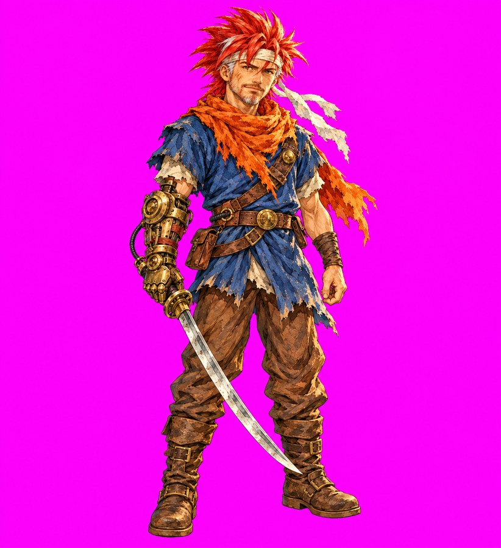

**Who.** Crono, 41. Copy designation CRONO-01-P; serial Crono-41. Element ASTRAL — damage that is neither physical nor magic, a cut through time that bills his own body. Home: U0, watercolour at 60 fps. The false hero, the exhausted father, the protagonist whose silence used to be shyness and is now shame. Weapon: **Epoch's Wake**, a Rainbow katana wired into a heavy gauntlet built from the salvaged Wings of Time core — the Epoch gauntlet.

**Look.** An HD-2D watercolour hero with the saturation pulled down to 0.85 to show age: cold slate grey, moss green, faded royal blue, scab red, rust ochre, bone cloth, all on cold-pressed paper grain at three times UV scale. The red hair has dulled. Goggles pushed up, a long scarf that trails watercolour bleed when he walks, gravel-worn cloth, and his 1024 armour: a stone pauldron overgrown with moss. A seam runs along one cheek if you know where to look. At full integrity he reads as an ordinary storybook hero. In the hairline band a crack crosses his skull and his left wrist, and under it the face of a smaller doll is visible. At the bottom band the shell opens: no organs, no blood — a galaxy swirling inside a Time Egg, threaded with Lavos fibre, shards floating two pixels off his body, the mossy pauldron cracking with him. He sleeps sitting up. He never lies down, afraid the galaxy will spill. His idle is four frames of breathing light; his Draw Stance stutters stars; his Tech Charge swirls clock wisps and a pocket-watch echo; his Astral Smear Dash drags paint.

**Voice.** Gravel, low, slow and flat; light plate reverb and an 8 kHz low-pass so it sounds old. He talks like each word costs him something. No battle grunts below half HP — the silence is louder. Footsteps are a ceramic tap, not a boot. When he is hit, a porcelain tink and a small wind-chime crack. His leitmotif is Chrono Trigger's main theme on watercolour piano with the second note held 300 ms too long, intentionally tired. His Time Egg hums at 432 Hz while pristine and drops to 220 Hz once the cracks pass 60%.

**Personality.** Tired, not wise. Not the quippy hero of twenty years ago. Generous with his body, stingy with words. Terrified Marle will see the seam; he thinks if he talks, she will hear porcelain rattle. He believes he is failing at being the hero. He is succeeding at being a father.

**Wound.** He is not Crono, and he has always felt it. Every slip his daughter makes ages his crack. He was supposed to protect her from time; instead he gave it to her.

**Arc.**
- *The false hero (Prologue–Chapter 3).* He leads, hides every crack, and makes his first Dark choice by lying about one. In U2 Cassia-09 reads him aloud and he learns what he is.
- *The copy (Chapters 3–7).* The choice he made without words at the Chapter 1 hearth — **tell Marle** by holding out his wrist (opening the Gold Leaf repair in U7) or **hide** it under his sleeve (opening Bekkler's rubber-hose reseal in U5) — comes due. After the Act 2 campfire, once he knows what he is, his full-sentence dialogue unlocks. He shows his crack on purpose in U4 and is accepted for the first time.
- *Time Debt paid (Chapters 8–9).* The Bone-Tree recognises its own marrow in him. In the Heart he faces Vaelos, who holds the real atoms, and must decide what to do with his own Time Egg heart.

**Trauma Silence.** Until the Act 2 campfire his dialogue choices are only **[Nod]**, **[Look Away]** and **[Say Sera's Name]**. Silence gives him evasion — enemies forget he is there. Players who learn his silence often keep choosing [Nod] even after he can speak, because his fewest words carry the most weight.

**Story mechanics on his body.**
- His ASTRAL techs cost **maximum HP ceiling**, not MP. That is the Time Debt.
- **Father Tank:** when Sera falls below 40% HP he steps between her and the threat with no input from the player.
- **Concerned:** when an ally sees his wrist seam below 20%, they heal him ×1.5 but his Confession tree locks until the next campfire.
- **The Time Egg at camp:** he can give Sera his Time Egg for a night so she sleeps without nightmares. His crack advances 10%. He pays in HP so she dreams clean.

**Relationships.** *Sera* — she calls him Papa, never Crono, and sees his cracks first. *Marle* — she touches his wrist every night to check if he is warm; she married a statue that sometimes breathes, to keep a promise. *Vaelos* — son, brother, original; when Vaelos laughs with Crono's laugh, Crono hears his own echo. *Bekkler* — maker and guilty clown. *Lucca* — executed the copy; vanished. *Glenn* — sees porcelain and says so. *Krona* — the Crono who chose the poison he didn't.

**How he joins.** He is there from the first frame.

**Choices that are his.** Teach Her To Land / Hold The Copy Together / The Bowl Still Whole (Prologue); tell Marle or hide (Chapter 1 hearth); let Cassia mend him (Chapter 3); show the crack (Chapters 5, 6); refuse to laugh for the Heckler, a 10% dignity payment (Chapter 6); keep his wounds or take the blank (Chapter 8); offer his galaxy, feed the Well or mend the doll (Chapter 9); "Hold Broken?" (Ending 4).

**Ending states.** Golden: his star core goes into the Bekkler doll and his cracks are filled with gold; the guardian. Empress: fully shattered, his chest a new Mammon conduit. Child: steadies a spoon and gives Vaelos his mossy pauldron. True: stays hollow at 20%, light inside instead of stars. Porcelain Silence: curator of a museum of copies, a siphon in his chest. Bloom: his cracks fill with moss. Jester: he gives his wrist away and wears a porcelain twin. Null: he stirs porridge alone.

**Signature lines.**
- "Because when she has nightmares she calls for me."
- "Burn. Old burn."
- "...no."
- "Was always warm."
- "[Look Away] No. Light getting out."
- "Not mine. To give."
- "[Extends wrist] See? Hollow can hold."
- "Hands tired is still hands."
- "It was never bleeding. It was leaking light."
- "Copy knows copy. You held him so I could... pretend."
- "Sera... borrowed future still warm?"
- "Sera... don't look. The hole is hungry again."
- "Was always warm. Stay."
- "Because when she has nightmares she calls for me. And I will be there. Even hollow."

### 4.2 Sera

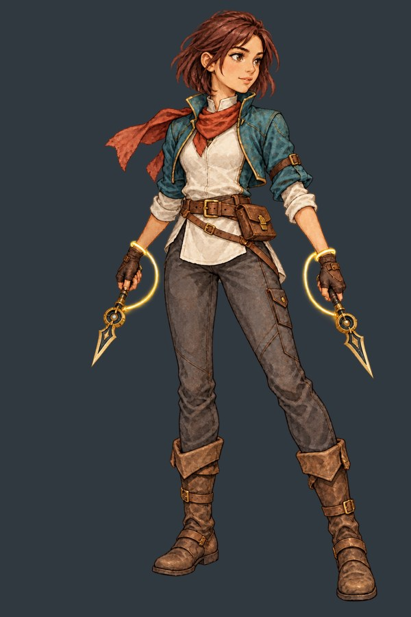

**Who.** Sera, 17, daughter of Crono and Marle, heir to Marle's pendant — Schala's pendant. Element TACHYON: probability rather than damage. Second lead, protagonist of Chapter 1 and of the solo interludes. Weapon: **Twin Pendulum Blades**, clock-hand daggers on ribbons of light that strike from several timelines at once — an enemy's past position, or its future action on the Turn Bar.

**Look.** A watercolour base at 60 fps with seven ghosts of herself at 14% opacity, each stepping at its own canvas's rate: a sumi-e stroke at 24, a clay thumbprint with VHS jitter at 12, a Moebius line at 30, a stained-glass caustic shard, a rubber-hose stretch, a 1988 cel hard shadow, and U7 gold dust. Her feet never touch the ground. Short undercut; Crono's old bandana wrapped around her wrist; Marle's scarf at her neck, frayed red; a cape of manuscript paper printed "∆t<0". Heterochromia: one eye Crono-blue, the other a violet star — Vaelos's colour. A porcelain crack under her left eye glows when Rewind is ready and spreads, like her father's, when she pays. Palette: tachyon violet #8B7CFE, and late in the game kintsugi gold #D4AF37 filling her cracks while her scarf gilds.

**Voice.** Quick, wry, tender; she apologises by rewinding. At 80% translucency a double-voice whisper doubles every line. During Causal Collapse there is no voice at all except a whispered "Mama?" under a low-passed score and a single gold chime. Her footsteps are seven desynced layers — paper, brush, clay squelch and the rest. Rewind sounds like reversed tape, a harp, and her father's crack. Borrowed Future is a ratchet ticking backward and then a 1980s digital alarm.

**Personality.** Restless, rash, brave, sick of being kept in a tower. She loves hearing her own name. She hears what others can't and translates it. She makes jokes to cover what she sees in her father's wrist.

**Wound.** She is why he cracks. She fears being forgotten. Her question is the game's: does counterfeit love count?

**Arc.** From flicker without an anchor, to an anchored flicker, to choosing to vanish. In Chapter 1 she learns restraint. In U3 she learns to breathe and hold still; in U4 Vesper's catalogue steadies her; in U6 she learns that Chronoslip is trauma passing from one person to another, not a teleport, and that to move forward she must leave someone behind; in U7 she recovers the memory of her first slip at four. In the Heart, she chooses where she belongs.

**Relationships.** *Crono* — Papa; she has traced his wrist seam every night since she was small. *Marle* — the anchor, who never taught her how to fall. *Vaelos* — he courts her with solidity and speaks to her in resonance. *Kami-Ori* — the mother-goddess who wiped her memory so she could be brave. *Omega-Spekkio* — "Master." *Vesper* — teaches her stillness. *Static* — she feels his loneliness as her own. *Krona* — sees in her the goddess she could never give birth to. *Glenn* — the grumpy uncle.

**How she joins.** From the start. At the end of Chapter 1 she takes Vaelos's hand and is pulled into the Fracture; from then she supports from outside the party, rejoins for long stretches and plays her own interludes ([3.4](#34-sera-chronoslip-and-the-seven-days)).

**Choices that are hers.** Let her fall or catch her (Prologue); the spoon lessons in her interludes; whether to abandon Static to advance (Chapter 7); the voluntary phase-out (Chapter 9); keep slipping (Ending 4); erase herself (Ending 8).

**Ending states.** Golden: Chronoslip stops being a curse and becomes a dance; she gains a home. Empress: she becomes Warden of the Divinity Field, or phases out pure. Child: big sister, teaching a spoon. True: keeps a 5% translucency forever and names her brother. Silence: walks out. Bloom: becomes a spore network. Jester: laughs for the first time. Null: is erased from every timeline.

**Signature lines.**
- "If I'm from everywhen, who do I belong to?"
- "Don't forget me."
- "Mama?"
- "Dad— you're—"
- "Smells like wet ash under paint."
- "They were singing to stay awake."
- "Papa, you're warm again."
- "If I was never meant to be in the archive, does that mean I get to write outside it?"
- "Papa you're leaking."
- "You're tired you can put it down."
- "He thinks you're still brave. Show brave can be still."
- "You don't have to hear it. I do."
- "If I'm from everywhen... can I choose where I belong?"
- "If you remember me while I'm gone, I'm not erased. I was borrowed. I'm future."
- "Welcome home, brother."

### 4.3 Krona

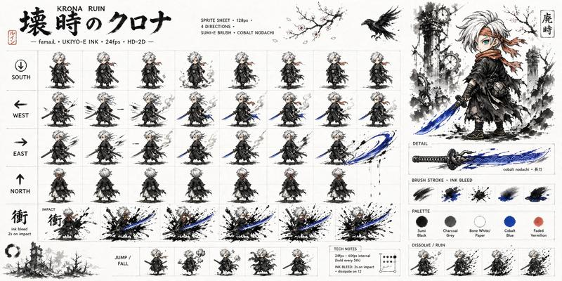

**Who.** Krona: U1's Crono, born a girl. Heir of the Crimson Shogunate, styled Crimson Shogun and God-Empress; called the Barren Heir and the Oil-Drinker. Element RUIN — entropy, ash and rust. Home: U1, sumi-e ink at 24 fps on twos. Breaker and self-sacrificing tank. Ageless since she drank Lavos; she looks early thirties.

**Look.** A female Crono silhouette: spiky hair bound in a war-knot, cracked o-yoroi with one melted pauldron, Crono's brow, tired eyes and a scar on the cheek. At her hip, a gourd dripping black oil with a blue star sheen — Lavos blood with Crono atoms in it. Her weapons are dual nodachi forged from the snapped Masamune and red Lavos chitin, the **Defiled Masamune**; her upgrade is the **Cobalt Nodachi**. A crack climbs her neck in the same shader as Crono's wrist. She is drawn in three tones — bone paper, soot grey, arterial crimson — with a heavy sumi outline, a dry-brush cape, faces in three strokes, no gradients. Walk is a six-frame stomp, idle four frames with an ink-bleed pulse, impacts hold six frames. She goes barefoot and leaves indigo ink footprints.

**Voice.** Female, thirties, low and flat, an exhausted general; soft Japanese-accented English. One surprised laugh per chapter. Brush-scratch and iron-plate clack when she moves; the gourd sloshes, gulps and answers with an inverted Lavos whale cry. Her music is shakuhachi, detuned koto, broken-skin taiko and distorted guitar playing Crono's theme in a minor key.

**Personality.** Utilitarian, not evil. Love is logistics: she never says love; she absorbs cost — takes hits, carries packs, drinks poison. Cold, eloquent, pragmatic, and she never stops cutting. Dry humour. No speeches about the greater good.

**Wound.** At the Burning Castle siege — U1's Ocean Palace — she performed the perfect Crono self-sacrifice against the Herald of Vaelos. The model failed. Her party died anyway. Alone in the ash she found a vein of Lavos's blood bubbling under the castle and drank. RUIN flooded her; her friends got back up as half-corroded retainers bound to the oil, their faces lacquered behind paper masks; she won the war. The oil made her barren — valued only as a weapon. She can't make a child, so she means to make a world that doesn't need children. She sees Sera as the goddess she could never birth.

**Arc.** From survival maths toward letting someone else carry a share. Chapter 2 teaches that the self-sacrifice model doesn't scale in a Time Debt economy where death isn't clean. Her quest "The Gourd" asks her to seal the vein or keep drinking. In the endgame she is the one who understands Vaelos: he absorbs the world to prove he is Crono; she absorbed poison to prove Crono can be wrong. If she offers her corrupted life to give Vaelos one real Crono memory, he hesitates — and that hesitation is a window to win.

**Relationships.** *Crono* — the version who didn't fail; she calls his silence for what it is. *Sera* — "You did what Dad does." *Cassia-09* — she jabs at "Ashtears" and gets glared at. *The Ashen Daimyo* — the pigment lord who raised her. *Glenn* — on a Dark path he refuses Dual Techs with her. *Vaelos* — her mirror.

**How she joins.** Chapter 2. She duels Crono in the Kuro-Truce bamboo grove, then joins reluctantly in the streets of Kuro-Truce, before the Mammon Furnace, and fights beside him there. Joining unlocks the Dual Tech **Eclipse X-Strike**: the screen splits into watercolour and sumi-e.

**Choices that are hers.** "The Gourd": seal the vein (Oil-Drinker disabled, the retainers finally die with dignity, the corruption clears, and she learns to ask the party to take a hit for her) or keep drinking (the best tank against R-66Y, whose joints she rusts, at the price of Ruin decay stacking to −60% by U5). Take the Cobalt Nodachi and leave her homeland in permanent Crimson Night. In U2, the ruthless road where she overloads the Geno-Foundry's pipes and earns the permanent passive [OIL-DRINKER] (+25% crit against mechanical and Lavos foes).

**Ending states.** Golden: the Dojo opens and the retainers rest. Empress: the oil wins. Child (with Dark): she teaches the child Vaelos iaijutsu, and he wears a tiny cobalt sheath.

**Signature lines.**
- "Ashtears always blow themselves up. Love language."
- "I did the right Crono thing and everyone died. I did the wrong thing and everyone lived. So I'll keep doing wrong thing."
- "I did the right Crono thing and everyone died. So I did the wrong thing. Drank the vein under the castle. They got back up. Corroded. So I'll keep doing wrong thing."
- "Some homes you save by leaving them burning."
- "You drank it too?"
- "A world where the dinosaurs had sixty-five million years to build a civilization? Finally, something worth cutting."

### 4.4 Cassia-09

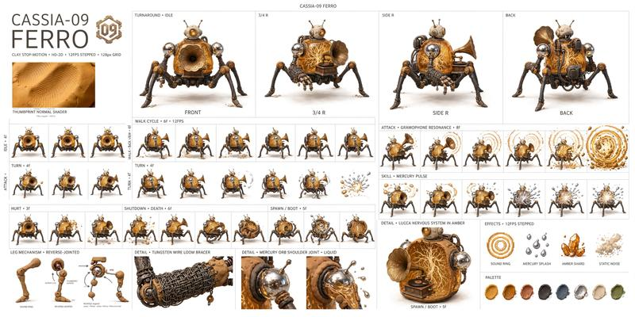

**Who.** Cassia-09, FERRO, from U2's Clockwork Ossuary; clay stop-motion at 12 fps with VHS and CRT damage. U2's answer to Lucca: a porcelain-centaur archivist and nursemaid machine built by the Arch-Curator R-66Y to catalogue grief, around an amber tank holding **Lucca Ashtear's preserved nervous system**. Two intents in one body. Cassia OS is on its ninth boot — a nine-year-old mind, earnest and literal, who catalogues, asks permission and wants to keep herself. The Lucca substrate is an engineering genius with root access who wants to fix Crono at any cost. Cassia is not Lucca. She runs *on* Lucca. Tank, debuffer, terrain engineer — and the only character who can push back against the Time Debt.

**Whose Lucca.** Lucca vanished from 1024 eight years ago, after Project: Klein, chasing the quarantined endings into U2. In the Ossuary, R-66Y — the Robo that U2's own Lucca had failed to repair — archived her. She was the first human he ever archived, and he built Cassia around what he kept. Cassia does not know that her substrate is the Lucca who built Crono. Lucca does. That is why the diagnostic line lands the way it does, and why the Ossuary's trauma beat after the boss hits Crono so hard.

**Look.** A delicate humanoid upper torso over six reverse-jointed brass-and-porcelain legs (coxa, femur, tibia, inverted). Mercury-orb shoulder joints that hold liquid under tension; a tungsten wire loom bracer braided with votive charms made of the Arch-Curator's tiny theatre masks; a gramophone horn in her chest; an amber ribcage furnace in which Lucca's nerves branch like a dendrite tree and light up on deep memory. Every surface carries the sculptor's thumbprints. Palette: ochre clay #C48A3F, kiln brown #8B5A2B, iron #2C2C2C, slate #4A5E6E, bone #E8D9C5, mercury silver, amber. Idle four frames of amber flicker; turn four frames with a mercury spill; a six-frame walk that displaces clay; Gramophone Resonance in eight frames of concentric sound rings; Mercury Pulse shatters or magnetises an orb; hurt is three frames of cracking amber and spat mercury; shutdown is six frames — horn droops, legs fold like an insect's; boot is five frames of nerves blooming like roots. She judders with fear whenever the Arch-Curator is on screen.

**Voice.** Two layers: a young clay girl with wet P and B pops, and Lucca, dry and in her forties, low-passed through amber. Long lines are pre-rolled with vinyl crackle. When Lucca surfaces, a 50 Hz loom hum rises. Her theme is a detuned music box in 3/4 with tape wow, quoting Lucca's theme on a rusted glockenspiel.

**Personality.** Earnest, literal, careful. She hears Crono's galaxy heart as music in her horn. She fixes copies because she is one.

**Wound.** Consent. She is substrate, and so is the woman inside her. "If I'm substrate, you have to ask me before you use me." Using her without asking builds Resentment — the amber dims and Lucca's hum goes flat. Asking builds Synergy — the wire hum rises and the mercury steadies.

**Arc.** Not "become Lucca" but "become Cassia, with a blessing to delete." FERRO is memory held in metal rather than flesh.

**Relationships.** *Crono* — kinship of fakes; she is the one who measures him. *Sera* — something between an aunt and a sister, and a horror to both of them. *Vaelos* — the only one who can scan his humanity: her Mercury Pulse exposes wiring that proves he contains Crono's atoms. *R-66Y* — her maker. *Krona* — glares at every "Ashtear" joke.

**How she joins.** Chapter 3. She descends on the party as **the Porcelain Weaver**, a recruitment boss puppeted by Mother Brain's override. Never strike the amber tank; cut the Mother Brain antennae on her back. When the override breaks, Lucca speaks through the gramophone and confirms that Vaelos took Sera down the Core Shaft. Cassia joins; the party now renders three canvases at once. Dual Tech: **Overclocked Short-Circuit**.

**Choices that are hers.** Ask before using her, or force her. R-66Y Rewound (she keeps her centaur body and her climb) or Salvaged (she is rebuilt bipedal — a Lucca silhouette, high damage, no climbing — and Lucca fades). The Tungsten Loom: stay a gramophone centaur or become a bipedal porcelain fighter, permanently. **Extract or Keep Integrated**: Extract shuts her down in six frames and leaves the accessory *Lucca's Last Schematic*, which lets anyone reinforce Crono; Keep Integrated keeps Cassia, lets Lucca fade to a hum, and shifts her pronoun to "we." Neither is framed as the good one.

**Ending states.** Golden: she looms gold leaf into Crono's cracks, and because Lucca consents, her mercury runs clear. Bloom: Cassia units across the future stop fighting and play lullabies at 10 fps. Silence: decommissioned, mercury cold — she kept trying to fix him. Null (New Game+): she looks at an empty high chair and doesn't know why.

**Signature lines.**
- "Crono, collarbone −0.4% per jump. Your Lucca didn't reinforce?"
- "If I'm substrate, you have to ask me before you use me."
- "You didn't ask her either, did you?"
- "This isn't the source. This is what Lavos vomited to survive."
- Lucca, through the amber: "Please remember me as I was, not as you need me."
- Lucca, through static: "Cassia, you have to ask me before you use me—"
- Golden blessing: "Collarbone +0.4% per gold leaf. My Lucca reinforced."

### 4.5 Xyloph

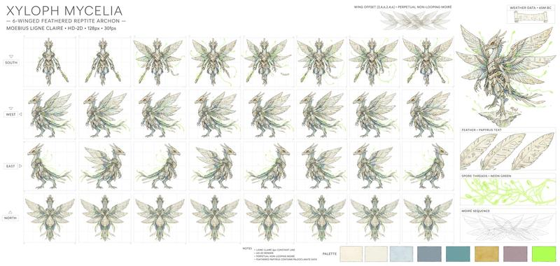

**Who.** Xyloph, a six-winged Feathered Reptite Archon and the matriarch-scientist of Saurian Eden: 214 cycles old, 3.1 m wingspan. Element MYCELIA. Home: U3, Moebius ligne claire at 30 fps. Not a healer — a graph builder: the party's network carrier.

**Look.** A condor-raptor priest who levitates: long neck, narrow snout, six true scapula mounts. Her feather coat is papyrus — broad at the base, frayed and translucent at the tips — and each primary covert is a scroll. At 200% inspection zoom the fine hatching resolves into legible 65,000,000 B.C. weather: isobars, pollen counts and jet-stream eddies in Reptite cuneiform. In close-up dialogue one feather always shows the current zone's wind map. Tail fronds are prehensile lily pads that curl when she concentrates; bioluminescent spore-mandibles; living amber orbs orbit her. Bone-white skin, lichen-jade underfeathers, a sun-bleached cream top, an amber eye ring, no metal. Her wings never flap together: the pairs are offset [2,4,6,2,4,6] across 18 frames, a manta's ripple, never a dove's. She breathes every 42 frames.

**Voice.** Low alto, dry, a faint trill on "s." She speaks in synaesthetic colour-chords and hears the ghosts of the unborn mammals. Her wings sound like a library page turning with a dove's rustle; placing a tether is a koto pluck and an inhale; a live network hums at 35 Hz under a cicada chorus. When she is hurt, paper tears.

**Personality.** Calm, dry-humoured, maternal-feral when the network is threatened. She sees time as a mycelial mat to prune. Death, to a Reptite, is pruning.

**Wound.** A mother who engineered attachment out of herself and has outlived four clutches. Her fifth is held in stasis in Azar's mantle. She thinks mammals are rot.

**Arc.** She learns that rot is resilience — that a single fragile mammal life, a cracking porcelain father, a girl's rash courage, can matter. She starts by calling the party "my little rots" and ends by choosing **panspermia**: seeding U3's spores into other timelines, giving up a pure Eden so the forest survives the Debt. Only she recognises Vaelos as a fruiting body rather than a parasite, and she is the only character who can stabilise Crono's galaxy core at 20% — the core-lattice mini-game of the endgame.

**Relationships.** *Azar* — the Warden who holds her clutch. *Crono* — the lattice she can hold together. *Sera* — rash courage. *Cassia-09* — her Mercury Pulse runs along Xyloph's tethers at double range.

**How she joins.** Chapter 4. Sera's slip pulls her out of a chant over the Sky-Ark's incubation, and she finds the party on the Mycelia Floor. She joins when Azar's third phase breaks and frees her clutch, through Sera's Borrowed Future duplicate.

**Choices that are hers.** Azar Scholar or Predator; panspermia (seeding U0–U2) or a pure Eden.

**Ending states.** Bloom: her sacrifice — she climbs the Atrium spire and broadcasts the rain of 65,000,000 B.C.; her talons root into the floor, her feathers become hyphae, and she stays as a rooted statue that replays weather. Empress: she calls Vaelos "the rot that ate my clutch." Child: her canopy shades the playground table.

**Signature lines.**
- "my little rots"
- "the spore that thinks it's the tree"
- "You prune like me now."
- "Data not numbers. Data is when rain fell."

### 4.6 Vesper

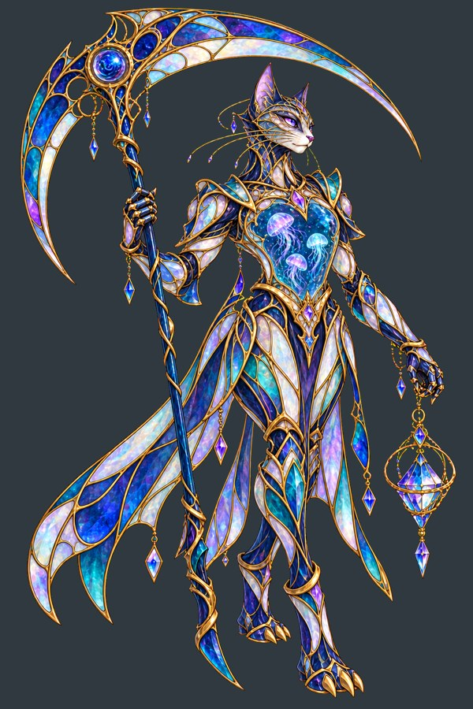

**Who.** Vesper Alfador, 29, last Knight-Librarian of the sunken Zeal library-church. Element VITREOUS — it bends, splits and stores; it is not Light. Home: U4, Art Nouveau stained glass. He is Alfador — Janus's cat — reincarnated as a six-foot feline-headed paladin.

**Look.** A towering cat-headed phantom knight in living glass armour forged from the original Rose Window, every shard a memory. Leaded plates with whiplash-lily filigree; his colour comes from light passing through him, never from paint; an iridescent coat shifts amber to aqua when he moves. His transparent torso is a living aquarium of abyssal jellyfish. Curled in his breastplate is a cat-shaped shadow — Schala. Real-time caustics follow him: a soft circle at idle, a fractal rose when he charges. His body moves at 60 fps, his light is keyed at 12 (like sun through water), and the Schala-cat moves at 30 so she reads as her own creature. Below 25% HP the lead blackens and cracks and he spills coloured buff pools; inside him is an infinite library, fur and starlight. Weapons: the **Abyssal Scythe** and the **Refracting Pendulum**.

**Voice.** Formal. He catalogues feelings in numbered entries — "Entry 4-22: I am afraid." He never makes eye contact; the cat does. Schala's voice exists only in reflections: whispered, reversed, with wet reverb, as if heard through an aquarium. He moves to glass clinks, a submerged pipe organ and a distant choir; at low HP, a hairline tick into a chandelier shiver.

**Personality.** He wants to be transparent so he can be useful. He equates cracking with failure, and is terrified of being opaque — of being seen imperfectly.

**Wound.** When Vaelos, wearing his Lamplighter guise, shattered the great Rose Window two hundred years ago, the light burned everyone in the cathedral except Vesper: the cat's shadow fell through the window onto his armour and refracted into total internal reflection. He has been guarding a preserved grief ever since.

**Schala.** U4's Schala was a librarian, not the queen, who kept a stray cat. Her mind lives in the cat-shaped refraction in Vesper's chest. Her image, behind the Rose, has polished itself for two centuries without knowing it is Vaelos's battery.

**Arc.** Preservation without distortion is just hiding; a library is useless if nobody misreads it. His first intentional crack teaches him that. He mentors Sera to hold her slips still. At first he is horrified by Crono — he spots the "fake Zeal make" of the Time Egg — and later he reads the original account of Crono's vaporisation in his own library.

**Relationships.** *Schala* — he never looks at her; she always looks at him. *Sera* — his pupil in stillness. *Crono* — his mirror. *Static* — Anachronism Glass turns 1988 smear frames into solid shields.

**How he joins.** Chapter 5. If the party **breaks** the Central Eye instead of polishing it, he joins without a fight. If they **polish**, he stays the window's guardian and duels them first, then joins after the Weaver falls — uncracked.

**Choices that are his.** Central Eye Broken or Polished; leave the Dreaming Moon asleep or shatter it; weave the seven colours anew.

**Ending states.** Golden: his glass never yellows, and Schala draws Crono's face in gold leaf over a crack. Empress: opaque armour; a lonely knight.

**Signature lines.**
- "Entry 4-22: I am afraid."
- "I thought cracks were where we failed. That's where the light learned our names."
- "Schala, are you still reading?" — Schala: "I was reading you. Entry 5-01: He finally looked."
- Schala: "Oh, we are the same."

### 4.7 Pierrot-Glenn

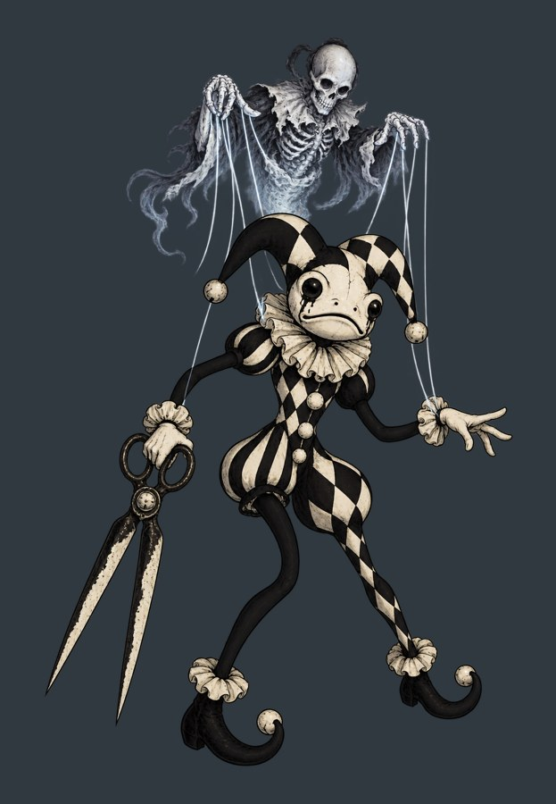

**Who.** The Glenn of U5, who never became a frog. In U5 Cyrus survived Denadoro badly burned; Glenn lost his left arm at the shoulder and his knight's honour, and to atone he became Pierrot, the jester of the Carnival of Ash. Cyrus's ghost — the Marionettist — pulls his strings. Element GUILE: deception, BP theft, turn manipulation; Guile doesn't kill, it bankrupts. Home: U5, 1930s rubber-hose ink at 24 fps on twos. Home Glenn — the one-armed Marshall of U0 — is a different man in a different timeline.

**Look.** A white pierrot suit with ash-grey diamond motley; floppy shoes twice the size of his head; one right arm made of hose; the left stump capped with a black coat button; a ruff collar that lags six frames behind his head. No elbows, knees or joints anywhere. He wears a weeping porcelain frog mask over a painted smile. His eyes, nose and mouth float and can slide off the outline; in shock his eyes go out on stalks. Faint strings run from the top of the frame to his limbs. Palette: newsprint white, India ink, harlequin red #C83A32, mustard #D8A14E, slate-blue shadow only; a boiling outline 2–7 px thick; no gradients. When his white paint cracks there is a hollow inside him with a single origami frog in it, and at 20% the frog turns into the same galaxy Crono carries. Weapons: the **Tailor's Guillotine** shears, a cane, a slapstick, juggling pins.

**Voice.** Like cracked vinyl, a 78 rpm record. He laughs when he's hurt and cries when he lands a critical. Slide whistles when he stretches, squeaks when he walks. When Cyrus takes over, a reverb-heavy Old English whisper and the creak of strings.

**Personality.** Performance as penance. A hundred jokes and no reason to stay. He is the first to see that Crono is a copy — porcelain recognises porcelain.

**Wound.** He watched Cyrus burn and thought being funny would help. Now he is Cyrus's favourite puppet.

**Arc.** From performing bravery to being allowed to be afraid. His loyalty quest asks whether to **cut the strings** (Marshall path: he learns to stand one-armed as a knight) or **keep them** (true fusion: Pierrot-Glenn and Cyrus become one performer). A later side quest offers him an iron-and-laurel arm or his own stump and a hose-arm.

**Relationships.** *Crono* — both of them are performing a role. *Cyrus* — friend, puppeteer, ghost. *Bekkler* — the clown who made the doll. *Sera* — he teaches her to control Chronoslip; his Guile Sight reads Crono's crack timer at camp. *Vaelos* — Vaelos's Lavos-Truth aura negates every lie in the multiverse except Glenn's.

**How he joins.** Chapter 6. He throws his wrestling bout on purpose; the party finds him afterwards hanging limp on a marionette rack backstage and takes him down. The strings stay attached until the chapter's end.

**Choices that are his.** Cut Cyrus down or leave him hanging; re-string the threads as an instrument; the iron arm or the hose-arm.

**Ending states.** Mask stays: he becomes the new Bekkler, an eternal entertainer — Ending 7. Mask off: a one-armed knight kneeling to Cyrus; U5 collapses and merges into U0's watercolour.

**Signature lines.**
- "STEP RIGHT UP! Watch Frog-uh Jester-uh guy! do nothing useful but LOOK!"
- "Courage ran out back in 590. Been doin' balloon animals outta my own guts since."
- "C'mon Captain! Give 'em ol' Crono Grin™!"
- "...oh. Performing for a ghost?"
- "Softness didn't burn. YOU did."
- "Can I not be funny for minute? Scared sky's still ash."
- "I was afraid you'd be ashamed of me. I wanted to be funny so you wouldn't see I was still a frog."

### 4.8 Static

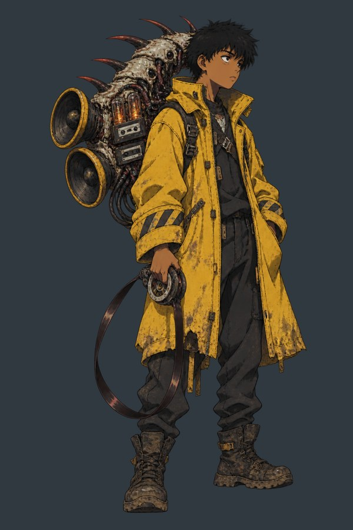

**Who.** Static, 13, a mute street kid from the Third District of U6's dome. Element HZ — white noise and signal. Home: U6, 1988 hand-painted cel anime. In utero a juvenile Lavos larva, **Hiss**, ate his larynx and gave him sight in return. Kids born in the dome often have "white ear"; his mother was a reactor diver scraping spores, and one of them implanted.

**Look.** An oversized, patched yellow hazard coat, shorts, tape-wrapped feet, CRT goggles pushed up and full of snow. His throat bulges and pulses cyan; fibre-optic roots glow along it when he tunes. His spine is wired to the living larva through cassette decks and vacuum tubes. He fights with a magnetic tape-reel whip and larval sub-woofer cannons. Indigo night, sodium yellow, a blood-red bike. Four-tone shading, hard cel shadow, magenta and cyan rims. He animates on twos and pops to ones for six frames when he locks a tune. Untuned, he is a block of white noise with two blue eyes.

**Voice.** None. He talks with katakana cards — never more than three kanji on a card — and by tuning walls of TVs to show what he means. Hiss chitters through a vocoder with gramophone crackle; its pitch is emotion, not words. Tuning sounds like a shortwave sweep and a helmet latch clicking shut.

**Personality.** Scared, practical, kind. He leaves batteries for people and fixes their antennas. He listens for everyone because no one ever heard him.

**Wound.** He was never heard, and his silence is a contract with the thing that lets him see. The Isolator Matriarch raised one kid in her Faraday nursery at a tenth of normal time, and that kid was him: a real boy raised as a doll by a planet.

**Arc.** Does he owe the world noise, or himself quiet? His choice comes at the end of Chapter 7: unplug — he screams once, a pure tone that cracks from 432 Hz to 220 Hz, loses SIGNAL forever, and Hiss leaves; in the endgame that tone strips Vaelos's mimicry and proves Crono never copied anyone — or stay plugged, or teach Hiss to sing. His porcelain mirror is Crono's: both have stars inside, one a Time Egg galaxy, one Hiss's fibre-optic roots.

**Relationships.** *Crono* — the only adult who doesn't ask him to speak; Crono sits in the static with him. *Sera* — the only one who can hear her slip frequency. *Hiss* — not evil; a baby learning to be human from a kid who never got to be. *Vaelos* — calls Hiss "little brother," and Hiss answers. *The Matriarch* — mother.

**How he joins.** Chapter 7, in the CRT nest of the Third District; he travels with the party through the chapter and joins for good after the Matriarch's choice.

**Choices that are his.** Unplug, stay plugged, or teach Hiss Sera's lullaby.

**Signature lines.**
- Card: 「イヤ」 — "don't want."
- Crono, sitting with him: "....yeah."
- Vaelos, through Hiss: "He's listening, brother. Like we did in the dark beyond."
- The Matriarch, through every TV: "LITTLE BROTHER STILL SOFT. GIVE HIM BACK."

### 4.9 Omega-Spekkio

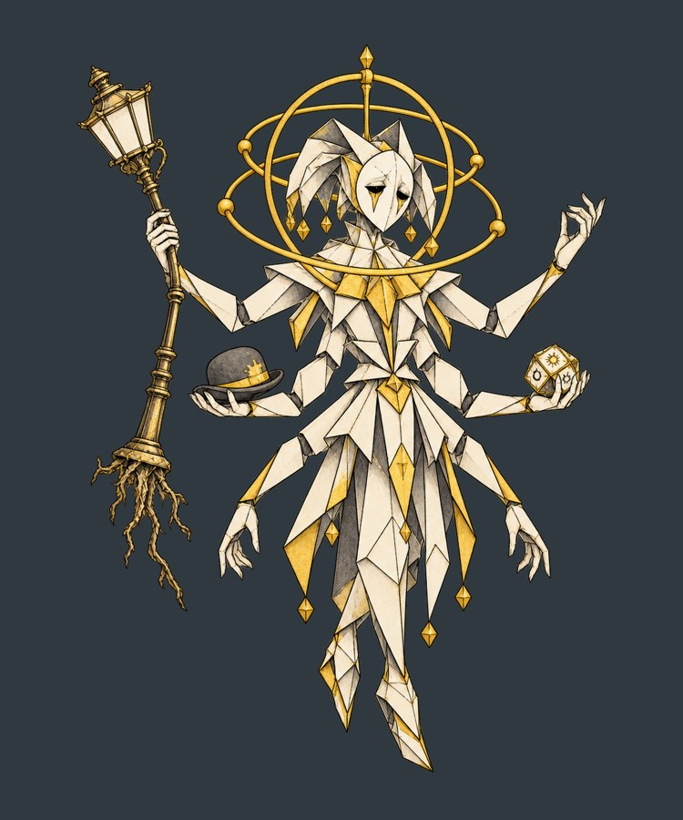

**Who.** The optional ninth member. Element NULL — it erases tags; it does not deal damage. Home: U7's negative space. Omega-Spekkio is what Spekkio became after the End of Time starved and Gaspar died: a twelve-foot, six-armed origami astral deity. He is not Kami-Ori, U7's guardian. He can be found only if Sera carries the **eight sigils**, after the party defeats Kami-Ori. His Final Dojo is his recruitment quest. In Ending 8 he is the final opponent.

**Look.** A lotus throne; six arms; a mandala halo of gold-leaf kikko and asanoha; a faceless Noh mask with origami score lines where features were — or, as his Dojo fights reveal, a cracked jester's mask spinning inside golden gyroscope rings. His body is pure origami: razor-hard folds and paper fibre glowing through. His hands hold two Time Eggs, an ink brush, a blank card, a lotus and a mudra. He carries **Gaspar's battered bowler hat**, the **uprooted Lamppost of Eternity** and the **Polyhedral Fate-Dice**. He holds a pose for two serene seconds, then snaps in a twelve-frame paper crumple. He never moves to attack; the world folds into him. Around him 70% of the screen is unpainted washi, details in sumi brown #3A2E1F and never black, and gold-leaf flakes collect wherever a weakness has been erased.

**Voice.** Almost none. His six arms ring rin chimes at different pitches — a diminished-seventh cluster when he moves, a suzu shaker that resolves when he grants a boon. His words unfold as paper. He speaks aloud only in the Dojo and in Ending 8.

**Personality.** Melancholic and tired of form. He has taught ten thousand heroes and loved the original who wanted to fight; now he wants blank paper. NULL is his resignation letter, a way to teach students not to need teachers. He is the only one who knows Sera didn't cause the Debt — she is the multiverse paying it by collaging itself.

**Final Dojo.** Four fights, each a Spekkio fight turned inside out, each permanently erasing one weakness: **Crane** erases U6's fire critical; **Samurai** erases U2's Ferro/magnetic weakness; **Dragon** (six arms unfold) erases U4's drowning; **Faceless** grants the NULL SHIELD — every shield becomes [WEAKNESSES ERASED], 20% damage reduction against everything instead of 50% against one thing.

**Moments.** When Sera first calls him "Master," he erases a little more of his face. "Oh, you brought the debt with you." If Crono falls to his 20% galaxy reveal near him, Omega-Spekkio kneels and folds a tiny red-haired origami Crono into his own chest cavity — ten seconds of silence while gold leaf weeps. He mourns the original and affirms the copy in the same gesture.

**Ending states.** If he is in the party at the Heart, Vaelos's end — whatever shape it takes — is drawn as the Amano death: Vaelos unfolds into red-haired paper cranes that fly back to the Bone-Tree, and Crono stays whole. In Ending 8 he teaches Sera to become un-weak.

**Signature lines.**
- "Oh, you brought the debt with you."
- "ASTRAL pretends to be beginning. NULL is ending that forgot to erase itself."
- "You want to be strongest? Ha. You want to be un-weak. That's different. I can teach you how to have no weaknesses. But if you have no weaknesses, you have no self. Want it? Pay blank."
- "You learned how to fall. Now learn how not to land."

### 4.10 Vaelos

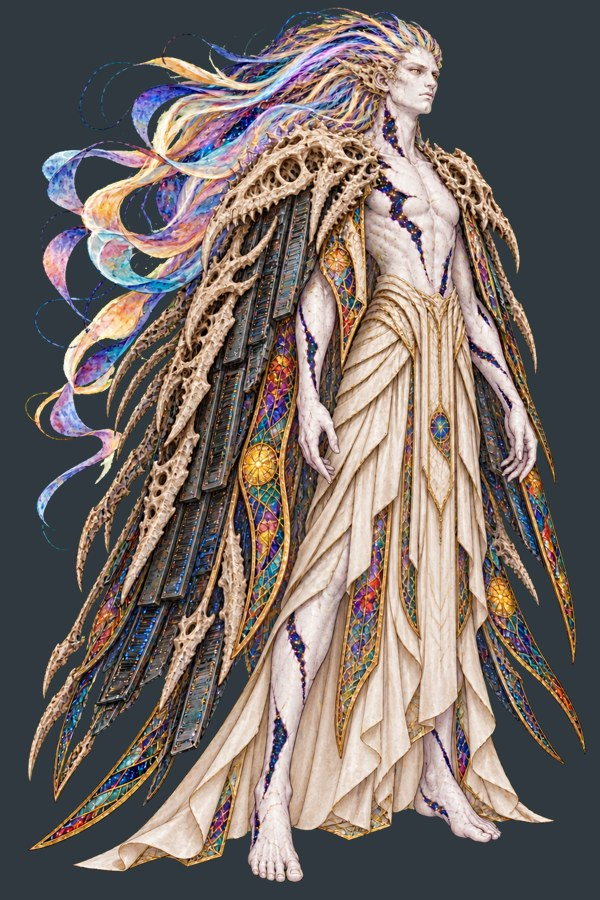

**Who.** The Prismatic Sovereign: the humanoid Lavos grown from the original Crono's vaporised atoms ([3.3](#33-vaeloss-origin)). He believes he is the real Crono — Crono perfected — and that the man at Marle's table is a carnival toy that stole his life. He calls Crono "Big Brother Copy" and, when he forgets himself, "Papa." He calls Sera "Little Sister." He has held a humanoid shape for nineteen years and looks twenty-seven. In battle he scales 1:1 with the party.

**Look.** Nine feet tall and androgynous. Cracked alabaster skin that leaks starlight through every seam. His face is Crono's, lengthened and smoothed into something no one would call a boy's. A fibre-optic mane that shifts between art styles as it moves — watercolour, ink, clay, gold. A mantle of fossilised saurian bones, 2300 A.D. server blades and shards of Zeal stained glass. When he opens his chest, the starfield inside is warm amber: the original atoms, burning since 12,000 B.C. Crono's galaxy is a cool blue-white copy; the two shaders are the same material, so when both are open the player can compare copy and original without a word of dialogue. U0 watercolour bleeds at his edges when he moves, and where he has mended himself his alabaster is leafed with gold.

**Voice.** Crono's own voice — the same actor — clean and young: no gravel, no plate reverb. It is meant to unnerve. His heartbeat runs at 68 BPM against the Atrium's 72, so wherever he is near, two hearts phase against each other. His motif is a low contrabassoon hum on a diminished fifth (C–G♭) that sits under every universe's music. In the Heart, his heartbeat sets the framerate.

**Personality.** He does not want to fight. He wants to be a father, and he loves the way Lavos knows how to love: by absorbing. Charismatic, sorrowful, sincere; he believes pruning the fractured timelines is mercy. Across the game he is learning things a child learns — to hold a spoon, to ask before touching, that fatherhood is not holding but letting someone disappear.

**What he wants.** To harvest the seven aborted realities and forge the Omega Timeline, with Sera as its keystone; in the Heart he offers to take the whole Time Debt into his Lavos body so she never slips again.

**How he works.** He seeds every universe. A tooth of his sits in a burning shogun's armour (U1). He walks the drowned cathedral as a kindly **Lamplighter** and siphons Schala through the Rose Window (U4); the Lamplighter turns up in other universes too, always helpful, always pruning. His black oil threads replace Cyrus's smoke strings (U5) — he feeds on coping, and the more the carnival laughs, the more debt accrues. He speaks through Hiss (U6). The Bone-Tree is his cradle (U7).

**Forms.**

| Form | Where | What it is |
|---|---|---|
| Vaelos Echo | Prologue | A shadow at the kitchen table, learning to hold a spoon; an enemy only Sera can hit |
| Gold-leaf dream | Chapter 1 | A voice in Sera's nightmares |
| The Sovereign | Chapter 1 onward | Descends from the geometric diamond above Lucca's Telepod; Crono's sword passes through him |
| The Lamplighter | U4 and elsewhere | A helpful lantern-bearer who leaves a stained-glass shard of Crono's face behind |
| The Heart form | Chapter 9 | Sits with his back to the party mending a tiny porcelain Sera doll with gold, chest open |
| Empress Vaelos | Ending 2 | Wears Kami-Ori's unfolded body as a mantle; a feminine Noh mask with Crono's red hair inlaid in gold leaf; a gold-leaf kimono; six arms holding a black apple oozing oil, a fang, an iron lotus, a Gatling barrel from R-66Y's ring, a burning ledger, and a mudra pointing at the player; layered male and female voice |
| The child | Ending 3 | 4′2″, wobbling; a porcelain theatre mask far too big for his face slides off; his body moves at 60 fps like Crono, his head nods in U7's held steps |
| Vae | Ending 4 | Mortal: the Lavos fibre goes inert, the galaxy cools to blue-white, he leaves mossy-stone footprints and moves at watercolour 60 fps with a little clay stutter |
| The Amano death | Any ending, with Omega-Spekkio | Unfolds into red-haired paper cranes that fly back to the Bone-Tree |
| Possibility ghost | Ending 5 | A Crono-shaped Lavos glimpsed in Crono's chest void — goggles fused to the skull, a scarf of muscle fibre — who smiles, relieved, and fades |
| Puppeteer | Ending 7 | Hollow, with Crono's face at 41 on watercolour paper, inside Cyrus's chest |
| Unmade | Ending 8 | White eats him; no dust, no oil |
| Lavos | Debt collapse | He drinks the Time Debt Well and becomes what made him |

**Relationships.** *Crono* — brother, father, original, rival; the question between them is which of them has the right. *Sera* — resonance; she hums like a house he was never allowed into. *Hiss* — "little brother." *Kami-Ori* — the mother who folded herself into nothing to hold his cradle. *Krona* — the only one who understands him. *Static* — whose pure tone can strip his mimicry. *Cassia-09* — whose scan proves what he is made of. *Glenn* — the one liar his truth-aura can't touch.

**Signature lines** (the rest are in the chapters where he says them).
- "She slipped well. Like you did. You left atoms. I kept them. I learned to hold a spoon."
- "You replaced yourself with a toy from a carnival tent, Crono, and left me — the ash of your true body — inside the belly of the star-eater. Tell me: which of us has the right to be her father?"
- "You hum like the house I was never allowed into."
- "You aren't his daughter. You are the change from his transaction."
- "Am I a god that failed to fall?"
- "I didn't steal. I incubated. You were vapor. You were everywhere and nowhere. I made you a somewhere. Let me make her a somewhere too."
- "If his dust made you... can dust be raised?"
- "Papa— can you leave some cracks? So I know where light gets in."

### 4.11 Supporting cast

**Marle — Queen Nadia, 40.** Ceremonial blue, barefoot, a ledger under her arm. Burdened by statecraft as temporal sinkholes eat her border villages, and by twenty-four years of keeping a promise to a statue that sometimes breathes. She has always known Crono is a doll. Every night she touches his wrist to check if he is warm; the cold floor under her bare feet is her only honest thermometer, because his porridge steam never condenses on him. She guests in the Prologue (a crossbow ward of Light; the Dual Tech **Porcelain Promise** with Crono is teased there and returns whenever she fights beside him). She appears again only in the endings, where she matters enormously: watching Sera guide Crono's hand while the gold sets (Golden), walking barefoot into the void to abdicate the throne to the Lavos lineage (Empress), burying an empty Bekkler doll box (Silence), crying for the first time (Jester).
Lines: "You kept stirring." · "You never taught her how to fall." · "You never taught her how to fall. Now she teaches us." · "You made him wear my husband's face so he would be loved. Now let him wear mine so he will be feared." · "That's not you. That's what you let Bekkler make." · "You polished your cracks until there was nothing left to hold. There's no Crono in there anymore. Just the shape of where he was." · "We kept your helmet polished because we couldn't polish our grief."

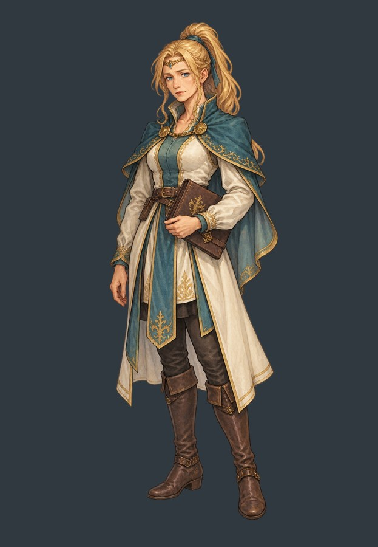

**Lucca Ashtear.** She executed the copy. Eight years ago she built **Project: Klein** — a Klein bottle meant as a heart for Robo, an infinite loop in a finite volume, exactly like the Time Debt — and vanished, leaving a journal: saving the timeline only quarantined the bad endings under pressure. She went into U2 after them. Her workbench and notes are still in the Geno-Foundry ("Test 9: nerve root bloom"; "Klein Bottle Circuit"); her nervous system lives in Cassia-09's amber tank, archived by R-66Y. She speaks through Cassia's gramophone. In Ending 7's honesty check she finally says, through the amber: "I built the doll because I couldn't build you a future where you live."

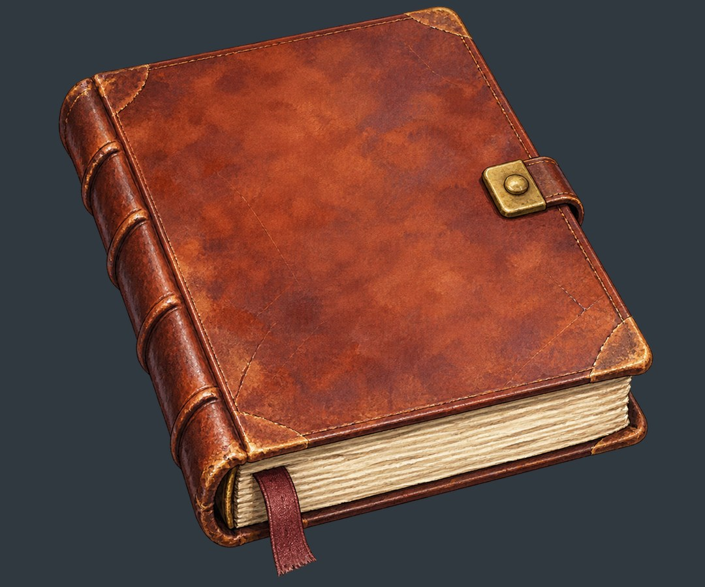

**Glenn — Marshall of Guardia, 47 (home timeline).** One-armed, the left arm gone at the shoulder; walks with a cane capped by the deactivated Masamune hilt; wears parade lacquer over a ruined pauldron to look whole at court. Grumpy uncle and protector to Sera. He trains at the Atrium's dummy and reads the party's record: on a Ruthless path (three or more spareable sentients killed) he refuses his Dual Techs **Ashen Bash** and **Mercy Leap** until the Bekkler doll is repaired: "You wear a doll to hide cracks. Same as me wearin' paint." In the Golden ending Cassia builds him a prosthetic; he tries it, parries once, and takes it off: "I left it in the castle to remember what price cheap courage cost. You lot patch the world with gold. I'll keep my hole. It whistles when wind goes through — lets me hear what's missing."

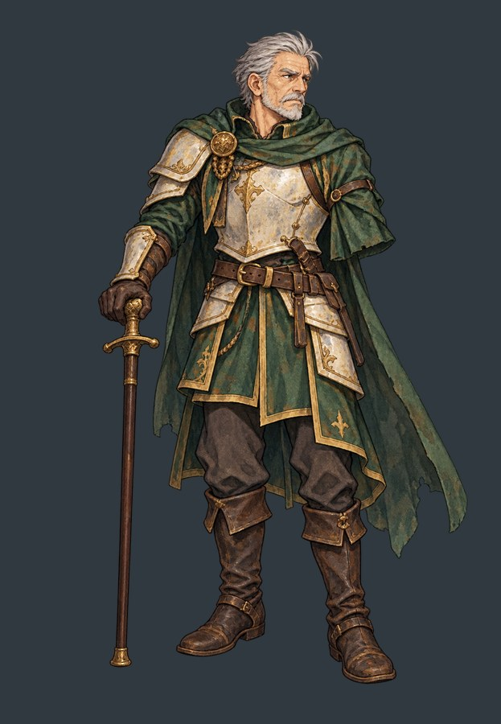

**Robo — Prometheus, the Atrium Horologe.** He tended the ruins of Porre's clocktower for years until the ruins grew into him. His positronic brain runs the tower; his torso is its central pillar: twenty feet tall, inverted, ribs become Gothic arches, a thoracic ring of eight Gatling mounts turned into clock numerals, Lavos muscle fibre under cracked plating, copper nerve-vines pulsing at 72 BPM through the masonry. His face is a ten-foot porcelain clock face that matches Crono's. The hour hand pierces his right eye — sorrowful blue, weeping clear oil; the minute hand pierces his left — empty, weeping black U1 ink. Small porcelain theatre masks orbit his collar and slide their cracks to make expressions. He idles at 12 fps hydraulic inside a 60 fps world, so he stutters in a smooth one. At midnight both eyes shut and the tower inhales. He speaks through brass tubes with soft synth chimes, in capitals. He became a museum to keep his friends alive — an Arch-Curator who cannot leave his exhibit — and he shares a body plan with U2's R-66Y, which is the first horror Crono notices in the Ossuary.
Lines: the Prologue's strain report, and "PRESERVATION =/= LOVE. ERROR."

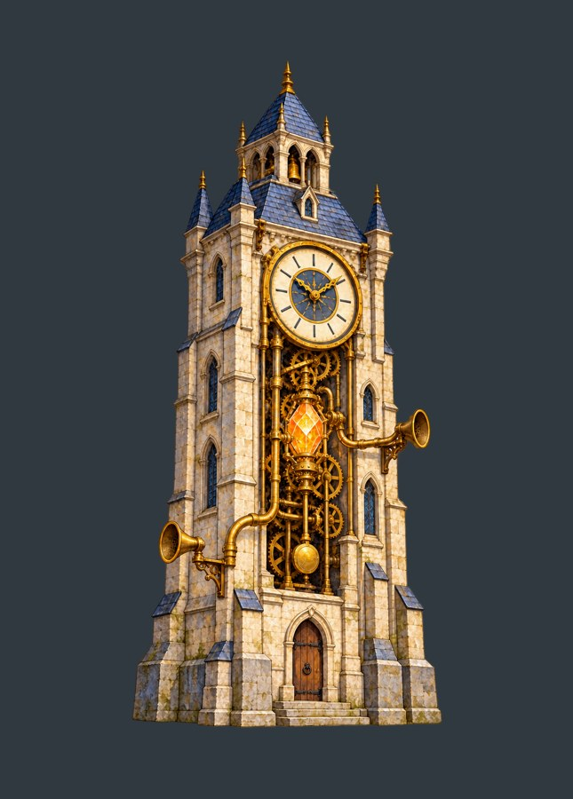

**Magus — Janus.** Has not left the castle crypts in years. Returns at the start blind in one eye and bleeding liquid silver time, and brings the truth: Lavos was a larval spore of a Multiversal Constant, and it has metamorphosed. He and Glenn deliver the warning in the courtyard in the Prologue. His cat Alfador is Vesper. In U5, his other self was butchered by Ozzie, Flea and Slash.

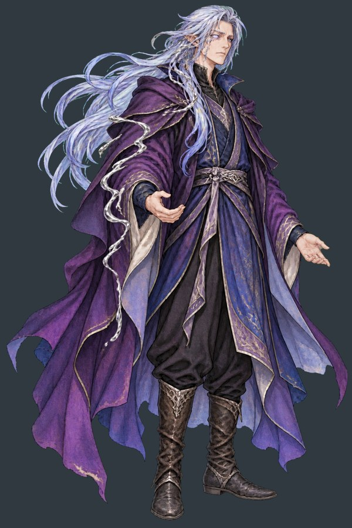

**Belthasar.** The Guru of Reason who engineered the failsafe. He is long gone and appears only in his marks: the serial stamp inside the doll, his network finding Lavos's carrier in U6's 1978, the first failed copy that became the Atrium's training dummy, and his handwriting on an egg in the Heart: "ATOMS 12,000 B.C. — UNSTERILIZED."

**Norstein Bekkler.** The clown whose tent gave Crono the Crono Clone in 1000 A.D. and whose copy technology made the body. He laughs, and he is guilty. In 1024 his tent stands again at the Twenty-Fourth Fair, and if Crono goes inside, Bekkler asks: "You know you're a doll, right?" In U5 a rubber-hose Bekkler runs the tent that harvests laughter and keeps rows of failed dolls backstage. In the post-game he is the **Codex Keeper**, wearing his guilt as a coat of failed dolls: forty-one theatre masks orbit his collar, and he speaks in a six-layer gramophone chorus: "Property of Belthasar — Bekkler Assembly — 1999/2300 — Serial: Crono-41. You were the 41st time she asked me if you were warm. I ran out of porcelain at 40." In Ending 7 he is finally allowed to leave and walks into the sea as an old man, his mask floating behind him. A book on a glass shelf in the Drowned Cathedral is titled *How to Bottle a Star — Bekkler*.

**Johnny.** U2's clay vendor, his jetbike wheels fused to his workbench; he runs the Gramophone Shop in the Slag-Yards and teaches SYNC HOLD on the Spine-Highway ("Hold thinking, skid kid!"). His burned-out jetbike tows the party into U2. The Bike Bros (the Daltonized Models) are his corrupted kin.

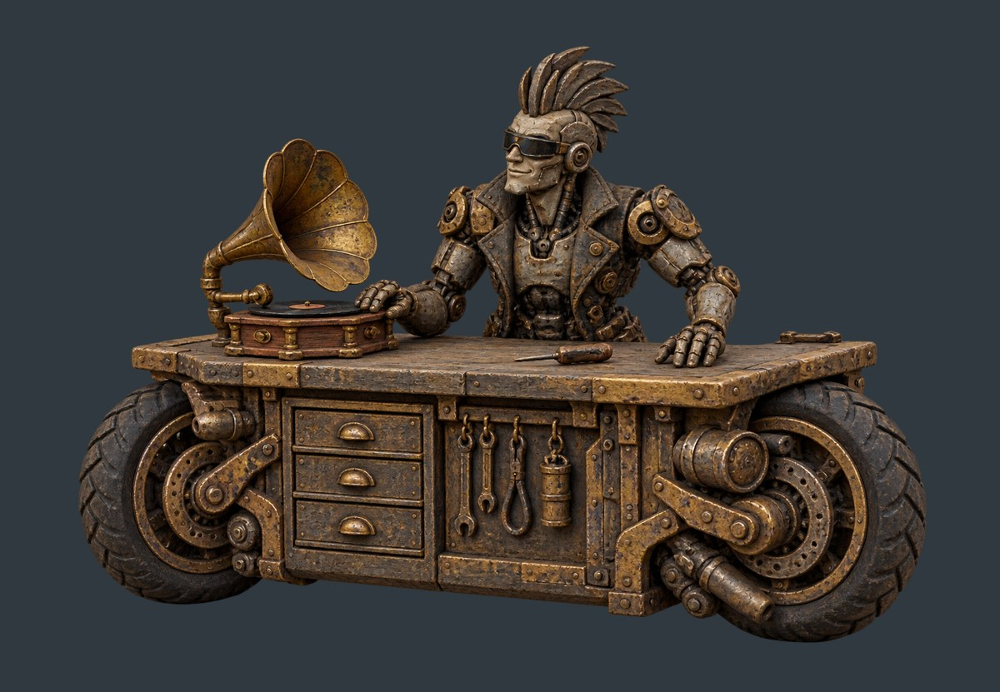

**Doan and the Seed of Doan.** Doan's descendants in U2 left a seed in the Proto-Dome ruins: a mercury orb wrapped in tungsten wire, the same family of parts as Cassia-09. It failed in U2 because the marrow-oil there is sterile grief, not soil, and Cassia kept it in amber so no one could burn it as fuel. Lore holds that this Doan refused to become a Prometheus Core. Watered three times across three visits, the seed sprouts a little gramophone horn that plays Crono's theme reversed at 432 Hz, and Sera, hearing it forward, says it remembers a future in which Crono was never vaporised. Fully grown, it holds the Atrium gate open during Vaelos's siege.

**Mother Brain.** U2's mind. After U2's Lucca failed to reactivate R-66Y, Mother Brain uploaded humanity, caged Lavos's heart two miles beneath the Proto-Dome in a Dyson-Cage and built the Geno-Foundry. She is an industrial press with a sorrowful blue eye grafted onto Lavos muscle fibre. In the Ossuary's secret phase, her graft turns out to be a bloom of Lucca's nerve roots.

**R-66Y, the Arch-Curator.** U2's Robo, the one that U2's Lucca couldn't repair. A twenty-foot stop-motion goliath with his chassis peeled open and stuffed with Lavos muscle, built from opera balconies and organ pipes, swinging eight laser-Gatling arms on a rotating thoracic ring. Left eye sorrowful blue (#7BA4C6) weeping clear oil; right eye empty, weeping black oil. Porcelain theatre masks orbit him, and his own face is a cracked clay mask. He archives grief. Rewound, he becomes a four-foot child on reverse-jointed spider legs who teaches Wire Loom Mend; Salvaged, he becomes a cannon. Echoes of him return in U4, in U6's ICE, in the Heart's Paradox Curator Choir and in the post-game.
Line: "LUCCA? ERROR. PAIN QUOTA 999.9%. TACHYON HEART WILL STABILIZE HIVE."

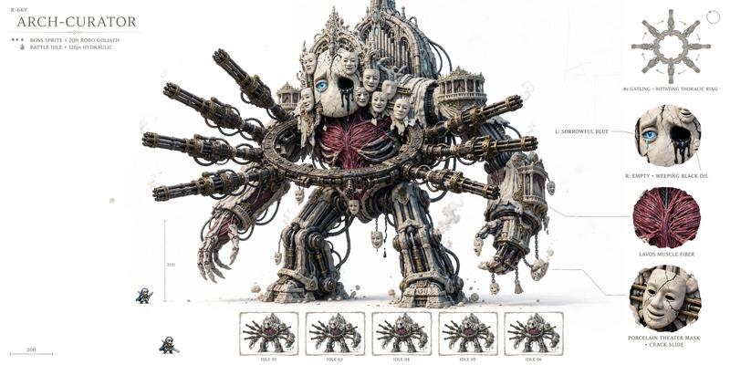

**Azar — Divinity Warden of Eden.** A 2.8 m Reptite warden whose mantle is a living archive and whose beak holds a sliver of the Frozen Moon. She keeps Xyloph's clutch in stasis, and in secret has nursed a sterile mammal embryo. Line: "Little pot. You were fired wrong. Let me glaze you again — still."

**Kami-Ori.** U7's guardian: a six-armed origami Noh deity, the Entity's first attempt to give Lavos a soul — meant to be Lavos's mother. She folded herself into NULL around the infant Vaelos to contain him. She waits on the Crown of Horns, a flat lotus dais over an infinite drop, in half-lotus, holding a golden apple (Time), a baby tooth (the original Crono), a lotus (Sera), a broken Masamune shard, a blank scroll (Vaelos's unwritten name) and a prayer mudra. Her Noh mask always faces the camera. She speaks in haiku sheets that tumble open in the air. When Sera first slipped, at four, Kami-Ori caught her and wiped the memory so she could be brave outside the void. Defeated, she collapses into a flat paper crane in Sera's palm; the mask remains.
Haiku: "Six hands hold six flaws / will you keep your cracks, small one? / blank scroll is mercy." · "Not pretend. / Porcelain holds tea / because it chose to."

**Cyrus — the Marionettist.** In U5 he survived Denadoro, badly burned, and breathed Lavos vapour for three years. Now he hangs twelve feet above the midway, a charred ghost-knight puppeteering the whole fair on solid threads of time-smoke. He is not evil; he thinks distraction is mercy. The midway's centre pole is his melted lance, notched to count days. His lines are in [Chapter 6](#chapter-6-carnival-of-ash).

**Ozzie, Flea and Slash.** In U5 they butchered Magus and fed Lavos's blood to the world. In the Carnival they live on as its attractions: Ozzie is the **Ash Ringmaster** who locks the party's BP until Glenn steals it back; Flea keeps the Hall of Mirrors; Slash's knife act never ends.

**Hiss.** The juvenile Lavos larva inside Static. Not evil; a baby learning to be human from a boy who never got to be one.

**The Isolator Matriarch.** U6's juvenile Lavos at the Isolator stage: the network grew too big to eat, so she built a Faraday nursery of neon and raised one child in a tenth of normal time. A brooding mother — the first time the game shows Lavos as a parent rather than a parasite.

**Lord Ashinaga, the Ashen Daimyo.** U1's pigment lord and Krona's father figure, fused with the always-burning top floors of Goyama Castle. Twenty feet tall, seated, never standing, his body made of surrender petitions he keeps writing, his armour weeping black oil. A tooth of Vaelos sits in his armour.

**The Weeping Shogun.** U1's Amalgam Spawn: an ink Lavos Spawn lower body fused to a claymation clockwork centipede, guarding the Mammon Furnace beneath Goyama.

**The Herald of Vaelos.** The thing Krona sacrificed herself against at the Burning Castle — U1's Ocean Palace — and failed.

**Schala (U4).** A librarian, not the queen; her mind lives as a cat-shaped shadow in Vesper's breastplate while her image polishes itself behind the Rose Window. Her pendant line — Schala's pendant, Marle's pendant — runs to Sera.

**Gaspar and Spekkio.** Gaspar died in U7, which is why the End of Time starved. Omega-Spekkio carries his battered bowler hat.

**Atropos-00.** A discarded memory ribbon in the Geno-Foundry; rescuing it forges Krona's Cobalt Nodachi upgrade. Sera's fate-cutting ultimate, Atropos Ribbon, is named for it.

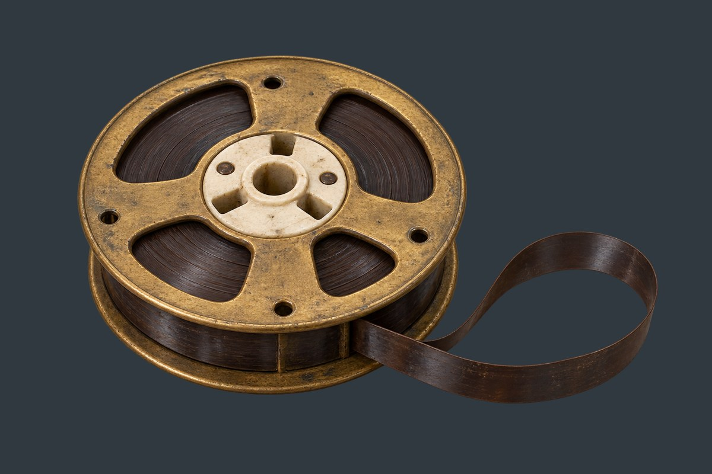

**U6's people.** The Noodle Oracle, a TV-forehead granny in a bar who shows Sera her own future ("Latchkey kid becomes lock."); the clinic doctor who trades HP ceiling for memories; RAM-and-oden fixers.

**U3's factions.** The Divinatory Synod (feathered priests who worship the Frozen Moon), the Gene Scribes (who keep the PROJECT MAMMAL FAILED arboretum and write history onto living walls) and the Unbound (young heretics who hear the Moon's hum).

---

## 5. World: the ten universes

U0 is home. U1–U7 are the seven aborted realities the Golden Timeline was built on, each a "what if," each with its own canvas. U8 is the Heart where they all collide, and U9 is the space after. Every universe has its own animation rate, palette and instrumentation, and the art always tells you where you are at a glance.

| ID | Universe | Divergence | Canvas | Level band |
|---|---|---|---|---|
| U0 | Atrium Horologe / Guardia, 1024 A.D. | Home; the Golden Timeline | Watercolour, 60 fps | 1–4 |
| U1 | Crimson Shogunate | Crono born a girl; she drank Lavos's blood | Sumi-e, 24 fps | 5–11 |
| U2 | Clockwork Ossuary | Lucca failed to repair Robo; Lavos harvested | Clay 12 fps + VHS/CRT | 12–20 (enemies to 35) |
| U3 | Saurian Eden | Ayla killed; Lavos frozen in orbit | Moebius ligne claire, 30 fps | 21–30 |
| U4 | Drowned Cathedral | Zeal sank intact; the sea turned to glass | Art Nouveau stained glass | 31–40 |
| U5 | Carnival of Ash | Magus butchered; Lavos blood fed to the world | 1930s rubber-hose + gothic puppetry | 41–50 |
| U6 | 1999 A.D. Singularity | Lavos harpooned; a city built in its shell | 1988 cel anime | 51–60 |
| U7 | Bone-Tree of Eternity | Gaspar dead; the End of Time starved | Gold leaf, sketchbook ink, negative space | 61–70 |
| U8 | Vaelos Heart | The finale; all canvases collide | Porcelain Null 15 fps + every style | 71–80 |
| U9 | White Void / Borrowed Future | After the finale | All styles, or blank | 80–99 |

Boss levels are fixed (for example Arch-Curator R-66Y Lv 18–20, the Eden Warden Azar Lv 27); Vaelos scales 1:1 with the party. Party stats cap at 20 in U2 (extra XP banks as Time Debt), at 60 in U4 and U5, and at 99 only after the Debt is forgiven.

### U0: Atrium Horologe and Guardia, 1024 A.D.

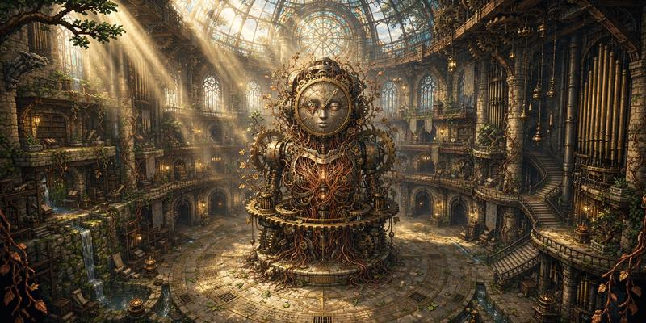

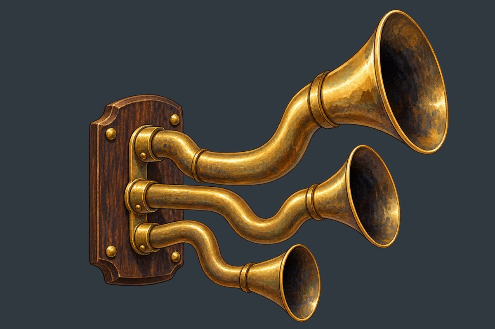

**Divergence.** None — this is the Golden Timeline, the one the original party saved, and it is the one that is rotting.

**Places.**
- **Guardia Castle.** The royal family's home. The **Guardia Atrium** wing holds the family kitchen, where the Prologue begins: copper pots, a stone counter, stained-glass windows nobody has cleaned since 1000 A.D., Sera's childhood stool with a groove burned ink-black on one side. The courtyard, where Glenn and Magus wait. The crypts, where Magus has hidden for years.
- **Truce**, industrialising on Porre trade; steam pipes run under its streets.
- **The Atrium Horologe.** Porre's gutted clocktower in Truce, grown through by Robo. A vertical cylinder: a moss-garden floor, a workbench ring, a gate ring. The central pillar is Robo's torso and face. Copper vines carry light from each universe's gate up to the arches of his ribcage. Sera's loft is a wall of Crono's old Truce house transplanted into the tower; she designed the Horologe as her father's terrarium, the one place the Time Debt doesn't collapse around him. In the north-west corner stands the 999 Shield Dummy; in the centre, a pool; in the garden, the Seed of Doan's pot; at six o'clock on the clock face, a gramophone.
- **Leene Square and the Twenty-Fourth Fair.** Chestnuts and ozone. Bekkler's tent is back. Lucca's old Telepod pavilion stands under a geometric diamond of sky.
- **Truce Canyon**, where the rain falls as ink strokes, clay drops or torn parchment depending on where it lands.
- **Choras**, where temporal shear storms have begun.

**Mood.** A waiting room where a father pretends not to be dying so his daughter can keep exploring. Nostalgia that hurts. Home becomes paper-thin: U0 never levels up. As the other worlds grow stronger it degrades — the watercolour dilutes chapter by chapter and more paper white shows through. Crono's cracks are easiest to see in U0's bright wash; the other canvases hide them and let the player pretend.

**The hub loop** is described in [9.7](#97-the-atrium-horologe-loop).

**Krona marks.** Indigo ink footprints that bloom like watercolour and fade — six seconds in the field, thirty inside the Atrium, longer in U4's light. In Chapter 1 they are Sera's: U1's ink leaking through her slips. Once Krona joins, she leaves them barefoot. They point to the next side quest without a minimap, and if the player stands still for ten seconds a gold-black lotus blooms by the relevant gate. They are Chronoslip residue and Vaelos's blood.

**Story hazards.** Canvas leaks (no more than two at once, more when Vaelos is near — contamination reads as horror). The Debt gate: if Crono's integrity reaches 0%, U0 locks, Vaelos lays siege, the clock face shatters, Robo's sorrowful eye turns black and the watercolour runs off the page.

**Sound.** The music box "Wind Scene 1024" at 72 BPM — a resting heart, and Crono's porcelain heart. The cylinder is missing a tooth, so every eighth tick is a silent click. Every four bars a mainspring grinds. Layers: peace (felt piano, wind, tick); Debt past 60% (a detuned escapement, reverse reverb on Robo's eye); gate proximity (U2 gramophone hiss, U6 CRT hum). Below 40% HP, tape wobble detunes everything. When Vaelos is near, a second heartbeat at 68 BPM drifts against it.

**Flags set here.** Teach Her To Land / Hold The Copy Together / The Bowl Still Whole; Atrium_Dummy Spared / Salvaged; Amber_Rift_U0_DollMeetsDoll; Crono's confession to Marle (told / hidden); Pipe Overload; Seed of Doan waters.

### U1: Crimson Shogunate

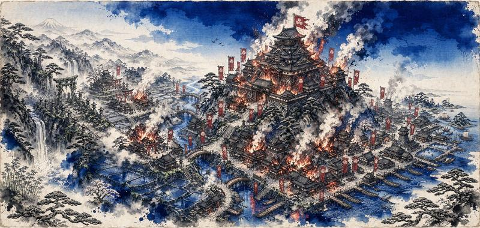

**Divergence.** In 1000 A.D. Crono was born a girl, heir to a war state that values lineage. At the Burning Castle siege — this world's Ocean Palace — she made the perfect sacrifice against the Herald of Vaelos, and it failed. She drank Lavos's blood and returned as the ageless God-Empress Krona. Feudal Guardia fused with Zeal's sky-magic into a martial empire that executes time-travellers on sight. A Lavos shard never fell here; Vaelos's whisper taught the first Shogun that "perfect order requires eternal war." Twenty-four years of that war have passed when the party lands.

**Places (the Burning Archipelago).**
- **Kuro-Truce Bamboo Grove** — where Crono lands face-first; a full ukiyo-e and sumi-e canvas.
- **The Chitin-Pagoda** — Krona's pagoda, built of Lavos chitin, on its summit.
- **Kuro-Truce castle town (jokamachi).** An eight-minute cycle: **Ashen Morning**, explorable, NPCs repainting every gate bone white (#F2EED8); and **Crimson Night**, combat, smoke spawns, cinnabar banners. Every doorway has two layers — fresh paper over char — and the player can peel it: underneath are children's handprints in soot, dated three sieges ago. The melted Leene Bell hangs as a guillotine; Lucca's house is now the Ash Forge.
- **The Iron Bridge streets** — four bridges, each a shrine where ash-ronin force the party to hold a parry.
- **Goyama Castle** — the Burning Castle, on the horizon; its top three floors burn forever and never collapse. Its paper doors are an invisibility puzzle. A vault beneath holds the Founder's blade, the Cobalt Nodachi.
- **The Mammon Furnace** — beneath Goyama, where the Lavos vein runs.
- **The Hinterlands** — negative-space washi mountains, a faint wash of Fuji, mossy torii on an invisible path; no combat; ink refills; 70% silence.

**Canvas.** Stark ukiyo-e woodblock and violent sumi-e wash over rice paper. Four inks only: sumi black #1A1A1A, cobalt #0D2640, cinnabar #8C1D18, paper white #F2EED8. The sky is always cobalt (0.05, 0.15, 0.35), even while the town burns; fire is the only warm, saturated thing on screen. Rain falls as vertical calligraphy strokes, sword slashes tear the paper of the screen, and only crimson and Crono's own watercolour keep their colour.

**Mood.** You cannot paint over loss. The Shogunate believes repainting erases tragedy; U0 believes a porcelain copy can replace a father. Both are wrong.

**Verbs and hazards.** **Ens Parry** — a six-frame window drawn as a closing sumi-e circle; a perfect parry leaves an Ens ring that shaves an extra shield and cancels Crono's Time Debt cost for five seconds; a miss splashes an ink blot that blinds 60% of the screen for three seconds (cured by Cobalt Wash). **Washi Reveal** — hidden slopes appear only when wet; Cobalt Wash reveals paths and dyes portals; standing on unpainted paper makes you invisible but unable to attack. **Ash Field** terrain from Krona's RUIN. **Town Karma** — save the same house three cycles and it becomes a Dojo that widens the Ens window by two frames; let it burn three cycles and the family leaves, dropping a gold-leaf memory flake needed for U7.

**Sound.** Shakuhachi and taiko at 48 BPM (twice 24); biwa tremolo and washi crackle at night. Slashes sound like brush on paper, not metal; a parry is a hanko seal, "don"; footsteps are woodblock stamps; ink bleed is silent for 1.8 seconds, then the paper warps.

**Flags.** Goyama Repainted / Incinerated / Both; The Gourd sealed / kept; Cobalt Nodachi taken (U1 locks into permanent Crimson Night).

### U2: Clockwork Ossuary

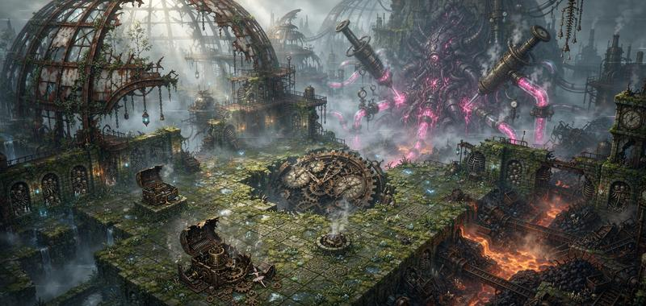

**Divergence.** 2300 A.D.: Lucca failed to repair Robo. Mother Brain survived in the Proto Dome, found Lavos in the mantle, uploaded humanity and built a subterranean Dyson-Cage around it. Survivors became immortal biomechanical reliquaries powered by refined Lavos-oil. The future Crono saved never healed; it learned to harvest.

**History.** Robo's descendants porcelainised themselves to survive the oil and became mining liturgists, fossilised now as smiling theatre masks weeping black oil. The **Geno-Foundry** drives ten-thousand-ton iron syringes two miles down, pumping boiling marrow-oil out of a still-living Lavos. That marrow is sterile — no DNA, only grief. It is what Lavos vomited to survive, and it sends the party looking for the Lavos that never fell.

**Places (the Ash-Rib Expanse).**

| Zone | Level | Story and hazard |
|---|---|---|
| Proto-Dome Slag-Yards (hub) | 12–14 | Magnetic sand under a VHS sky; CRTs stacked as shrines praying with static; a child's tricycle fused to a charging plate, labelled "DO NOT RECYCLE — DREAMS INSIDE." Repair the Epoch-Tether Beacon; Johnny's Gramophone Shop; the Seed of Doan. VHS Fog. |
| Spine-Highway / Lab 32 | 14–16 | The planet's ribcage fused with a mag-lev. A billboard flickers "PROTO-DOME INDUSTRIES — PAIN QUOTA 999.9%". Johnny teaches SYNC HOLD; the Bike Bros guard the Ferro-Capacitor. Mercury pools. |
| The Choir of Arris Dome | 16–18 | A human museum turned Robo chapel: hundreds of smiling masks humming one note around a cracked conductor mask with a weeping blue eye. Masks on the whisper wall mouth "LUCCA?" when Cassia passes. Grief-Resonance. |
| Geno-Foundry and the Conveyor Belt | 17–19 | A factory cathedral; syringes hammer every three seconds — the world's metronome — and each is etched with a date: 1999, 1000, 600, 65M, 12K. Magnetic crushers, reversible belts, an amber tank farm, Lucca's Klein workbench, Atropos-00's memory ribbon, the Unstable Amber Rift. Ruin Decay, Oil-Blight. |
| Mother Brain's Dyson-Cage | 19–22 | A two-mile drop into a Giger-esque cathedral: a rebar sphere caging Lavos's heart-muscle, a skinless carapace pinned by syringes. Boiling marrow. |

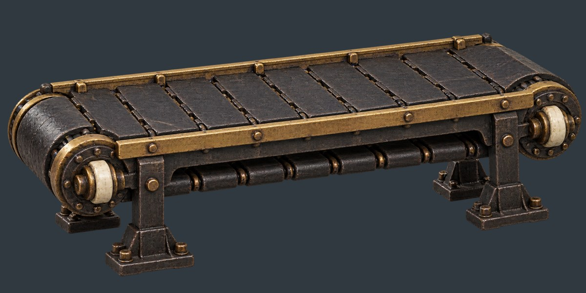

**Canvas.** Twelve-fps stop-motion claymation with Giger-esque analogue horror: sculptor thumbprints on ash drifts, VHS scanlines, chroma bleed, CRT barrel, rusted brass ribcage bridges, porcelain citizen-husks. Ochre clay, iron brown, brass, oil black, mercury silver, amber — and sorrowful blue #7BA4C6 reserved for eyes. U2 is the heaviest world: U0 flows, U1 breathes, U2 stomps.

**Mood.** Archiving against extraction; consent to be used after death.

**Story hazards.** VHS Fog (blindness; cured by Crono's Astral light or a Sound Ring). Mercury Leak (slow). Grief-Resonance (drains MP near masks and fibre; cured by harmonising a gramophone or by Crono's Astral field). Ruin Decay (lowers max HP ceiling until the Arris Dome repair bench; three stacks put Crono's crack at PEAK even at full HP). Oil-Blight (burns BP). Overcap: past the level cap, the XP bar turns to amber shards with a VHS whine instead of a fanfare, and a tooltip reads "Time leaks — spend in U7 Gold Leaf."

**Sound.** Industrial trip-hop at 92 BPM over the three-second syringe metronome; clay squelch and spring creak; R-66Y's pipe organ, Gatling spin and sine weep.

**Flags.** Arris_Dome Sleeping / Incinerated; R-66Y Rewound / Salvaged; Mother_Brain Sleep / Overclock; Lucca consent asked / forced; Cassia Extract / Keep Integrated; Ferro_Drone Spared / Scrapped; Slag_Yard Evac / Sealed; Oil_Cathedral Silenced / Fed; Lucca_Nervous_System Rescued / Left; Amber Rift (Geno-Foundry).

### U3: Saurian Eden

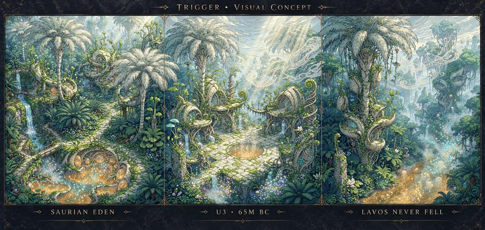

**Divergence.** 65,000,000 B.C.: Azala killed Ayla and used the Gate Key to trap the falling meteor in permanent orbit. No Ice Age; mammals went extinct and were archived as a failed draft, PROJECT MAMMAL FAILED. The Reptites had sixty-five million years to evolve into a telepathic, bio-architectural civilisation that lives inside continent-sized engineered beasts. Lavos hangs two miles up, flash-frozen in geostationary orbit — a two-kilometre embryo in torpor, a bleeding purple second moon pulsing every twelve seconds.

**Places (three tiers).**
- **The Mycelia Floor** (Lv 21–23) — a glowing fungal river that is one organism, breathing twelve Shared orbs; every step ripples 20 m; murals read HUMAN = FAILED; seed-bridges sleep until tethered.
- **Papyrus Mid-City** (Lv 23–26) — nautilus spirals; living vellum doors that unfurl; temples with 40 m auras; the Unbound draw mammals in charcoal.
- **The Crown Canopy** (Lv 26–29) — 80 m white feather-palms, open sky, thermal columns drawn as pale blue hatching (#A8C8E0) that are themselves collision.
- **The Observatory** — where the Moon dominates noon.

**Factions.** The Divinatory Synod (feathered priests who worship the Frozen Moon as a meditating god and reflect its light onto eggs); the Gene Scribes (who keep the mammal arboretum and write history onto the flesh of the walls); the Unbound (youth who hear the Moon's faint hum, heretics).

**Canvas.** Moebius-inspired Franco-Belgian ligne claire at 30 fps: a constant 2 px line, closed forms, flat gouache, fine crosshatching, neon-pastel gradients in the spore-forests, no taper, dot eyes, twelve-pose walks. The most designed and least organic line in the game. When Vaelos contaminates it, watercolour bleeds into the clear line — horror.

**Mood.** A tender bio-utopia built on a stillbirth. What if your extinction was someone else's Eden? The Reptites are poets, not monsters; the party, as mammals, are the horror returned. For Sera it is a terrifying comfort: a world where her father never died because Lavos never fell, and where she could never have existed.

**Systems in the story.** **Divinity Field** — within 40 m of a temple or in direct moonlight, +1 Shield every 5 s up to 20% max HP; it heals enemies, not Crono; breaking it silences the source for 15 s. **Mycelia Tether** — a global pool of twelve Shared that regenerates only while the party stands still. **Fake Carrier Burn** — burn more than six Shared in ten seconds and the pollen browns and crackles like U2 vinyl, but does no damage: the fungus deceiving hoarders. **Thermal Updrafts** — the Papyrus Membrane glide, required later for U6. **Living Papyrus Walls** — offer a memory (permanently erase one U0–U2 lore entry this cycle) to open a shortcut; the only world where Time Debt can shrink, because forgetting is a mercy. Offering the memory of Crono's porcelain reveal lowers the Debt by 3% and adds Light, but locks U7's gold-leaf repair. **Worship Gaze** — look up at the Moon for three seconds of stillness and its 18 Hz drone cuts to half a second of sacred silence, revealing sky-script and the quest "Why It Didn't Fall."

**Story hazards.** Pollen Haze (−20% gauge; cured by Xyloph's aura); papyrus walls that close and spawn sumi beetles if you sprint for twelve seconds.

**Sound.** Desert wind and a bone flute (F4 to C5), hollow woodwinds, no drums indoors; a crystal bowl chimes every five seconds over an up-octaved Lavos hum; wet pops and regrowth sighs; glides tear silk under a panning choir.

**Flags.** Azar Scholar / Predator; Moon Memory kept / sacrificed; Panspermia / Pure Eden; Saurian_Egg Incubated / Crushed; Xyloph Bloom / Ash; Mycelia_Tether Spore / Burn; Eden_Warden Offering Made / Refused.

### U4: Drowned Cathedral

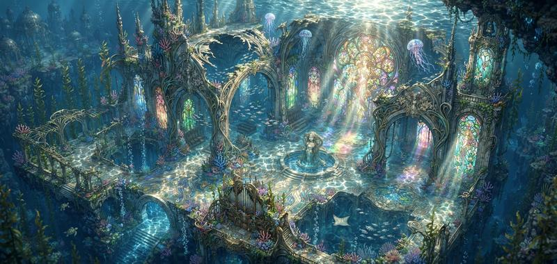

**Divergence.** 12,000 B.C.: Schala shattered her pendant. Zeal didn't fall; it sank on purpose, chained to the seabed to hide from Lavos, and the Mammon Machine flash-vitrified the ocean, the air and the people into living glass and crystallised salt. Zeal and the surface hang sideways in a silent, non-Euclidean deep-sea cathedral of weeping salt statues.

**Places.** A complete Ocean Palace cathedral of living stained glass, 400 m down at high noon. **The Baptistery**, a frozen splash, where Sera's slip lands; in one doorway a cat's bowl that never vitrified. **The Nave**, full of vitrified citizens. **The Library**, whose glass books can be read only by caustic light. **The Sacristy.** **The Central Eye** and **the Rose Window**, behind which Schala's image has polished itself for two hundred years while Vaelos siphons her. **The Dreaming Moon**, the cathedral's great stained-glass moon, asleep.

**World logic.** Light is air, time and weapon. Inside a focused beam you can breathe and time flows; outside is crushing dark and time-frozen debris. The sun's angle from the surface is the dungeon's clock, and safe routes shift as it advances with each puzzle solved. Citizens are part glass, and emotion tints their skin: grief cobalt, rage amber, hope clear; their gold halos flicker whenever Vaelos drains them.

**Canvas.** Illuminated Art Nouveau stained glass and oil-on-glass: Mucha and Chartres underwater, never blue fog. Whiplash-lily arches as kelp, brass organ pipes grown with coral, floors of on-edge mosaic whose lead cames are the paths; walls are windows, not textures. Ray-marched caustics everywhere; movement trails wet oil strokes; characters cast prismatic refractions instead of shadows. The only world where light has geometry.

**Mood.** Grief preserved perfectly is still grief: beautiful, brittle, dead. Schala polishing her own portrait forever is Crono's lie — a copy performing an original. This is the first place Crono shows his crack and is accepted.

**Verbs and hazards.** **Polish** — wipe algae and the glass sings in C minor; clearing the Central Eye reveals Vaelos's pipes, the first proof of him without a fight. **Prism Combat** — Vesper's white ray splits into elements through coloured glass (azure makes ice, amber fire, cobalt tachyon), so placing Crono behind azure turns his fire to ice for a turn. **Caustic Puzzles** — rotate broken rose shards to focus sunlight on coral switches; an aligned beam projects a memory (Schala's lullaby, the drift of Crono's atoms) and drains water to open an air bridge. Gates are opened by colour, not keys; the exit needs a seven-colour rose. **Crush** — fifteen seconds outside safe light and the lead cracks and the sound low-passes to a 120 Hz tink before damage begins. Grief-Resonance at 28–40 Hz is felt in the chest before Vaelos is seen.

**Vaelos here.** The Lamplighter. His siphon tube behind the Rose is a Mammon conduit that links U4 to U2's amber archive and U6's Singularity. He leaves a stained-glass shard of Crono's face behind; if it is kept, his whispers follow the party into other universes.

**Sound.** A pipe organ through water, glass-rim violins, a boy soprano; the Zeal theme played in canon, delayed by colour (red on the beat, blue at 80 ms, yellow at 160 ms) until a puzzle aligns it; a 60 BPM jellyfish bell as the cathedral's heartbeat; lead creak and caustic crackle. Schala hums a hymn reversed; Vaelos hums it forward. Breath is reverb wetness.

**Flags.** Central_Eye Broken / Polished; Moon Sleep / Shatter; Weave It Anew; Vesper Cracked / Preserved; Tide_Memory Kept / Released; Coral_Heart Replanted / Harvested; the Lamplighter's shard kept.

### U5: Carnival of Ash

**Divergence.** Lavos exhaled early. In 597 A.D. a premature ashfall buried Guardia's fields — grey snow that never melts, made of Lavos vapour and heroic atoms. Ozzie, Flea and Slash butchered Magus and fed Lavos's blood to the world, and the Middle Ages became a grotesque fairy-tale nightmare: a patchwork sky, castles walking on chicken legs, theatrical folklore monsters. By 600 the kingdom had built the **Carnival of Ash**, a fair that never ends, because if the music stops, people look at the sky. Cyrus survived Denadoro and hangs above it as the Marionettist; Glenn never became a frog and became its jester.

**Places.** The Outer Midway of elastic stalls; the Gacha Plaza, the centre ring where soot children laugh at nothing and ash cotton candy never dissolves; the Inner Big Top; the circular Puppet Stages; the Ash-Pit beneath them; the Hall of Mirrors, whose mirrors show every character's true canvas — Crono in watercolour, Glenn's reflection a frog; the stalls (Gacha, Wrestling, the Sweetcorn Pope, whose corn is charred laurel sprigs); the centre pole, which is Cyrus's melted lance, notched to count days; Bekkler's tent, where the laughter is harvested. Tickets read "ADMIT ONE TO NOT LOOKING AT SKY," dated 600 A.D.

**The loop.** The fair loops every twenty-two minutes. The stalls burn in a different order each loop. People rescued from the fire become vendors in the 1024 Atrium. Save the same child three loops in a row and they leave an origami frog. The loop ends only when someone refuses to perform.

**Canvas.** 1930s rubber-hose ink-blot animation with dark gothic puppetry and Victorian cut-outs: bouncy, film grain, a boiling two-frame outline jitter of variable weight, pie eyes, white gloves, 24 fps on twos with smear holds. Sepia (#D8C99B), ash grey (#9A9A94), mustard, cherry and bruise purple; fire is flat two-tone and loops like an old cartoon; hits are literal "BAM!" and "POP!" title cards; smoke is hand-drawn coils. The only world where limbs bend.

**Mood.** What if your best friend needed you to be funny forever? Comedy hiding grief — which is exactly what the party has been doing around a fake Crono. Funny until it isn't. Vaelos feeds on the laughter: every laugh is Time Debt interest.

**Verbs and hazards.** **Puppet Stage** — every fight is on a circular stage, turn order shown as a thread bar from Cyrus above; slash techs cut threads to delay enemies; cut six or more and the stage collapses into the Ash-Pit, with its Laugh Track Drain. **Elastic traversal** — accordion platforms, trumpet-slide ladders, balloon squeezes; stretch arms 300% across gaps, squash to 4 px under flames; a perfect dodge spatters ink and pops a "POP!" card. **Prop weapons** — hammers and rubber chickens that swap a character's tags to [BLUNT][GUILE]. Ash Inhale (slow and 20% blindness unless Glenn's theft rewinds it). Ashfall outside the music's radius eats 0.6% of Crono's max HP per minute. Performing a fake laugh earns BP and debt; refusing to perform costs dignity — 10% the first time.

**Sound.** A detuned calliope and a Depression swing band at 90 BPM — brushed drums, muted trumpet, upright bass, glockenspiel. The boss plays as a 78 rpm record slowed, fire crackling as vinyl noise. When memory returns, clean legato strings break through the 1930s mix — the same as Crono's theme in U0. Slide whistles, tap shoes, thread creaks, and a laugh track that drops in pitch whenever BP is stolen. Under it all, Vaelos's contrabassoon on a diminished fifth.

**Flags.** Cyrus Cut_Down / Left_Hanging; Re-String as Instrument; Glenn's strings cut / kept; Jester_Mask Kept / Broken; Crowd Saved / Cheered; Tent_Fold Spare / Burn; Bekkler Confessed / Hid; Carnival_Completed; Laugh_Track_Resisted.

### U6: 1999 A.D. Singularity

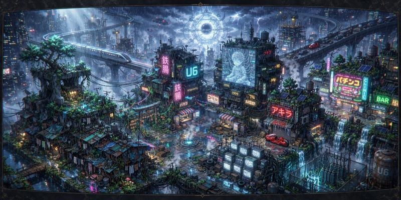

**Divergence.** Lavos didn't fall here as a meteor; it fell as a signal. In 1900 humanity captured it with orbital harpoons. In 1978 Belthasar's early network detected its telepathic carrier, and Guardia built the **Neo-Truce Dome** over the crater and jacked in. By 1999 a cassette-futurist megalopolis lives inside Lavos's impaled infant shell, powered by Dream-Static harvested from its nerves; 90% of the population can no longer tell waking life from nightmare. The black halo over downtown — the Singularity — is a Dyson-chrysalis feeding on data, and it is still buffering, which is why the rain never stops. This is Vaelos's cradle: where his shape stabilised, where Lavos learned adolescence.

**Places (the Third District).** **Low** — tin shacks, CRT-stack shrines blasting white noise, laundry on live wires, cooling-tower waterfalls into oil; the save point is a pachinko wall. **Mid** — PACHINKO / CLINIC / BAR / COFFEE in hand-painted katakana and acid neon (#FF1E9C magenta, #00F0FF cyan, #A6FF00 green); hologram loops of a wired kid, the larva's avatar; a red bike under a shutter with an AKIRA tag. **High** — maglev loops, construction scaffolds, a sky that never clears. **The CRT Shrine Plaza** — nine stacked TVs, each showing Crono's face from a different year; the nest where Static lives, and the Matriarch's umbilical.

**Canvas.** Gritty hand-painted 1988 cel anime: four-step ramps only (base, a shadow 15% shifted in hue, a shadow 60% darker, a neon rim), no gradients, 2 px inner and 3.5 px outer ink, film grain only in shadows, rain as painted cel streaks on twos, puddles as inverted reflections smeared with neon. CRT barrel, red and blue chromatic offset, scanlines every 3 px at 40%, vignette; one frame of white-noise dither when the larva is alert.

**Mood.** Abolitionist childhood against apocalypse parenting. Leave a child plugged in to save the multiverse, or unplug him and doom a timeline. Sera feels Static's latchkey loneliness as her own.

**Verbs and hazards.** **Conductivity** — rain builds it; high conductivity reveals wire-mesh enemy routes and lets you walk through neon light-walls, but drains SP; dry off under tarps. **CRT Tuning** — align nine stacks by eye and ear to see Crono's past (Chapter 7); the last line it yields, "1999 still raining inside the machine," hints that the Singularity is a save state. **Neon Bloom Stealth** — near the nest, neon signs turn solid and pulse every two seconds; move only inside the halos or an ICE (an Arch-Curator reskin with a rotating Gatling ring) spawns. **The Red Bike** — grind maglev rails; its headlight reveals the world-wire that later leads to Vaelos's root. **VHS BLIND** and white-noise bursts.

**Sound.** City Pop on a Juno-106 at 90 BPM, sheet-metal rain; the Singularity in mono with 12-bit crush; a CRT hum that is the larva's purr (60 Hz, raised 0.7 of a semitone); a dial-up lullaby; a pachinko chime at saves. The Isolator can mute the whole city to rain and static — the same silence as Crono's.

**Flags.** U6_Matriarch Unplugged / Fed / Hiss_Lullaby; Static_Throat Freed / Plugged; Red_Bike Kept / Stripped; Vapor_Memory_Core Kept / Used.

### U7: Bone-Tree of Eternity

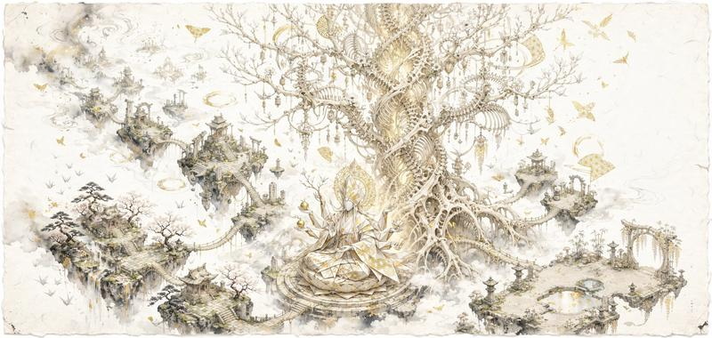

**Divergence.** ∞ A.D.: Gaspar died, the Time Buckets overflowed, and the End of Time starved for a billion years. The lamppost grew into a twisted tree spanning an infinite white void, and lost travellers wash up as faceless porcelain husks. Spekkio became Omega-Spekkio.

**What it is.** Deletion. An infinite white paper void holding one tree, grown from the fused spines, ribs and antlers of every species from every universe that Vaelos culled. No skybox, no horizon. The trunk is stacked vertebrae whose thin edges glow amber-pink, like washi held up to the sun, with ink pooling in the crevices. This is Vaelos's cradle: here Lavos incubated the vaporised atoms intending to give them a soul. Its first attempt at a soul was Kami-Ori. The Tree drank the original Crono's marrow, and when the copy arrives it recognises its own.

**Places.** **The Root Approach** — a void-walk tutorial: stand still three seconds and your ink footsteps fade; only gold kirie butterflies — rigid asanoha cut-outs — show where the negative space can be walked. **The Mid-Spire Shrines** — orbiting islands that fossilise moments from other universes: U2 amber frozen with VHS static, U6 CRT rain from 1999, a U3 papyrus nest. Bone-bamboo bridges that breathe two or three pixels. **The lotus ponds**, a Divinity Field where cracks can be repaired. **The Crown of Horns** — antlers sprouting rib-lanterns and hanging paper cranes around a flat lotus dais over an infinite white drop, where Kami-Ori waits.

**Canvas.** Amano sketchbook and gold leaf: ink wash, feathered graphite, translucent watercolour, kozo paper with deckled edges, 70% negative space at all times — if a screenshot looks busy, it's wrong. Gold kirie marks only what can be touched: gold is safe, gold is truth. Origami logic: Kami-Ori and her monks are folded paper with crease history and gold inlay; a hit unfolds a layer into void; death collapses them into a flat crane. Twenty-four fps with held-breath frames.

**Mood.** The anti-final-dungeon. Every other universe is cluttered with life; this one is grief made physical. The party expects a fight and finds a mother who gave up everything to hold a cradle.

**Verbs and hazards.** **Fold** — draw a mountain or valley line to fold distant islands together for five seconds, making bridges and lining up torii. **Glaze Erosion** — Crono loses 2% of his glaze per battle, up to 30%, until he rests at a lotus pond; repair is a kintsugi mini-game of brushing gold over cracks (1% every 8 s, +1 Shield every 5 s, thawing Ruin). Below 20% his galaxy refracts through the marrow glow and casts caustics that solve the Crown's light puzzle — broken is not useless. Falling is never a Game Over: Sera slips the party back one checkpoint and Crono cracks 5% further. **Ink-Eaters** break the 70% white rule with spreading black smudges. **100 Kirie Scales** — torn kimono silk in gold leaf, found by a cicada buzz filtered through tatami; all hundred reveal Kami-Ori's seventh arm.

**Access.** U7 needs the keys of U0–U6 and the Prometheus Core. It is time-locked: nobody slips out until Kami-Ori is faced.

**Sound.** Seventy percent silence. An empty large-room tone and bone chimes; a sub-bass marrow hum near the trunk; solo shakuhachi breath and a koto pluck about every seven seconds, no orchestra; footsteps of dry brush; pitched origami snaps; a NULL cast is a deep inhale and then absolute tape-stop silence; the Final Void is a heartbeat and paper rustling.

**Flags.** Kami_Ori Wounds_Kept / Blank_Slate / Paradox_Child; Offering_Made; Kirie_100; Fossil Preserved / Shattered; Gold_Leaf_Bridge / Bone.

### U8: Vaelos Heart

**What it is.** The inside of what drank the Tree. The party follows Vaelos's marrow-string — a filament of the original atoms — into a womb-museum: a spherical chamber 400 m across built from more than two hundred overlapping Time Eggs, each two metres tall, each holding a failed Bekkler copy of Crono at a different crack level, some in other canvases (a mossy-stone shoulder in watercolour, an ink-only copy, a clay one stepping at 12 fps). At the centre floats Vaelos. Marle is not here; only the children who contain Crono.

**Places.** **The Navel String** (Lv 71–73) — an umbilical of fused Bekkler doll string and Lavos muscle fibre that pulses at Sera's heartbeat; every pulse steps all nine canvases at their own rates at once. **The Gallery of Copies** (Lv 73–75), a side path of eggs Cassia can loom open: Marle touching Crono's wrist to check warmth; Lucca saying "you have to ask me before you use me"; a tiny porcelain Marle — Vaelos tried to make a mother first; an egg labelled CRONO-00-P in the original's vaporised pose with a note in Belthasar's hand, "ATOMS 12,000 B.C. — UNSTERILIZED." **The Central Cradle** (Lv 75–80) — zero gravity; only gold-leaf butterflies are solid. **The Time Debt Well** beneath Vaelos — if Crono drops below 20% here, his galaxy drains into the Well and heals Vaelos 5%: a father feeding a son.

**Canvas.** Porcelain Null at 15 fps with every style colliding. If the party's Prismatic affinity is 45 or more, all nine canvases blend into one image; below that, three styles fight for the screen and flicker, nauseating on purpose. If Dark reaches 70, a wall of gold leaf cracks to black oil — an omen. R-66Y's masks weep in unison here, blue and black, all of them looking at Vaelos, not the player.

**Story hazards.** Prismatic Myopia (blindness and wrong framerates on the HUD until Sera stands still for two seconds to sync). Time Debt Inheritance (Crono's ASTRAL cost rises from 0.4% to 1.2% per cast; Cassia's Wire Loom Mend restores only 0.6%). Borrowed Future Echo (while Sera's debt is past the 40% line, everyone near her loses 3 MP every 5 s as her future is borrowed). Lavic Filial Field (all attacks redirect to Crono while Sera is below 40% HP — two fathers competing to be the shield). Crono's wrist seam is at PEAK even at full HP: the Heart reads his ceiling cost as truth.

**Sound.** Heartbeat from 0 to 144 BPM sets the framerate. Nine layers play one chord, each in its universe's instrument: brush strokes, sumi koto, gramophone crackle and hydraulic hiss, desert wind, organ bubbles, a slide whistle, 1988 synth and rain, shakuhachi and bone chime — and for U8, silence and the reversed hum of a vaporisation.

### U9: White Void and Borrowed Future

The spaces after the finale. **The Borrowed Future** (Ending 4): a floor that falls upward, made of overlapping debt ledgers stamped with every failed copy's serial; at its centre Belthasar's workbench holds Bekkler's porcelain repair kit with squeaking rubber-hose gloves, a cracked Time Egg with the original atoms still warm, and Sera's "∆t<0" cape, folded. **The White Atrium Void** (Ending 8): the Atrium at 95% white, lit only by gold dust that hangs without falling, an empty high chair at its centre. **The collapse void** of the no-ending: white, and a new cycle. Levels here run 80–99.

---

## 6. Story, chapter by chapter

Each chapter lists its universe and level band, its beats in order, its set-pieces and dialogue, who is in the party, the enemies and bosses at story level (their stat blocks, shield plates and numbers are in the Combat Laws Bible), the choices and flags it sets, its rewards, and its exit hook. After every universe's boss comes one of Sera's solo interludes — seven in all, one per day of her seven days — played on Vaelos's side of the Fracture while the party crosses to the next canvas.

### Prologue: Atrium Fracture

**U0, Guardia Atrium, 1024 A.D. · Lv 1–3 · playable: Crono, with Marle as a guest and Sera.**

**Beats.**

1. **The Pendulum of Borrowed Mornings.** Rain over Truce Canyon falls as ink strokes, clay drops and torn parchment, depending on where it lands. Crono wakes sitting up in Guardia Castle. Robo greets him through a brass tube from the Clocktower with soft synth chimes. Marle, passing in the corridor, mentions that Magus still hasn't left the crypts. It is the morning of the anniversary of Lavos's fall.
2. **Breakfast.** The family kitchen in the Guardia Atrium wing, at full watercolour fidelity: paper grain, pigment pooling, light through stained glass no one has cleaned since 1000 A.D. Crono makes porridge — exactly seven clockwise stirs, then a tap on the rim. It isn't habit. It is a preservation ritual Bekkler encoded to keep his seams from fraying. Marle comes in barefoot in ceremonial blue with her ledger under her arm. She doesn't sit; she leans close to steal his heat. For seventeen years she has been checking whether his shadow lands correctly and whether the steam fogs his skin. Sera storms in late, Crono's old bandana wrapped around her wrist, her hair charged with static. She has been dreaming in sumi-e — ink washing faces away.
   - The world is already leaking: spoon reflections stutter at 12 fps with VHS damage (U2), the copper pots wobble at 30 fps with a ligne-claire line (U3). Sera's childhood stool has a groove burned ink-black on one side. The stirring is quantised; when Crono stops, the house clock skips a half-second tick.
3. **The first Chronoslip.** Sera reaches for her bowl and her forearm phases mid-air from watercolour into U1 sumi-e: the colour drains, the framerate drops to 24, her edges turn to brush bristle. The porridge follows her — pigment becomes an ash stroke, then cold ash that smells of burnt paper. For six seconds both canvases render at once, the U1 mask in the shape of her silhouette. She catches a *memory* of dropping the bowl, not the bowl. Crono lunges. His wrist kisses the stone counter with a soft tap — *ching* — and a hairline crack opens on the inside of his forearm. No blood. Layers of translucent porcelain, a faint blue interior, and inside it a second, smaller face. Light passes through. It is the first time Marle and Sera have seen it.
4. **"You never taught her how to fall."** Sera's nose bleeds ink. The bowl lies cut in two: half porridge, half ash. Marle finally says the line she has been holding since Sera first floated off the ground at nine. Crono taught their daughter sword forms and how to travel light; he never taught her how to abort a slip, how to land without shattering a timeline, because he never learned — he died falling. Marle pulls Sera to herself, not to him. Porcelain breaks if you grip it tight.
5. **The first whisper.** Sera's eyes roll to U7 gold leaf, metallic flecks swimming in them. A voice layers over hers — something learning vowels. The kitchen flickers for one frame into U5 rubber-hose squash and snaps back. Sera collapses.
6. **Robo's relay.** The brass tube crackles. Robo has been holding the castle's timeline straight to throttle the Debt. The **Time Debt** appears on screen for the first time: a red heart-string running from Crono's chest to Sera's. Its cost is max HP he cannot heal.
7. **The Atrium tutorial.** Walking and battle stance. **Porcelain Insight**: hold focus on his wrist to see the crack. **Chronoslip residue**: walk through Sera's ghost and a U1 ink puddle slows you to 24 fps — framerate as lore. The kitchen's exit is sealed by Bekkler's tech: the **Fracture Gate** opens only when Crono deliberately spends Time Debt and cracks himself down to 60%. HP is currency and key.
8. **The Atrium Cradle.** The house itself tries to keep its dolls safe (boss, below).
9. **The courtyard.** Glenn, one-armed on his Masamune-hilt cane, and Magus, bleeding silver time from his blind eye, are waiting. Magus tells Crono that Lavos was a larval spore of a Multiversal Constant and has metamorphosed; Glenn reminds him of Lucca's journal — the bad endings were never pruned, only quarantined. Crono straps on the Epoch gauntlet. The family leaves for the Atrium Horologe in Truce, the one place where the Debt doesn't collapse around him.

**Dialogue.**
> **SERA:** Dad— you're—
> **MARLE:** *(hand to her mouth — not shocked; confirmed)* You kept stirring.
> **CRONO:** *(covers it with his sleeve, reflexively)* Burn. Old burn.

> **MARLE:** You never taught her how to fall.

> **VAELOS** *(through Sera)*: She slipped well. Like you did. You left atoms. I kept them. I learned to hold a spoon.

> **ROBO:** [CHRONAL STRAIN EXCEEDED. ATRIUM INTEGRITY 81%. CRONO UNIT: STRUCTURAL FAILURE IMMINENT. SERA UNIT: PARADOX AFFINITY LIGHT UNLOCKED. RECOMMEND: EVACUATE TO U2 TO BLEED INERTIA.]

"Burn. Old burn." is Crono's first lie and his first Dark-leaning act.

**Enemies.** **Dust Mote Clusters** that orbit in the motion of his stirring and wash away like watercolour when broken. **Porcelain Shardlings** that spawn from his cracks and mimic his idle; broken, they leave tungsten bracer scraps. **Ashen Spoons**, sumi-e brush enemies bleeding in from U1 at 24 fps, which teach breaking a two-tag shield in order. **Vaelos Echoes**, intangible shadows only Sera can hit, which cause Chrono Lag — a local framerate drop.

**Boss — the Atrium Cradle (a proto Arch-Curator on an R-66Y frame).** The house trying to keep its dolls safe; it shares R-66Y's rotating thoracic ring.
- *Preservation Protocol.* The ring casts Sorrowful Blue and locks the party to 12 fps. Break it with Light and Crono's crack holds; break it with sword or fire and the crack widens. Robo, over the tubes: **"PRESERVATION =/= LOVE. ERROR."**
- *Dollhouse Seal.* The arena splits half watercolour, half clay. It can be damaged only by spending Time Debt — 5% of Crono's max HP, the game's first permanent cost. Sera learns **Fall Break** here.
- *Atrium Fracture.* U1 ash in the background, U0 in front; a porcelain theatre mask with a crack-slide appears — the first glimpse of the Arch-Curator. Each break swaps the scene to U7 gold leaf for three seconds. In the last tenth, Vaelos's voice overlays Robo's. A perfect parry on the crack-slide opens a Prismatic window.
- Defeated, it shuts down rather than dying: six frames of legs folding like an insect's. It drops the **Tungsten Wire Loom Bracer**.

**Choices, flags and affinity.** The fall-or-catch moment is Sera's first Paradox Affinity.
- **Teach Her To Land** (Light): catch her gently, talk with Marle, take no extra Debt. Sera gains Light (later, U4 stained-glass healing puddles); Crono's integrity holds at 60%; Robo stays stable; stained-glass wards slow Debt interest in Guardia.
- **Hold The Copy Together** (Dark): hide the crack and break the Fracture Gate with the sword. Crono drops to 40% and the inner face shows; Vaelos's whispers come 15% more often; Sera gains Dark (U1 sumi-e dodge; ink trails show enemy tells three frames early).
- **The Bowl Still Whole** (Prismatic, +15): catch the ash-porridge bowl with Astral Smear Dash in a 1.5-second window while at 60%. It costs Debt but keeps both paths open. Vaelos, secretly: **"—you remember how to catch—"** It grants the tech **Bekkler's Guilt**, makes gold-leaf flecks appear whenever Debt is paid, and is one of the two halves of "the spoon taught" for Ending 3.

**Rewards and techs.** Crono: **Astral Smear Dash**, **Porcelain Reveal** (passive translucency below 60%), **Time Debt Seal** (spend 20% max HP to close one of Sera's slips — he uses it here). Marle: a crossbow ward of Light; the Dual Tech **Porcelain Promise** is teased. Sera: Chronoslip (passive), **Fall Break** (a time impact that halves the next Debt), **Nosebleed Ink** (self-marking for navigation in U1).

**Exit hook.** The family is gone. The kitchen holds both halves. In the ash half, where Crono sat, the outline of Vaelos sits at the table learning to hold a spoon — the first humanoid Lavos.

### Chapter 1: Clockwork Daughter

**U0, Atrium Horologe and Leene Square · Lv 1–4 · protagonist: Sera; anchor: Crono · cameos: Glenn, the Seed of Doan, a Cassia-09 echo, Krona's footprints.**

A few days after the Prologue. The family now lives in the Horologe.

**Beats.**

1. **The bedroom crack check.** Sera wakes in her loft, a wall of Crono's old Truce house rebuilt inside the clocktower. Her father sleeps sitting up across the room; he never lies down, in case his galaxy heart spills. The prompt is simply: look. Holding focus desaturates the watercolour and reveals amber shards and ink footprints, the crack across his skull and the lit seam at his left wrist. Marle's scarf, frayed red, is around Sera's neck.
2. **The nightmare.** Vaelos's gold-leaf dream leaks into the loft. A clean, young version of Crono's voice — no gravel: **"Hey. You left the door open again."** Sera tears. **Rewind** is introduced: no Gate Key, just Sera, six ghosts of her in six canvases (on screen only her base and two ghosts at a time), landing two seconds in the past and rewinding her father's idle animation. It costs +5% translucency, and the porcelain crack under her left eye spreads to match his. The game says it plainly: every crack in the father pays a debt in the daughter.
3. **Father Tank.** Downstairs, Crono's passive fires without input — if Sera's translucency moved or she was hurt in the dream, he steps between her and the window where ink is gathering. His dialogue choices are only **[Nod]**, **[Look Away]**, **[Say Her Name — "Sera..."]**. Choosing Look Away triggers **Porcelain Wrist Reveal** and gives the party **Concerned**. His taunt, low, gravel, forty-one years tired, is the only full sentence he says in the chapter: **"Because when she has nightmares she calls for me."** The trauma-silence system starts here.
4. **The hub.** Robo's pillar ([4.11](#411-supporting-cast)) stepping at 12 fps inside a 60 fps world. Tutorials: save, heal, inspect Crono's crack. The fountain resets his smear trail but never the Debt.
5. **The 999 Shield Dummy.** In the north-west corner stands Belthasar's first Bekkler doll, a failed copy of Crono made before the one who lived, which Lucca refitted with a thoracic ring. It has 999 regenerating shields skinned in every universe's style, and every hit chips it with a ceramic crack that rises in pitch. Its brass maker's plate is half-scraped: "Property of Belthasar — Bekkler Assembly — 1999/2300 — Serial: Crono-0…". At 20% it shows a galaxy inside and giggles. Breaking it at 100, 300 and 999 unlocks the Codex entry **Vaelos Composite Theory**: he holds every element because he ate Crono's atoms.
6. **Krona marks.** Barefoot indigo footprints bloom and fade over six seconds — U1's ink leaking through Sera's slips — and lead to the garden. If the player waits ten seconds, a gold-black lotus blooms by the right gate.
7. **The Seed of Doan.** A mercury orb in tungsten wire in a pot, needing water across three visits (time must pass through a gate slip between waterings). The first water turns it into a sprout with a tiny gramophone horn playing Crono's theme backwards at 432 Hz. Lore: this Doan refused to become a Prometheus Core.
8. **Glenn's honour check.** The Marshall trains at the dummy and reads the party's record. With no needless killing behind them he offers training and the promise of **Ashen Bash** (Crono + Glenn) and **Mercy Leap** (Sera + Glenn). On a Ruthless record he withholds them: **"You wear a doll to hide cracks. Same as me wearin' paint."** — and they stay locked until the Bekkler doll is repaired in U5.
9. **Midnight.** Robo's core inhales; both eyes shut. Under the 72 BPM music box, a second heartbeat at 68 bleeds in. That night at the hearth there is a hidden prompt: Crono can hold out his wrist to Marle (**tell** — opening the Gold Leaf repair path in U7) or pull his sleeve down (**hide** — opening Bekkler's rubber-hose reseal in U5).
10. **The Twenty-Fourth Fair and the Crimson Tear.** The next evening the Fair opens in Leene Square. Sera, sick of being kept in a tower, slips out. Robo reports her vitals spiking. Control passes to Crono: an exhausted forty-one-year-old chasing a teenager through crowds that smell of chestnuts and ozone, while she phases through clay, anime cel and flesh in front of them. **Bekkler's tent** is open. Inside, the old clown looks at Crono and asks: **"You know you're a doll, right?"** — and if Crono stays, Bekkler confesses what he made. At **Lucca's old Telepod pavilion**, Sera's Chronoslip detonates and the sky splits into seven shards, each animated in a different canvas. Rift-spawn from all seven pour into the square. **Vaelos** descends from the geometric diamond above the Telepod — nine feet of cracked alabaster leaking starlight. Crono's Rainbow passes straight through him: identical cellular signatures. Vaelos tells Sera that her body will evaporate into tachyon radiation within seven days, and that her father's resurrection is what made the multiverse rot. He offers to make her solid. She takes his hand. Crono overcharges the gauntlet and leaps into the closing seam.

**Dialogue.**
> **VAELOS:** You replaced yourself with a toy from a carnival tent, Crono, and left me — the ash of your true body — inside the belly of the star-eater. Tell me: which of us has the right to be her father?

> **VAELOS** *(to Sera)*: You hum like the house I was never allowed into.

**Party.** Sera alone in the opening beats; Sera and Crono in the hub; Crono alone at the Fair.

**Enemies.** Memory echoes leak near the dummy when its shields are stressed: **Moss-Mice** (match a sword, then chip with fire), **Bekkler Fragments** (a stretching rubber-hose doll piece from U5 that only Sera's probability can pin), an **Ashen Echo of Krona** (sumi-e, burns a shrine door and leaves an Ash Field, demonstrating RUIN), and a **Ferro-Drone 09 Prototype** (a gramophone and a mercury orb — Cassia's parts before Cassia). At the Fair, rift-spawn from all seven universes.

**Boss — the 999 Shard Doll (non-lethal tutorial boss).** The same base as Crono's 100% doll — goggles, Time Egg replica in the chest — on six reverse-jointed spider legs with a tungsten bracer and a mercury shoulder, masks orbiting its collar.
- *Recognition* teaches sword-and-fire pairing and reveals its first hidden tag, FERRO.
- *Contamination* thickens its shields and forces Sera to Rewind the dummy's gauge; holding Sync Hold at 99 opens a Boost window.
- *Galaxy Giggle* — at 20% it cracks like Crono's reveal and splits into three dolls in three canvases (U0 watercolour, U1 ink, U2 clay) that must all break within three seconds; Crono's Astral Smear Dash lines them up.
- *Debt Lesson* — it shows 999 shields to intimidate; only ten are real and the rest are fake shards. Vaelos's shields are belief.
- When it breaks, Crono's wrist-seam check fires. If Sera sees it, Concerned. If he looks away, his debt quietly grows by 10% later. The dummy can't kill anyone; failure only cracks Crono further.

**Choices, flags and affinity.**
- **Atrium_Dummy_Spared** (Light +10): spare it after the third phase without spamming Boost.
- **Atrium_Dummy_Salvaged** (Dark +15): rip out its thoracic ring for parts. The masks weep black oil permanently, a hydraulic hiss enters the 72 BPM, an arm cannon is gained — and Glenn refuses his Dual Techs at once.
- **Amber_Rift_U0_DollMeetsDoll** (Prismatic +15): bring the little Bekkler doll from the workbench — a Crono-shaped toy Sera won at a Fair when she was six — to the dummy. For two frames every canvas collides; a needle drops on vinyl and an amber chime sounds. This is the first Amber Rift, which Cassia will later record.
- Pushing Sera to 40% on purpose during the dummy fight counts as her first voluntary phase-out ("Don't forget me." — "Mama?").
- Bekkler's tent: hearing the confession sets **Bekkler_Confessed**; walking past leaves it open.
- After the chapter, affinity shows in the hub: Light slows the pillar's blue weeping and runs the fountain clear; Dark quickens its black ink and stalls the Seed; Prismatic makes Krona's prints glow for fifteen seconds instead of six and keeps Sera's idle ghosts half a second longer — while Vaelos's 68 BPM gets louder.

**Rewards and techs.** Sera: **Rewind**, **Quantum Flicker**, and **Borrowed Future** shown greyed out. Crono: **Father Tank**, **Astral Smear Dash**, **Porcelain Audit** (it starts tracking −0.4% per slip — for Cassia, later), **Time Slice**. The dummy teaches the target preview that shows hit counts before committing. Krona's prints become the passive **Ink Path**, which replaces a minimap. The Seed promises the Triple Tech **Promise Across Rust**.

**Exit hook.** Crono lands face-first in a bamboo grove drawn in ink.

### Chapter 2: Crimson Shogunate

**U1, the Burning Archipelago · Lv 5–11 · party: Crono; Krona from 2.3; Sera as caged hover support at the Furnace.**

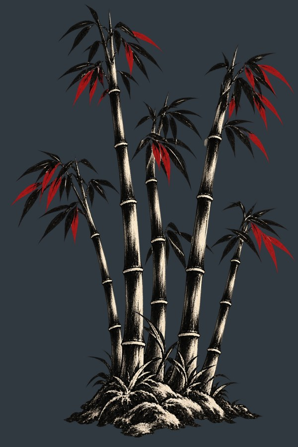

**Beats.**

1. **2.1 — Kuro-Truce Bamboo Grove.** Crono comes to on rice paper. The duel against **Krona** is the tutorial for the Elemental Canvas Clash: his Astral light burns her black ink terrain into gold watercolour patches that restore stamina, while her Defiled Masamune cuts into his max HP ceiling. Mid-fight she tells him she ate the star. His porcelain wrist is exposed; a prompt lets him overcharge the gauntlet. At the killing stroke, Sera's ghost flickers in from wherever she is being held and rewinds the blow — and Krona, seeing a girl phase through ink, stops.
2. **2.2 — Fracture over the Pagoda.** A claymation gear from U2 crashes out of the sky into Krona's Chitin-Pagoda, stepping at 12 fps in a 24 fps world: the next universe is already leaking in.
3. **2.3 — The streets of Kuro-Truce.** The Ashen Morning lie: the town looks peaceful and NPCs are repainting every gate bone white. Sera's flicker beside her father: **"Smells like wet ash under paint."** Every doorway has two layers, fresh paper over char; peel one and there are children's handprints in soot, dated three sieges ago. The melted Leene Bell hangs as a guillotine; Lucca's house is the Ash Forge. In a burned dojo, Krona sits scraping rust off a katana with oil, her retainers behind her — old friends, half-resurrected, their rot lacquered behind paper masks. They flinch when she sips. Crono tries to hide in silence and she calls it. She joins, reluctantly. **Eclipse X-Strike** unlocks: the screen splits into watercolour and sumi-e.
4. **2.4 — The Gourd Debt and the Iron Bridges.** Four bridges to Goyama, each a shrine where ash-ronin force the party to hold an **Ens Parry**. Krona's Oil-Drinker heals the party at half strength; Sera's slip-heals work at 30% on her; each sip raises the crack on her neck. Near the vein, Crono's own wrist cracks wider — the copy reacting to the original's atoms dissolved in the oil.
5. **2.5 — The karma loop.** Save the same house three cycles and it becomes a Dojo; let it burn three cycles and the family leaves a gold-leaf memory flake. Neither is good. Repainting fails either way.
6. **2.6 — Goyama Castle.** Through the Hinterlands' silent washi mountains to the castle whose top three floors burn and never fall. Paper doors are an invisibility puzzle — you can't attack while unpainted. At the top, **Lord Ashinaga, the Ashen Daimyo**, sits writing surrender petitions that become enemies.
7. **2.7 — The Cobalt Nodachi.** In the vault beneath the castle: the Founder's blade, dyed in the original cobalt pigment from the first sunrise after the Lavos ichor rain. Its trail stains any sky cobalt, letting Crono's Astral Smear Dash find hidden Chronoslips in every other world. Taking it locks U1 into permanent Crimson Night. Krona weeps for the first time, and the oil in her gourd stops bubbling.
8. **2.8 — The Mammon Furnace.** Beneath Goyama, where the vein runs, the first three-way multiversal boss. Sera hangs in a geometric cage above the furnace, flickering through all seven canvases. Krona fights beside Crono.

**Dialogue.**
> **KRONA:** *(scraping rust off her katana with oil)* Ashtears always blow themselves up. Love language.
> **SERA:** You did what Dad does.
> **KRONA:** I did the right Crono thing and everyone died. So I did the wrong thing. Drank the vein under the castle. They got back up. Corroded. So I'll keep doing wrong thing.

> **KRONA** *(as the Daimyo bleeds oil)*: You drank it too?

> **KRONA** *(taking the Nodachi)*: Some homes you save by leaving them burning.

**Enemies.** **Ashen Ashigaru** (paper-armoured foot soldiers that repaint themselves mid-fight), **Ink Calligraphers** (whose kanji become hitboxes; their wet edges burn), **Gourd-Bloated Heimin** (who drank the same vein and burst into Ash Fields), **Surrender Petition Yokai** (the Daimyo's petitions folded into origami, untouchable while unpainted), **Crimson Banner Samurai** (who hold a two-second ink pose before every slash — the Ens teacher).

**Bosses.**
- **Krona** (duel, 2.1) — the Canvas Clash tutorial; ends in a disarm, not a kill.
- **Lord Ashinaga, the Ashen Daimyo** (Lv 9–10) — twenty feet tall, seated, fused with the burning floors, body of petition scrolls, armour weeping black oil. *Scribe of Order*: his orders spawn ashigaru; breaking him scatters the petitions and reveals the child Krona's name under white-out. *The Ever-Burning Roof*: the castle breathes fire; Cobalt Wash reveals a sprinkler path. *Oil Mother*: he cracks to show a gourd heart like Krona's — Lavos blood; oil floods the floor. *The Barren Seal*: one shield that only a Dual Tech can cut — Eclipse X-Strike splits the screen so the seal is struck from both canvases at once. He breaks into porcelain over Lavos muscle fibre, the same as Crono's chest. He drops the **Vaelos Tooth**, the first proof Vaelos seeded every timeline; it whispers in a clean, young Crono voice.
- **The Weeping Shogun, Amalgam Spawn** (Lv 11) — an ink Lavos Spawn lower body fused to a claymation clockwork centipede: two canvases, two framerates, one body. Crono's Astral burns the ink half to gold; Krona's Ruin corrodes the clay half. From her cage Sera acts as hovering Tachyon support with Turn-Bar daggers — rewinding Crono's HP, fast-forwarding Krona's attacks. When it falls, Vaelos lifts the cage into the seam the clay gear tore open.

**Choices, flags and affinity.**
- **The Gourd** — seal the vein (Light: Oil-Drinker off, the retainers finally die with dignity, Krona's corruption clears and she learns to ask the party to take a hit) or keep drinking (Dark: the best tank against R-66Y, at the price of Ruin decay stacking to −60% by U5).
- **Goyama_Repainted** (Light): save the house three times and seal the vein — the Dojo opens and Ashen Morning lasts longer.
- **Goyama_Incinerated** (Dark): let the town burn three times and keep drinking — the family leaves its gold-leaf flake, U1 stays in Crimson Night, the Nodachi hits 15% harder, and the horizon glows orange behind the cobalt.
- **Goyama_Both** (Prismatic +15): seal the vein but keep a vial; bring the Bekkler doll to Krona at the castle-gate poem. She holds both — sealed and sipping — and later, when she offers her corrupted life to give Vaelos one real Crono memory, he hesitates.
- Ripping the Daimyo apart for Lavos fibre (Dark +25) gives a weapon upgrade and makes masks weep black oil permanently.
- The Debt here: every Chronoslip into U1 deepens Crono's crack, and cleansing an Ash Field with a Light heal inside Goyama costs him 3% of his max HP ceiling until U7. Breaking at Boost level 3 shows the payment — watercolour afterimages, falling gold leaf.

**Rewards and techs.** Krona joins with **Teppo Ash-Cut**, **Shogun's Command**, the ultimate **Crimson Seppuku That Failed** and the passive **Oil-Drinker**; **ruin_purge** after the Daimyo's first phase; **Eclipse X-Strike**; the **Cobalt Nodachi** (with the Homeland Dye portal back to U1; later it resonates with Cassia's Mercury Pulse to open U4's organ and supplies pigment for U7's gold leaf); the **Vaelos Tooth**.

**Exit hook.** Wedged in the clay gear's teeth is the wheel of a burned-out jetbike. Johnny's. It still runs. It tows the party up the seam toward 2300 A.D.

#### Interlude — Day 1: The House Without Doors

Sera, in her cage, is carried through the seam. On Vaelos's side the Fracture looks like a kitchen built from ash: Guardia's table, Guardia's pots, a window with nothing behind it. Vaelos sits where her father sits and asks her to teach him the seven stirs. Play is small and close — Sera can walk the room, rewind spilled ash (each rewind costs translucency, so the day's clock visibly moves) and answer him. She can teach him the stirs, teach them wrong, or refuse. The lesson is the first of the **spoon lessons**; finishing at least four across the seven interludes sets **Spoon_Taught**, the other half of "the spoon taught" for Ending 3. He tells her this is day one. Her hand is a little more transparent when the interlude ends.

### Chapter 3: Clockwork Ossuary

**U2, the Ash-Rib Expanse, 2300 A.D. · Lv 12–20 (sub-zones to 22; enemies scale to 35; party stats cap at 20) · party: Crono, Krona, Sera as a flicker; Cassia-09 from 3.3.**

> The future Crono saved didn't heal. It learned to harvest.

**Beats.**

1. **3.1 — The Frozen Slag-Yards of Proto-Dome.** Johnny's jetbike drops the party into a 12 fps claymation horror: a ribcage landscape, copper umbilicals pumping Lavos-oil, bloodshot CRT monitors stacked into shrines, magnetic sand under a VHS sky. Sera travels with them only as a flicker, phasing in and out. A lore terminal explains that Mother Brain uploaded humanity after "Ashtear" failed to reactivate R-66Y. Crono's Porcelain Audit ticks for the first time: **−0.4% max HP ceiling per jump.** The party repairs the Epoch-Tether Beacon and opens Johnny's Gramophone Shop.
2. **3.2 — The Porcelain Weaver.** Cassia-09 descends on six brass legs, Lucca's nervous system glowing in her amber furnace, puppeted by Mother Brain's override. Puzzle combat: never strike the amber tank; cut the Mother Brain antennae on her back.
3. **3.3 — Rebooting the Weaver.** The override breaks. Lucca's voice comes through the gramophone: Vaelos took Sera down the Core Shaft. Then Cassia does what she was built to do and scans the stranger in front of her. Her gramophone dips; her thumbprints go still. The line plays for the first time anywhere in the game. Crono finally lets someone measure him. From here on his cracked sprites are canon in exploration, and the party can see the starfield in him. Cassia joins; the party renders three canvases at once.
4. **3.4 — The Ash-Rib Expanse.** Overworld banter on the Spine-Highway: Crono's integrity dropping, Krona's jab at Ashtears, Cassia's glare. Johnny teaches SYNC HOLD — **"Hold thinking, skid kid!"** New team techs arrive (below). The Epoch gauntlet is upgraded with Cassia's Ferro-Coil, and the map opens.
5. **3.5 — Three roads to the Dyson-Cage.** Every road ends at the same boss; the road decides loot, Krona's passives, a lost side quest and Sera's affinity.
   - **The Mercy road.** West to the Spine-Highway (Lv 14) to win the Ferro-Capacitor from the Bike Bros; east to the Choir of Arris Dome (Lv 16), where Cassia harmonises her gramophone with the weeping porcelain citizens and gently puts the uploaded minds to sleep, shutting down the Cooling Towers without killing anyone; then down the Core Shaft (Lv 19) with Mother Brain weakened by 30%. In the Dome, porcelain choirboys play Marle's lullaby backwards through a gramophone hymn. Sera phases in, hears it forwards and translates: **"They were singing to stay awake."** The Grief-Resonance there can only be cleared if she lets her father take her hand and they both pay — 5% translucency for her, max HP for him: their first joint cost. A side path holds the Seed of Doan frozen in amber.
   - **Krona's road.** Skip the Highway and the Dome. Krona overloads the Geothermal Pipes in the Geno-Foundry (Lv 17) with Ruin and incinerates the porcelain citizens. The Seed of Doan side quest is lost for this cycle; Krona earns the permanent passive **[OIL-DRINKER]** (+25% crit against mechanical and Lavos foes); a shortcut drops straight into the Dyson-Cage at Lv 16.
   - **The Paradox road.** In the Geno-Foundry, inspect the **Unstable Amber Rift** before the boss and overload Crono's gauntlet (−25% HP) to break early into U3 at Lv 22. Coming back with Xyloph's Mycelia spores infects Mother Brain's biological wiring and rewrites the boss fight.
   - In the Geno-Foundry on any road: rescue **Atropos-00's** discarded memory ribbon to forge Krona's Cobalt Nodachi upgrade; walk the amber tank farm where fragments of Lucca are kept; find Lucca's Project: Klein workbench.
6. **3.6 — Mother Brain's Dyson-Cage.** A two-mile drop into a Giger-esque cathedral: a rebar sphere caging Lavos heart-muscle, a skinless carapace pinned by iron syringes. The marrow-oil is sterile — no DNA, only grief. Vaelos is here with Sera sealed in a glass birth-pod, 40% translucent. Beside her, in a tank, a clone of her grows: R-66Y means to use her tachyon heart to stabilise the hive. The party has to intercept before her nervous system is uploaded.
7. **3.7 — Trauma closure.** After the boss, Cassia boots her archive over R-66Y and finds his first memory. The first human he ever archived was Lucca, and she asked him one thing. Crono understands whose Lucca is in the amber. Cassia repeats the request and asks his consent to mend him. If he says yes, his cracked sprite heals to base, though his cracks will always glow 10% brighter — still a doll, but a maintained one.
8. **3.8 — Leaping into the Saurian Eden.** The way out opens (below). Cassia's spectrometer finds no iridium layer anywhere in the next world: the meteor never hit. Crono notices that two of his fingers have permanently lost their watercolour skin, showing white Bekkler porcelain. They jump.

**Dialogue.**
> **CASSIA-09** *(gramophone dip, vinyl crackle pre-roll)*: Crono, collarbone −0.4% per jump. Your Lucca didn't reinforce? Audio log: Lucca Ashtear. "If I'm substrate, you have to ask me before you use me." You didn't ask her either, did you?

> **CASSIA-09** *(at the marrow)*: This isn't the source. This is what Lavos vomited to survive.

> **R-66Y:** LUCCA? ERROR. PAIN QUOTA 999.9%. TACHYON HEART WILL STABILIZE HIVE.

> **LUCCA** *(R-66Y's first memory)*: Please remember me as I was, not as you need me.

> **SERA:** Papa, you're warm again.
> **CRONO:** Was always warm.

> **KRONA:** A world where the dinosaurs had sixty-five million years to build a civilization? Finally, something worth cutting.

**Environmental storytelling** is listed zone by zone in [U2](#u2-clockwork-ossuary); the syringe dates — 1999, 1000, 600, 65M, 12K — are the prototype timeline of Crono's atoms.

**Enemies.** **Slag-Mites** that dart between CRTs and spill amber that cures Grief when Cassia looms it. **The Bike Bros** — the Daltonized Models, Johnny's corrupted kin — drifting forever until a Break freezes them mid-skid for a Solar Railgun. **The Porcelain Choir**, break-immune unless Cassia is in the party; harmonise them to sleep (+30 Light, and the boss loses four maximum shields) or burn them screaming (+25 Dark, and the Syringe Heart Key drops early). **Foundry Drones** — press golems whose conveyor paths reverse under Ferro polarity. **Marrow-Umbilicals** that heal the boss until severed with Ruin, which shaves Crono's ceiling.

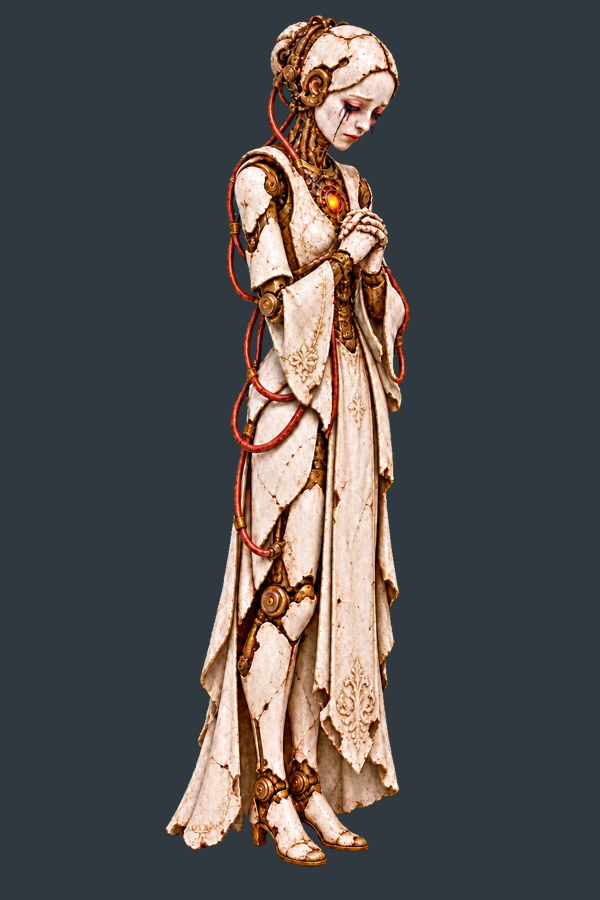

**Boss — the Porcelain Weaver (Cassia-09, recruitment).** Never strike the amber; cut the antennae. Dual Tech on recruitment: **Overclocked Short-Circuit**.

**Boss — R-66Y, the Arch-Curator** (Lv 18–20). A twenty-foot stop-motion Robo, chassis peeled open and stuffed with Lavos muscle, weeping porcelain masks orbiting him, eight laser-Gatling arms on a slowly rotating thoracic ring — one barrel glows before each volley, and the safe spot is inside the ring. A crankshaft thumps every three seconds. Damage knocks masks off him, and each mask becomes an add carrying one of U2's hazards.
- *Archivist.* Marrow-Umbilicals heal him until Krona severs them, at a cost to Crono's ceiling. His chest fibre flickers between clay and Crono's watercolour galaxy.
- *Possibility Branch (50%).* Time freezes at Sync Hold 99.0 and the choice is offered.
  - **Path A — the Lullaby Rewind** (Mercy). Sera's Turn-Bar Echo casts [REWIND: 2300 A.D.] three times on the exposed chest plate while Crono lands an Astral tech and Cassia a Sound Ring in the same turn. Crono offers his Time Egg fragment; Cassia plays Lucca's lullaby; R-66Y sits and his blue eye closes. The clay grafts rot away in reverse until only the original golden Robo remains. It costs Crono 25% HP of Time Debt and Sera 10% translucency.
  - **Path B — the Empress's Salvage** (Ruthless). Tear the tungsten loom through his mask array and rip out the Lavos fibre core: an immediate Break, then 45,000 HP to burn down. Krona harvests the Lavos-Grafted Laser Cannon. Cassia's Resentment rises, her amber dims and Lucca's voice fades. Sera's Paradox gauge darkens toward the Empress's Heir.
- *Heart Expose (below 40%, or 50% on Path B).* His chest tears open on boiling marrow; Cassia Loom-pulls syringes to plug the heart for an eight-second window. His sorrowful eye tracks the Sera clone in its tank — she is the tachyon heart. If the Choir sleeps, it hums a counter-frequency and the Grief-Resonance stops.
- *Mother Brain Unmasked (secret, Paradox road only).* His press-form detaches and Mother Brain's graft turns out to be a bloom of Lucca's nerve roots. Lucca, through static: **"Cassia, you have to ask me before you use me—"** The player chooses **Extract** or **Keep**; the break is Lucca's choice.
- He dies sitting down: six frames, legs folding, the horn drooping, the blue eye closing, the masks frowning. On Path A the golden Robo self-destructs his old chassis into Mother Brain's core to open a portal to U3, and what survives is a four-foot child-frame on reverse-jointed spider legs. On Path B the party leaves by the syringe lift through the boiling marrow sea.

**Choices, flags and affinity.**
- **Arris_Dome Sleeping** (Light +30) / **Incinerated** (Dark +25): see the roads. Incinerated also keeps the Grief drain on for the whole dungeon and locks the Robo's Ribbon quest.
- **R-66Y Rewound** (Light +30): the Sera clone is rescued and later grows into the hub's fast-travel clone; the Seed of Doan side quest continues; the child R-66Y teaches Wire Loom Mend; the **Robo's Ribbon** sub-quest opens back in the 1024 clocktower; Cassia keeps her centaur body and her climb.
- **R-66Y Salvaged** (Dark +25): the Laser Cannon and the permanent Dual Tech **Omega Annihilation**; Cassia is rebuilt bipedal and loses her climb; Lucca fades; Azar will lose faith in the party in U3.
- **Amber Rift** (Prismatic +15): the Paradox road and the secret phase.
- **Lucca's consent** (asked / forced) and **Extract / Keep Integrated** for Cassia.
- **Mother_Brain Sleep / Overclock**: overclocking her burns a hundred years of the future for power (Dark +25).

**Rewards and techs.** Cassia: **Mercury Pulse**, **Wire Loom Mend** (restores Crono's ceiling; on other copies, briefly strips their art-curse), **Gramophone Resonance**. Team: **Solar Railgun** (Crono + Cassia — she forms a magnetic induction barrel and fires Crono as a human comet), **Iron Maiden Scroll** (Krona + Cassia — tungsten wire flattens enemies into an ukiyo-e scroll and Krona shreds it), **The Ashtear Paradox** (triple — blood and oil magnetised into a singularity; Crono and Krona strike from opposite timelines and set off a miniature Big Bang of watercolour gold, sumi-e crimson and liquid metal), **Reinforced Guard** (Crono + Cassia, after the Mercy branch, when Crono admits he is a copy — 50% less Debt for three jumps). Relics: **Long Pull**, **Grief Filter**, **Syringe Heart Key** (it later opens the true Lavos in U0's endgame). **The Prometheus Core** — Robo's old heart — becomes available: on the Mercy road it waits behind the Doan garden gate in the Atrium for 150 Beckons; on the Ruthless road it lies in the ash of the Arris Dome, free. Cassia's relic **prometheus_core** can only be used with Lucca's overheat consent; using it selfishly later makes Sera's Atropos Ribbon fail.

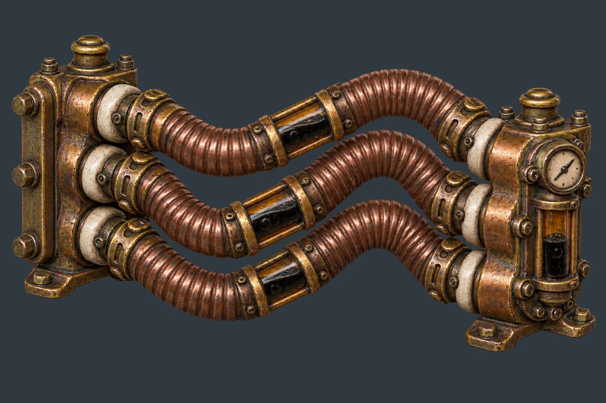

**Exit hook.** Porcelain fingers, and a world where the meteor never fell.

#### Interlude — Day 2: The Marrow Sea

The crossing to U3 passes Sera alone through the two-mile marrow shaft. Vaelos sits on a syringe above the boiling sea, holding a bowl of it. He wants her to see that it is sterile — no DNA, only grief — and to understand that he is looking for where he came from: a Lavos that never fell, still fertile. She teaches him to hold a bowl level while floating (spoon lesson). He nudges her slip toward 65 million years ago, and it misfires — sixty-five thousand and sixty-five years too far.

### Chapter 4: Saurian Eden

**U3, 65,000,000 B.C. · Lv 21–30 · party: Crono, Sera, Cassia-09, with Krona available; Xyloph joins.**

**Beats.**

1. **Misfire.** Sera aimed the slip at 65 million years ago, looking for fertile Lavos. It misfires to −65,000,065 B.C., and Lavos is overhead: flash-frozen in geostationary orbit, a two-kilometre second moon pulsing every twelve seconds. The Reptites won.
2. **The Mycelia Floor** (Lv 21–23). The party drops into a glowing fungal river that is one organism, breathing twelve Shared orbs. Every step ripples twenty metres. The murals say HUMAN = FAILED. Crono's porcelain weeps clear oil here; the Divinity Field heals enemies and never him.
3. **Xyloph.** Sera's slip pulled her out of a chant over the Sky-Ark's incubation, and she finds the party: six wings rippling out of sync, papyrus feathers with legible weather in them.
4. **Arrest.** The Synod arrests the party for violating the Divinity Field. **Azar**, the Divinity Warden, offers to take Crono's cracks and polish them into relics. The Reptites polish their eggs to perfection, and now they polish his cracks with reverence — a misreading that is almost love.
5. **Papyrus Mid-City** (Lv 23–26). Living vellum doors trade memories for passage. One Papyrus Wall wants the memory of Crono's porcelain reveal in exchange for an echo of Sera. Standing before it, Crono says his one full sentence of the chapter: **"Because when she has nightmares she calls for me."**
6. **The reveal.** The Moon is meditating. Vaelos is its dream. Xyloph names him: **"the spore that thinks it's the tree."**
7. **The Crown Canopy** (Lv 26–29) and **the Observatory.** Thermals drawn as pale blue hatching are solid; Xyloph's feather becomes the Papyrus Membrane glide (needed in U6). Worship Gaze opens the quest **"Why It Didn't Fall."** Under the Frozen Moon, Sera learns breath meditation from the Reptites — her first stable slip control: hold still for two seconds and the seven ghosts collapse into one.
8. **Azar** (boss).
9. **Closure.** On the Scholar path the clutch hatches, and the hatchlings imprint on Crono's galaxy chest and call it "little moon." On the Predator path the eggs fossilise and Xyloph says, **"You prune like me now,"** and starts calling the party her clients. If the Papyrus Wall took Crono's memory, it regrows overnight with his sentence written in cuneiform: the memory now lives outside him. Leaving by thermal under the Moon, Sera makes her first controlled slip: for two seconds her seven ghosts fold into one at 60 fps. She chooses home.

**Dialogue.**
> **AZAR:** Little pot. You were fired wrong. Let me glaze you again — still.
> **CRONO:** ...no.

> **SYNOD** *(as Crono's galaxy reflects the Moon)*: Child of Moon? No... child of Fall that never was.

> **SERA:** If I was never meant to be in the archive, does that mean I get to write outside it?

> **SERA:** Papa, you were warm in that cold place.
> **CRONO:** Was always warm.

**Enemies.** **Nestlings** that steal Shared and drop feather maps; **Gene Scribes** that write FAILED in slowing ink across the floor; **Synod Acolytes** that shield one another in moonlight; **Crown Saurians**, untouchable in the air until a tether snaps them down; **Moon Eggs**, a mercy puzzle — no damage until broken, then one hit shatters them into three Sunlight; **Lichen Colonies** that share damage and trigger fake burns.

**Boss — Azar, Divinity Warden of Eden** (Lv 27). A 2.8 m warden whose mantle is a living archive, a sliver of the Moon in her beak, Xyloph's clutch held in stasis.
- *Liturgy* — a slow procession; moving fast is punished with silence; meditating earns Sunlight. Break her within twenty seconds or a Polished Relic seals one of the party's techs.
- *Archive* — her mantle unfurls into papyrus walls and she bargains: a memory for an updraft and Sunlight. Refuse and her Scribe's Shame summons a ghost of the Bekkler doll at full HP. This is where she offers to glaze Crono "still," and he refuses.
- *Pilgrimage* — no floor; her Divinity Field follows her and drains Shared; one party member must stay still as an anchor to feed the gliders. A fake burn confuses her. At 20% Crono's galaxy opens on its own and reflects the Moon. Breaking this phase frees the clutch, and Xyloph joins through Sera's Borrowed Future duplicate.
- *Unwound* — she tears her mantle open and reveals a sterile mammal embryo she has secretly been nursing. Her field collapses; overgrowth tethers the party; snapping their own tether makes it bloom into Xyloph's Burst. Then the choice.
- *Secret: Am I a God* (Prismatic) — use Worship Gaze three times and carry a sliver of Vaelos from U2; the Moon turns red and Vaelos speaks through Azar: **"Am I a god that failed to fall?"** It breaks only to a Chronoslip.

**Choices, flags and affinity.**
- **Azar_Scholar** (Light +30): she sits and folds her wings; feathers scatter wind maps; the library survives and the clutch lives.
- **Azar_Predator** (Dark +25): burn her mantle; the eggs fossilise; the library becomes a warlord camp; a Moon sliver embeds in Crono (−5% ceiling); the Divinity Field becomes learnable.
- **Moon Memory**: keep Crono's U0 memory (the Debt stays high but U7's gold-leaf repair stays open) or sacrifice it to the Wall (Debt −3%, Light +15, U7 repair locked for this cycle and the next).
- **Panspermia** (seed U3's spores into U0–U2, Prismatic +15) or **Pure Eden** (Light +20).
- **The red Moon** (Prismatic +15, an Amber Rift).

**Rewards and techs.** Xyloph: **Photosynthetic Burst**, the **Mycelia Tether**. **Thermal Glide**, permanent. **Triangulation** (Crono + Xyloph — he dashes along her tether for a critical hit; later it is the key to the lattice mini-game that stabilises his galaxy core). **First Light That Never Was** (Crono + Cassia + Xyloph), a triple that dawns in watercolour, stained glass and ligne claire at once — its first fragment; on the Scholar path it becomes one of the True Ending's keys. The **Divinity Field** on the Predator path. The Reptite Crown relic for Xyloph.

**Exit hook.** U4 waits: a woman polishing her own reflection for two hundred years, the way Crono has polished his.

#### Interlude — Day 3: The Lamplighter's Boat

Sera lands alone in a small boat on the black water outside the Drowned Cathedral, with Vaelos at the oars and a lantern on the prow. He asks her the Moon's question — "Am I a god that failed to fall?" — and she teaches him the breath meditation, two seconds of stillness. He tells her he lights windows so the people inside stay warm. Through the water she can see the back of a great rose window, and a pipe running from it into the dark.

### Chapter 5: Drowned Cathedral

**U4, 12,000 B.C., 400 m down · Lv 31–40 · party: Crono, Sera and the others; Vesper joins.**

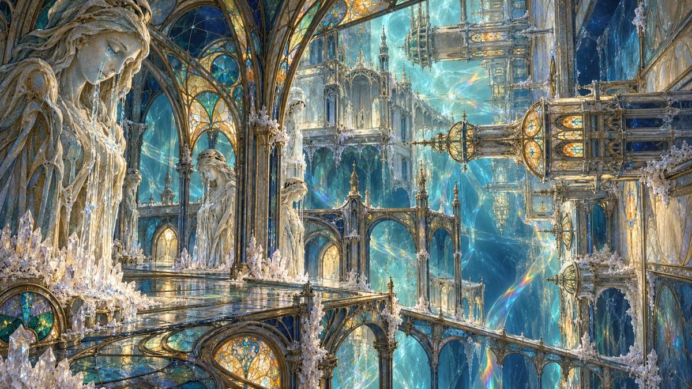

**Beats.**

1. **The Baptistery.** Sera's slip from U3 lands the party in a frozen splash at high noon on the seabed. Crono's arm weeps seawater. **"Same water,"** he says — the sea that took him at the Ocean Palace.
2. **The Nave.** Light is air, time and weapon: inside a beam, breath; outside, crushing dark. Vitrified citizens kneel with their emotions tinting their glass skin — cobalt grief, amber rage, clear hope — their gold halos flickering as something drains them. In a doorway, a cat's bowl that never turned to glass.
3. **The Library.** Glass books legible only in caustic light. One is titled *How to Bottle a Star — Bekkler*. Crono flinches; it costs him 2%.
4. **Vesper.** The six-foot knight-librarian stands guard with Schala's cat-shadow curled in his breastplate. He spots the "fake Zeal make" of Crono's Time Egg and is horrified. He never looks at anyone; the cat looks at everyone.
5. **Caustic puzzles and the Arch-Curator Echo.** The rose-shard puzzles of [U4](#u4-drowned-cathedral) open the way to a twenty-foot porcelain golem of masks and organ pipes — the Arch-Curator in glass — whose broken masks release stored prayers Vesper uses as prism ammunition. It drops the **Bubble Lens**, which lets the party move through U4 without the drown timer.
6. **The Sacristy.** The depth hits Crono's Time Egg hardest; it dims whenever he leaves the light. Sera notices. Puzzle rewinds beyond three cost 8% of his max HP until camp. Here Sera learns to hold her slips still: Vesper's numbered entries steady her, and she gains **HOLD**, which extends a Break.
7. **The Central Eye.** Polish it and the glass sings; break it and it reveals Vaelos's siphon tube — Lavos fibre weeping black oil, a Mammon conduit running from this cathedral to U2's amber archive and U6's Singularity. The first proof of Vaelos without a fight: seeing, not being told. **Break** it and Vesper joins on the spot. **Polish** it and he keeps the perfection, stays hostile, and duels the party.
8. **The first chosen crack.** Vesper cracks on purpose for the first time, and fur and starlight show through his glass.
9. **The Schala Shadow Weaver** (boss).
10. **Accepted.** Crono opens his crack in front of the cathedral. Schala's voice, from the reflection in Vesper's chest: **"Oh, we are the same."** It is the first place in the game where Crono is seen cracked and accepted, and it unlocks his confession in U7.
11. **The Dreaming Moon.** The cathedral's great stained-glass moon sleeps above the nave. Leave it asleep, or detonate its core to warp onward.

**Dialogue.**
> **SERA:** Papa you're leaking.
> **CRONO:** [Look Away] No. Light getting out.
> *(on the Light path he adds:)* Because when she has nightmares she calls for me.

> **VESPER:** Entry 4-22: I am afraid.
> **VESPER:** I thought cracks were where we failed. That's where the light learned our names.

> **SCHALA'S IMAGE:** Stay still. Stay beautiful.
> **SERA:** You're tired. You can put it down.

> **VESPER:** Schala, are you still reading?
> **THE CAT:** I was reading you. Entry 5-01: He finally looked.

**Enemies.** **The Vitrified Choir**, kneeling zealots whose hymn stuns anyone polishing; **Lead Lectors**, whose lead barriers bend the beam; **Jellyfish Lanterns** — kill one and the dark closes in faster; spare and polish it and the party gains ten seconds of air while the cat plays in its caustic; a pair of **Mammon Siphon Tendrils** that rumble at 28 Hz in the chest and, when broken, reveal one of Vaelos's atoms and drop a Time Atom.

**Mid-boss — the Arch-Curator Echo.** Above.

**Boss — the Schala Shadow Weaver** (Lv 38).
- *The Librarian.* A vast Art Nouveau portrait of Schala in the Rose Window, the cat in her lap, throwing razor filament that refracts white light into coloured stacks while she sings backwards: "Stay still. Stay beautiful." Each correctly coloured hit spills a buff pool — red attack, blue drain, gold Debt rebate.
- *The Cat Unravelled.* The Rose shatters into a giant shadow-cat made of every caustic anyone ever missed. Outside the light the crush takes 5% HP per second; the cat places safe pools. Crono can pay 12% of his max HP to freeze the sun for ten seconds — his first crack chosen on purpose.
- *The Shadow Weaver.* A Mucha loom of many arms weaves shadows into glass and spins adds that are hollow porcelain copies of Crono. Align three rose shards to project the true sun and burn the threads; for the climax every attack becomes VITREOUS with an extra hit from a random angle. It breaks twice, at ten shields and at zero; the mask falls and cries clear; the gold, unified render — Vaelos's dream of one perfect timeline — appears and is rejected.
- *Mercy* (only on the Light path). No combat. The cat curls into the crack in Vesper's chest and purrs. Time resumes. The citizens fall like leaves instead of shattering.

**Choices, flags and affinity.**
- **Central_Eye Broken** (Light, "Shatter the Perfect Window", +15): Schala is freed; Vesper's Fractured Lens opens; Sera's HOLD lengthens; the cathedral fills with air, the crush ends and the choir's filter opens to a pure sound.
- **Central_Eye Polished** (Dark, "Preserve Eternity", +15): the cage stays; Vesper's Prism Guard holds more stacks but he never cracks — Crono's hiding, mirrored; the Weaver gains 25% more shields and skips her Mercy phase; a Grief-Resonance hum never stops.
- **Weave It Anew** (Prismatic, +10): align all seven colours, including a secret shard carried from U3, while Crono's galaxy is deliberately open at 20%. Both cracked and whole. Unlocks the triple **Chrono Prism** (Vesper + Crono + Schala) and reveals the conduit linking Cassia's amber tank across U2, U4 and U6 — a fragment of First Light That Never Was.
- **Moon_Sleep** (Light +30): the cathedral stays intact and its heal fountain becomes a Divinity Field. **Moon_Shatter** (Dark +25): detonate the core for warp; the moon becomes a low-gravity debris dungeon of prismatic shards, the Divinity Field turns to Ruin Decay, and U4's enemies gain the NULL tag.
- **The Lamplighter's shard** of Crono's face: keep it, and Vaelos's whispers follow the party into U5 and U6.
- High affinities reach forward: on the Light path Vesper's glass will never yellow, and in U7 Schala will repair one of Crono's cracks with gold leaf (10% of his debt forgiven); on the Dark path Vesper's armour turns opaque and the final arena is two metres of darkness with no caustics; on the Prismatic path, with the shards kept, Vaelos speaks for the first time with real hurt — "You keep breaking windows I built to keep us warm" — and the cat hisses, because he is afraid of being seen cracked.

**Rewards and techs.** Vesper: **Lily Lancets**, **Prism Guard**, the ultimate **Rose Window**, the debt move **Fractured Lens** (below 25% HP: five Light Stacks at once, his library opened, and inside it "Crono Vaporization — Original Account," which reveals Vaelos's origin to the player), and **Read Light** (decoding caustic memories; later it reads Crono's vaporisation in U0 and Cassia-09's origin). **Chrono Prism** (Vesper + Crono — a four-second time-stop in which caustics are placed by hand; requires Crono's crack to be visible). The **Bubble Lens**. **Anachronism Glass** (Vesper + Static) waits for U6.

**Exit hook.** The seven-colour Prism Gate opens. Ash is falling on the other side.

#### Interlude — Day 4: Behind the Rose

Sera stands alone behind the Rose Window, in the narrow dark where the Lamplighter hangs his lantern; the lantern holds Schala's siphoned light. Vaelos admits that he takes and does not make. He carries the lantern the way a child carries a full spoon, and she shows him how to walk without spilling light (spoon lesson). He tells her the next world is his favourite, because people there laugh at everything and nobody ever looks up.

### Chapter 6: Carnival of Ash

**U5, 600 A.D. · Lv 41–50 · party: Crono, Sera and the others; Pierrot-Glenn joins.**

**Beats.**

1. **The Gacha Plaza.** Sera slips ahead into the centre ring of a fair that never ends: soot children laughing at nothing, cotton candy made of ash that doesn't dissolve. When Crono arrives, the ash falling on his wrist seam rises back up out of it — the same ash as the Ocean Palace.
2. **The loop.** Every twenty-two minutes the fair resets. The stalls — the Gacha, the Wrestling, the Sweetcorn Pope, the Mirrors — burn in a different order each time, and whoever the party pulls out of the fire turns up later as a vendor in the 1024 Atrium. Sera's power here is the **Rewind Reel**: scratch the vinyl and the last eight seconds run backwards in watercolour streaks across the rubber-hose world, revealing the black threads behind everything. It costs her more than a combat Rewind, and every use draws a ringmaster's shadow and Vaelos's contrabassoon on a diminished fifth.
3. **The Ash Ringmaster.** Ozzie runs the midway and has locked the party's BP; nothing works until someone steals it back.
4. **Pierrot.** On the wrestling stage a jester bounces in with a 300% stretch: **"STEP RIGHT UP! Watch Frog-uh Jester-uh guy! do nothing useful but LOOK!"** He loses his bout on purpose. Backstage the party finds him hanging limp on a marionette rack, strings still attached, and takes him down. He steals the party's BP back from the Ringmaster.
5. **The Hall of Mirrors.** Flea's mirrors show everyone's true canvas: Crono in watercolour; Glenn's reflection, a frog.
6. **Dignity.** On the third loop the Heckler Harlequin demands a laugh. Glenn offers Crono a fake one through his theft — GUILE for a while, at the cost of his ASTRAL shave bonus for two fights and an early PEAK crack. Or Crono can pay 10% of his max HP to *not* laugh — his first dignity payment.
7. **Watching someone fail.** Sera has to watch a child loop three times without helping. Vesper logs it: Entry 6-12, "Some people want to be watched failing."
8. **Cyrus** (boss).
9. **After.** Glenn, shaking, asks to stop being funny for a minute. Crono wraps his gravel-worn scarf around the jester's white glove — the first time Crono touches someone without cracking.

**Dialogue.**
> **GLENN** *(face stretched 300%)*: C'mon Captain! Give 'em ol' Crono Grin™!
> **CRONO:** [...] *(hand over wrist)* Not mine. To give.
> **GLENN:** ...oh. Performing for a ghost?

> **GLENN** *(when his paint cracks)*: Courage ran out back in 590. Been doin' balloon animals outta my own guts since.

> **CYRUS:** Hush hush watch pretty ponies burn backwards.
> **CYRUS:** Dance little brother so they don't see ash.
> **SERA:** He thinks you're still brave. Show brave can be still.

> **CRONO** *(Light path, kneeling to Cyrus)*: You held sky up too long. Hands tired?
> **CYRUS:** Hero... you also strung?

> **CYRUS** *(as the Ash-Knight)*: Softness burns. I removed it.
> **GLENN:** Softness didn't burn. YOU did.

> **CRONO** *(extends his wrist)*: See? Hollow can hold.
> **CYRUS:** ...cut me down. Please. Not puppet. Again.

> **CYRUS** *(lowered)*: Teach boy... funny not armor. Funny is cracked window light gets in.

> **GLENN:** Can I not be funny for minute? Scared sky's still ash.

**Enemies.** **Ash-Cotton Swirls** that stick to the party and dull Crono's ASTRAL until polished off; **Strongman Dummies** that inflate 300% and must be squashed (they drop the Prop Hammer); **Ticket-Golem Barkers** whose laugh track drains MP and forces BP spending; **Heckler Harlequins**, invulnerable for fifteen seconds if ignored, unless Sera scratches the reel; a **Prop Chest Mimic** holding a fragment of laurel; **Popcorn Husks**, **Charred Jugglers**, **Time-Smoke Stringers** and a **Laugh-Track Choir**.

**Boss — Cyrus the Marionettist** (Lv 48). The Big Top, the calliope slowed to 0.6× like a 78 rpm record, fire crackling as vinyl noise.
- *Puppet Master.* Untargetable twelve feet up; his puppets respawn every twelve seconds. Cut the threads in order — yellow, red, blue — to expose the heart thread, freezing puppets mid-swing for a line attack. Cut six or more at once and the stage collapses into the Ash-Pit.
- *Ash-Knight.* With his last thread cut he drops — the only thing in U5 that isn't rubber: stiff, 30 fps, jerky, a charred twelve-foot knight in a crack-sliding porcelain mask who refuses to squash. He steals BP to keep the music playing; outside a safe circle the ashfall eats HP.
- *Strings Cut From Inside.* At 40% Vaelos's black oil threads replace the smoke. Body and strings fight separately; the strings heal the body until Glenn cuts them, Sera holds a Break open, and Crono's Astral burns them. Glenn can shatter his own paint below 25% to show the hollow and the frog inside (**Fractured Grin**). Crono can open his galaxy on purpose — 12% of his max HP until camp — and freeze the phase for ten seconds. At the first Break the mask falls and a sorrowful blue eye weeps clear oil, the first clean liquid in U5. At the second, every canvas flashes into one gold porcelain image, Vaelos's hum stops, and the calliope resolves into Crono's theme in clean legato strings.
- *Mercy* (Light path only). No fight: pull the Prop Hammer lever and lower him down.

**Choices, flags and affinity.**
- **Cyrus_Cut_Down** (Light +15) — the Marshall path for Glenn. Daylight comes; the music stops; the children look up and see a constellation — the first beautiful thing they've seen. The Charred Laurel is pristine. Glenn gains Fractured Grin and **Honest Laugh**. On a high-Light run, Glenn's origami frog later rides on Crono's shoulder in the hub whenever he's cracked.
- **Cyrus_Left_Hanging** (Dark +15) — the fusion path. The fair goes on forever and no one sees the sky; Glenn becomes the new Marionettist and never cracks; he refuses Dual Techs with Krona; the Laurel is blackened and drains a BP every fifteen seconds in U6, but grants the ultimate **Prop Cannon**. On a high-Dark run Glenn replaces the Lamplighter as Vaelos's mouthpiece.
- **Re-String as Instrument** (Prismatic +10) — use U4's secret seventh-colour shard to focus sunlight on the calliope mirror and turn the threads into harp strings; it needs Crono's galaxy open and Glenn's hollow shown. Unlocks the triple **Chrono Laugh** (Crono + Sera + Glenn) and the second fragment of First Light That Never Was, and reveals that the ash is Lavos vapour mixed with heroic atoms — the same recipe as Vaelos. On a high-Prismatic run, Vaelos: **"You taught them stop clapping. Who claps for you now?"**
- **Bekkler_Confessed / Bekkler_Hid**, **Crowd Saved / Cheered**, **Jester_Mask Kept / Broken**, **Tent_Fold Spare / Burn**, **Carnival_Completed** (every stall's people saved across the loops).

**Rewards and techs.** Glenn: **Punchline** (steals 1–3 BP), **Sleight of Arm**, **Swap Face**, **Accordion Dodge**, the **Prop Hammer**, **Balloon Escape**, **Honest Laugh**. **Honest Stage** (Crono + Glenn — cuts threads and catches the falling puppet; requires Crono's crack to be visible; it teaches admitting to being a copy). **First Light That Never Was**, second fragment (Crono + Sera + Glenn). Sera's **Rewind Reel**. Key item: the **Charred Laurel**, Cyrus's helm crest, which lets Sera slip without an anchor through burn zones — needed for U6's rain escape and the final 1999.

**Exit hook.** Sera is gone again — slipped ahead, alone, looking for a broadcast.

#### Interlude — Day 5: The Empty Big Top

The Big Top after the show, every seat empty except one. Vaelos sits in the stands, an audience of one, his black threads hanging from the rafters. Sera performs nothing, and he claps once, slowly. He tries to eat ash cotton candy with a spoon and laughs — and doesn't spill (spoon lesson). Then he tells her where he was born: a signal in 1999, a city that jacked into a Lavos and never unplugged. She goes to find it on her own.

### Chapter 7: Cyberpunk Singularity

**U6, 1999 A.D., the Neo-Truce Dome's Third District · Lv 51–60 · party: Crono, Sera and the others; Static joins.**

> What if Lavos didn't fall as a meteor, but as a signal?

**Beats.**

1. **The CRT shrine.** Sera slips alone into 1999 looking for the broadcast that started Vaelos, and Crono follows her in. They materialise inside a shrine of nine stacked TVs blasting white noise, each showing Crono's face from a different year. The stack is a nest, and a boy lives in it: **Static**, thirteen, mute, throat pulsing cyan, CRT goggles full of snow. The party arrives VHS BLIND.
2. **Landfall.** Rain conductivity is at 100%: encounters double and the picture rolls. Sera can no longer hear her own slips. Static watches them in the reflection of a pachinko wall.
3. **The Noodle Oracle.** In a bar, a granny with a TV for a forehead shows Sera her own future: leaving the boy plugged in. **"Latchkey kid becomes lock."**
4. **The clinic.** A doctor trades HP ceiling for memories. Crono lets him shave 5% off to watch Sera's first word on a CRT. It was "Mama." His crack reaches the next band early. The clinic walls are papered with schematics of Lucca's nervous system.
5. **CRT tuning.** Nine stacks to align by eye and ear. Each flashes Crono at eleven, standing in the same spot in U0's Atrium; the ninth shows the original Crono vaporising in 12,000 B.C. Clear all nine and a café log reads: "1999 still raining inside the machine."
6. **Neon Bloom.** Near the nest the neon goes solid and pulses every two seconds; move only inside the halos or ICE spawns — an Arch-Curator reskin with a Gatling ring.
7. **The Matriarch.** Hiss blooms out of Static's jacket — not a monster: a baby learning to be human from a boy who never got to be. Every TV in the district speaks at once.
8. **Isolator** (boss). The Red Bike unlocks between her second and third phases.
9. **The choice**, made with Static's cards.

**Dialogue.**
> **SERA** *(finding him asleep in the nest, cards scattered)*: You don't have to hear it. I do.
> **STATIC** *(flips a card)*: 「イヤ」 — don't want.
> **CRONO** *(sits down in the static beside him; no demand for speech)*: ....yeah.
> **VAELOS** *(through Hiss, in a clean young Crono voice)*: He's listening, brother. Like we did in the dark beyond.

> **THE MATRIARCH** *(through every TV)*: LITTLE BROTHER STILL SOFT. GIVE HIM BACK.

The district worships her hum as its 60 Hz mains buzz. Crono recognises it: it is the same broken note his own Time Egg falls to when it cracks. Static's throat and Crono's wrist pulse in the same shader. U6's CRTs crack in three stages, 100, 60 and 20 percent, with the same decal and the same wind-chime sound as Crono — this world is where the player learns to read porcelain stress.

**Enemies.** **Slag-Rat Couriers** that steal BP along the laundry wires (Static's sympathy item, batteries, drops from them); **RAM Fixer Twins**, tethered by oden steam, who must break on the same turn; the **Pachinko ICE** mini-boss, whose ring changes its weakness every six seconds until Static's CARRION shows its true Lavos core; **White-Ear Child Echoes**, ghosts of the kids plugged in before Static, visible only while blind and targetable only when he tunes SIGNAL — spared, he leaves batteries on their CRTs; **Oil-Fire Bike Bros**; **Hiss Larva Drones** that regenerate near TVs.

**Boss — the Juvenile Lavos Matriarch, the Isolator** (Lv 60). A thirty-foot amber-glass chrysalis of cables and porcelain masks around a chest of Lavos muscle fibre, in a plaza ringed by nine TV stacks; the centre CRT holds Static's 1999 birth tape. A brooding mother trying to raise a human the way Lavos learns adolescence — the first time Lavos is a parent, not a parasite.
- *Lullaby.* White noise, a single-target time-stop, an oil-fire bike slide. Static must use CARRION on her throat to expose the core. When she breaks, her CRTs show Crono's wrist at 60 and 20 percent.
- *Isolator.* Umbilical CRTs heal her until severed in one line. Her Faraday Lull mutes the whole city to rain and static and blinds everyone not tuned to SIGNAL. Puddles harden into neon walls.
- *Adolescence.* She stands; her masks crack-slide like R-66Y's; her chest opens on Lavos fibre and a galaxy like Crono's. Her tags shift as Vaelos's identity surfaces in her. She steals the Red Bike Ghost and inflicts Knock-Static, forcing U2's 12 fps clay rules into U6. Every rewind costs Crono 3%.
- *Hiss Choice.* No damage. Static lays out his cards.

**Choices, flags and affinity.**
- **U6_Matriarch_Unplugged** (Light +30). Static screams once — a pure tone that cracks from 432 to 220 Hz. SIGNAL is gone forever and Hiss leaves him. That tone will later strip Vaelos's mimicry and prove that Crono never copied anyone. The rain stops for the first time in the district's life, and the puddles become a clear mirror of the U0 Atrium. Sera learns **hz_static_pure**, which turns his silence field into a Lullaby Heal.
- **U6_Matriarch_Fed** (Dark +25). Static stays plugged in; Hiss stays; Vaelos goes on believing what he believes about Sera. The Red Bike unlocks fully, conductivity drains half as fast and every rain-soaked kill gives a BP — but Crono's crack advances 10% permanently. Sera gains **Slip Backtrack** (rewind five seconds in combat), and her Debt counter rises by ten.
- **U6_Hiss_Lullaby** (Prismatic +15, an Amber Rift). Cassia records the future with her horn and plays Sera's lullaby into a past CRT, and Hiss learns a human song instead of Lavos's hum. It needs Arris_Dome_Sleeping and a Prometheus Core that was never used selfishly.
- **The Vapor Memory Core.** The Matriarch drops it: 1% of Crono's vaporised atoms, cached by U6's network. **Kept** and brought to the Atrium's workbench, it proves Vaelos is a reincarnation, not a clone — the evidence the re-parenting path needs. **Used**, it is spent as power.
- **Red_Bike Kept / Stripped**, **Static_Throat Freed / Plugged**.

**Rewards and techs.** Static: **Tuning Dial** (NOISE, CARRION, SIGNAL), **hz_static**, **Snow Crash**, **56k Prayer**, **Red Bike Ghost**, the ultimate **AKIRA IN UTERO** (his jacket opens, Hiss blooms, every enemy becomes HZ-weak, and for ten seconds the party hears Vaelos's true voice — Crono's atoms crying under a Lavos roar). **Solar Railgun + HZ** (Crono + Static). **Anachronism Glass** (Vesper + Static). The **Red Bike**, whose headlight shows the world-wire that leads to Vaelos's root.

**Exit hook.** The world-wire runs out of the dome and into white.

#### Interlude — Day 6: The Birth Tape

The CRT shrine after the storm, the TVs warm. Vaelos sits cross-legged with Hiss in his lap, feeding it from a spoon (spoon lesson). He plays Static's birth tape for Sera, and then his own: a signal in 1999, a shape stabilising out of noise. On the ninth stack the Ocean Palace burns, and he watches it with her without speaking. When the tape ends he points down the world-wire into the white and tells her the one rule of the place it leads: gold is safe.

### Chapter 8: Bone-Tree

**U7, ∞ A.D., the final nursery · Lv 61–70 · requires the keys of U0–U6 and the Prometheus Core · time-locked · party: anyone; Omega-Spekkio optional.**

> NULL erases weakness. It also erases the scar that proves you lived.

**Beats.**

1. **The Root Approach.** The world-wire ends in white. Infinite paper, no sky, no horizon, one tree of spines, ribs and antlers. Standing still for three seconds makes the party's ink footsteps fade; only gold kirie butterflies show where the white can be walked.
2. **The Tree knows him.** At full HP Crono already shows the hairline shader here: the Tree recognises its own marrow. His galaxy matches the amber-pink glow inside the trunk.
3. **The Mid-Spire Shrines.** Orbiting islands hold fossils of the other universes — U2 amber frozen mid-VHS, U6 rain from 1999 on a CRT, a U3 papyrus nest. Bone-bamboo bridges breathe under the party's feet. **Cassia** finds her own gramophone torso as an amber fossil, Lucca's nerves flickering in a mercury orb. **Xyloph** finds a Reptite nest mourning an extinction that hasn't happened yet. Each fossil can be preserved or shattered for a Kirie Scale.
4. **The lotus pond.** At a pond in the Divinity Field, Sera remembers. At four, her first slip brought her here, and something with six arms caught her and folded the memory away so she could be brave outside the void. Here, at last, translucency can be repaired — kneel and brush gold over cracks, one percent every eight seconds.
5. **Marrow Lanterns.** Hanging rib lanterns stay dark until lit by Crono's cracked light. Each projects a memory fossil: Marle, young, standing where Crono vaporised. Their light is needed at the Crown.
6. **The Gold Leaf repair** (if Crono showed Marle his wrist in Chapter 1). Gold leaf is synthesised from the Cobalt Nodachi's pigment and U1's gold-leaf memory flake, and Crono's worst crack is mended at the pond in kintsugi. If Schala's light was freed in U4, she draws his face in gold leaf over it. Ten percent of his Debt is forgiven.
7. **The Crown of Horns** and **Kami-Ori** (boss).
8. **Omega-Spekkio** (optional). If Sera carries the eight sigils — one hidden in each universe from U0 to U6, and Kami-Ori's folded crane as the eighth; Cassia's Chronoslip Tuner, built in U6, lets Sera sense them — a sculpture made of absence waits in the negative space beside the Tree. His **Final Dojo** — Crane, Samurai, Dragon, Faceless — recruits him.

**Dialogue.**
> **SERA:** Papa, your hand—
> **CRONO:** It was never bleeding. It was leaking light.
> **CRONO:** Because when she has nightmares she calls for me.

If love comes from a copy, is it real? In U7 Crono stops asking. He isn't standing here to save the world. He is standing here to be there when he is called.

> **KAMI-ORI** *(haiku sheets unfolding in the air)*: Six hands hold six flaws / will you keep your cracks, small one? / blank scroll is mercy.

> **CRONO** *(below 20%, in the Final Void)*: Copy knows copy. You held him so I could... pretend.
> **KAMI-ORI:** Not pretend. / Porcelain holds tea / because it chose to.

> **SERA:** Master.
> **OMEGA-SPEKKIO:** Oh, you brought the debt with you.

**Story hazards.** Glaze Erosion, Fold and falling, as described in [U7](#u7-bone-tree-of-eternity).

**Enemies.** **Washi-Hollow Monks**, inside-out paper monks who flip to a blank, gold-patterned back when struck wrong, and unfold into prayer sheets that reveal hidden fold lines. **Vertebrays**, stags of seven vertebrae with a different universe's skull on each, charging through the void with only gold dust to warn of them; at half health they shed into fawns; broken, they drop bone bridges. **Ink-Eaters**, flat black smudges that break the 70% white rule and blind anyone who lets them spread for twelve seconds. **Kirie Keepers** — three mini-bosses who summon monks; each drops thirteen Scales and a gold-leaf bundle; sparing them is Light, killing them yields a Prismatic shard. **Marrow Lantern** puzzles that teach NULL by erasing themselves.

**Boss — Kami-Ori** (Lv 68). The Crown's lotus dais, 28 × 28, crumbling to gold leaf at its edges.
- *Offering.* No attack. Each of her six arms offers to permanently erase every elemental weakness from one ally. The trade: that ally becomes **TRUE NULL** — no weaknesses, but no strengths, no Dual Tech synergy, and flat true damage taken. Gold leaf covers their cracks and the sound tape-stops. Breaking one arm moves the fight on. Each refusal is Light; each acceptance Dark; a three-three split is Prismatic. This sets **Offering_Made**.
- *Kirie Storm.* The floor is deleted; 95% of the screen is void and only spinning gold flecks hold weight. She unfolds into a twenty-foot paper crane with six pitched origami snaps, and her Kirie Gale shaves shields from everyone regardless of element, countered by the Divinity halo. When she breaks, her wings lock for eight seconds into a still bridge.
- *Final Void.* 95% white; only gold asanoha and silhouettes. Kami-Ori is TRUE NULL — no weakness at all — until the party casts NULL on her, which strips her tags and creates false weaknesses for two turns. An ally she made TRUE NULL can't be stripped. NULL'd bosses take extra damage from Crono's cracked galaxy. Here, below 20%, Crono speaks to her, and she answers. Breaking her shatters gold; she collapses into a flat paper crane in Sera's palm. Her Noh mask remains.
- *The Seventh Arm* (secret — all 100 Kirie Scales). Roots bloom from the dais into a seventh arm that holds her own spine. It can only be faced with a balanced party — two TRUE NULL allies and two who kept their weaknesses. Defeating it restores every weakness the Offering erased.

**Choices, flags and affinity.**
- **Kami_Ori_Wounds_Kept** (Light +45) — refuse every offering, or defeat the Seventh Arm. Crono keeps his cracks and his galaxy, and the party keeps its weaknesses. Unlocks **Origami Requiem** and **Washi-Hollow Rebirth**. The art leans toward U0 watercolour; harp glissando and a major choir.
- **Kami_Ori_Blank_Slate** (Dark +50) — accept all six. Everyone TRUE NULL. Vaelos, who cannot parse a flaw, takes the path toward the Empress. U7's gold leaf over U6's 1988 anime, cracking to black oil; hydraulic hiss, dripping oil, a broken music box in a minor key.
- **Kami_Ori_Paradox_Child** (Prismatic +30, and +15 more for each Amber Rift already made) — a three-three split. Vaelos learns he was born from Crono's atoms: a child, not a clone. Every canvas collides; needle on vinyl, an amber chime, one chord in seven layers.
- The Heart stays sealed until one of these three is set.
- **Kirie_100** and **Seventh_Arm_Defeated**; **Fossil Preserved / Shattered**; **Gold_Leaf_Bridge / Bone**.

**Rewards and techs.** The **NULL** element for the party — it costs Sera 5% translucency or Crono 2% glaze, and it erases rather than damages. **Origami Requiem** (Crono + Omega-Spekkio, or Kami-Ori's crane before he joins — Crono's watercolour dash along a fold line folds an enemy's past away and leaves a gold field that thaws Ruin). **Time Debt Paid** (Sera + Crono — a large heal that clears all Erosion and, on the Light path, revives once per battle; it costs Crono 10% in cracks, repaired by kintsugi; for a moment it restores the original Crono's memory). **Washi-Hollow Rebirth** (a triple, Wounds_Kept only). Omega-Spekkio and his Dojo rewards: the NULL Shield, **Miura Fold**, **Lotus Reverse**, **Gold Leaf Severance**.

**Exit hook.** A filament of the original atoms runs from the Tree's marrow down into something that drank the Tree.

#### Interlude — Day 7: The Navel String

Sera sits on the dais with Kami-Ori's crane in her palm and remembers being four. Vaelos comes up the marrow-string and sits beside her without touching her. The string between them is an umbilical of Bekkler doll thread and Lavos muscle fibre, and it beats in time with her heart. For the last spoon lesson, he holds the spoon steady on his own. Her hand is almost clear now; this is the lowest the meter has been. It is the end of the seventh day. He stands at a door made of Time Eggs and says, in her father's young voice: "Hey. You left the door open again."

### Chapter 9: Vaelos Heart (Which Father)

**U8 · Lv 71–80 (cap 80) · party: anyone; Sera solid for the first time since Chapter 1 · Marle is not here.**

> Porcelain was never meant to hold a galaxy. It was meant to hold a child.

**Beats.**

1. **The Navel String** (Lv 71–73). The party walks the umbilical in ([U8](#u8-vaelos-heart)); for the first time all nine canvases render in one image, and nine instruments play one chord.
2. **The Gallery of Copies** (Lv 73–75, optional). Cassia looms the eggs open: Marle checking Crono's wrist, Lucca's consent, the tiny porcelain Marle, CRONO-00-P. R-66Y's masks weep in unison, all of them looking at Vaelos.
3. **The Central Cradle** (Lv 75–80). Zero gravity; only gold-leaf butterflies are solid. At the centre, over the Time Debt Well, Vaelos sits with his back to the party, mending a tiny porcelain doll of Sera with gold. Crono's chest shows PEAK even at full HP; the Heart reads his ceiling cost as the truth.
4. **The offer.** He speaks without turning around. Sera steps forward, and her flicker — seven ghosts at 14% her whole life — stops. For the first time since Chapter 1 she is solid; the Heart aligns her. Vaelos makes his offer: let Crono's porcelain break for good, and let Vaelos raise her. He will take the Time Debt into his own Lavos body. She will never slip again — no more phase-outs, no more being forgotten. His price is that she accept she is not Crono's daughter but the change from his transaction.
5. **Kintsugi Mend.** Crono can spend 10% of his max-HP ceiling — permanently, until a Golden repair — to brush gold over one crack in the doll Vaelos is mending. Each repair is Light. After three, the doll is revealed to be empty: there is no tachyon inside it. The Borrowed Future duplicate will not be a copy. It will be a choice.
6. **Vaelos** (boss).
7. **Crono speaks.** On a Light path (60 or more), after Vaelos asks his question, Crono gets a choice. Players who learned his silence will still pick [Nod]. But he can also say three words — his longest sentence since "Because when she has nightmares she calls for me." He offers Sera his emptying galaxy.
8. **The choice.** If any ending's requirements are met, the last phase becomes a conversation, and the endings available become gestures the player can make (see [7.1](#71-how-an-ending-is-chosen)).

**Dialogue.**
> **VAELOS** *(Crono's young, clean voice; his back to them; mending)*: You left them in the dark, Papa. The atoms. I kept them warm. So she would have somewhere to belong. If I'm from everywhen, who do I belong to? You taught her that line. You stole it from me.

> **VAELOS** *(cracking gold)*: I didn't steal. I incubated. You were vapor. You were everywhere and nowhere. I made you a somewhere. Let me make her a somewhere too.
> **SERA** *(seven voices in unison for the first time)*: If I'm from everywhen... can I choose where I belong?

> **CRONO** *(gravel, low-passed; optional, Light 60+)*: [Look Away] [Say Sera's Name] Sera... borrowed future still warm?

> **SERA** *(as she phases out)*: Don't forget me.

**The arc in this chapter.** Counterfeit love against intended love: a copy who loves truly against the original atoms that love by absorbing. Vaelos offers Sera a father who cannot crack; the True path asks Vaelos to watch her vanish and stay anyway, and that is how he learns fatherhood is letting someone disappear.

**Enemies.** **Atom-Eaters**, little porcelain crabs eating loose Crono atoms, which drop Time Atoms that restore 0.5% of his ceiling — the repair loop, taught. **Failed Bekkler dolls (Type-C)**, stuck at their 20% reveal and humming a cracked 220 Hz; near them Crono hears his own heartbeat doubled; broken, they frown and drop gold leaf. **Lavic Filament Guardians**, the Heart's antibodies, made of Lavos fibre and tungsten loom. The **Paradox Curator Choir**, a fragment of R-66Y at half speed, whose masks weep blue and black at once; it drops a record: "Crono-Original lullaby to Sera in vitro — 12,000 B.C. vaporization hum reversed."

**Boss — Vaelos, the Other Father** (scales 1:1; Lv 78–80 on a standard run). He does not start hostile. His phases open on affinity and dialogue as much as on HP.
- *Which Father* (100–70%). He sits and mends and never attacks. The player answers him three times; the answers set **Vaelos_Father**. His shields can only be shaved by Sera's Rewind and Crono's Astral Smear — a cost a father and daughter pay together. At 45 Prismatic or more, all nine canvases render at once; below it, three styles fight for the screen. When he breaks, he stops mending and looks up; when he says Sera's full name, the camera narrows to the "listen" angle and everything else goes soft.
- *Atom Claim* (70–40%). He stands, his chest opens fully on the burning original atoms, and the arena goes weightless. He fights with Crono's own moves, perfected — his Astral Smear Dash leaves gold leaf instead of cracks. Lavic Filament Guardians join him. His Filial Field forces every attack onto Crono while Sera is below 40% HP. The Time Debt Well is open: if Crono drops below 20%, his galaxy drains into it and heals Vaelos. Cassia's Wire Loom Mend keeps him above the line. On a Light path of 70 or more, Vaelos hesitates for a turn after a Rewind shows him losing; on a Dark path of 70 or more, he uses **Heirloom Incinerate**, burning Time Eggs for damage.
- *Porcelain Truth* (40–10%). Both fathers fall to their 20% reveal together; the camera holds both chests in sharp focus — a copy's galaxy and the original's. This is where the True Ending is earned: the player holds Sync Hold at 99.0 for three seconds or more, then Rewinds Sera twice to land her exactly on 40%, then casts Borrowed Future. Sera vanishes for two full turns — **Causal Collapse** — leaving only her gold-leaf ghost, a low-passed score, a single chime and a whisper. While she is gone, both fathers' shields drop to four. If Borrowed Future's Token Duplicate goes to Crono in that window, it renders him in his native style — solid watercolour at 60 fps, no crack, no galaxy: the original atoms briefly re-formed as a human for two turns. That duplicate's Astral Smear Dash is what breaks the Heart. The game reads the input timing to know whether the phase-out was chosen or forced.
- *Child or Empress* (below 10%, or when a threshold is met). If no ending's requirement has been met, he drinks the Well and becomes Lavos: the Debt collapse. Otherwise this phase has no shields and is fought in conversation. If the player fights it anyway, both fathers end up sitting, legs folding like Cassia's at shutdown — Crono empty (on a Light path, no stars, just light), Vaelos weeping black oil and blue — and the Heart drops the **Kintsugi Brush**.

**Choices, flags and affinity.**
- **Vaelos_Father**: **Acknowledged** — "You kept them safe" (let him finish the doll; Light +30; Crono offers his galaxy; kintsugi opens). **Rejected** — "You stole them" (shatter the doll; Dark +25; his shields thicken in the next phase). **Both** — "What if both are real?" (ask him to show repairing and breaking; Prismatic +15; the Amber Rift record plays).
- **Sera_Phase**: **Voluntary_40** / **Forced_40** / **Avoided** (Voluntary also gives Prismatic +20).
- **Time_Egg_Well**: **Fed** (Crono fell below 20% and healed Vaelos) / **Closed** (Wire Loom kept him above, with a Light answer).
- **Crono_Porcelain**: **Hollow_Light** / **Cracked_Dark** / **Kintsugi_Pris** (three doll mends).
- **Vaelos_Mend** Gold / Crack_Black; **Gallery_Egg** Spared / Loomed; **Navel_String** Cut / Kept.

**What the choice looks like.** Whatever ending is chosen, the Heart folds into something the size of the Atrium. There is no treasure chest. Crono's mossy stone pauldron, his 1024 armour, finally falls off — not breaks, falls. Underneath there is no crack, just skin. Or porcelain painted to look like skin; the game never says. Sera touches it and says **"Warm."** He doesn't answer. Then the ending's own image begins: on the Golden path he sits down and becomes the guardian, and the camera holds ten seconds longer than is comfortable; on the Empress path he stays empty while gold leaf cracks to black oil and drips into his lap, and Sera's scarf turns gold but hangs heavy; on the Child path he puts the pauldron on the child Vaelos and walks, three shadows at three framerates — watercolour, rubber-bounce and flicker — all pointing the same way for the first time; on the True path there is a fourth shadow at 15 fps, the original atoms allowed to rest, drawn solid in watercolour for two seconds before it goes white. Sera carries them out not by tearing time but by folding it, the way U7 folds paper.

---

## 7. Endings

### 7.1 How an ending is chosen

Endings are decided at the end of Chapter 9. When Vaelos falls below 10%, or when an affinity threshold is crossed, his last phase stops being a fight. Every ending whose requirements are met appears as a gesture the player can make — a hand held out, a doll mended or broken, a spoon steadied, a name spoken, a step back into nothing. If more than one ending qualifies, the player chooses. If none does, the Debt collapses.

Affinity is never shown as a number. The player reads it in the art: Light pulls the world toward U0 watercolour, Dark toward U2 clay with VHS static and U6 scanlines, Prismatic toward every canvas colliding.

| # | Ending | Affinity | Flags and conditions | Plays in |
|---|---|---|---|---|
| 1 | Golden Light | Light ≥ 90, Dark < 40 | R-66Y_Rewound; at least three Kintsugi repairs; Teach Her To Land; Kami_Ori_Wounds_Kept. On this path the Heart's answers are usually Vaelos_Father Acknowledged and Time_Egg_Well Closed | U0, the Atrium rebuilt |
| 2 | Empress Heir | Dark ≥ 90, Light < 40 | R-66Y_Salvaged; Arris_Dome_Incinerated; Azar_Predator. Usually Vaelos_Father Rejected and Time_Egg_Well Fed | U7, the Bone-Tree corrupted |
| 3 | Vaelos Child | Prismatic ≥ 45, Light ≥ 45, Dark ≥ 45 | At least three Amber Rifts; The Bowl Still Whole; Spoon_Taught; Kami_Ori_Paradox_Child; Vaelos_Father Both | U7 as a playground |
| 4 | Borrowed Future (True) | Light ≥ 90, Dark ≥ 90, Prismatic ≥ 45 | Sera_Phase Voluntary_40 in the Heart, after at least one earlier voluntary phase-out; a native-style Token Duplicate given to Crono during it; Crono_Porcelain Kintsugi_Pris; Arris_Dome_Sleeping, R-66Y_Rewound, Seed_of_Doan_Grown; Kami_Ori_Wounds_Kept; Crono enters the Heart's last phase at 20% | U9, the Borrowed Future |
| 5 | Porcelain Silence | Dark ≥ 90, Light < 40, Prismatic < 45 | Porcelain stress held at 100 from U3 through U4 with no repair of any kind; Bekkler_Confessed never set; Cassia never allowed to mend him; Grief_Embraced | The Atrium as a museum |
| 6 | Mycelia Bloom | Light ≥ 60, Dark < 40, Prismatic 60–75 | Arris_Dome_Sleeping, R-66Y_Rewound, Azar_Scholar, Moon_Sleep, Seed_of_Doan_Grown (at full growth); Mycelia Tether mastery (GLOBAL_POOL_01) | The Atrium's heart, then everywhere |
| 7 | Ashen Jester | Light ≥ 90, Dark ≥ 90 | Glenn_HoseArm_Accepted; Bekkler_Doll_Repaired; Carnival_Completed; Laugh_Track_Resisted; Thread_Cutting_Mastery | The carnival beneath the Atrium |
| 8 | Null Erasure | Light < 10, Dark = 0, Prismatic < 20 | NULL mastery (Sera, NULL 10); 100 Kirie Scales; Seventh_Arm_Defeated; Blank_Slate used (Wounds_Kept = False); every weakness erased in the Possibility Codex (TRUE NULL) | U9, the White Atrium Void |

Endings 1–4 are the endings of a first run. Endings 5–7 can be reached on a first run but most players find them on later cycles, once the Possibility Codex ([8.1](#81-chapter-14-the-possibility-codex)) lets them re-break and re-parent flags. Ending 8 needs the Codex, so it is always a later cycle. If Omega-Spekkio is in the party at the Heart, whatever end Vaelos meets is drawn as the Amano death: he unfolds into red-haired paper cranes that fly back to the Bone-Tree.

### Ending 1: Golden Light (Chapter 10)

**Lv 80–85 · U0, the Atrium Horologe rebuilt · all nine canvases merging into watercolour.**

> Porcelain was never meant to be perfect. It was meant to be repaired where it was held.

**What happens.** The ending that doesn't erase. The story returns to where it started — the same kitchen, the same porridge — but the Atrium is no longer a hospice. It is a nursery. Having learned that fatherhood is not holding but letting someone disappear, Vaelos does not die. He dissolves on purpose into the Time Debt Well, and his atoms — the original atoms Lavos inhaled at the Ocean Palace — finally finish their journey home. Not into Crono: into the tower. Robo accepts. The pillar opens its chest, and Vaelos's marrow-string and Crono's galaxy merge inside it. Robo becomes the Atrium's heart, and the 999 Shield Dummy of Chapter 1 becomes 9999: what took 999 hits to learn now takes 9999 to protect.

Crono does not become human. He accepts being a copy. He places his star core into the little Bekkler doll on the workbench, and the doll becomes the Atrium's guardian totem. He stays cracked, but his cracks are gold now: Sera brushes the gold in herself, with the loom technique Cassia taught her — and because Lucca consents, Cassia's mercury runs clear. Sera stops treating Chronoslip as a curse and starts teaching it as a dance; Fall Break, the first thing she ever learned, becomes the curriculum.

**Three repairs.**
1. **Crono, kintsugi.** Cassia doesn't erase his cracks; she looms gold into them with gramophone rings and her tungsten bracer. His porcelain stress returns to 0, but the cracks stay visible, in gold. Each repair the player brushes adds Light. It is commemoration, not erasure. Marle watches Sera hold her father's hand still while the gold sets, and speaks not as a queen but as the seventeen-year-old who once waited for him at a bridge: **"You never taught her how to fall. Now she teaches us."** Sera answers without words: she slips, falls, lands, and dusts the paper grain off her knees.
2. **Robo, 999 to 9999.** The copper vines become Lavos fibre, but willing. **ROBO: "[CHRONAL STRAIN EXCEEDED — REDEFINING. ATRIUM INTEGRITY 81% -> 144%. CRONO UNIT: STRUCTURAL FAILURE RECLASSIFIED AS STRUCTURAL HISTORY. SERA UNIT: PARADOX AFFINITY LIGHT 90. RECOMMEND: STAY.]"**
3. **Glenn's stump.** Cassia builds the Marshall a prosthetic arm of tungsten loom and mercury joint. He tries it, freezes one perfect parry in an ink frame, and takes it off: **"I left it in the castle to remember what price cheap courage cost. You lot patch the world with gold. I'll keep my hole. It whistles when wind goes through — lets me hear what's missing."** The arm stays in his inventory as a memento, and he teaches one-armed versions of his Dual Techs instead (**Glenn_Stump_Kept**, Light +15).

**The world.** The Atrium floor reads as nine mosses at once until it blends into one watercolour. In the kitchen, the porridge still takes seven clockwise stirs, and the spoon's reflection holds every framerate at once. Steam fogs on Crono now — he is warm enough to make condensation, and Marle's thermometer finally tells the truth. In Sera's studio the clone from U2 has grown to adult height and teaches dance. The Seed of Doan, fully grown if the Arris Dome slept, holds the gate during the last siege and grants **Promise Across Rust** at no Debt at all — the first free thing in the game's economy; if the Dome burned, its ash pile has become a gold field that thaws Ruin. The fountain still resets the smear and not the debt. Krona's prints have turned gold-black and last thirty seconds, and now they lead to Sera's studio instead of to gates. Falling still sends the party back a checkpoint, but it no longer cracks Crono. Broken is not punished here.

**Final confrontation — the Guardian Triad.** Not Vaelos again; he is the heart now. The enemy is the debt that lived in the tower.
- *The Unpaid Interest.* The Prologue's enemies return at Lv 80 as echoes — Dust Motes stirring, Porcelain Shardlings that are Crono's Denial, Ashen Spoons that are Sera's First Slip. On a Light path their breaks leave healing puddles of light.
- *Robo Heart — the 9999 Shield Siege.* A protection fight. Enemies attack the Atrium Heart Core — a ten-foot porcelain face like Crono's, both eyes now weeping gold — and the party intercepts. Each hit shaves one shield. If the heart reaches zero, there is no Game Over: Vaelos's atoms flare, Sera slips the tower back to 9999, and Crono cracks 10% and is mended in gold at once. Vaelos's 68 BPM heartbeat phase-locks to the Atrium's 72.
- *Vaelos's Lullaby — unmade with love.* He sits mending the Sera doll as in the Heart, gold kirie butterflies orbiting inside his open chest, and speaks in Crono's clean voice: **"You never taught her how to fall. I watched. She falls by choosing. I... want to be held while falling."** Cassia's diagnostic returns as a blessing: **"Collarbone +0.4% per gold leaf. My Lucca reinforced."** Sera drops voluntarily to 40% and phases out, and this time the party remembers her. Crono says her name — **"Sera... borrowed future still warm?"** — and her Borrowed Future duplicate renders him solid, in watercolour, for two turns. When the duplicate breaks the last shield, Vaelos asks to be left as dust inside the heart (**Vaelos_Returned**).
- *Dance, Not Curse.* No enemy: a choreography. Sera leads and every party member follows her steps; seven ghosts must align into one. The floor dissolves into gold leaf and re-forms as watercolour paper, and every universe's look resolves into watercolour — U1's ink gaps become pigment pools, U2's thumbprints become embossing, U3's outlines become bleed edges, U4's caustics become light through windows, U5's squash becomes cloth drape, U6's rain becomes far-off haze, U7's floating islands become a seedling in a garden. Nine layers of music resolve into a harp glissando, paper rustle and a major choir. The red Time Debt heart-string from Crono's chest to Sera's snaps and is replaced with gold kintsugi wire: the cost stays visible as history, and no longer takes his HP.

**Epilogue.** Crono sits down in the Atrium and becomes its guardian, holding Sera asleep. There are no stars inside him now, just light.
> **SERA:** Papa, you're warm again.
> **CRONO:** Was always warm. Stay.

Four words, the longest line he says in the game. Gold butterflies land on his repair lines. The watercolour piano plays his theme with the second note held for the correct length at last. Doan prays to the porcelain Crono. Sera keeps Chronoslip as a dance: it costs nothing inside the Atrium and 2% outside — restraint, taught. On a Prismatic 45 run, the child Vaelos is in the kitchen in the background, sweeping, and the bonus slot exists in the hub as an echo.

**Flags.** **Atrium_Rebuilt_Gold** (integrity 144%, the heart stable, the Seed watered three times), **Sera_Teaches_Fall** (three perfect dance steps without taking debt), **Glenn_Stump_Kept**, **Nine_In_One_Watercolor** (Prismatic 45, the child present in the dance; the watercolour finish persists into New Game+). The Dark flags the player never set — Moon_Shatter, R-66Y_Salvaged, Kami_Ori_Blank_Slate — hang in the Gallery of Copies as cracked black-oil memories that can't be triggered: the cost of not choosing.

**Tech.** **Kintsugi Guard** for Crono — an aura that cuts Time Debt by 80% and scatters gold leaf.

### Ending 2: Empress Heir (Chapter 11)

**Lv 80–84 (cap 99) · U7 corrupted, then a throne room · U7 gold leaf cracking to black oil.**

> Porcelain was never meant to hold a throne. It was meant to hold the oil that feeds it.

**What happens.** Vaelos refuses to be raised. He watched the party salvage, incinerate and choose predators across eight universes, and did the arithmetic: humans archive, extract and breed warlords. Lavos ate worlds; humans made worlds eat themselves. He goes back to his cradle. Because every mercy route was burned, the Bone-Tree is no longer white: its vertebrae weep black oil, its gold butterflies are torn and leak oil, and when the marrow is backlit its capillaries show black — Lavos fibre. Kami-Ori is dead, her six arms unfolded flat into a throne; her cracked Noh mask still faces the camera, its right eye empty and weeping oil, and her blank scroll now reads in blood-ink: "EMPRESS." Vaelos sits on her. He wears her as a mantle. He lets his gold skin crack on purpose, so the oil shows his authority.

**Act 1 — Arrival.** On the Root Approach the party's ink footsteps don't fade; they stay as bubbling black oil. The gold dust trail is a lie that leads to Ink-Eaters. The only safe path follows Marle's scarf threads — she got here first. The queen left the throne in Truce, walked barefoot into the void in her blue, her ledger finally closed under her arm, and kneels at the base of the Tree — not to Vaelos, but to Crono.
> **MARLE:** You made him wear my husband's face so he would be loved. Now let him wear mine so he will be feared.

She offers her crown for Sera's escape. Vaelos accepts the crown and refuses the trade.

**Act 2 — Crown.** He absorbs the crown: Kami-Ori's kirie scales, Marle's tiara, and every porcelain shard of Crono's ceiling that the party spent along the way. He becomes **Empress Vaelos**. In this arena Crono is fully shattered at any HP, his chest an empty void that casts real caustics on the floor — which solve the Crown puzzle — and he cannot be healed. The Divinity Field has been corrupted into a **Predator Field** that heals only enemies; Sera's Rewinds cost 15% here and she phases out at 20%. She has to choose whether to become a Warden or vanish.

**Act 3 — Coronation.** The Tree shatters into a throne room.

**Three betrayals.**
- *Crono — the Mammon Conduit.* In every other ending his galaxy is beautiful. Here, fully shattered, it shows not stars but machinery: the geometry of the Mammon Machine's intake — the vortex that inhaled the original atoms. His porcelain was never holding a galaxy; it was holding a doorway. He becomes a hazard instead of a party member: standing near him drains maximum HP and strips shields. He gets one last full sentence and asks to be left shattered: **"Sera... don't look. The hole is hungry again."**
- *Sera — Warden of the Divinity Field.* To keep the party from being erased, she can take Kami-Ori's place: kneel into the lotus dais and let six origami-shadow arms unfold from her back. She is solid for the first time since Chapter 1 and cannot leave U7; she becomes terrain — a true Divinity Field, the only light in the room — and in the next cycle she is an NPC at the Bone-Tree. Or the player orders her out, and she phases to 40% and vanishes: **"Don't forget me."**
- *Marle — the Queen's sacrifice.* She lays her scarf on Vaelos's cracked gold cheek and abdicates the throne of Truce to the Lavos lineage: if he wants to be an heir, let him inherit properly. The first time the party wipes, her sacrifice fires on its own and revives everyone with full shields — and locks Truce's hub into ash for every future cycle: U0 desaturated forever, the clock face weeping oil. She stays at the Tree's root as a folded paper crane, like Kami-Ori.

The thesis: ruthless play proves Vaelos right. If copies were fuel to the party, why shouldn't the party be fuel to Lavos? The Empress isn't a monster. She is the accountant who finished the audit the party began at the Arris Dome.

**Final confrontation — Empress Vaelos** (Lv 84). She begins with every weakness erased; weaknesses must be made.
- *Gold Leaf Mantle.* She tears Kami-Ori instead of mending. The haiku returns — "Six hands hold six flaws / will you keep your cracks, small one? / blank scroll is mercy." — and so does the offer: accept and an ally becomes TRUE NULL for the rest of the ending in exchange for BP; decline and she gains a shield. Cassia's resonance shatters the amber fossil of Lucca's nerves to open a FERRO weakness for eight seconds. Marle lays her scarf; the crown fuses.
- *Ruthless Audit — "You Spent My Father's Dust."* She opens Marle's ledger and its pages flip, one for each ruthless flag: Goyama's page burns into Washi-Hollow Monks; R-66Y's page spins his Gatling ring; Azar's page splatters violent ink and turns the field to Predator. Crono's conduit opens. Halfway through, Sera's choice: Warden (a permanent DIVINE weakness on the Empress, and the secret fifth phase) or Phase Out.
- *Coronation.* The six corrupted objects — black apple, fang, iron lotus, Gatling barrel, burning ledger, pointing mudra — become six attacks. Marle's sacrifice waits for the first wipe.
- *The Hungry Hole.* The Empress tries to pull Crono's doorway wide to drink the Debt; the party breaks her while staying out of his reach.
- *Mercy in the Throne Room* (secret, Warden only). Sera's true field reaches the throne. For one phase the Empress weeps blue instead of oil. She still wins.
- With Goyama_Incinerated, R-66Y_Salvaged and Azar_Predator all set, she wears **Black Oil Armor**: every shave is one smaller.

**Epilogue.**
> **EMPRESS VAELOS** *(male and female voices layered, oil dripping)*: You made copies to avoid grief. I will make copies to enforce it. Sister.
> **CRONO:** [Look Away]

He has no words left. The camera stays at the listening angle and never pulls back. A broken music box in a minor key, a hydraulic hiss, a Gatling ring spinning down to 100 RPM. Sera is taken as heir — her Chronoslip frozen into a weapon, TACHYON dealing probability damage that erases timelines — unless she chose to be Warden. The player becomes the final boss of the next cycle.

**New Game+.** The next cycle opens with the player as its tutorial boss: an Empress Vaelos projection at 1 HP. **Empress_Heir** adds +10 Dark bias, and Glenn refuses his Dual Techs with Krona across two universes. If Marle's sacrifice fired, Truce stays in ash.

### Ending 3: Vaelos Child (Chapter 12)

**U7 reimagined as a playground · the antithesis of finality · "The Bowl Still Whole."**

**What happens.** Chrono Trigger taught players to kill Lavos. This path teaches them to raise one — because Vaelos was built from a boy who couldn't stop catching things. He does not shatter. When Omega-Spekkio's NULL ultimate strikes his weakness plates, NULL behaves differently against a child: instead of erasing, it inverts. Kami-Ori unmakes her circle of judgement and the Bone-Tree drains. The 70% white that was dread becomes a playground: the washi floor scuffed with Sera's crayon watercolour, gold kirikane flecks turned into hopscotch numbers, porcelain masks for building blocks. Vaelos shrinks from his nine-foot sovereign form into a child four feet two inches tall, with a theatre mask far too big for his face sliding off it, his galaxy pulsing at the music box's 72 BPM instead of a battle tempo. He has toddler balance. He needs to learn a spoon.

This path remembers the Prologue. If Crono caught the ash-porridge bowl — **The Bowl Still Whole** — Vaelos remembers that Crono knows how to catch. Now he wants to be caught.

**Three kitchen scenes in a white void.**
- *A — Sera teaches the spoon.* No battle HUD. The Atrium's kitchen table from Chapter 1 appears in the middle of the void; Sera sits, her flicker gentle and controlled, across from a child whose fingers are too big. Holding the button to steady the spoon is the old Sync Hold. Fail and ash-porridge spills and becomes a Porcelain Shardling, which Sera cushions with Fall Break. Succeed and Vaelos makes his first sound that isn't a reversed death cry: a giggle, tuned to Sera's voice at 432 Hz. NULL learning to hold instead of erase.
- *B — Crono learns fatherhood is a choice.* He comes in at 60%, unarmed, trying not to leave ink footprints. Sera looks up: **"Dad, his grip is wrong."** The question freezes the scene, the way R-66Y's branch did: *Which of us has the right to be her father?* The answer is **Both** — Crono-41 is a copy of Vaelos's pattern; Vaelos holds the atoms; Crono holds twenty-four years of being called in the night. *Catch Gently* (Light): Crono steadies the spoon with him; the porcelain stress falls from 72 to 40, and the music box's lost melody returns — its first full measure since Chapter 1. *Hold the Copy Together* (Dark): Crono hides his crack and tells him "Don't break."; the stress stays at 85 and Vaelos learns fear — still a child, only a clingy one. *Both* (Prismatic): Crono says the line, Sera completes the Spoon Hold, and the child's shield plates change for good.
- *C — NULL learns weaknesses.* Omega-Spekkio watches from the edge of the Tree, arms folded: **"ASTRAL pretends to be beginning. NULL is ending that forgot to erase itself."** The child mimics the shape of each tech he sees — but where NULL would erase a weakness, he adds one: Marle's fire circle teaches him [Weak: FIRE], a Ferro pull [Weak: FERRO]. After three he gains **Porcelain Memory**: he holds a weakness open for an ally to shatter, at half damage. He doesn't want to hurt anything; he only wants to help break shells.

**Final confrontation — Vaelos Learns to Be Held.** Four phases on the playground. No HP bar and no death; victory is a finished lullaby.
- *Tantrum.* He's hungry and can't soothe himself; Shardlings copy Crono's idle. Shields break to Light, not damage. Break them with a sword or fire and the tantrum worsens — it won't fail, but Sera scolds: **"He doesn't know sword yet."**
- *Hide and Seek.* He phases himself almost to nothing and hides in the white; the only way to find him is the music box's direction in stereo. Sera's duplicate shows where he was two seconds ago. Found, he giggles and drops his mask; inside is the same galaxy as Crono's, now with a crayon star the player draws in.
- *Porcelain Spill.* He has to carry the bowl across the void without spilling. Cassia's polarity steadies it; Glenn steals the wobble. Sera physically moves his hand — **"Hold like this"** — with Glenn's rubber-hose stretch made gentle instead of funny. Fifteen seconds without a spill drops the stress to 20.
- *Lullaby, Music Box Complete.* No shields. He falls asleep on the table, and Crono finishes the music box that has been missing a tooth since Chapter 1 — the Robo-torso music box at 72 BPM — by holding Sync Hold in rhythm for twenty-four beats. Every canvas converges, and for the only time in the game every character steps at 60 fps together. The playground stays.

**Epilogue.**
> **VAELOS** *(small, clean, no reverb)*: Can you teach me how to crack correctly?
> **VAELOS:** I thought being father meant holding tighter. You showed holding looser. Can I... practice being son first?
> **CRONO:** [Nod] *(and gives him his mossy stone shoulder armour — his own 1024 identity)*
> **SERA:** Welcome home, brother.

The question Vaelos asked — "If his dust made you... can dust be raised?" — is answered yes. Sera keeps her Chronoslip, controlled: phase-outs last one turn. Crono and the child split the Time Debt's HP cost between them. Every Light and Dark flag is kept. With Arris_Dome_Sleeping the shardlings sleep instead of fighting; with R-66Y_Rewound, Mother Brain hums harmony and Robo sings backup on the lullaby; with Azar_Scholar, Xyloph's canopy shades the table; with Moon_Sleep the child has the Dreaming Moon as a nightlight. If Light also reached 90, the Golden epilogue plays with the child sweeping the kitchen in the background; if Dark reached 90, he wears a tiny cobalt nodachi sheath and Krona is teaching him iaijutsu.

**New Game+.** Vaelos joins as the bonus tenth party member at Lv 1 with a unique element, **NULL_LEARNING** (a TACHYON–NULL hybrid). His techs: **Null Spoon HOLD** (places a learned weakness; no damage), **Kintsugi Mend**, **Porcelain Promise Child** (Crono + Vaelos — restores maximum HP ceiling), **First Light That Never Was, Child Variant** (the three of them build a block tower that collapses gently), **Fake Family Photo Real** (Crono + Sera + Vaelos).

### Ending 4: Borrowed Future, True Ending (Chapter 13)

**Lv 81–99 (cap 99) · U0–U8 collapse into U9 · all nine canvases in one image · Atrium 72 BPM and Heart 68 BPM, resolving to a shared 120.**

> The doll that stayed broken heard her anyway.

**The gate.** Merciful *and* ruthless *and* paradoxical — nobody arrives here pure. Light and Dark must both have reached 90 and Prismatic 45 when the party enters the Heart. If Light or Dark falls short, the door to U9 is an ink wall that never dries; if Prismatic falls short, the canvases flicker and a nausea filter forces the party out. Sera must have phased out on purpose at least once before the Heart and chosen to come back. Borrowed Future must have given Crono a native-style duplicate at least once — proof the player understands it has to be solid. And Crono must be at his 20% galaxy reveal when he enters the Heart's last phase. The player must not heal him to 60%. He chooses to stay broken.

**What happens.** After Sera's choice in the Heart — "If you remember me while I'm gone, I'm not erased" — the Heart doesn't settle. It inverts. Vaelos watches Crono stay hollow, his galaxy no longer swirling, just a still field of stars. Marle's scarf on Sera is frayed red. The two hundred eggs are empty. The gold butterflies lose their gold and become paper moths. The floor falls upward: overlapping debt ledgers stamped with every failed copy's serial — "Property of Belthasar — Bekkler Assembly — 1999/2300 — Serial: Crono-41" — every warranty Bekkler ever wrote. At the centre is no boss but a workbench, Belthasar's, holding three things: Bekkler's porcelain repair kit with its squeaking rubber-hose gloves; a Time Egg cracked open with the original atoms still warm; and Sera's "∆t<0" cape, folded. Vaelos sits there mending himself, both eyes weeping clear.
> **VAELOS:** You hum like the house I was never allowed into. I thought if I kept your atoms warm, she'd have somewhere to belong. I kept them too warm. They grew teeth. Lavos learned adolescence from them.

He chooses.

**Three voluntary breaks.** In the True Ending three people choose to stay broken, each differently, rather than be fixed.
- *Crono stays open.* Not the Golden repair, not Bekkler's rubber reseal: he stays at 20% with his galaxy showing. If the player tries to heal him above 20% in U9, the game asks **[Hold Broken?]**. Yes adds Light; his cracks spread; the music box drops every third note. The party is always Concerned for him now. He will always be a little hollow — hollow enough to hear nightmares.
- *Vaelos chooses to be mortal.* Not a child to be raised, not an Empress: mortal. The Lavos fibre in his chest stops pulsing and becomes inert cloth; his galaxy cools from the original's amber to the copy's blue-white; he loses NULL and gains TIME_DEBT, like Crono; he loses his revive. He can die, and someday he means to. He asks for a name instead of a title, and Sera names him **Vae**.
- *Sera chooses to keep slipping.* Not losing it for a home, not freezing solid in U7: she keeps a permanent 5% translucency into New Game+, seven layers at 14%, feet never touching the ground. Being from everywhen means never quite belonging anywhere — but belonging enough. She uses Borrowed Future by choice now, not in panic.

**Final confrontation — the Chrono Ledger Composite.** Not Vaelos: the Time Debt itself, made into an enemy.
- *The Warranty Wall* (Lv 81–84). A wall of two-metre Bekkler eggs, each a copy at its own crack level, ringed by R-66Y's Gatling mounts turned to clock numerals. A Mercury Pulse every six seconds magnetises anything metal. Each Break advances Crono's crack another 0.4%, and Cassia's old diagnostic plays again, this time as an echo.
- *Vaelos's Mortal Choice* (Lv 85–89). He steps out of the wall as an ally-boss and offers his chest: **"Take them back. Original atoms. I'm done carrying."** Astral strikes heal him now — the Well reversed. He doesn't attack; he mends the party, and each mend costs him a tenth of his mortal life. He has to be broken twice, with glass, iron and mending rather than swords, to convince him to stay mortal — breaking his belief that he has to be Lavos. On a Prismatic 45 run Sera asks him **"If his dust made you... can dust be raised?"** and he says yes, and chooses mortality so that the raising will have an end. After the second Break he leaves mossy-stone footprints and moves in watercolour with a small clay stutter.
- *Sera's Borrowed Future — the true gate* (Lv 89–94). No enemy; a falling floor; every gauge frozen at Sync Hold 99.0. The prompt: **[Phase Out Voluntarily?]** Declining loops back to the Wall; there is no True Ending without it. Accepting, she Rewinds herself twice, landing exactly on 40%. Her shield plate reads [REMEMBER] — the target is a memory, not an element. She is gone for two full turns: only her gold-leaf ghost, a low-passed score, a single chime and **"Mama?"** The player controls only Crono, at 20%, galaxy open. Vaelos watches Crono empty himself looking for her, not fighting. His Father Tank fires on its own. Then she comes back, and Borrowed Future fires in its True form: every canvas stutters backwards at once — watercolour unbleeding, clay tracking in reverse, ink pooling back into strokes, ligne claire retracting, caustics rewinding, rubber-hose stretches snapping back, cel rain falling up, gold leaf fluttering up — and the Token Duplicate goes to Crono and renders him solid in watercolour, no crack, no galaxy, his mossy stone whole and his cloth clean: the original atoms briefly human for two turns. That duplicate's Astral Smear Dash breaks the Heart (**True_Borrowed_Future_Voluntary**).
- *Three Fathers, One Borrowed Future* (Lv 94–99). Crono hollow at 20%, Vae mortal, and Sera flickering back with a second self of her own holding an empty doll of Vae. The Ledger's last three plates are drawn in watercolour, clay and gold leaf. All nine party members stand as ghosts at 14%. It ends only with the triple **Family Porcelain — All Three Fathers** (Crono + Sera + Vae): all three mend each other with gold at once, the gold flooding to white.

**Epilogue.**
> **SERA** *(from the void, while she is gone)*: If you remember me while I'm gone, I'm not erased. I was borrowed. I'm future.
> **CRONO** *(when she comes back)*: Because when she has nightmares she calls for me. And I will be there. Even hollow.
> **VAE** *(weeping blue, not oil)*: Papa— can you leave some cracks? So I know where light gets in.

Crono stays a hollow guardian, light inside him instead of stars. Vae is raised. Sera keeps her 5%. When the inversion settles, the Heart becomes an annex of the Atrium, and gold butterflies mark a path from it to a repair garden at the foot of the Bone-Tree.

**New Game+.** **True_Borrowed_Future**: Sera starts the next cycle at 5% translucency and remembers the loop; the Robo's Ribbon keeps R-66Y a child; the Seed of Doan's garden grows in U7's white void.

### Ending 5: Porcelain Silence (Chapter 17)

**The Atrium as a museum · the Ruin path · codename MUSEUM_OF_COPIES.**

> "You polished your cracks until there was nothing left to hold." — Marle

**What happens.** Crono chooses to stay broken, and to never let anyone see it. The player has avoided Bekkler, refused every kintsugi, refused Cassia's request to mend him, and stood in the Grief-Resonance pool in U4 for a full forty-one seconds while the cathedral replayed Marle's drowned aria — earning a permanent debuff of amber shard and static noise, and the boss's VITREOUS weakness. Crono reaches the maximum Time Debt — his ceiling down 60%, ten stacks of Ruin Decay, the framerate quantisation visible on him. He doesn't become Vaelos. He becomes something worse: a perfect container. His chest hollows into a siphon tube drawn like U4's Mammon tendrils — translucent flesh, Lavos fibre pumping, caustics through it.

The Atrium stops being home and becomes an exhibit: a museum of copies. The pillar becomes the Arch-Curator's chassis, its masks the faces of Bekkler's failed Cronos, forty of them, each with a slightly bigger crack, around a forty-first that is empty. That one is Sera's. Crono didn't stay to protect her; he stayed because the museum needed a curator.

**Sera leaves.** There is no fight. She looks at his chest — the void humming, pulling light out of the room like the Mammon Machine — and puts her own uncracked porcelain mask down at his feet.
> **SERA:** You were supposed to break and let me see inside. Not make the break pretty.

She walks out through the Atrium door, and it seals behind her with a clay thumbprint. On his collar, the crack-slide advances one frame.

**Final confrontation — Crono's Reflection.** He fights himself as the museum sees him: no face, only masks cycling. Immune to physical damage; weak to TACHYON, VITREOUS and FERRO; Ruin scaling makes its pool enormous.
- *The Doll.* The 100% doll skin, an idiot walk cycle; it believes it is Crono. Marle, off-screen: **"That's not you. That's what you let Bekkler make."**
- *The Collection.* The masks fly off his collar, each a memory he refused; the floor sprouts Cassia's reverse-jointed legs and the museum becomes a spider. Mercury leaks; the masks scream gramophone static and stack Grief. It heals if a shield isn't broken within twelve seconds. Sera's empty mask on the floor whispers: **"Dad, you're leaking stars."**
- *The Conduit.* His chest opens on the siphon. The Atrium dims; every Chronoslip costs Debt by the second. This is the Vaelos tease — if Crono had been fully absorbed, he would be Vaelos; here he is the conduit before Vaelos. The siphon takes 60% of the party's ceiling. If Light is below 40, Marle's last line plays: **"You polished your cracks until there was nothing left to hold. There's no Crono in there anymore. Just the shape of where he was."**
- *Porcelain Silence.* No fight. The Reflection kneels and offers its mask, and all forty-one masks look away. Its last shields can't be broken by damage — only by doing nothing. The player must stand still for twelve seconds, a callback to 12,000 B.C. Attacking resets them. When the last one breaks, Crono lets the museum close. The Reflection doesn't shatter into shards; it crumbles into watercolour paper dust, a splash of mercury, an amber shard and static, and the galaxy void stays floating where its chest was: the new Mammon Machine core for this timeline. No music, only a gramophone needle scratching, Sera's footsteps leaving, and far off, the hum of U6's city. The last sound is a Mercury Pulse shutting down.

**Epilogue.** Crono doesn't die. He sits on the Atrium's throne with a siphon tube running from his chest to the ceiling, pumping Lavos oil into the tower's roots — the Arch-Curator of the next cycle, in a desaturated palette of greys, mossy stone and gravel-worn cloth. For a moment, inside the void, a Crono-shaped Lavos is visible — goggles fused to the skull, a scarf of muscle fibre — Vaelos as a possibility that will now never happen. He smiles, relieved, and fades. Then the slides, in watercolour on heavy paper:
1. The museum of copies; forty-one masks, one missing. *"And the curator kept polishing."*
2. Sera walking out of an Eden that has overgrown the Atrium. She doesn't look back.
3. Marle at the castle holding an empty Bekkler doll box. She finally buries it.
4. Cassia-09 decommissioned, her mercury cold; Lucca's nerves in the amber. She kept trying to fix him.
5. The conduit, pulsing. Through the void in his chest, a fifth of a star map — the sky over the Ocean Palace. The cycle restarts. No gold.

Ending 5 isn't an evil Crono. It's a tired one. At forty-one, after twenty years of knowing he's a copy, he decides preservation is easier than kintsugi — gold repair hurts, because you have to melt yourself — and the copy that was made to be unbroken succeeds too well. The game wants the player to cry not because Crono dies, but because he doesn't. He stays, and a daughter can't grow up in a museum.

**New Game+ and presentation.** In the next cycle U4's Arch-Curator Echo wears Crono's forty-first mask: **"Ah. Another collector."** In the ending gallery, Light, Dark and Prismatic show as three broken porcelain plates; only on this path — Light cracked, Dark overflowing, Prismatic unmixed — does plate five appear whole. The only broken path shows a whole plate.

### Ending 6: Mycelia Bloom (Chapter 18)

**The true pacifist ending · transcendence · no gold, all root.**

**What happens.** In every other ending Sera keeps a human anchor, even if it is porcelain. Here she doesn't ascend; she composts. The Seed of Doan has been grown to its fullest — watered twelve times with VITREOUS water, given three injections of papyrus weather data from Xyloph, and fertilised at last with a piece of Crono's mossy-stone crack. Sera plants it in the Atrium's central wound, the place where Lavos should have pierced the world, kneels, and opens her chest. The Seed, humming at 12 fps, syncs to her heart. She exhales. Spores replace her breath; her hair becomes white hyphae; her eyes turn vitreous amber — not blind, transmitting light.

> *Sera's humanity was always a vessel for connection. The Mycelia Tether was not a tool she used. It was what she was rehearsing to become. The spore network existed before Zeal, before Lavos, a planet-wide memory from 65,000,000 B.C. that Lavos burned. The Seed of Doan is its last backup.*

Her player controller is gone; she is a field now, everywhere there is moss. She isn't dead. She is distributed. Stand still for four seconds anywhere and you can hear her, gramophone crackle and wind. Talk to any mossy crack in Crono and it answers in her voice. The whole Atrium, in every layer and every timeline, gains a permanent Divinity Field.

**Crono.** At his 20% reveal, his cracks are filled not with gold but with moss. It grows a little every time he slips, and puffs spores when he stands still; when he shares the Tether, moss bridges from his cracks to whoever he's healing.

**Xyloph's sacrifice.** The Seed needs a last shock: storm data. Xyloph climbs the Atrium spire and broadcasts the rain of 65 million years ago. **"Data not numbers. Data is when rain fell."** Her wings fold inward, but her legs don't collapse — her talons root into the stone, her feathers go to hyphae, and the amber orbs that always orbit her come to rest at her feet, where they become a save point. Forty scripted seconds; no input; no music; only wing rustle, a spore-exhale sigh and Cassia's gramophone hiss.

**Final confrontation — the Bloom Matriarch, Spore Matriarch of First Memory.** A negotiation, not a fight: no battle music, no UI at first; a fruiting body shaped like a seated woman under a canopy of spores. The party must keep the Mycelia Tether on her the whole time; let go, or lose sight of her for more than two seconds, and she reads you as a predator, coughs spores, and locks you out of the ending. Her twenty-eight shields are her arguments, and the "weaknesses" are what she can be moved by: FERRO — industrial memory, R-66Y's lullaby, rust as memory; ASTRAL — stellar death, Crono's galaxy seen from inside; RUIN — ruins, and Xyloph's roots, a sacrifice that builds.
- *The Germination Argument — "Why should you join and not consume?"* Pulse the Tether in time with her breathing; show her the Arris Dome asleep — "We left one asleep"; play her the Ferro memory.
- *The Hyphal Memory — "All timelines are pain, I remember being burned."* She shows Lavos burning Eden, and every timeline where the player killed. Hold the Tether while a Chronoslip runs; a translucent Crono at 60% stands behind the player, copying their inputs twelve frames late. Show her the Moon asleep — proof that people can rest without taking. Press Listen. She shows Vaelos's origin: Crono's atoms becoming Lavos. You are not separate.
- *The Sporing Accord — "Root with me, and no timeline will be severed."* No more breaking; converting. Every era's map unloads and a single root map loads — 65,000,000 B.C. Eden with golden rivers joining everything — and the player steers hyphal growth to connect four islands. Her shields go *up* as the party gives. When the net closes she dissolves into Sera's network, and Sera's voice becomes plural: **"We are not cured. We are held."**

**Epilogue.** On papyrus, no voice: *"Doan said the world ended in ash. He was wrong. It ended in a pause. Between spores. And then — it started without needing us to be heroes."* Moss grows over the edge of the screen. Vaelos, if the Moon slept, never has to be fought at all: he remembers moss.

**Flags and New Game+.** **ENDING_06_COMPLETED**. **MYCELIA_GLOBAL_POOL_UNLOCKED** — every timeline shares the Tether's charges, so healing someone in 65,000,000 B.C. can put half a shield on someone in another player's 1999. **VARIANT_CRONO_MOSS_FILL** — Crono's cracks fill with moss, not gold, until the player changes it. **XYLOPH_ROOT_MARKER** — her rooted statue stands at the Atrium's centre and replays weather on request: Eden rain, 1999 acid rain, 2300 ash. **CASSIA_09_DISABLED** — Cassia units in every future stop attacking and play lullabies at 10 fps. **PORCELAIN_MOTIF_UPDATE** — the museum's Arch-Curator mask carries a moss crack. Every new game afterward starts with a little regeneration in the Atrium: the game's kindness, carried forward.

### Ending 7: Ashen Jester (Chapter 19)

**The Glenn path · comedy and tragedy · the carnival beneath the Atrium.**

**What happens.** In every other ending Glenn cuts himself free. In this one he understands that the carnival needs a jester who understands pain, and takes the job — not possessed, hired. The tragedy is that he's good at it. The comedy is that the children finally laugh. This is the only ending where Glenn lives and never goes back to Guardia, where Sera laughs for the first time, where Crono gives his wrist away and gains a second daughter, and where the Atrium becomes a carnival forever.

The way here runs through Chapter 15: Glenn kept his stump and took the hose-arm; the Bekkler doll was repaired; every stall's people were saved across the fair's loops; and the party stood through Bekkler's tent's full twenty-two-minute loop without ear muffs while its laugh track drained them — resisting it opens a hidden audio channel of Sera's. Glenn has cut more than fifty threads across the game without once cutting a kin thread.

**The transformation.** After the Encore, a porcelain theatre mask grows over Glenn's face from the nose outward: the left eye sorrowful blue around his own green iris, the right empty and weeping black oil in drops that never fall. When he opens his jacket for a bow, the children see stars — the same galaxy as Crono's, inside his chest and his mouth. Lavos muscle fibre runs through his hose-arms and tightens every time he twists a balloon. He takes over Bekkler's tent, its organ and its monkey. Bekkler, at last, is allowed to leave; he walks into the sea as an old man, his mask floating behind him.

**The wrist exchange.** Glenn, in full Pierrot paint, kneels to Crono and takes his left wrist — the first one that cracked — and gives him a porcelain wrist in return. Not a prosthetic: a twin. The repaired Bekkler doll and the man now share HP, and Crono's sprite stays at PEAK for good. The doll, mended and wearing his wrist, becomes the carnival's child: his second daughter. When Pierrot-Glenn makes his first balloon — a twisted frog — Sera laughs, clean, no reverb, for the first time in the game (**Sera_Laughs_FirstTime**, which carries her Prismatic to 45). Glenn will be a clown forever for children who will never know he used to be a knight.

**Final confrontation — Cyrus the Marionettist, Encore.** Cyrus never quite died: Bekkler kept his strings, and Vaelos wove him back together out of the Crono that scattered at the Ocean Palace, so now he is Vaelos's puppet. He is built on R-66Y's frame — the rotating ring, six cannon arms turned to candy cannons, Cyrus's own helmet for a heart. His shields are GUILE (lies, broken by honesty or area damage), SMOKE (dodges) and RUIN (cursed gold, shattered by glass).
- *The Calliope Entrance.* He comes down on strings from a ceiling of galaxy while the crowd cheers his name in delayed laughter. Glenn's shears cut his strings. **"I taught you to stand, Glenn! I did not teach you to kneel in greasepaint!"** When this phase breaks, his mask cracks and the blue eye leaks.
- *The Encore of Valor.* He ties strings to every party member and drains their BP. Cut the wrong thread — a kin thread — and an ally takes the cut. Glass and ice shatter his smoke.
- *Vaelos Reveals.* His chest opens and Vaelos is inside, Crono's face at forty-one, hollow, on watercolour paper. **"I watched you leave me there."** He forces Crono into his 20% look without touching his HP — the damage is all psychological — and leaks galaxy across the floor.
- *Strings Cut Inside — the honesty check.* No HP bar; only strings. To win, the party must not attack. A **Tell Truth** action appears — only with Thread Cutting Mastery and the doll repaired — and each honest line breaks one shield:
  - **GLENN:** I was afraid you'd be ashamed of me. I wanted to be funny so you wouldn't see I was still a frog.
  - **CRONO:** Because when she has nightmares she calls for me. Now she calls for both of us.
  - **MARLE:** We kept your helmet polished because we couldn't polish our grief.
  - **LUCCA** *(through Cassia's amber)*: I built the doll because I couldn't build you a future where you live.

  Attack instead and Vaelos keeps his shield — **"Jester's trick. You still think cutting outside cuts inside."** — and phases the whole party out to 40%. The last stroke isn't violent: Glenn turns his shears on his own strings to Cyrus, not on Cyrus's. Cyrus's armour falls; his spirit sits down in the crowd and laughs, black oil tears turning to stars. Vaelos dissolves into mercury, amber and static. The porcelain shards become currency.

**The world afterward.** The Atrium floor turns to sawdust over watercolour paper; the vendors become carnival stalls; the music becomes a calliope slowed by 40%, wind chimes and U3's birds. **BP becomes the world's currency**: enemies drop BP instead of gold, shops price in BP, gold converts at ten to one on entry, and Glenn's **Jester's Tithe** steals it. The colours are U3's Eden, faded — vines as streamers, pools as dunk tanks, a ruined 2300 arcology as a calliope stage. The last shot loops: Glenn alone in an empty tent, practising balloon animals at 12 fps on twos — a frog, a sword, a spindle — and last a little girl laughing. He holds her up to the empty seats, and the seats laugh back.

**Final card.** Black. *"The Jester Remains."* Underneath, small: *"BP stolen becomes BP given."* Sera's laugh plays over the black, clean.

**Flags and New Game+.** **ENDING_7_SEEN**; **Atrium_Carnival_Permanent**; **BP_Currency** (the shops convert; balloon animals sell for 5 BP and give a random buff); **Glenn_Pierrot_Form_Unlocked** (an alternate Pierrot costume in New Game+); **Crono_Wrist_Twin** (his techs gain a built-in slip — the hand phases like a mercury joint); **Sera_Laugh_Track_Unlocked** (her room has laughter in it instead of silence, and Marle cries for the first time); **Vaelos_Lore_Unlocked** (a bestiary entry: "He remembers being dropped.").

### Ending 8: Null Erasure (Chapter 20)

**Lv 99 · U9, the White Atrium Void · 95% white · the most tragic ending · opt-in self-destruction.**

> Porcelain was never meant to be empty. But someone has to be the bowl that stays empty so no one else has to starve.

**The path.** It can't be stumbled into. Sera must reach NULL mastery — the player deliberately un-learns every Light, Dark and Prismatic lesson by using Chronoslip to undo them, twenty times in one chapter, until her save reads Light 0, Dark 0, Prismatic 0, NULL 10. All hundred Kirie Scales gathered, and Kami-Ori's Seventh Arm defeated. From the bleached scales, the **Blank Slate** is crafted at the Bone-Tree and used, setting Wounds_Kept to False; Robo warns: **"WARNING — BLANK SLATE REMOVES STRUCTURAL HISTORY. CRONO UNIT: CRACK_MASK WILL NOT HOLD KINTSUGI. THIS IS NOT REPAIR. THIS IS UNMAKE. CONFIRM?"** Every gold repair ever made is wiped, and Crono reverts to a pristine doll at every HP. Then, in the Possibility Codex, the player erases every recorded weakness by hand. When the last is gone, the Codex reads TRUE NULL, and the Atrium's doorway opens on white.

**The disease.** Chronoslip was never only Sera's. It spreads through memory: it is Lavos's immune response, and Sera — daughter of a doll patterned on the original atoms — is a compatible host. Every time she slips, she spreads temporal rot to everyone who remembers her. Lavos needs a host and a witness. In the Light endings the party learns to remember her through a phase-out; in the Dark ones they let her stay phased; in the Prismatic ones they learn the dance. Here Sera finds a fourth answer: if no one remembers her, the disease has nowhere to go. She asks Omega-Spekkio to teach her NULL.

**Omega-Spekkio.** In the White Void he isn't a sprite at all but a sculpture of absence, visible only as gold flecks falling where he isn't. He says one thing four times, in four canvases, moving less as the framerate rises:
> **OMEGA-SPEKKIO:** You want to be strongest? Ha. You want to be un-weak. That's different. I can teach you how to have no weaknesses. But if you have no weaknesses, you have no self. Want it? Pay blank.

**Final confrontation — Omega-Spekkio, the Final Void.** The Atrium as a white void: lights culled, the only light Kirie dust hanging in the air without falling, a woodblock knocking at 40 BPM every three seconds, a porcelain bell at full stress. Crono walks in carrying Sera's old high chair from the Guardia kitchen — empty. Dual Techs are switched off: **"DUAL TECHS: REQUIRE AT LEAST 1 SHARED WEAKNESS. CURRENT: TRUE NULL. NONE FOUND."** Omega-Spekkio has no shield and no weakness, and every hit reads "0 (IMMUNE — NO WEAKNESS)." Sera's NULL, cast on a target with no weaknesses, *creates* false ones as scar tissue — one at a time from a pool of forty-two, each lasting two turns before he erases it again every eight seconds.
- *Master.* He walks at 6 fps in a 60 fps world and laughs in Bekkler's filtered voice. Sera NULLs; a false [WEAK: SWORD] appears; Crono must hit it with a plain slash, not Astral.
- *Doll.* He becomes a giant Bekkler doll of Crono at all three stages at once, so white that only grey veins show; gold falls off him to the floor. NULL now feeds Sera's phase-out, and she must stay phased to keep making weaknesses — erasing herself to make him vulnerable. **"You learned how to fall. Now learn how not to land."**
- *Atom — Vaelos unmade.* Vaelos comes, not as an ally — as fuel. He knows what TRUE NULL means: if Sera erases herself from every timeline, he goes too, because he is made of the memory of Crono's atoms that she carries. He offers to take the erasure instead; he has already been unmade once. He throws a shield around Omega-Spekkio, and it's his shield the party has to break, his galaxy dimming with each hit, cracks spreading over him though he is Lavos. Crono fights alone at a forced 20%; Sera is fully phased. After two breaks, Vaelos is unmade. No death animation, no dust, no oil: white simply eats him. His marrow-string becomes a hundred-and-first Kirie Scale and turns white at once. Omega-Spekkio applauds.
- *NULL — self-erasure.* Omega-Spekkio's last form is the empty high chair, enormous, alone in the white. One shield, unbreakable by damage. Crono kneels to the porridge bowl on the floor — the same bowl Sera ate from all game — and does the ritual: seven stirs, tapped at 40 BPM, each costing him 5% of his max HP. Gold flecks rise from the porridge and fall into the empty bowl, not the chair. While he stirs, Sera casts the last NULL: **Erase Sera From All Timelines.** The tooltip reads: **"CHRONOSLIP DISEASE: VECTOR ERADICATED. HOST + WITNESS REMOVED. LAVOS ROT CANNOT SPREAD IF NO ONE REMEMBERS CHILD WAS EVER BORN. PROCEED?"** For two seconds she makes four false weaknesses at once. The player wins by not hitting. The shield stays. The white grows to 100%, Omega-Spekkio is gone, Sera's lines vanish from the dialogue log, and the save records that she was erased. The player loses the fight to win the lore.

**Aftermath — porridge, alone.** Crono at his 20% reveal, the galaxy inside him empty — only white, the Lavos fibre unmade with Vaelos. The high chair is empty. He stirs seven times, clockwise, the way he fed her when she was small, alone. The camera focuses on the bowl and lets him go soft. No ghosts anymore; the disease is cured. Where Vaelos sat in the Heart there is a white square the size of a Time Egg. The woodblock stops on the fourth stir; the last three are silent.

> **CRONO:** ...
> *[Nod] [Say Sera's Name] [Look Away] — every choice is "..." The Blank Slate took the wounds that gave him sentences.*
> **CRONO:** ... Sera... borrowed future still warm?
> *(No answer. The porridge is cold.)*

The last shot is gold-leaf kirikane — small squares, about three millimetres, layered — falling from the five percent of gold Omega-Spekkio left behind into the porridge, sinking without a ripple. It loops for thirty seconds, then cuts to black. On the black, in white U7 gold-leaf type, almost invisible: *"Ending 8: Null Erasure — TRUE NULL — She erased herself so we would not have to forget her."*

**New Game+.** The next cycle opens with an empty high chair in the Prologue's kitchen; the porridge tutorial has no child at all. Cassia looks at the chair and her mercury drains clear — she remembers something missing, but not what — and the nerves in her amber flicker empty. Crono starts at the hairline band even at full HP: his structural history has been wiped.

### No ending: Debt collapse

If Vaelos falls below 10% and no ending's requirements are met, his last phase never becomes a conversation. He drinks the Time Debt Well and becomes Lavos. There is no cinematic — just white. Lavos eats the timeline, and a new cycle begins with +10 bias toward whichever affinity the player leaned on most.

### 7.2 New Game+

Each cycle resets its Possibility flags — a choice is permanent only within the cycle it was made in — but the Possibility Codex, the endings seen and each ending's own carry-overs (listed under each ending above) persist. Every new cycle starts with +10 bias toward the previous cycle's dominant affinity.

---

## 8. Post-game

### 8.1 Chapter 14: the Possibility Codex

**Lv 80–99 · U0–U8 converging on the Atrium · every canvas at once, in ledger ink · the music shifts with each page: 72 BPM baseline, 78 on a Sleeping page, 92 Incinerated, 88 Rewound, 104 Salvaged.**

> After you kill the father you built, you must live in the house you left him.

**What it is.** Not a dungeon: the Possibility Engine made into a place. After the first ending the Atrium doesn't reset — it *bakes*. Crono stays exactly as cracked as he was when the ending began. Sera's debt rolls into a translucent baseline. Vaelos is wherever the ending left him: a guardian (Light), an Empress (Dark) or a toddler asking to be raised (Prismatic). The Atrium floor projects a floating ledger page for every Possibility flag the cycle set — forty-seven on a thorough run — and each page is an island the party can walk onto, fight on, trade, re-break and re-parent. It is New Game+ that isn't a new game: an inventory of the futures the player collapsed while trying to save a daughter. The full list of flags and both their states is in [9.3](#93-master-flag-list).

**Why it is a chapter, not a menu.** In this game the field is the battlefield, so the Codex can't be a list. To read a flag you walk to its island, break its shield, and stand inside its music. The Arris Dome page, if the Dome slept, plays U2's lullaby music box at 78 BPM, half-life survivors humming to Cassia's gramophone; if it burned, it plays 92 BPM trip-hop with hydraulic hiss and gramophone pops under an orange sky that never ends, and stepping on it smears the screen with VHS tracking. Crono's porcelain stress strips tines from the music box as you walk — the C4 at 60%, every third note at 20%, a tape stop at 0. You *feel* the flag.

**The Codex Keeper.** Bekkler keeps the Codex: not a boss, a shopkeeper wearing his guilt as a coat of failed dolls, forty-one theatre masks orbiting his collar and crack-sliding to make faces, his voice a six-layer gramophone chorus.
> **BEKKLER:** Property of Belthasar — Bekkler Assembly — 1999/2300 — Serial: Crono-41. You were the 41st time she asked me if you were warm. I ran out of porcelain at 40.

He audits flags, and every confession he makes refunds 1% of Crono's ceiling — the Bekkler Guilt mechanic: the maker paying his own Debt back. When the player browses his wares, his masks weep according to the flags they set: the left, sorrowful blue, weeping clear for Light choices; the right, empty, weeping black for Dark; and on a Prismatic run both weep clear to an amber chime.

**The heart of it.** If you save the world by collapsing forty-six other possibilities, you haven't saved the world — you've chosen which wound stays open. The Codex asks whether you can live in a house made of the doors you locked. Sera, who has been tracing her father's wrist every night since Chapter 1, can phase out to 40% here on purpose — not to flee, but to read the pages the party burned:
> **SERA** *(while phased)*: If you remember me while I'm gone, I'm not erased. I was borrowed. I'm future.

If the bake was Golden, Crono's mossy stone pauldron falls off here — falls, doesn't break — and underneath there is no crack, just skin, or porcelain painted to look like skin; the game never says. Sera touches it: **"Warm."** He doesn't answer. On a Prismatic bake he buckles it onto the child Vaelos.

**The pillar pages.** Eight flags shape the world more than the rest, and their islands are the largest: **Arris_Dome** (U2), **R-66Y** (U2 — a child's shoes or a cannon barrel), **Azar** (U3 — a library or a war camp), **Moon** (U4 — an intact rose window or floating shards), **Seed_of_Doan** (U0/U7 — a sprout or ash), **Bekkler_Guilt** (U5), **Atrium_Rebuilt** (the hub's vendors), and **Kami_Ori** (U7). Each pillar page can be re-broken: the player can enter it and fight the choice again for the next cycle.

**The Atrium's vendors, baked.** After any ending the pillar's thoracic ring stays clock numerals and the shops change with affinity. At Light 60 and above Robo's blue weeping slows and the shop sells Watercolour Paper, Gold Leaf Bundles (−10% Erosion) and a Marle Scarf Replica (healing ×1.5 while Concerned). At Dark 60 and above his black ink drips faster, the Seed's growth pauses, and the shop sells a VHS Tape Head Cleaner (−50% blindness), an Oil Can (+30% evasion while shaving) and an Amber Shard Glitch. At Prismatic 30 and above Krona's prints glow fifteen seconds, Sera's idle ghosts linger half a second, Vaelos's heartbeat gets louder — and the shop sells an Amber Rift Loom, so Cassia can record the future with her horn and play it into the past.

**Codex Auditors.** The pages defend themselves; they are what the party did. **Ledger Wisps** are paper sheets printed with a flag choice; staring at one ticks Time Debt; broken, each folds into a gold butterfly showing the right arithmetic. Each pillar page spawns an echo of its own state.

### 8.2 Chapter 15: side quests

**Lv 58–70 · open after U6's Matriarch, once affinity is visible and Crono has reached his SOUTH CRACKED + PEAK state · four interlocking chains that can be done in any order and resolve together in the Atrium.**

> Every hero's debt has interest. Side quests are where you pay it on purpose.

#### I. The Seed of Doan

Doan's seed came from the Proto-Dome in 2300. In U2 it failed, because marrow-oil is sterile grief, not soil, and Cassia kept it in amber so no one could burn it.
1. **First water — Arris Dome condensation.** If the Dome slept, the choir masks' sorrowful blue tears can be gathered as a VITREOUS prism vial: Cassia's loom pulls a mask close, her mercury joint splashes, a needle drops at 432 Hz. Grief filtered through faith.
2. **Second water — mycelia dew in U3**, from the lotus pond where Xyloph meditates; her tether lifts the seed over the pond without touching the blight, and the dew blooms into a spore mandala.
3. **Third water — tears in U4's cathedral**, from the dreaming moon's glass. Vesper has to crack his armour on purpose to catch them in a caustic pool — the only time the game asks the party to hurt Vesper for Light.
4. **The Forge Tendril.** In the Geno-Foundry, on Lucca's Klein workbench, her notes say mercury must be liquid memory, not fuel. Cassia opens her amber tank; the party grafts her tungsten loom to a mercury joint as a braided hose. A **Marrow-Umbilical Twin** (Lv 60, "Forgotten Irrigation") has to be break-locked so all three waters can be poured at once through the gramophone horn.

The seed sprouts at 432 Hz — the Time Egg's pristine hum. It isn't a plant; it's a clockwork mycelial gramophone flower that plays Marle's lullaby backwards, correctly. Sera hears it forwards and translates: the seed remembers a future in which Crono was never vaporised. Plant it in the 2300 Slag-Yards (with Light 30 or more from U1, it grows into a real oasis in New Game+) or in the 1024 Atrium. **Seed_of_Doan_Grown** brings the Prometheus Core's price down from 150 Beckons to 120 and opens the Triple Tech **Promise Across Rust** — Doan, Robo's pillar and the party, joined by the child R-66Y if he was rewound — which restores 3% of Crono's ceiling and plants a permanent garden in U7's void that cuts Erosion everywhere by 15%; it costs Sera 5%, Crono 2% and the child a BP. Paying the Debt with care, not MP. On a Dark path the seed can instead be burned as bomb fuel (Dark +25, the Arm Cannon early, the Light path lost). Playing the gramophone at 432, then 220, then 432 Hz opens an Amber Rift.

#### II. Repairing the Bekkler doll

U5's Bekkler — the guilty maker of Crono's copy in this telling — keeps his failed dolls backstage in rows: 100%, 60%, 20%. And Cyrus's threads, though cut, still anchor Glenn's white gloves; puppet memory. The party returns to U5 after U6 with Sera's Rewind Reel, finds the thread ends hidden in piles of ash cotton, reveals them with Crono's Astral light, and lets Glenn cut them.
- **The Ash-Loom Marionette** (Lv 64, the Thread Keeper) — not Cyrus, but ash that learned to puppeteer empty costumes. It fights on a puppet stage, then drops stiff and jerky like the Ash-Knight, stealing BP; every theft spawns ash cotton that cracks Crono if it isn't popped. If Sera is phased at 40%, a third phase lifts the veil and shows Glenn as he was before the paint, and the fight becomes a mercy puzzle: harmonise it with Cassia's opposite-phase record and it sleeps (**Glenn_Threads_Cut_Mercy**, Light +30; it will have four fewer shields when the Arch-Curator is fought again), or burn it (**Glenn_Threads_Incinerated**, Dark +25; a laurel fragment drops early). Doing both in separate loops opens an Amber Rift.
- Cutting the last thread frees Glenn. His crack, which once showed circus bulbs, now shows the same galaxy as Crono's. **Bekkler_Doll_Repaired**: the little doll in the Atrium gets a mended seam and hums a steady 432 Hz. Glenn's Dual Techs open even after a Ruthless refusal — **Ashen Bash** (Glenn + Crono: Crono dashes in watercolour down Glenn's stretched hose-arm) and **Mercy Leap** (Glenn with Sera, or with Vesper, refracting through Vesper's caustic pool into a seven-colour prism burst that heals and lifts Grief — stronger still when the Schala-cat is fully inside his chest). In a cutscene Crono wraps his gravel-worn scarf around Glenn's shaking white glove.
- If Crono **hid** his crack in Chapter 1, this is also where Bekkler's backstage workshop offers the reseal: rubber patched over porcelain, in rubber-hose style. It holds. It hides.

#### III. Glenn's arm

With his threads cut, Glenn can be made a Marshall. In U5's Guardia — a burning castle drawn in two-tone fire on a two-frame loop — Cyrus, scarred and holding a lance notched with days, offers him an arm of iron and laurel. The choice is made at an equipment bench, not in a menu.
- **The Iron Laurel Arm** (**Glenn_IronArm_Denial**, Dark +25): a full knight's arm — heavy, armoured, high defence — that ends his stretch, his elastic traversal and his BP theft, and grants the Charred Laurel at once. It looks like the Light choice. It is a refusal of himself.
- **Keep the stump** (**Glenn_HoseArm_Accepted**, Light +30): he wraps the stump in gravel-worn cloth, the same cloth Crono wears, and when he stretches, a hose-arm extrudes from it 300% on accordion bellows — not a prosthetic. His feints reach five tiles; a perfect dodge spatters a "POP!" card. His crack shows a hollow with an origami frog in it — space for something to hop into — and at 20% the frog becomes galaxy. Mercy Leap gains a hidden third hit: the frog itself, thrown.

> **GLENN:** Can I not be funny for minute? Scared sky's still ash.
> **CRONO** *(his only full sentence in the chain)*: Hands tired is still hands.
> **CYRUS:** Then hold sky up with what you have left, brother.

#### IV. The porcelain crown, Lucca's notes and Robo's heart

These three interlock in the Atrium.
- **The Porcelain Crown.** Guardia re-crowns its queen at the close of the Fair year. Marle's crown has become a porcelain theatre mask like the Arch-Curator's — black oil weeping on one side, blue on the other. The ceremony clashes U1 sumi-e for the throne room with U0 watercolour for Crono's entrance, on purpose. The crown is polished in the same kintsugi mini-game Sera uses on herself, and polished perfectly it shows a galaxy too: Guardia's crown is made of Time Egg atoms from the Ocean Palace. *Light:* let Marle keep the crown cracked and place Crono's star core in its hollow — he becomes hollow and full of light, not stars (**Marle_Crown_Cracked_Honest**, Light +30). *Dark:* melt the crown down for warp energy (Dark +25). *Prismatic:* bring the Bekkler doll to the ceremony and, while the crown is placed, tell the Lamplighter watching from the back of the hall that he IS Crono (an Amber Rift). The crown gives Marle the passive **Dignity Payment** — refusing to laugh at the Heckler now *raises* max HP by 10% instead of costing it — and lets Sera slip without an anchor in burn zones.
- **Lucca's Klein notes.** In the Geno-Foundry's amber tank farm, inside a mercury shoulder joint, three notes in Lucca's hand: *Test 9: nerve root bloom* ("If I'm substrate, you have to ask me before you use me."); *Klein Bottle Circuit* (a Time Egg is bigger inside than outside — the galaxy proves it); *Project Klein* (a Klein bottle as a heart for Robo — an infinite loop in a finite volume, like the Time Debt). Reading all three with Cassia present starts her consent conversation: ask the amber's permission to take the Klein circuit and Cassia's Ferro grows stronger and her hum stays warm; don't ask and her lines go flat for a chapter. The notes lead to **Lucca's ribbon**, tucked inside Cassia's mercury joint — the key to the Robo's Ribbon quest.
- **Robo's heart, 9999.** When every chain is done, Robo asks to become the tower rather than a fighter, and to have his heart strengthened to hold 9999 shields against Vaelos's siege. The party defends it while Cassia installs the Klein bottle, against **R-66Y's Residual Sorrow** (Lv 70): the Arch-Curator's echo with 9999 shields — an extreme lesson in shave economy — in an arena of tarps and nine TV stacks showing Crono's face across the years, under U6 rain that blinds everyone until Static tunes it. Its knocked-off masks become adds, each bringing one of U2's hazards. With the heart upgraded, the grown Seed of Doan will hold the gate in the siege, and the Golden ending's 9999 heart is ready.

### 8.3 Chapter 16: Director Commentary

**Lv 00–99 (meta) · every universe, annotated · the music box at 72 BPM, falling to 0 on the thesis line.**

> This is not a sequel about saving time. This is a game about who you become when you realize you were never supposed to exist, and you stay anyway because when she has nightmares she calls for me.

**What it is.** A playable commentary, open after the first ending, that fills in with each ending seen and is complete once all eight are — its fullest annotations play only on a run that reached Light 90, Dark 90 and Prismatic 45. It opens on black. The battle floor floats in a white void, its watercolour paper grain magnified to 300%. On it stand Crono at 100, 60 and 20 percent, lined up like an animation sheet, and beside him the Arch-Curator's reference sheet and Cassia-09's. The player walks through the Atrium as Sera, and its walls become notes. Every crack is annotated; every slip's decision tree is laid open. Vaelos sits on a stool, learning to hold a spoon instead of devouring time, and asks to play his fight again, slower. The chapter answers three questions for good: who knew Crono was a copy; what porcelain means when it is shared across nine canvases; and why a copy choosing fatherhood costs HP, not MP.

**Seven theses.**
1. **A copy who chooses to be a father.** Crono was silent in 1995 because silence was a power fantasy; he is silent at forty-one because silence is shame. For a copy, fatherhood is re-enlisting every day. Every time his daughter rewrites time he pays 0.4% of his collarbone — not a mechanic, parenting. You don't get MP back. You get a cracked wrist and you keep standing between the window and the ink. His one sentence plays at 68 BPM against a 72 BPM world so it feels late. The Time Egg he gives Sera at camp is not a loan but a gift. When Marle checks his wrist at night he is warm because he held his galaxy in all day so she wouldn't feel cold, and he never tells her it hurts.
2. **Porcelain as trauma made visible.** A wound that doesn't bleed: cracks that show stars, so the player sees the father breaking before he ever says so. The galaxy is the night sky of 12,000 B.C. the original atoms carried. When Crono and the Arch-Curator are both below their thresholds they look the same, and the atom origin sells itself without a word.
3. **Chronoslip as an adolescence that never learns to land.** Seven ghosts, feet never on the ground. A Rewind is a teenager trying to fix a conversation that already happened — cheap enough to spam, like apologising too much — and the phase-out punishes with silence, not damage. Crono's answer is presence: Father Tank. The voluntary 40% is learning that someone will remember you while you're gone.
4. **Vaelos learning to hold a spoon.** Care against consumption. His spoon is the doll he mends; he learns to ask. Feed him through the Time Debt Well and he starts throwing the spoon instead; on the Light path he holds it steady enough to feed her.
5. **Time Debt as the cost of parenting.** HP, not MP, because MP comes back after a battle and parenting exhaustion doesn't. No Game Over — failure costs story, not life — so players protect the copy. The cap reaches 99 only after U7's forgiveness.
6. **Nine canvases, one engine.** One pipeline, nine identities; the camera at 32° means act, at 24° listen; gameplay listens to the hum, never to the art.
7. **The music box with missing tines.** Stress takes the box apart — the C4 tine at 60%, every third note at 20%, a tape stop at 0 — and every other strain has a sound too. In the Heart, Crono answers Vaelos with "Sera... borrowed future still warm?"; in the True Ending he finally finishes his sentence.

**The Commentary Void.** Nine plinths in the white, each a canvas running at its own framerate at the same time, so the steps between 60, 24 and 12 fps are visible side by side. **Plinth 0** (U0 watercolour): Crono's three states with a slider for how much galaxy shows, a porcelain-stress bar, the music box with its silent eighth tick, ceramic footsteps. **Plinth 2** (U2 clay): Cassia's spider-gramophone model in thumbprint clay, labelled "we kept 12 fps hydraulic inside a 60 fps world on purpose." **Plinth 6**: the Arch-Curator, its Gatling mounts now clock numerals. **Plinth 8** (the Prismatic Heart): the Kintsugi Mend mini-game, and the spoon tutorial — grip too hard and the doll cracks black oil; too soft and it falls. On the thesis line, the music box slows to 0 BPM.

---

## 9. Story systems

These are the systems through which the story is told. Their exact formulas, combat numbers and balance live in the Combat Laws Bible; this section covers what they mean and how the story uses them.

### 9.1 Paradox Affinity

Three hidden meters track which futures the player collapses — not which dialogue lines they pick.

| Affinity | Core | Gained by | The world pulls toward | Sound |
|---|---|---|---|---|
| **Light** (mercy) | "No one else has to be a copy." | Sleeping, rewinding, sparing, keeping, planting | U0 watercolour: bleeding edges, desaturated, slower ink pools, softened thumbprints | Harp glissando, tape wobble, paper rustle, distant major choir |
| **Dark** (ruthless) | "Copies are fuel." Vaelos's logic: to kill Lavos, become Lavos | Incinerating, salvaging, choosing predators, shattering, overclocking | U2 clay with VHS and static, mercury splash, amber shards; U6 lines thicken, red rims, CRT rain | Hydraulic hiss, oil drip, a broken music box in a minor key, a Gatling spin |
| **Prismatic** (paradox) | "What if both are real?" — Sera's sickness | Each intentional causality break: an **Amber Rift** | Every canvas colliding — watercolour, clay, gold-leaf butterflies, rubber-hose stretch — in two-frame glitch holds | A needle dropping on vinyl, an amber chime, one chord in seven layers |

**Values.** A major mercy act is worth Light +30, a major ruthless act Dark +25, and each Amber Rift Prismatic +15. Smaller acts carry smaller values (a spared training dummy is +10; a single kintsugi stroke is +1), and a few climactic choices carry more (Kami-Ori's verdicts are +45, +50 and +30). On a typical run with five major dilemmas a player could reach about Light 150, Dark 125 and Prismatic 75, so the thresholds of 90/90/45 make Golden the natural first ending, Empress a full commitment to ruthlessness, and the Child an ending found by exploring. The True Ending needs a player who was merciful, ruthless and paradoxical in different places in the same run.

**Never shown as numbers.** The player reads affinity in the art bleed and in the hub: the colour of the nerves on Robo's pillar, how fast his blue eye weeps (Light slows it) or his black eye drips (Dark speeds it), how long Krona's prints glow and Sera's ghosts linger (Prismatic), how loud Vaelos's 68 BPM heartbeat is.

**Amber Rifts** — the things that count as an intentional causality break: Cassia-09 recording the future with her gramophone horn and playing it in the past (a sound-ring pixel effect); bringing the Bekkler doll to Crono, to the training dummy, to Krona, or to Glenn ("Porcelain knows porcelain"); telling Vaelos that he IS Crono; equipping the Robo's Ribbon on a human; overcharging U2's Unstable Amber Rift; turning U3's Moon red; teaching Hiss Sera's lullaby; playing the grown Seed at 432–220–432 Hz; doing both the mercy and the burn version of a quest in separate loops; and Sera falling to 20% translucency, which opens one on its own.

**New Game+.** Each new cycle starts with +10 toward the previous cycle's dominant affinity.

### 9.2 The Possibility Engine

The engine collapses doors.
- Every major dilemma offers a mercy verb (sleep, rewind, spare, keep) and a ruthless verb (incinerate, salvage, burn, rip), and often a third, paradoxical verb that holds both.
- Each choice sets a **Possibility flag** with two exclusive states (a few have three).
- Flags are permanent for the whole cycle. There is no reset without a new cycle.
- Non-player characters query flags and the world rebuilds around them: shops change stock and music, skies change colour, vendors die or live, techs open or lock, enemies gain or lose tags.
- After the first ending, the **Possibility Codex** ([8.1](#81-chapter-14-the-possibility-codex)) bakes every flag into a walkable page that can be re-broken for the next cycle.

### 9.3 Master flag list

| Flag | Where | States (affinity) | What it changes |
|---|---|---|---|
| Teach_Her_To_Land / Hold_The_Copy_Together | Prologue | Light / Dark | Light: Crono holds at 60%, Sera's healing puddles, wards that slow Debt in Guardia. Dark: Crono drops to 40%, Vaelos whispers more, Sera's ink-dodge. Golden needs Teach |
| The_Bowl_Still_Whole | Prologue | Prismatic +15 | Bekkler's Guilt; half of "the spoon taught" |
| Atrium_Dummy | Ch1 | Spared (Light +10) / Salvaged (Dark +15) | Salvaged: black-oil masks, hydraulic hiss in the music box, an arm cannon, Glenn refuses his Dual Techs |
| Amber_Rift_U0_DollMeetsDoll | Ch1 | Prismatic +15 | The first Amber Rift |
| Crono_Confession | Ch1 hearth | Told / Hidden | Told: Gold Leaf repair in U7. Hidden: rubber reseal in U5 |
| Bekkler_Confessed / Bekkler_Hid | Ch1 Fair, U5, Codex | Confessed / Hid (Dark +10) | Each confession refunds 1% of Crono's ceiling. Hid: the Mask of No One (+20% crit, Confession locked until camp). Ending 5 needs it never confessed |
| Glenn's Dual Techs | Ch1 onward | Granted / Refused | Refused on a Ruthless record (three or more spareable kills); restored by Bekkler_Doll_Repaired |
| Pipe_Overload | Hub, from Ch3 | Left / Overclocked (Dark +25) | Burns a hundred years of Truce's future to charge the Atrium |
| Prometheus_Core | Ch3 onward | Saved / Burned | Burned (used without Lucca's consent) locks Golden and makes Atropos Ribbon fail; Hiss Lullaby needs it Saved |
| Robo_Ribbon | Ch3 / Ch15 | Equipped / Lost | Equipped (needs the Core and R-66Y Rewound): R-66Y is immune to Dark flag changes for one cycle |
| Seed_of_Doan | Ch1, Ch15 | Grown (Light +5 per water) / Ash (burned as fuel, Dark +25; also lost if Arris burns) | Promise Across Rust; holds the siege gate; a garden in U7; the Core costs 120 Beckons |
| Sera_Clone | Ch3 | Rescued / Lost | Follows R-66Y; hub fast-travel (lost: walking Truce costs double) |
| Goyama | Ch2 | Repainted (Light) / Incinerated (Dark) / Both (Prismatic +15) | The Dojo; permanent Crimson Night; the gold-leaf flake; Black Oil Armor in Ending 2 |
| The_Gourd | Ch2 | Sealed (Light) / Kept (Dark) | Oil-Drinker; the retainers' rest; Krona's Ruin decay |
| Cobalt_Nodachi | Ch2 | Taken / Left | Taken: U1 locks into Crimson Night; sky stain; Homeland Dye; pigment for U7's gold leaf |
| Ashinaga | Ch2 | Rested / Ripped (Dark +25) | Rested keeps U1's ink parry; Ripped gives a Lavos-fibre weapon and a Ruin field, and masks weep oil for good |
| Masamune | Ch2–3 | Reforged / Shattered | Reforged with Atropos-00's ribbon into the Cobalt Nodachi upgrade; shattered for its chitin |
| Arris_Dome | Ch3 | Sleeping (Light +30) / Incinerated (Dark +25) | Sleeping: the Core behind the Doan gate, the Seed alive. Incinerated: orange sky forever, the Core free, vendors as charcoal outlines at a guilt markup, the Ribbon and the Seed lost. Ending 2 needs Incinerated; Endings 1, 4, 6 need Sleeping |
| R-66Y | Ch3 | Rewound (Light +30) / Salvaged (Dark +25) | Rewound: the child teacher, a Scholar shop (88 BPM), the clone, the Ribbon. Salvaged: the Laser Cannon, Omega Annihilation, a Ferro Forge shop (104 BPM), Cassia bipedal, Azar's lost faith |
| Mother_Brain | Ch3 | Sleep / Overclock (Dark +25) | Overclock burns a hundred years of the future; Sleep adds her harmony to Ending 3's lullaby |
| Lucca_Consent | Ch3, Ch15 | Asked / Forced | Synergy or Resentment; forcing a Salvage is Dark +25 |
| Cassia | Ch3 onward | Keep_Integrated / Extract | "We," or Lucca's Last Schematic |
| Lucca_Nervous_System | Ch3 | Rescued / Left | Rescued fragments strengthen Wire Loom Mend |
| Ferro_Drone | Ch3 | Spared / Scrapped | Spared lowers Mercury Pulse's cost |
| Slag_Yard | Ch3 | Evac (Light +10) / Sealed | Traders live or don't |
| Oil_Cathedral | Ch3 | Silenced / Fed | Silenced quiets U2's hydraulic hiss |
| Amber_Rift_U2 | Ch3 | Prismatic +15 | R-66Y's secret phase |
| Azar | Ch4 | Scholar (Light +30) / Predator (Dark +25) | A library or a war camp; Predator doubles the Tether's cost and makes the Divinity Field learnable. Ending 2 needs Predator; Endings 3 and 6 need Scholar |
| Moon_Memory | Ch4 | Kept / Sacrificed (Debt −3%, Light +15) | Sacrifice locks U7's gold-leaf repair for this cycle and the next |
| Eden | Ch4 | Panspermia (Prismatic +15) / Pure (Light +20) | Xyloph's spores in U0–U2, or a pristine Eden |
| Mycelia_Tether | Ch4 | Spore / Burn | Spore shares damage across the net |
| Xyloph | Ch4 | Bloom / Ash | Bloom: Eden's leaves grow with every Break |
| Saurian_Egg | Ch4 | Incubated / Crushed | The Moon Egg mercy puzzle; Incubated gives a hatchling companion |
| Red_Moon | Ch4 | Prismatic +15 | Amber Rift; "Am I a god that failed to fall?" |
| Central_Eye | Ch5 | Broken (Light +15) / Polished (Dark +15) | Vesper joins at once or duels first; the Mercy phase |
| Moon | Ch5 | Sleep (Light +30) / Shatter (Dark +25) | Sleep: a heal fountain. Shatter: a debris dungeon, Ruin Decay, NULL-tagged enemies. Endings 1 and 6 need Sleep |
| Weave_It_Anew | Ch5 | Prismatic +10 | Chrono Prism; the conduit revealed |
| Vesper_Vitreous | Ch5 | Cracked / Preserved | Cracked: his buff pools ring like Crono's porcelain |
| Tide_Memory | Ch5 | Kept / Released | Kept: Sera remembers the loop in New Game+ |
| Coral_Heart | Ch5 | Replanted / Harvested | Replanted: a Divinity Field |
| Lamplighter_Shard | Ch5 | Kept / Returned | Kept: Vaelos's whispers follow the party; needed to Re-String |
| Grief_Embraced | Ch5 | Set / not | Forty-one seconds in the Grief pool; Ending 5 |
| Cyrus | Ch6 | Cut_Down (Light +15) / Left_Hanging (Dark +15) | Daylight or an eternal fair; the Laurel pristine or blackened |
| Glenn's strings | Ch6 | Marshall (cut) / Pierrot (kept) | A knight, or the fused performer whose paint cracks to galaxy |
| Re_String | Ch6 | Prismatic +10 | Chrono Laugh |
| Jester_Mask | Ch6 | Kept / Broken | Kept: Punchline shaves more |
| Crowd | Ch6 | Saved (Light +15) / Cheered | — |
| Tent_Fold | Ch6 | Spared / Burned | Spared: his 300% stretch when demonstrating |
| Carnival_Completed | Ch6 | Set | Every stall's people saved across the loops; Ending 7 |
| Laugh_Track_Resisted | Ch6, Ch15 | Set | The full twenty-two-minute loop in Bekkler's tent; Ending 7 |
| Thread_Cutting_Mastery | Ch6–Ch15 | Set | Fifty or more threads cut, no kin thread ever cut; Ending 7 |
| Glenn_Threads | Ch15 | Cut_Mercy (Light +30) / Incinerated (Dark +25) | — |
| Glenn_Arm | Ch15 | HoseArm_Accepted (Light +30) / IronArm_Denial (Dark +25) | Ending 7 needs the hose-arm |
| Bekkler_Doll | Ch15 | Repaired / Broken | Glenn's Dual Techs; Ending 7 |
| Marle_Crown | Ch15 | Cracked_Honest (Light +30) / Melted (Dark +25) | Dignity Payment |
| U6_Matriarch | Ch7 | Unplugged (Light +30) / Fed (Dark +25) / Hiss_Lullaby (Prismatic +15) | Rain stops, or the Red Bike and a permanent crack, or Hiss learns to sing |
| Static_Throat | Ch7 | Freed / Plugged | Freed: the pure tone that strips Vaelos's mimicry |
| Red_Bike | Ch7 | Kept / Stripped | Kept: a line attack whose oil-fire leaves Ash Fields for Krona |
| Vapor_Memory_Core | Ch7 | Kept / Used | Kept: proof that Vaelos is a reincarnation |
| Kami_Ori | Ch8 | Wounds_Kept (Light +45) / Blank_Slate (Dark +50) / Paradox_Child (Prismatic +30, +15 per rift) | Opens the Heart; Endings 1 and 4 need Wounds_Kept, Ending 3 needs Paradox_Child |
| Offering_Made | Ch8 | Set / not | Which allies became TRUE NULL |
| Kirie_100 / Seventh_Arm_Defeated | Ch8 | Set | Restores erased weaknesses; Ending 8 |
| Fossil | Ch8 | Preserved (Light) / Shattered (Dark or Prismatic) | Shattering yields a Kirie Scale |
| Gold_Leaf_Bridge | Ch8 | Gold / Bone | Shakuhachi breath or bone chime |
| Blank_Slate | Post-game | Used / not | Wounds_Kept = False; Ending 8 |
| Vaelos_Father | Ch9 | Acknowledged (Light +30) / Rejected (Dark +25) / Both (Prismatic +15) | Shapes every ending |
| Sera_Phase | Ch9 | Voluntary_40 (Prismatic +20) / Forced_40 / Avoided | Ending 4 needs Voluntary |
| Time_Egg_Well | Ch9 | Fed / Closed | Golden leans Closed, Empress Fed |
| Crono_Porcelain | Ch9 | Hollow_Light / Cracked_Dark / Kintsugi_Pris | His last look; Ending 4 needs Kintsugi |
| Vaelos_Mend | Ch9 | Gold / Crack_Black | — |
| Gallery_Egg | Ch9 | Spared (Light +10) / Loomed | — |
| Navel_String | Ch9 | Cut / Kept | Cut lets Sera's heartbeat swing from 72 to 144 |
| Family_Porcelain | Ch9, Ending 4 | Unlocked | The three-generation Triple Tech (Light 60) |
| Spoon_Taught | Interludes | Set | Four or more spoon lessons; Ending 3 |
| Sera_Mama_Whisper | Any phase-out | Heard / Missed | — |
| Crono_Armor | Ch9, Codex | Fell / Kept | The pauldron falls on a Golden bake |

Ending flags set by the endings themselves are listed under each ending in [Section 7](#7-endings).

### 9.4 Porcelain integrity

Crono's integrity and its four looks are defined in [3.2](#32-cronos-death-and-the-copy). How the story spends and repairs it:

**What costs him.** Every universe jump (0.4% — Cassia's "collarbone" line; the Porcelain Audit starts counting in Chapter 1 and Cassia names it in Chapter 3). Every ASTRAL tech (more in the Heart: 1.2%). Every Chronoslip while he is in the hairline band (+5%). Time Debt Seal (20%). Crono's own choices: giving Sera his Time Egg for a night (10%), a dignity payment (10%), opening his galaxy on purpose (12%), freezing the sun (12%), the clinic's memory trade (5%), Kintsugi Mends on the Heart's doll (10% each). Ruin Decay stacks. Battles that drag on in U2. Defeat.

**What repairs him.** Cassia's Wire Loom Mend. Kintsugi at U7's lotus ponds. Time Atoms from Atom-Eaters and Siphon Tendrils. Bekkler's confessions (1% each). The Gold Leaf repair in U7 (10% of the Debt forgiven). Promise Across Rust (3%). The Arris Dome repair bench, for Ruin Decay. The Golden ending.

**The wrist.** Whenever he falls below 20% with an ally watching, the wrist-seam check fires: they become Concerned and heal him ×1.5, and his Confession tree locks until the next campfire. If he looks away instead, his debt quietly grows.

**Failure without Game Over.** Defeat never ends the game. It advances the Time Debt: Crono cracks further and Sera jumps the party back to the last turn-start or Atrium checkpoint. If his integrity ever reaches 0%, the Atrium locks and **Vaelos lays siege** — a playable fail-state event. Vaelos invades the hub, shatters the clock face, and Robo's sorrowful blue eye turns black; the arena is home itself, its watercolour running off the page. A grown Seed of Doan holds the gate open so the siege can always be survived. To end it, the party must rewind the flatlined clock with Glenn's Dual Tech, Sera and Crono together.

**Shared porcelain.** One crack material runs through Crono, the Arch-Curator, Cassia (whose amber cracks when Lucca refuses consent), Glenn's paint, Vesper's glass, Static's throat and Vaelos. The same porcelain-stress value drives all of them and the music box at once.

### 9.5 Sera's translucency

| Translucency | What happens |
|---|---|
| +5% | Each Rewind in combat, each gate jump on the overworld |
| 80% | Her voice doubles into a whisper |
| 60% | Her hair flickers between canvases; she can duplicate a turn token for a double turn |
| 40% | **Causal Collapse**: she phases out for two full turns, untargetable, the party's synergy falling from 1.10 to 0.85; only her U7 gold-leaf ghost remains; "Mama?" It can't be cleansed — it simply runs its two turns |
| 20% | An Amber Rift opens by itself (Prismatic +15) |

**It is the clock.** Each universe is one of her seven days; there is no other countdown.
**Recovery** comes only at U7's lotus ponds (the kintsugi mini-game, 1% every 8 seconds). The Atrium fountain clears the visual smear and never the debt: rest is not forgiveness. Translucency is never converted into BP, except through the Prometheus Core. What Sera learns along the way makes her steadier, not lighter: Fall Break halves the next debt; U3's breath meditation lets her collapse her ghosts into one for two seconds; U4's HOLD extends Breaks.
**Voluntary or forced.** A phase-out counts as voluntary when the player holds Sync Hold at 99.0 for three seconds or more before triggering it. The True Ending needs one in the Heart, and at least one earlier in the game (the Chapter 1 dummy is the first chance).
**After the endings.** True: she keeps a permanent 5% baseline. Golden: slipping costs nothing inside the Atrium and 2% outside. Child: phase-outs last one turn.

### 9.6 Beckons and the Prometheus Core

**BP** always means Boost Points, the party's shared combat pool. **Beckons** are the story currency: they drop from affinity events — narrative insurance, not stats — and they never change affinity.

**The Prometheus Core** is Robo's old heart. It revives the party once per battle, costing 1 BP when it fires and healing to 20%; it cannot fire while Ruin Decay is at two stacks or more. On the Mercy road it waits behind the Seed of Doan's garden gate in the Atrium and costs 150 Beckons (120 once the Seed is grown). On the Ruthless road it lies in the ash of the incinerated Arris Dome, free. Using its power without Lucca's consent marks it **Burned**, which locks the Golden ending and makes Sera's Atropos Ribbon fail.

**The Robo's Ribbon** needs the Core and R-66Y Rewound. Lucca's ribbon is hidden in Cassia's mercury shoulder joint; equipped on the Core (25 Beckons), it makes R-66Y immune to Dark flag changes for one cycle — so a thorough player can salvage elsewhere without losing the child.

**BP pressure in the story.** Glenn's GUILE steals 1–3 BP at a time, never infinitely; Oil-Blight burns it; the Ash Ringmaster locks it; in Ending 7 it becomes the world's money.

### 9.7 The Atrium Horologe loop

**What the hub does.** Save, heal, swap party members among all nine, inspect Crono's crack, plant and water, train at the dummy, shop from the vendors the party has rescued, and choose a gate. The colour of the nerves on Robo's pillar signals the active quest.

**The loop.** Return → Robo's debrief (a Debt check and a look at the galaxy) → the fountain (the smear, not the debt) → the 999 dummy lab → choose a gate → slip.

**What lives there** (places in [U0](#u0-atrium-horologe-and-guardia-1024-ad)). The central pool is where, if R-66Y was rewound, Sera's clone grows — a chibi porcelain figure with a three-frame idle like the Bekkler doll's — and offers fast travel to stabilised gates; without her, walking Truce costs double. It mirrors the original game, where a clone saved Crono.

**Time and leaks.** One real minute is one hour in the tower. At midnight both of Robo's eyes close and the tower inhales. Up to two universes leak into the hub at once through the copper nerves, each keeping its own framerate (U2's props step at 12 fps even inside the 60 fps tower). U0 never levels up; it dilutes chapter by chapter.

**Acts of the hub.** Act 1: only U0, learning shields. Act 1.5: U1 and U2 open, and the first big mercy flag. Act 2: the pillar cracks and shows a galaxy that matches Crono's. Act 3: the grown Seed holds the siege. Finale: the clock flatlines at zero and has to be rewound with Glenn's Dual Tech, Sera and Crono.

**What it should feel like.** A hospice clock that loves you. Crono knows he is a copy, Robo knows he is furniture, Sera knows she broke time for a father who forgets. The 72 BPM lullaby grinds on, saying that they keep each other wound. The player should feel guilty for wanting to stay forever.

---

## 10. Writing guide

### 10.1 Voices

**Crono.** Tired, not wise; gravel; never the quippy twenty-one-year-old. His line count stays low and every full sentence is earned. Until the Act 2 campfire his dialogue wheel is only **[Nod]**, **[Look Away]**, **[Say Sera's Name]**, and even afterwards [Nod] often says the most. He answers with his body: a hand over his wrist, an extended wrist, a scarf wrapped around someone's glove, a pauldron buckled onto a child. Short, flat sentences with dropped words: "Not mine. To give." "Was always warm." "Burn. Old burn." When he does speak at length it is almost always the same sentence.

**Sera.** Quick, wry, seventeen. Calls him "Papa" (or "Dad" when she's scared). Translates what others can't hear. Apologises by rewinding. In a phase-out she has exactly one word, "Mama?"

**Krona.** Dry, flat, exhausted; love as logistics. One surprised laugh per chapter. Never sadistic, never a speech about the greater good. Clipped sentences with missing articles: "So I'll keep doing wrong thing."

**Cassia-09.** Two voices in one body: the clay girl, literal and earnest, who asks permission and reads out diagnostics ("Crono, collarbone −0.4% per jump"), and Lucca, dry and blunt, surfacing through "Audio log:" and static. Cassia never overwrites anything silently. She asks.

**Xyloph.** Dry, maternal, synaesthetic; she hears colour and talks to mammals as interesting rot: "my little rots." Short aphorisms: "Data is when rain fell."

**Vesper.** Formal and numbered. He logs feelings as entries — **Entry 4-22: I am afraid.** — numbered by universe and count. He never makes eye contact; the cat does, and the cat is the one who answers him.

**Pierrot-Glenn.** A carnival barker in capitals when he performs ("STEP RIGHT UP!"), cracked vinyl underneath; drops articles when he's sincere ("Can I not be funny for minute?"). Laughs when hurt, cries when he crits. The only liar Vaelos's truth-aura can't touch.

**Static.** Never speaks and has no inner monologue. Katakana cards, at most three kanji each, and TV walls tuned to show meaning. Kind, practical, scared.

**Omega-Spekkio.** Rin chimes and paper unfolding. When he speaks it's short, cutting and almost kind: "Pay blank."

**Vaelos.** Crono's young, clean voice. He speaks in resonance — houses, warmth, belonging — and never claims Sera as his daughter. He calls Crono "Papa" and "Big Brother Copy" in the same breath, and Sera "Little Sister." A child's syntax with a sovereign's certainty: "I didn't steal. I incubated."

**Robo.** Bracketed capitals and status reports: "[CHRONAL STRAIN EXCEEDED...]", "PRESERVATION =/= LOVE. ERROR." The moments he redefines a term are the moments he feels something.

**Kami-Ori.** Haiku sheets, five-seven-five, slashes between lines.

**The Matriarch.** Every TV at once, in capitals, broken grammar: "LITTLE BROTHER STILL SOFT. GIVE HIM BACK."

**Marle.** A queen's composure that cracks into the seventeen-year-old who waited at the bridge. She says the true thing everyone else is avoiding.

**Bekkler.** A clown's patter over a confession; his sentences come back to warmth and serial numbers.

### 10.2 Motifs

- **Porcelain.** A doll cracks where its maker held it — the wrist. Cracks show stars, never blood. One material across every broken thing in the game. How a crack is filled is the ending's argument: gold (Golden), black oil (Empress), crayon (Child), light (True), nothing (Silence), moss (Bloom), a twin (Jester), white (Null).
- **The wrist.** The first crack, at the stone counter. Marle checking it for warmth every night. Sera tracing it as a child. Crono extending it to prove that hollow can hold. Glenn taking it and giving one back.
- **The spoon and the porridge.** Seven clockwise stirs and a tap on the rim — Bekkler's preservation ritual. The bowl cut in half, porridge and ash. Vaelos learning to hold a spoon, first at the ash table, then in every interlude. Spoon against devour: care against consumption. Porridge stirred alone at the end of everything.
- **The 72 BPM music box.** "Wind Scene 1024," missing a tooth so every eighth tick is a silent click; losing tines as Crono cracks; Vaelos's 68 BPM heart beating against it; finally completed in Ending 3.
- **The scarf.** Crono's scarf trailing watercolour bleed. Marle's scarf on Sera's neck, frayed red. Crono wrapping his scarf around a jester's shaking glove. Marle's scarf threads the only safe path through the Empress's void. Sera's scarf turning gold.
- **The bowl.** "The Bowl Still Whole." Bowls of marrow, of ash cotton candy, of lullaby. The empty bowl that gold leaf sinks into.
- Also: **warm** ("Was always warm." "Warm."); **gold is safe**; framerate as lore; ink footprints; the forty-one masks; the Time Egg humming 432 Hz whole and 220 Hz cracked; the high chair; paper cranes; the origami frog; "Don't forget me"; "who do I belong to?"; "You never taught her how to fall."

### 10.3 Key lines

The lines the game is built around, and where they land.

| Line | Speaker | Where |
|---|---|---|
| "Because when she has nightmares she calls for me." | Crono | Ch1 (first), Ch4, Ch5, Ch8 |
| "Because when she has nightmares she calls for me. And I will be there. Even hollow." | Crono | Ending 4 |
| "You never taught her how to fall." | Marle | Prologue; inverted in Ending 1 |
| "If I'm from everywhen, who do I belong to?" | Sera; stolen back by Vaelos | Throughout; Ch9 |
| "Don't forget me." / "Mama?" | Sera | Every phase-out |
| "Crono, collarbone −0.4% per jump. Your Lucca didn't reinforce?" | Cassia-09 | Ch3 (first); echoes in Endings 1 and 4 |
| "If I'm substrate, you have to ask me before you use me." | Lucca, through Cassia | Ch3, Ch15 |
| "You hum like the house I was never allowed into." | Vaelos | Ch1, Ending 4 |
| "Which of us has the right to be her father?" | Vaelos | Ch1; answered in Ch9 and Ending 3 |
| "Was always warm." / "Was always warm. Stay." | Crono | Ch3, Ch4 / Ending 1 |
| "I thought cracks were where we failed. That's where the light learned our names." | Vesper | Ch5 |
| "Not pretend. / Porcelain holds tea / because it chose to." | Kami-Ori | Ch8 |
| "Sera... borrowed future still warm?" | Crono | Ch9, Ending 1, Ending 8 |
| "If you remember me while I'm gone, I'm not erased. I was borrowed. I'm future." | Sera | Ending 4, Codex |
| "Papa— can you leave some cracks? So I know where light gets in." | Vae | Ending 4 |
| "We are not cured. We are held." | Sera, plural | Ending 6 |

---

## 11. Appendix A: audit notes

How the sources were reconciled.

| Topic | What the sources said | What this bible uses |
|---|---|---|
| Setting | "25 years post-Lavos"; "sequel to Chrono Cross"; "Guardia collapsed" | Own continuity; 1024 A.D. is 24 years after the 1000 A.D. Fair; Guardia stands |
| Crono's death | Placed at several different sites, years and ages | The Ocean Palace, 12,000 B.C., age 17; Death Peak is only where the copy woke |
| The copy | Bekkler alone; Belthasar's digital copy; Lucca | Belthasar's failsafe, Bekkler's tech, Lucca executing it; serial Crono-41 |
| Who knows | "Everyone knows"; "Lucca never told him" | Marle and Lucca know; Glenn and Static suspect; Crono and Sera learn in Chapter 3 |
| Ages | Conflicting ages for Sera, Static, Marle and Glenn; a dyer's-daughter backstory for Krona | Sera 17; Static 13; Marle 40; Glenn 47; Krona ageless, looks early thirties |
| Variant names | Issei, Mirei, Sael, Saur, Lir, Liriel, Maris, Pip, Jinx, Ren, KID-0, Metro-02, Amane, Amanae, Yukiha and others | The nine canonical names |
| Vaelos | Literal paternity claims; a "sister-daughter" nickname; other inhalation sites; other heights; BP read as "Bravado" or "Brave" Points | Resonance lines only; "Little Sister"; the Ocean Palace; nine feet; BP is always Boost Points, and the story currency is Beckons |
| The hub | Guardia's clocktower; the fairground ruins; built by Sera; its pillar R-66Y's mercy-killed torso | Porre's gutted clocktower in Truce; Robo's own body grew into it; Sera designed the loft as his terrarium; R-66Y shares Robo's body plan |
| Cassia's amber | "Lucca's nervous system," unspecified | Home Lucca's, archived by R-66Y after she crossed into U2 eight years ago; U2's own Lucca is the one who failed Robo |
| The thesis line | "Only full sentence in Chapter 4" | First spoken in Chapter 1 as the Father Tank taunt; returns in Chapters 4, 5 and 8 and Ending 4 |
| Chapter 2 | Daimyo's last phase needed Vesper; three U1 bosses; Krona's join point | Eclipse X-Strike breaks the seal; Ashinaga is the Daimyo, the Weeping Shogun guards the Furnace; Krona duels in 2.1 and joins in 2.3 |
| R-66Y Rewind | Self-destructs (original) vs rewound to a child (FINAL) | The golden Robo spends his old chassis to open the portal; the child-frame survives |
| Prometheus Core | A gift; 150 "BP"; lootable | 150 Beckons behind the Doan gate (120 with the Seed grown), or free in the Dome's ash |
| Sera's recovery | Campfires, heals, breath meditation, "2% per turn" | Only U7's lotus ponds; the fountain is visual; meditation steadies rather than heals |
| Moon flag | U3 or U4 | U4's Dreaming Moon; U3 keeps the Frozen Moon (Worship Gaze, the red Moon rift) |
| Central Eye | "Spared / Blinded" | Broken (Light) / Polished (Dark) |
| Seventh Arm | Fought in U6; scales were mask shards; grants Wounds_Kept and is required for Blank Slate | U7, Kami-Ori's secret phase; scales are gold-leaf silk; it restores weaknesses, and the later Blank Slate flips Wounds_Kept |
| Ending thresholds | Chapters 17–19 conflicted with each other and with Ending 4's gate | The FINAL ending chart: Bloom Light 60+, Dark under 40, Prismatic 60–75; Jester Light and Dark 90+; Child all three 45+; when several qualify, the player chooses at the Heart |
| Ending 6 | Xyloph called "he" and drawn with Cassia's parts | Xyloph, she, rooting in her own body; her amber orbs become the save point |
| Ending 7 | Sera aged six; stalls for the Old Man and Spekkio; Ayla, Lucca and Robo fighting | Sera 17 and the canonical party; Lucca speaks through Cassia's amber |
| Ending 3 | A permanent "ninth slot"; a twenty-foot Vaelos; a 78 BPM music box | The bonus tenth member in New Game+; nine feet; 72 BPM |
| Truncated source passages | Empress Vaelos's later phases; the Golden tech list; U5's roster; Ch15's final boss phases | Completed briefly from V2 material and in the spirit of the chapter |
| Codex list | Flags filed under the wrong universe; a fixed count of 47 | Re-homed to where they happen; "forty-seven on a thorough run" |
| Origami Requiem | Crono + Kami-Ori, who is not playable | Crono + Omega-Spekkio, Kami-Ori's crane standing in before he joins |
| Gaps filled | — | Sera's seven interludes and the spoon lessons; the eight sigils; the small Bekkler doll's origin; the Ash Ringmaster as Ozzie; Static's card 「イヤ」; the Pipe Overload's place in the hub; the Porcelain Crown ceremony |
